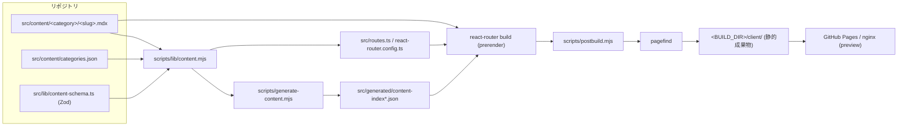

# アーキテクチャ

> 実装状況：**Phase 0〜4 実装・検証済み**（Phase 5 公開準備中）。本書は現在のコードを説明する。コードと食い違う場合はコードを正とし、本書を直す。
> 要件の原典は [SPEC.md](./SPEC.md)、判断理由は [decisions/](./decisions/README.md) を参照する。

## 1. システム概要

React Router v8 Framework Mode + Vite による **完全静的サイト**。`ssr: false` とし、公開ページをビルド時に prerender する。実行時のサーバー・バックエンド・DB は持たない。



- `scripts/lib/content.mjs` がコンテンツ読み込みの唯一の実装。`routes.ts`・`react-router.config.ts`（prerender 一覧）・`generate-content.mjs`・`validate.mjs` がこれを共有する。
- ルート定義と prerender 一覧はコンテンツディレクトリを直接読む（`listArticles()`。MDX はコンパイルしない）。UI が使うメタデータ（目次・読了時間・前後記事）は content index（JSON）から読む。

## 2. ビルドパイプライン

`bun run build` は以下を順に実行する。途中で失敗したら非ゼロ終了。

| # | ステップ | 実体 | 出力 |
| --- | --- | --- | --- |
| 1 | `content:generate` | `scripts/generate-content.mjs` | `src/generated/content-index.json`（git 管理外） |
| 2 | `react-router build` | `react-router.config.ts`（`prerender()`） | `<BUILD_DIR>/client/**/index.html`、JS/CSS アセット |
| 3 | postbuild | `scripts/postbuild.mjs` | サブパス時のページ移動、`404.html`、`sitemap.xml`、`robots.txt`、`.nojekyll` |
| 4 | pagefind | `pagefind --site ${BUILD_DIR:-build}/client` | `<BUILD_DIR>/client/pagefind/` |

### ビルドの種類

| script | 環境変数 | 出力 | 用途 |
| --- | --- | --- | --- |
| `build` | — | `build/client` | ルート配信（`/`）。verify・preview |
| `build:subpath` | `BASE_PATH=/it-knowledge-base/`、`BUILD_DIR=build-subpath` | `build-subpath/client` | GitHub Pages。CI ではこれを `site` アーティファクトとして公開 |
| `build:e2e` | `CONTENT_DIR=tests/fixtures/content/valid` | `build-e2e/client`、`build-e2e-subpath/client` | E2E 用（fixture コンテンツ、ルート / サブパスの 2 本） |
| `build:drafts` | `INCLUDE_DRAFTS=true`、`ALLOW_DRAFT_BUILD=true`、`BUILD_DIR=build-drafts` | `build-drafts/client` | 下書きを含む目視確認専用 |

- `draft: true` の記事は `listArticles()` の時点で除外され、ルート・prerender・content index・検索・sitemap に現れない（`INCLUDE_DRAFTS=true` のときのみ含む）。
- postbuild は content index が下書き入り（`includeDrafts: true`）なのに `ALLOW_DRAFT_BUILD=true` でなければ失敗する。GitHub Actions 上（`CI=true` かつ `GITHUB_ACTIONS=true`）では `ALLOW_DRAFT_BUILD` があっても失敗する。
- 開発サーバー（`bun run dev`）は `content:generate -- --drafts --lenient` の後に `INCLUDE_DRAFTS=true` で起動し、下書きも表示する（エラーがあっても起動は続ける）。

## 3. ルーティング

### URL 体系

| URL | 内容 | 生成 |
| --- | --- | --- |
| `/` | トップ（ヒーロー、カテゴリ一覧、新着） | prerender |
| `/<category>/` | カテゴリ別記事一覧 | prerender（`categories.json` の全カテゴリ。記事 0 件は「準備中」表示） |
| `/<category>/<slug>/` | 記事 | prerender |
| `/404` | Not Found ページ | prerender → postbuild で `404.html` に移動 |
| その他 | catch-all（NotFound 表示） | クライアント遷移時のみ |

- slug はサイト全体で一意。URL として安定させ、変更しない。
- 記事 0 件のカテゴリもページは生成されるが、サイドバー・sitemap には出ない（トップのグリッドでは「準備中」としてリンクなしで表示）。

### `src/routes.ts`

```ts
layout('routes/site-layout.tsx', [
  index('routes/home.tsx'),
  layout('routes/article-layout.tsx', articleRoutes), // route('<category>/<slug>', '<MDX ファイル>', { id: 'article/<slug>' })
  ...categoryRoutes, // route('<category>', 'routes/category.tsx', { id: 'category/<slug>' })
  route('*', 'routes/not-found.tsx', { id: 'catch-all' }),
]);
```

- **記事ルート**：`listArticles()` が返す記事ごとに、MDX ファイル自体をルートモジュールにする（記事単位でコード分割、loader なしのため `.data` は生成されない）。記事追加時にルーティングの手動編集は不要。開発サーバーでは `scripts/lib/vite-content-plugin.mjs` が記事の増減を検知し、`routes.ts` の mtime を更新してルートを再読み込みさせる。
- **カテゴリルート**：`categories.json` の各エントリに静的ルートを 1 つずつ作る（同じ `routes/category.tsx` を共有し、ルート id `category/<slug>` からカテゴリを特定）。動的な `:category` セグメントは未知の URL にもマッチしてしまい、`/404` で prerender した 404.html がブラウザで別ルートとしてハイドレーションされるため使わない。
- **catch-all**：`/404` の prerender と、クライアント側で未知の URL に遷移した場合の両方が同じ `*` ルートを通る。どの URL で静的ホストが 404.html を返しても、ハイドレーション時に同じルートにマッチし不整合が起きない。
- **prerender 一覧**（`react-router.config.ts`）：`'/'`、各カテゴリ `/<slug>/`、各記事の path、`'/404'`。

### メタデータの解決

- 記事の MDX ルートモジュールは `meta` を export しないため、`routes/article-layout.tsx` の `meta` がすべての記事に適用される。記事はルート id（`article/<slug>`）から引き、見つからなければ `location.pathname` から `getArticleByPath()` で引く。下書き記事には `robots: noindex` を付ける。
- カテゴリページはルート id、無ければ pathname の先頭セグメントからカテゴリを引く。

## 4. base path

| 設定 | 値 |
| --- | --- |
| 環境変数 | `BASE_PATH`（既定 `/`、GitHub Pages は `/it-knowledge-base/`）。`basePath()` が `/segment/` 形式に正規化 |
| Vite | `base = basePath()` |
| React Router | `basename = basePath()` |
| アセット | `withBase()`（`src/lib/utils.ts`）で favicon・`<Figure src>`・Markdown 画像に前置 |
| Pagefind | `options({ baseUrl: import.meta.env.BASE_URL })`。結果 URL は `toRouterPath()` で basename を除いてから `<Link>` へ |
| sitemap / robots | `SITE_URL`（CI では `https://s-kaisei.github.io/it-knowledge-base/`、既定 `http://localhost:8080<base>`）からの絶対 URL |

- 内部リンクは React Router の `<Link>` を使い、base path を手書きしない。MDX 内の `/` 始まりのリンクは `mdx-components.tsx` の `a` 置換で `<Link>` になる。
- React Router は basename 付きビルドでページを `<client>/<basename>/` 配下に出力する。postbuild がそれを成果物ルートへ移動し（成果物ルート = 公開 URL のサブパス）、ルートの `index.html`（SPA フォールバック）は `__spa-fallback.html` に改名して残す。
- ルート配信とサブパス配信の両方を verify（ビルド・リンク検証）と E2E（`subpath` プロジェクト）で検証する。

## 5. コンテンツデータフロー

1. `readArticles()` が `src/content/<category>/*.mdx|md` を gray-matter で読み、`src/lib/content-schema.ts` の Zod スキーマで検証する（Node 26 のネイティブ型ストリッピングで `.mjs` から `.ts` を import）。slug とファイル名、category と配置ディレクトリ、カテゴリの存在、slug 重複も確認する。カテゴリ配下のサブディレクトリはエラー。
2. カテゴリは `src/content/categories.json` を唯一の定義元とする（`order` 順）。UI にハードコードしない。
3. `buildContentIndex()` が各記事を本番と同じ MDX パイプラインでコンパイルし、最終 HAST から目次（h2 / h3、rehype-slug の id）、本文文字数（読了時間 = 500 字/分）、KaTeX エラーを取り出す。前後記事はカテゴリ内の `order` → タイトル順で決める。
4. 出力先は `contentIndexFile()`：既定は `src/generated/content-index.json`、`CONTENT_DIR` 指定時は `content-index.<dir>.json`（fixture が本物の index を上書きしない）。`vite.config.ts` のエイリアスで `~/generated/content-index.json` をこのファイルに解決する。
5. UI（サイドバー、カテゴリページ、パンくず、目次、ページャ、関連記事、出典）は `src/lib/content.ts` 経由で content index を import して描画する。実行時に `src/content` を走査しない。

### MDX 処理（`scripts/lib/mdx-options.mjs`）

| 処理 | ライブラリ | 実行タイミング |
| --- | --- | --- |
| frontmatter 除去 / GFM（表など） | remark-frontmatter / remark-gfm | ビルド時 |
| 数式 | remark-math + rehype-katex | ビルド時（HTML 化） |
| 見出し id | rehype-slug | ビルド時 |
| コードハイライト | @shikijs/rehype（github-light-default / github-dark-default、`defaultColor: false` で CSS 変数） | ビルド時 |
| Mermaid | `remarkMermaid` が ` ```mermaid ` を `<Mermaid chart>` に変換 → mermaid | **クライアントのみ** |

- `@mdx-js/rollup` は `enforce: 'pre'` で React Router のプラグインより先に MDX をコンパイルする。content index 生成も同じ `mdxOptions()` を使うため、目次の id と本文の id が一致する。

### MDX コンポーネントの登録

- 記事で使える独自コンポーネントの一覧は `src/components/article/mdx-component-names.ts` の `MDX_COMPONENT_NAMES`（`Callout`、`EffectiveAccessTimeSimulator`、`Figure`、`Mermaid`、`Misconceptions`）が唯一の定義元。
- `mdx-components.tsx` は `satisfies Record<MdxComponentName, unknown>` で、一覧と実際の登録が一致することを型で保証する。
- `content:check` は本文中の大文字始まりの JSX タグを同じ一覧と照合し、未登録のタグをエラーにする（実行時にしか壊れない問題をビルド前に検出）。
- HTML 要素の置換：`a`（内部リンクを `<Link>`、外部は `rel="noopener noreferrer"`）、`img`（`withBase`、lazy）、`table`（横スクロール用ラッパー、キーボードでフォーカス可能）、`h2` / `h3`（見出しアンカー）、`pre`（`CodeBlock`：ファイル名・言語ラベル・コピーボタン）。

### Mermaid（`src/components/diagrams/mermaid.tsx`）

- prerender HTML には図のソース（`<pre data-mermaid-source>`）が入る。ブラウザでは `useEffect` 内で `mermaid` を動的 import して SVG に置き換える。
- 状態は `data-mermaid="pending|rendered|error"` で公開し、失敗時は `data-mermaid-error` にメッセージを入れ、注意文とソースを表示する。E2E と `scripts/screenshots.mjs` はこの属性で描画失敗を検出する。
- 配色は CSS 変数（デザイントークン）から `base` テーマ変数を生成し、`data-theme` の変更時に再描画する。描画は直列化（mermaid のグローバル設定のため）。`securityLevel: 'strict'`。
- `accTitle:` をアクセシブルネームにする。SVG は自然幅の 80% までは縮小し、それより狭い画面では枠内で横スクロールする（`tabIndex=0` でキーボードスクロール可能）。
- 図全体に `data-pagefind-ignore` を付け、ソースや図中ラベルを検索対象にしない。
- `content:check` は mermaid のパーサー（jsdom 上）で構文のみ検証する。レイアウト・描画時の失敗は E2E が `data-mermaid-error` で検出する。

### シミュレーター

- `src/components/simulators/effective-access-time-simulator.tsx`（実効アクセス時間）。計算は `src/lib/simulators/effective-access-time.ts` の純粋関数で、`tests/unit/` と `tests/components/` でテストする。
- 状態はコンポーネント内のみ（保存・送信なし）。ブラウザ API を使わないため、prerender HTML に初期値の計算結果が入る。`data-pagefind-ignore`。

## 6. 検索

- Pagefind 1.6.0 を `bun run build` の最後に `<BUILD_DIR>/client` に対して実行する。
- 索引対象は記事レイアウトの `<article data-pagefind-body>` のみ。パンくず・記事メタ・下書き表示・インライン目次・関連記事・出典・ページャ・Mermaid 図・シミュレーター・見出しアンカーは `data-pagefind-ignore`。トップ・カテゴリ・404 は body 属性を持たないため索引されない。下書きは本番ビルドに含まれないため索引にも出ない。
- メタデータ：`title` は記事 h1（`data-pagefind-meta="title"`。`<title>` の「| IT Knowledge Base」は含まない）、`category` はカテゴリ名。

| 層 | ファイル | 役割 |
| --- | --- | --- |
| 純粋関数 | `src/lib/search.ts` | 結果 URL → ルーターパス変換、抜粋の `<mark>` だけを扱う安全なパーサー、キー操作のインデックス計算、ショートカット判定、結果の平坦化 |
| ローダー | `src/components/search/pagefind.ts` | `withBase('/pagefind/pagefind.js')` をブラウザでのみ動的 import（初回オープン時、失敗したら次回再試行）。開発サーバーでは読み込まず「利用不可」扱い |
| フック | `src/hooks/use-search.ts` | 遅延ロード、120ms デバウンス、古い応答の破棄、状態（idle / loading / ready / unavailable / error） |
| UI | `src/components/search/` | `SearchProvider`（ダイアログ 1 つを共有、⌘K / Ctrl+K /「/」）、`SearchTrigger`（ヘッダー）、`HeroSearchButton`（トップ）、`SearchDialog`（Radix Dialog + combobox/listbox） |

- **base path**：Pagefind は自身の配置場所からサイトのベースを推定し、結果 URL を `/it-knowledge-base/network/x/` のように返す（`baseUrl` も明示）。UI は `toRouterPath()` で basename を取り除いたパスを `<Link to>` / `navigate()` に渡し、React Router が basename を付け直す。
- **抜粋の安全な表示**：`dangerouslySetInnerHTML` は使わない。`parseExcerpt()` が `<mark>` だけを強調区間として認識し（属性は捨てる）、他のタグや文字参照はテキストとして React に渡す。
- **日本語入力**：IME 変換中（`compositionstart`〜`compositionend`、`isComposing`、keyCode 229）は検索も Enter による遷移も行わない。
- **アクセシビリティ**：ダイアログ名「サイト内検索」、入力は `role="combobox"` + `aria-activedescendant`、結果は `role="listbox"` / `option`（実体は `<a href>`）、`role="status"` で件数や状態を通知。閉じると開く前の要素へフォーカスを戻す。
- **開発サーバー**：インデックスが無いため「検索インデックスは本番ビルド後に利用できます（bun run build）」と表示する（404 リクエストもコンソールエラーも発生させない）。
- テスト：`tests/unit/search.test.ts`、`tests/components/search-dialog.test.tsx`、`tests/e2e/search.spec.ts`（fixture）、`tests/e2e/search-subpath.spec.ts`（subpath）。詳細は [ADR 0005](./decisions/0005-search-with-pagefind.md)。

## 7. 配信と 404

- postbuild が `client/404/index.html` を `client/404.html` にコピーし、`client/404/` を削除する（`/404/` が 200 を返さないように）。
- GitHub Pages は `404.html` を自動利用。nginx（preview）は `try_files $uri $uri/index.html $uri.html =404` と `error_page 404 <BASE_PATH>404.html`。
- 存在しない URL をトップへ転送しない（SPA フォールバック禁止）。
- `scripts/lib/static-site.mjs` の `resolveStatic()` が GitHub Pages の解決規則（`/x/` → `x/index.html`、`/x` → 301 `/x/`、`x.html`）を再現し、`scripts/serve-static.mjs`（E2E・スクリーンショット用サーバー）と `links:check` が共有する。
- 詳細は [ADR 0006](./decisions/0006-github-pages-subpath-and-404.md)。

## 8. テストと検証

| 層 | 場所 | 実行 |
| --- | --- | --- |
| unit（node） | `tests/unit/`、`tests/harness/` | Vitest project `unit` |
| components（jsdom） | `tests/components/` | Vitest project `components` |
| E2E | `tests/e2e/` | Playwright（Chromium） |
| fixture | `tests/fixtures/content/valid/`（E2E 用サイト）、`tests/fixtures/content/invalid/<case>/`（`content:check` の異常系） | — |

Playwright の 4 プロジェクト（`playwright.config.ts`）。各ビルドは `scripts/serve-static.mjs` で GitHub Pages と同じ規則で配信する。

| project | 対象 spec | 配信するビルド | 備考 |
| --- | --- | --- | --- |
| `site` | `site.spec.ts` | `build/client`（実コンテンツ、`/`） | `bun run build` が先に必要（verify では step 8 で生成済み） |
| `fixture` | 上記・下記以外すべて | `build-e2e/client`（fixture、`/`） | デスクトップ 1440×900 |
| `mobile` | `mobile.spec.ts` | `build-e2e/client` | Pixel 7 |
| `subpath` | `subpath.spec.ts`、`search-subpath.spec.ts` | `build-e2e-subpath/client`（`/it-knowledge-base/`） | |

- `bun run test:e2e` は `build:e2e` を実行してから Playwright を起動する。
- 品質ゲート `scripts/verify.mjs` の順序は [DEVELOPMENT.md](./DEVELOPMENT.md#8-verify-の順序) を参照。

## 9. ディレクトリ責務

| パス | 責務 |
| --- | --- |
| `src/root.tsx` | HTML シェル、`lang="ja"`、テーマ初期化インラインスクリプト、ErrorBoundary |
| `src/routes.ts` | ルート定義（記事・カテゴリルートはコンテンツから生成） |
| `src/routes/` | `site-layout`（ヘッダー・サイドバー・検索）、`home`、`category`、`article-layout`、`not-found` |
| `src/content/<category>/` | 記事 MDX |
| `src/content/categories.json` | カテゴリ定義の唯一の情報源（12 カテゴリ） |
| `src/components/ui/` | 汎用 UI（`CategoryIcon`） |
| `src/components/layout/` | ヘッダー、サイドバー、モバイルドロワー、フッター、テーマ切替 |
| `src/components/article/` | MDX 登録、Callout、Figure、Misconceptions、CodeBlock、目次、記事フッター、難易度バッジ |
| `src/components/diagrams/` | Mermaid |
| `src/components/simulators/` | ページ内完結のシミュレーター |
| `src/components/search/` | Pagefind 検索 UI |
| `src/lib/` | Zod スキーマ、content index アクセサ、テーマ、検索、シミュレーター計算などの純粋関数 |
| `src/hooks/`, `src/styles/` | フック（目次のスクロール連動、テーマ監視、数式のスクロール対応、検索）、グローバル CSS / トークン |
| `src/generated/` | 生成物（git 管理外） |
| `scripts/` | generate-content / validate-content / check-links / postbuild / verify / serve-static / screenshots、`lib/` に共通処理 |
| `tests/` | unit / components / e2e / harness / fixtures |
| `docker/nginx.conf` | preview 用 nginx 設定（`__BASE_PATH__` をビルド時に置換） |
| `.claude/` | Claude Code ハーネス（[HARNESS.md](./HARNESS.md)） |

## 10. 制約

- 実行時サーバー・バックエンド API・DB・認証・ユーザーデータ永続化を持たない。
- prerender 中に `window` / `document` / `localStorage` 等のブラウザ API を呼ばない（`useEffect` 内またはイベントハンドラ内）。テーマはインラインスクリプトでハイドレーション前に適用する。
- MDX はリポジトリ内のレビュー済みファイルのみ。外部 MDX を取得・実行しない。
- シミュレーターの状態はページ内で完結し、保存・送信しない。
- 外部ランタイム依存（CDN フォント等）を持たない（[ADR 0008](./decisions/0008-self-hosted-fonts.md)）。
