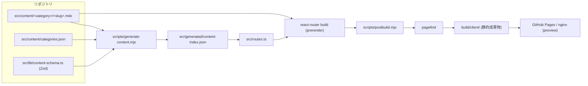

# アーキテクチャ

> 実装状況：**Phase 0（設計のみ）**。本書の内容はまだ実装されていない。各節の「（Phase N で実装予定）」は実装予定フェーズを示す。
> 要件の原典は [SPEC.md](./SPEC.md)、判断理由は [decisions/](./decisions/README.md) を参照する。

## 1. システム概要

React Router v8 Framework Mode + Vite による **完全静的サイト**。`ssr: false` とし、公開記事をビルド時に prerender する。実行時のサーバー・バックエンド・DB は持たない。



## 2. ビルドパイプライン（Phase 1〜2 で実装予定）

`npm run build` は以下を順に実行する。途中で失敗したら非ゼロ終了。

| # | ステップ | 実体 | 出力 |
| --- | --- | --- | --- |
| 1 | `content:generate` | `scripts/generate-content.mjs` | `src/generated/content-index.json`（git 管理外） |
| 2 | `react-router build` | `react-router.config.ts` の `prerender` | `build/client/**/index.html`、JS/CSS アセット |
| 3 | postbuild | `scripts/postbuild.mjs` | `build/client/404.html`、`sitemap.xml`、`robots.txt` |
| 4 | pagefind | `pagefind --site build/client` | `build/client/pagefind/` |

- 出力先は `build/client/` に統一する（package.json / Dockerfile / CI / デプロイ設定で共通）。
- `draft: true` の記事は 1 の時点で除外され、以降のルート・prerender・検索・sitemap に現れない。

## 3. ルーティング（Phase 1〜2 で実装予定）

### URL 体系

| URL | 内容 | 生成 |
| --- | --- | --- |
| `/` | トップ（ヒーロー、カテゴリ一覧、新着） | prerender |
| `/<category>/` | カテゴリ別記事一覧 | prerender（公開記事があるカテゴリのみ） |
| `/<category>/<slug>/` | 記事 | prerender |
| `/404` | Not Found ページ | prerender → `404.html` にコピー |
| `*` | catch-all（クライアント側で NotFound 表示） | なし |

- slug はサイト全体で一意。URL として安定させ、変更しない。

### 記事ルートの自動生成

`src/routes.ts` は `@react-router/dev/routes` のヘルパーで、content index から記事ルートをプログラム的に生成する。

```ts
// 概念図（実装は Phase 2）
layout("routes/article-layout.tsx", [
  ...articles.map((a) =>
    route(`${a.category}/${a.slug}`, `content/${a.category}/${a.slug}.mdx`, {
      id: `article:${a.slug}`,
    }),
  ),
]);
```

- 各 MDX ファイルがそのままルートモジュールになる（記事単位でコード分割）。
- loader を使わないため `.data` ファイルは生成されない。
- 記事追加時にルーティングの手動編集は不要。
- `prerender: async ({ getStaticPaths }) => [...]` も同じ content index から生成する（公開 slug + カテゴリページ + `/404`）。

## 4. base path（Phase 1 で実装予定）

| 設定 | 値 |
| --- | --- |
| 環境変数 | `BASE_PATH`（既定 `/`、GitHub Pages は `/it-knowledge-base/`） |
| Vite | `base = BASE_PATH` |
| React Router | `basename = BASE_PATH` |
| Pagefind | 検索結果 URL に base path を前置する |
| sitemap | 絶対 URL に base path を含める |

- 内部リンクは React Router の `<Link>` を使い、base path を手書きしない。
- ルート配信とサブパス配信の両方を E2E で検証する。

## 5. コンテンツデータフロー（Phase 2 で実装予定）

1. `generate-content.mjs` が `src/content/**/*.mdx` の frontmatter を gray-matter で読み取る。
2. `src/lib/content-schema.ts` の Zod スキーマで検証する（Node 26 のネイティブ型ストリッピングで .mjs から import）。
3. カテゴリは `src/content/categories.json` を唯一の定義元とする。UI にハードコードしない。
4. 生成する情報：記事メタデータ、カテゴリ、目次（github-slugger。rehype-slug と同じ id）、関連記事、前後記事（カテゴリ内 `order` 順）。
5. UI（サイドバー、カテゴリページ、パンくず、目次、ページャ）は content index を import して描画する。

### MDX 処理

| 処理 | ライブラリ | 実行タイミング |
| --- | --- | --- |
| GFM（表など） | remark-gfm | ビルド時 |
| 数式 | remark-math + rehype-katex | ビルド時（HTML 化） |
| 見出し id | rehype-slug | ビルド時 |
| コードハイライト | shiki（light/dark デュアルテーマ、CSS 変数） | ビルド時 |
| Mermaid | mermaid | **クライアントのみ**（`useEffect`） |

- Mermaid は prerender 時にはソースをフォールバック表示し、描画失敗時は DOM に `data-mermaid-error` を付与する。

## 6. 検索（Phase 2 で実装予定）

- Pagefind をビルド後に `build/client` に対して実行。`<html lang="ja">`、記事本文に `data-pagefind-body`。
- 開発サーバーでは `/pagefind/pagefind.js` が存在しないため、検索 UI に「検索インデックスは本番ビルド後に利用できます」と表示する。
- 詳細は [ADR 0005](./decisions/0005-search-with-pagefind.md)。

## 7. 配信と 404（Phase 1 で実装予定）

- `/404` を prerender し、postbuild で `build/client/404/index.html` → `build/client/404.html` にコピー。
- GitHub Pages は `404.html` を自動利用。nginx（preview）は `error_page 404 /404.html`。
- 存在しない URL をトップへ転送しない（SPA フォールバック禁止）。
- 詳細は [ADR 0006](./decisions/0006-github-pages-subpath-and-404.md)。

## 8. ディレクトリ責務（Phase 1 で作成予定）

| パス | 責務 |
| --- | --- |
| `src/root.tsx` | HTML シェル、`lang="ja"`、テーマ初期化スクリプト、共通レイアウト |
| `src/routes.ts` | ルート定義（記事ルートは content index から生成） |
| `src/routes/` | トップ、カテゴリ、記事レイアウト、404 のルートモジュール |
| `src/content/<category>/` | 記事 MDX（12 カテゴリ） |
| `src/content/categories.json` | カテゴリ定義の唯一の情報源 |
| `src/components/ui/` | 汎用 UI（shadcn/ui 由来の最小限） |
| `src/components/layout/` | ヘッダー、サイドバー、フッター、テーマ切替 |
| `src/components/article/` | Callout、Figure、目次、ページャ等の記事部品 |
| `src/components/diagrams/` | Mermaid、SVG 図解 |
| `src/components/simulators/` | ページ内完結のシミュレーター |
| `src/components/search/` | Pagefind 検索 UI |
| `src/lib/` | Zod スキーマ、純粋関数（計算ロジック等） |
| `src/hooks/`, `src/types/`, `src/styles/` | フック、型、グローバル CSS / トークン |
| `src/generated/` | 生成物（git 管理外） |
| `scripts/` | generate-content / validate-content / check-links / verify / postbuild |
| `tests/` | unit / components / e2e / harness / fixtures |
| `docker/nginx.conf` | preview 用 nginx 設定 |
| `.claude/` | Claude Code ハーネス（[HARNESS.md](./HARNESS.md)） |

## 9. 制約

- 実行時サーバー・バックエンド API・DB・認証・ユーザーデータ永続化を持たない。
- prerender 中に `window` / `document` / `localStorage` 等のブラウザ API を呼ばない（`useEffect` 内または `typeof window` ガード）。
- MDX はリポジトリ内のレビュー済みファイルのみ。外部 MDX を取得・実行しない。
- シミュレーターの状態はページ内で完結し、保存・送信しない。
- 外部ランタイム依存（CDN フォント等）を持たない（[ADR 0008](./decisions/0008-self-hosted-fonts.md)）。
