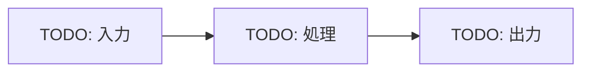

{/*

使い方：

- このファイルを src/content/CATEGORY/SLUG.mdx にコピーし、slug をファイル名と一致させる。
- 「TODO:」が残っている記事は content:check で検出され、公開できない。
- 日付フィールドは TODO のままだとスキーマ検証で失敗する。実際の日付に置き換える。
- 見出しは標準構成。トピックに合わせて統合・省略・改名してよい（機械的に強制しない）。
- 注記はすべて MDX コメント（波括弧とスラッシュ・アスタリスクで囲む形式）で書いてある。表示されないので残してもよいが、書き終えたら削除する。HTML コメント（<!-- -->）は MDX では構文エラーになるので使わない。
- h1 は書かない（タイトルは frontmatter から表示される）。見出しは h2 → h3 の順。
- 「関連記事」と「参考資料・出典」は frontmatter の related / prerequisites / references から記事末尾に自動表示される。本文に同じ節を書かない。
- 使える MDX コンポーネント（Callout / Figure / Misconceptions / Mermaid / 数式 / コードブロック）は docs/CONTENT_GUIDE.md の 5 章。

*/}

## この記事で分かること

{/*
読後に分かることを 3〜5 項目の箇条書きで。「〜とは何か」「なぜ〜か」「〜との違い」など。
*/}

- TODO: 分かること 1
- TODO: 分かること 2
- TODO: 分かること 3

## 一言で説明すると

{/*
専門用語を使わずに 1〜2 文で。後続の詳細説明の「地図」になる文。
*/}

TODO: 一言での説明

## なぜ必要なのか

{/*
それが無かったら何が困るのか。解決している問題・歴史的背景を先に示す。
*/}

TODO: 必要性

## 身近な例え

{/*
日常の例えで直感をつかませる。最後に「この例えが当てはまらない点」（限界）を必ず書く。Callout の tip / warn も使える。
*/}

TODO: 例え話

<Callout type="warn" title="例えの限界">
TODO: この例えが当てはまらない点
</Callout>

## 技術的な仕組み

{/*
直感 → 定義の順で。用語は初出で一言補足。数値・数式は出典で裏付ける。必要なら h3 で分割。
*/}
{/*
数式はインライン $...$、ブロック $$...$$（KaTeX）。コードは言語を指定し、必要なら title="ファイル名" を付ける。
*/}

TODO: 仕組みの説明

## 図解

{/*
Mermaid（mermaid コードフェンス）、SVG / 画像（<Figure />）、比較表など。図の内容は本文でも説明し、図だけに依存しない。
*/}

TODO: 図の説明文（図が表している流れを本文でも説明する）

## 実務での活用例

{/*
実際の現場でどう使われるか・どこで意識するか。具体的な場面、設定、コード例など。
*/}

TODO: 活用例

## 関連技術との比較

{/*
混同されやすい技術と表で比較する。観点（目的・仕組み・用途など）を揃える。
*/}

| 観点 | TODO: この技術 | TODO: 比較対象 |
| --- | --- | --- |
| 目的 | TODO | TODO |

## よくある誤解

{/*
「誤解」と「実際」の組で書く。
*/}

<Misconceptions
  items={[
    { myth: 'TODO: よくある誤解', fact: 'TODO: 実際はどうか' },
  ]}
/>

## まとめ

{/*
「この記事で分かること」に対応させて 3〜5 行で要点を再確認する。新情報は書かない。
*/}

TODO: まとめ

## 理解度チェック（任意）

{/*
必要な場合のみ。2〜3 問。答えと解説を 
 で折りたたむ。不要ならこの節ごと削除。
*/}

TODO: 確認問題（不要ならこの節を削除）
