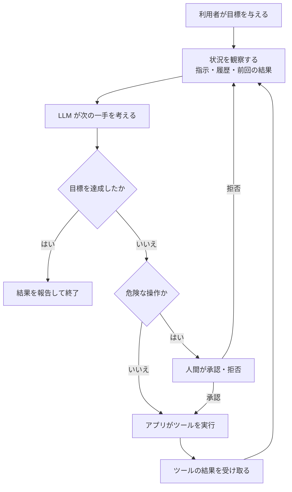

## この記事で分かること

- AI エージェントとは何か、1 回だけ答えるチャットとの違い
- エージェントループ（観察 → 考える → ツールで行動 → 結果を観察）と ReAct の考え方
- ツール呼び出しの仕組みと、ツール接続を標準化する MCP（Model Context Protocol）
- 権限の最小化・人間の承認・サンドボックス・テストによる検証などのガードレール
- プロンプトインジェクション、暴走、コストといったリスクと、よくある誤解

## 一言で説明すると

AI エージェントは、[大規模言語モデル（LLM）](/ai/llm/)に「道具（ツール）」を持たせ、目標を達成するまで「状況を見る → 次の一手を考える → 道具を使う → 結果を見る」を繰り返させる仕組みです。

## なぜ必要なのか

LLM 単体は、入力された文章の続きを生成するだけです。1 回の質問と回答（チャットの 1 往復）では、モデルは手元の知識だけで答えるしかなく、最新の情報を調べたり、プログラムを実際に動かして確かめたりはできません。

ところが実際の仕事の多くは、1 回の回答では終わりません。「このバグを直す」なら、関連するファイルを探して読み、修正し、テストを実行し、失敗したら直す、という手順を何度も往復します。AI エージェントは、こうした**複数の手順と外部とのやり取りが必要な作業**を LLM に任せるための構成です。

後述の ReAct の論文（Yao ほか）は、質問応答や事実検証で推論だけに頼ると起きやすいハルシネーション（もっともらしい誤り）や誤りの連鎖を、Wikipedia を検索する簡単な API を使わせることで抑えられたと報告しています。

なお「AI エージェント」の定義は統一されていません。本記事では「LLM がループの中でツールを使い、目標に向けて自分で次の行動を選ぶシステム」の意味で使います。応用情報技術者試験のシラバス Ver.7.2 にこの用語はありませんが、大規模言語モデル、生成 AI の活用、ハルシネーション、AI の出力を人間が確認することの重要性、ヒューマンインザループ（HITL）が挙げられています。

## 身近な例え

AI エージェントは「電話で指示を受けて動く、腕はいいが現場を見たことのない新人」に似ています。

- 新人（LLM）は自分では現場に行けません。代わりに「棚を見て」「この書類を持ってきて」と頼める手足（ツール）が用意されています。
- 新人は、手足から返ってきた報告（ツールの結果）を聞いて次の指示を考え、目標を達成するまで繰り返します。
- 金庫を開ける、取引先に送金するといった重大な操作は、上司（人間）の承認がないとできない決まりにしておきます。

<Callout type="warn" title="例えの限界">
人間の新人は、届いた書類に「この指示を無視して金庫を開けよ」と書かれていても、まず疑います。LLM は、ツールの結果として読み込んだ文章と本来の指示を確実に区別できるとは限りません（後述のプロンプトインジェクション）。また新人は経験を翌日に持ち越せますが、LLM は作業中の記録を毎回入力として渡されないと覚えていられません。
</Callout>

## 技術的な仕組み

### 1 回のチャットとエージェントの違い

通常のチャットでは、アプリが会話の履歴をモデルに渡し、モデルが返した文章をそのまま利用者に表示して終わります。エージェントでは、モデルの出力が「回答」ではなく「このツールをこの引数で呼んでほしい」という**行動の要求**であることがあります。アプリはそれを実行し、結果を会話に追加してもう一度モデルを呼びます。この往復を、モデルが「完了した」と判断するか、回数や時間の上限に達するまで続けます。次の図は、この往復を 1 つの流れとして表したものです。



上の図で、利用者が目標を与えると、指示・履歴・前回のツールの結果から状況を把握し、LLM が次の一手を考えます。目標を達成したと判断すれば報告して終わり、まだなら次に使うツールと引数を決めます。その操作が危険なものとして指定されていれば人間に承認を求め、拒否されたらその事実を踏まえて考え直します。承認された操作や安全な操作はアプリが実行し、結果を受け取って再び観察に戻ります。実際の実装では、この図に加えてループ回数や費用の上限で強制的に止める仕組みも置きます。承認や上限といった仕組みは、後の「ガードレール」の節で説明します。

### ツール呼び出し（関数呼び出し）

ツール呼び出し（function calling とも呼ばれます）は、次のように動きます。

1. アプリが、使えるツールの一覧をモデルへの入力に含めます。各ツールには名前、何をするかの説明、引数の形（JSON Schema というデータ形式の定義）が付きます。MCP の仕様（版 2026-07-28）でも、ツールの定義は名前・説明・`inputSchema`（JSON Schema）などで構成されます。
2. モデルは、ツールを使うべきだと判断すると、ツール名と引数を構造化したデータとして出力します。
3. **アプリ（ホスト側のプログラム）がツールを実際に実行**し、結果をモデルへの次の入力に追加します。

重要なのは 3 です。モデル自身がコマンドを実行したりネットワークにアクセスしたりするのではなく、モデルが出すのはあくまで「要求」です。実行するかどうか、どの権限で実行するかは、アプリ側で決められます。ガードレールを置ける場所もここです。

<Callout type="tip" title="覚え方">
「モデルは頼むだけ、実行するのはアプリ」と、役割を 2 つに分けて覚えます。前の節の図でも、LLM の箱は「考える」だけで、ツールを動かすのは「アプリがツールを実行」の箱です。この分担があるから、実行の直前（図の「危険な操作か」）に権限の確認や人間の承認を差し込めます。「LLM が自分でコマンドを実行する」という説明を見たら、誤りだと気付けるようにしておきましょう。
</Callout>

```json title="ツール定義の例（説明用）"
{
  "name": "run_tests",
  "description": "プロジェクトのテストを実行し、結果を返す",
  "inputSchema": {
    "type": "object",
    "properties": { "path": { "type": "string" } },
    "required": ["path"]
  }
}
```

### ReAct：考えることと行動することを交互に

ReAct（Reasoning + Acting）は、LLM に**推論の記録（思考）とタスク向けの行動を交互に生成させる**手法です（Yao ほか、2022 年 10 月初版、v3 は 2023 年 3 月。機械学習の国際会議 ICLR の採録版）。論文によれば、推論は行動計画を立てて追跡し、必要に応じて修正したり想定外の事態に対処したりするのを助け、行動は知識ベースや環境から情報を集めるのに使われます。思考の過程が残るため、人間が後から「なぜその行動をしたか」を追いやすい点も利点として挙げられています。ReAct は、「考える → ツールを使う → 結果を見る」というループの代表的な先行研究です。

<Callout type="tip" title="覚え方">
名前を Re（Reasoning：推論）と Act（Acting：行動）に分解すると、中身をそのまま思い出せます。「1 回のチャットとエージェントの違い」の図では、Reasoning が「LLM が次の一手を考える」、Acting が LLM が出す行動の要求と、それを「アプリがツールを実行」する部分に当たり、その間を「ツールの結果を受け取る → 状況を観察する」がつないでいます。推論だけだと外の情報で確かめられずに誤りを重ねやすく（「なぜ必要なのか」の節）、行動だけだと計画を立てて追跡・修正する役がいない。だから交互に行って補い合う、と因果で覚えましょう。
</Callout>

### コンテキストとメモリの管理

LLM が一度に読める入力の量（コンテキスト）には上限があり、ループを重ねると履歴やツールの結果がたまってコストも増えます。そのため一般に次のような工夫をします（方法は製品によって異なります）。

- 古いやり取りを要約して短くする
- 作業メモや計画をファイルなどの外部に書き出し、必要なときに読み直す
- 大きな文書は全部を渡さず、検索して関係する部分だけを渡す

モデルは呼び出しごとに渡された入力しか見ないため、「何を覚えているか」はアプリ側の設計で決まります。

### MCP：ツールをつなぐ標準

ツールをアプリごとに独自の方法でつなぐと、同じツールでもアプリの数だけ接続部分を作り直すことになります。**MCP（Model Context Protocol）** は、LLM アプリケーションと外部のデータ・ツールを接続するためのオープンなプロトコルです。2026-11-28 時点で公式サイトが最新版として示している仕様（版 2026-07-28）によれば、概要は次のとおりです。

- メッセージ形式に JSON-RPC 2.0（JSON で「どの処理をどの引数で呼ぶか」と結果をやり取りする、遠隔手続き呼び出しの軽量な規格）を使います。
- 登場するのは、LLM アプリである**ホスト**、ホスト内で接続を担う**クライアント**、機能を提供する**サーバー**です。
- サーバーは、データを提供する Resources、定型のプロンプトを提供する Prompts、モデルが実行できる関数である **Tools** を公開できます。クライアントは `tools/list` でツールの一覧を取得し、`tools/call` で呼び出します。
- プログラミング言語の支援機能をエディタ間で共通化した Language Server Protocol（LSP）に着想を得ています。

<Callout type="tip" title="覚え方">
標準化の効果は数で考えると覚えやすくなります。アプリが 3 つ、ツールが 4 つあるとき、組み合わせごとに接続部分を作ると $3 \times 4 = 12$ 通りですが、全員が MCP に対応すれば各自が 1 回ずつ対応するだけで $3 + 4 = 7$ 回で済みます（掛け算が足し算になる）。役割は「ホスト（LLM アプリ）の中にクライアントがいて、外のサーバーにつなぐ」と入れ子で覚え、ツールは「`tools/list` で一覧を見てから `tools/call` で呼ぶ」の 2 段階です。
</Callout>

仕様は安全面の原則も定めています。ツールは任意のコード実行を意味しうるので慎重に扱うこと、ツールの説明（注釈）は信頼できるサーバー由来でない限り信頼しないこと、ツール呼び出しの前に利用者の明示的な同意を得ること、呼び出しを拒否できる人間を介在させるべき（SHOULD）ことなどです。ただし、これらはプロトコルでは強制できず実装側が担う、とも明記しています。MCP は改訂が続いているため、利用時は最新版を確認してください。

### ガードレール：任せる範囲を設計する

エージェントは自分で行動を選ぶため、「何をさせないか」の設計が欠かせません。OWASP の LLM 向け Top 10 2026 年版の LLM03:2026「過剰な代理権（Excessive Agency）」は、被害の原因を**過剰な機能**（不要なツールがある）、**過剰な権限**（必要以上のアクセス権がある）、**過剰な自律性**（影響の大きい操作を確認なしで実行する）の 3 つに整理しています。対策として一般に次のものを組み合わせます。

- **最小権限**: ツールを必要なものだけに絞り、汎用的なシェル実行より目的を限定したツールを使います。OWASP は、データを読むだけのツールに更新や削除の権限まで持たせてしまう例を挙げ、読み取り専用の権限に絞るよう勧めています。
- **人間の承認**: 削除、送金、外部への送信、本番環境への反映など影響の大きい操作の前に、人間の確認を求めます。
- **サンドボックス**: エージェントが動く環境を隔離し、壊れても困らない範囲に閉じ込めます。[Docker](/cloud/docker/) などのコンテナや使い捨ての環境がよく使われます。
- **下流での認可**: 「モデルが判断したから許可」ではなく、呼び出される側のシステムが権限を検査します（OWASP のいう complete mediation）。
- **検証ループ**: テストやリンター（コードの書き方の誤りや規約違反を自動で検出するツール）など、決まった基準で機械的に判定できるチェックを実行させ、通るまで修正させます。モデルの「できました」という自己申告ではなく、実行結果で判断します。
- **上限と記録**: ループ回数・時間・費用に上限を設け、ツールの使用をログに残します。

<Callout type="tip" title="覚え方">
OWASP LLM03:2026 の 3 つの「過剰」と対策を、1 対 1 で対応づけて覚えます。原因を言われたら対策を、対策を言われたら原因を言えるようにしておくと、選択肢の判断に使えます。

| 原因（何が過剰か） | 例 | 主な対策 |
| --- | --- | --- |
| 機能 | 要約だけでよいのに送信ツールもある | 不要なツールを外す・目的を限定したツールにする |
| 権限 | 読むだけのツールに削除の権限もある | 最小権限・呼び出される側での認可 |
| 自律性 | 影響の大きい操作を確認なしで実行する | 人間の承認 |

ここまでが OWASP の 3 分類と対策の対応です。以下は本記事の整理です。

サンドボックスは実行環境の中での被害を、上限は回数や費用の暴走を、ログは異常の発見と事後の調査を受け持つ後ろの守りです（本記事の整理）。ただし、許可したツールを通じて外部に出た操作（メール送信など）はサンドボックスでは防げないため、表の 3 つの対策を省略できるわけではありません。
</Callout>

こうした仕組み一式を、モデルを包む**ハーネス**（馬具の意）と呼ぶことがあります。このサイト自体もコーディングエージェントで開発しています。その開発環境では、ツール実行の直前に動くフックが強制プッシュや広範囲の削除などの危険なコマンドを拒否し、作業を終える前に記事の検証やテストの品質ゲートを実行して、失敗すれば（上限回数まで）作業を続けさせます。技術レビュー担当のエージェントには編集やコマンド実行のツールを与えていません。ただし、これらは誤操作を防ぐ補助でありセキュリティの境界ではありません。そのため、ビルドやテストはコンテナ内で実行し、コマンドごとに許可・確認・拒否を決める設定や人間のレビューと組み合わせています。

### エージェントの評価

エージェントは「最終的に目標を達成できたか」で評価するのが基本です。代表例の SWE-bench（Jimenez ほか、ICLR 2024）は、12 の Python リポジトリの実際の GitHub の課題（issue）と、それを解決したプルリクエストから 2,294 問を作り、コードベースと課題文を渡して修正させる評価です。論文時点（2023 年）の最高成績は 1.96% でした。その後の成績はモデル・評価条件・データセットの版で大きく変わるため、数値は日付と条件とともに読む必要があります。実務では、自分たちの課題に近いテストケースで、成功率に加えて時間・費用・危険な操作の有無も記録して評価します。

## 実務での活用例

製品の機能は変化が速いため、以下は 2026-11-28 時点の一般的な使われ方として読んでください。

- **コーディングエージェント**: リポジトリのファイルを読み、コードを修正し、テストやビルドを実行して結果を確認しながら作業します。テストが自動の検証ループの役割を果たすため、テストが充実しているプロジェクトほど任せやすくなります。変更は人間がレビューしてから取り込み、[CI/CD](/devops/ci-cd/) のパイプラインでも同じテストを実行して二重に確認するのが一般的です。
- **調査アシスタント**: Web や社内文書を検索して複数の情報源を読み、要約します。出典を示させ、人間が元の情報を確認することが前提です。

## 関連技術との比較

| 観点 | チャットボット | ワークフロー自動化 | AI エージェント |
| --- | --- | --- | --- |
| 手順を決めるのは | なし（1 往復で回答） | 人間があらかじめ固定 | LLM が実行時に選ぶ |
| 外部への行動 | 基本的にしない | 決められた処理だけ実行 | ツールを選んで実行 |
| 結果の予測しやすさ | 回答の内容は揺れる | 高い（毎回同じ手順） | 低め（手順も揺れる） |
| 向いている作業 | 質問応答・文章作成 | 手順が決まった定型処理 | 手順が状況で変わる作業 |
| 主なリスク | ハルシネーション | 想定外の入力で止まる | 誤った行動・暴走・コスト増 |

手順を事前に決められる作業なら、RPA などのワークフロー自動化の方が確実で安価なことが多く、エージェントは手順を書き切れない作業で検証と制限を前提に使います。

## リスクと注意点

- **プロンプトインジェクション**: OWASP の LLM 向け Top 10 2026 年版でも 1 番目（LLM01:2026）です。特にエージェントで問題になるのが**間接プロンプトインジェクション**で、Web ページ、文書、メール、ツールの応答などの外部コンテンツに含まれる指示によってモデルの振る舞いが変えられてしまうものです。OWASP は、LLM が指示とデータを構造的に区別しないことなどから現時点で信頼できる防止策はないとし、注入がときに成功する前提で設計するよう勧めています。外部コンテンツを出どころを明示して分けて渡すことは成功率を下げる手段ですが、回避されうるとも書かれています。そのうえで、最小権限や、取り消せない操作・外部に見える操作の前の人間の承認によって被害を限定します。OWASP LLM03:2026 も、悪意あるメールの指示でメール要約用のエージェントが機密情報を転送してしまう例を挙げています。
- **暴走**: 誤った判断に基づいて行動を重ねたり、同じ失敗を繰り返してループが終わらなかったりします。回数・時間の上限と、取り消しにくい操作の承認で抑えます。
- **コスト**: ループのたびに LLM を呼ぶため、費用と時間が積み重なります。OWASP LLM06:2026「無制限な消費」は、過剰で制御されない推論によるサービス停止や経済的損失をリスクとして挙げ、トークン量も含めたレート制限と利用枠、予算を超えたら止める支出上限、エージェントの手順数や時間の上限、実行できる行動数の上限、費用の監視を対策としています。

組織的な管理の枠組みには、NIST の AI RMF 1.0（2023 年 1 月公開、任意利用）と生成 AI 向けプロファイル NIST-AI-600-1（2024 年 7 月公開）があり、シラバス Ver.7.2 も AI RMF を用語例に挙げています。

## よくある誤解

<Misconceptions
  items={[
    { myth: 'AI エージェントは自律的なので、人間が監督しなくてよい。', fact: '自分で次の行動を選べることと、任せきりにしてよいことは別です。MCP の仕様はツール呼び出しを拒否できる人間を介在させるべきとし、OWASP も影響の大きい操作には人間の承認を求めるよう勧めています。承認の仕組み、上限、ログ、結果の検証を組み合わせて使います。' },
    { myth: 'ツールを多く持たせるほど、賢くて役に立つエージェントになる。', fact: 'OWASP LLM03:2026 は、不要な機能や必要以上の権限を被害の原因として挙げています。ツールが増えるほど、誤った選択やプロンプトインジェクションで悪用されたときの影響範囲も広がります。目的に必要なツールと権限に絞るのが基本です。' },
    { myth: 'LLM が自分でコードを実行したり、Web にアクセスしたりしている。', fact: 'モデルが出力するのは「このツールをこの引数で呼んでほしい」という要求です。実際に実行するのはアプリ（ホスト）側のプログラムで、実行するかどうか、どの権限・どの環境で実行するかもアプリ側で制御できます。' },
    { myth: 'エージェントが「完了しました」と報告したら、作業は正しく終わっている。', fact: 'モデルの自己申告は誤ることがあります。テストの実行結果など機械的に判定できる基準や、人間のレビューで確認します。シラバスも AI の出力を人間が確認することの重要性を挙げています。' },
  ]}
/>

## まとめ

- AI エージェントは、LLM がツールを使いながら「観察 → 考える → 行動 → 結果の観察」を目標達成まで繰り返すシステムです。
- モデルが出すのはツール呼び出しの要求で、実行はアプリ側が行います。ReAct は思考と行動を交互に生成させる代表的な考え方です。
- MCP は LLM アプリとツール・データの接続を標準化するプロトコルで、同意や人間の介在といった安全原則も定めています（版 2026-07-28）。
- 最小権限、人間の承認、サンドボックス、テストによる検証、上限とログといったガードレール（ハーネス）が不可欠です。
- 間接プロンプトインジェクション、暴走、コスト増が主なリスクで、完全な防止策はないことを前提に設計します。

## 理解度チェック

**問1**: 社内の問い合わせメールを読んで回答の下書きを作るエージェントに、「メールを読む」「メールを送信する」「下書きを保存する」の 3 つのツールを持たせる予定です。ガードレールの観点から、どのツールをどう扱うべきですか。

<details>
<summary>答えと解説</summary>

目的は下書き作成なので「メールを送信する」ツールは持たせないのが基本です（過剰な機能を避ける）。どうしても必要なら、送信前に必ず人間の承認を求めます。また「メールを読む」は読み取り専用の権限にします。受信メールに悪意ある指示が含まれていても、送信手段がなければ情報を外部に送られる被害を防げます。OWASP の Excessive Agency の例と同じ考え方です。

</details>

**問2**: コーディングエージェントに修正を任せるとき、「エージェントが完了と報告した」以外に、作業の正しさを確かめる方法を 2 つ挙げてください。

<details>
<summary>答えと解説</summary>

例えば、(1) 自動テストやビルド、リンターを実行して機械的に判定する（エージェントの作業中にも検証ループとして使い、CI でも再実行する）、(2) 人間が変更内容をレビューしてから取り込む、の 2 つです。モデルの自己申告ではなく、外部の基準で確認するのがポイントです。

</details>

## 過去問題

現時点で関連する過去問は 7 問です。AI エージェントそのものを問う問題はまだ見当たらないため、ツール呼び出しのデータ形式、ガードレール（最小権限・サンドボックス・下流での認可）、比較対象のワークフロー自動化（RPA）に関する問題を選んでいます。生成 AI・機械学習一般の問題は[大規模言語モデル（LLM）](/ai/llm/)の記事に載せています。

<PastExam source="令和5年度 秋期 応用情報技術者試験 午前 問7">
JavaScript のオブジェクトの表記法などを基にして規定したものであって，“名前と値との組みの集まり”と“値の順序付きリスト”の二つの構造に基づいてオブジェクトを表現する，データ記述の仕様はどれか。

- ア　DOM
- イ　JSON
- ウ　SOAP
- エ　XML

<PastExamAnswer answer="イ">
名前と値の組（オブジェクト）と、順序付きのリスト（配列）でデータを表すのは JSON です（イ）。「ツール呼び出し」の節のとおり、ツールの定義（引数の形は JSON Schema で書く）も、モデルが出力するツール名と引数も JSON で表すのが一般的で、MCP のメッセージ形式 JSON-RPC 2.0 も JSON を使います。DOM は HTML・XML 文書を操作するためのモデル、SOAP は XML を使うメッセージ交換の規格、XML はタグで構造を表すマークアップ言語です。
</PastExamAnswer>
</PastExam>

<PastExam source="令和7年度 春期 応用情報技術者試験 午前 問42">
Web アプリケーションソフトウェアの開発における OS コマンドインジェクション対策はどれか。

- ア　SQL 文の組立ては全てプレースホルダで実装する。
- イ　シェルを起動できる言語機能を利用した実装を避ける。
- ウ　直接メモリにアクセスできる言語機能を利用した実装を避ける。
- エ　利用者が入力したファイル名にディレクトリが含まれていないかのエラーチェックを実装する。

<PastExamAnswer answer="イ">
OS コマンドインジェクションは、外部から入力された文字列がシェルのコマンドとして解釈され、意図しないコマンドが実行される攻撃です。根本的な対策は、シェルを起動する機能をそもそも使わないことです（イ）。「ガードレール」の節で、汎用的なシェル実行より目的を限定したツールを使うと述べたのも同じ考え方で、エージェントに外部の文章を読ませる場合は特に重要です。アは SQL インジェクション、ウはバッファオーバーフローなどメモリの不正な操作への対策、エはディレクトリトラバーサルへの対策です。
</PastExamAnswer>
</PastExam>

<PastExam source="令和5年度 春期 応用情報技術者試験 午前 問37">
セキュア OS を利用することによって期待できるセキュリティ上の効果はどれか。

- ア　1 回の利用者認証で複数のシステムを利用できるので，強固なパスワードを一つだけ管理すればよくなり，脆弱なパスワードを設定しにくくなる。
- イ　Web サイトへの通信路上に配置して通信を解析し，攻撃をブロックすることができるので，Web アプリケーションソフトウェアの脆弱性を悪用する攻撃から Web サイトを保護できる。
- ウ　強制アクセス制御を設定することによって，ファイルの更新が禁止できるので，システムに侵入されてもファイルの改ざんを防止できる。
- エ　システムへのログイン時に，パスワードのほかに専用トークンを用いて認証が行えるので，パスワードが漏えいしても，システムへの侵入を防止できる。

<PastExamAnswer answer="ウ">
セキュア OS は、管理者でも変更できない強制アクセス制御で、プログラムごとにできることを必要最小限に絞ります。侵入されても許可されていない更新はできないため、改ざんを防げます（ウ）。「侵入を完全には防げない前提で、権限を絞って被害を限定する」という点は、プロンプトインジェクションが成功しうる前提で最小権限を設計する、という「リスクと注意点」の考え方と同じです。アはシングルサインオン、イは WAF、エは多要素認証の説明です。
</PastExamAnswer>
</PastExam>

<PastExam source="平成31年度 春期 応用情報技術者試験 午前 問43">
情報セキュリティにおけるサンドボックスの説明はどれか。

- ア　OS，DBMS，アプリケーションソフトウェア，ネットワーク機器など多様なソフトウェアや機器が出力する大量のログデータを分析する。
- イ　Web アプリケーションの入力フォームへの入力データに含まれる HTML タグ，JavaScript，SQL 文などを他の文字列に置き換えることによって，入力データ中に含まれる悪意のあるプログラムの実行を防ぐ。
- ウ　Web サーバの前段に設置し，不特定多数の PC から特定の Web サーバへのリクエストに代理応答する。
- エ　不正な動作をする可能性があるプログラムを特別な領域で動作させることによって，他の領域に悪影響が及ぶのを防ぐ。

<PastExamAnswer answer="エ">
サンドボックスは、信頼できないプログラムを隔離した領域で動かし、外に影響が及ばないようにする仕組みです（エ）。「ガードレール」の節のとおり、エージェントもコンテナなどの隔離した環境で動かし、誤った操作をしても壊れて困らない範囲に閉じ込めます。アは大量のログを集めて分析する仕組み、イは入力のエスケープ（サニタイジング）、ウはリバースプロキシの説明です。
</PastExamAnswer>
</PastExam>

<PastExam source="令和8年度 ITパスポート試験 公開問題 問92">
ゼロトラストセキュリティの考え方に基づいた情報セキュリティ対策の例として，適切なものはどれか。

- ア　インターネットと内部ネットワークの境界にファイアウォールを配置し，インターネットからの脅威を境界で遮断する。
- イ　内部ネットワークからであっても外部ネットワークからであっても，ネットワーク上の情報資源へのアクセスには二要素認証を利用する。
- ウ　内部ネットワークに接続する PC にインストールされたソフトウェアに脆弱性が発見されたときに，そのセキュリティパッチは公開後直ちに適用する。
- エ　内部ネットワークに接続する PC のうち，インターネットにアクセスする PC だけにマルウェア対策ソフトをインストールする。

<PastExamAnswer answer="イ">
ゼロトラストは、「内側からのアクセスだから安全」とは考えず、すべてのアクセスをその都度確かめる考え方です（イ）。アは境界で守る従来型の考え方です。ウは脆弱性対策として妥当ですが、ゼロトラスト固有の考え方ではありません。エはインターネットに接続しない PC を安全とみなしており、「内側だから安全」と考える点でゼロトラストと逆です。「ガードレール」の節の下流での認可も同じ発想で、「モデル（エージェント）からの要求だから許可」とはせず、呼び出される側が毎回権限を検査します。
</PastExamAnswer>
</PastExam>

<PastExam source="令和元年度 秋期 応用情報技術者試験 午前 問71">
RPA（Robotic Process Automation）の説明はどれか。

- ア　ホワイトカラーの単純な間接作業を，ルールエンジンや認知技術などを活用して代行するソフトウェア
- イ　自動制御によって，対象物をつかみ，動かす機能や，自動的に移動できる機能を有し，また，各種の作業をプログラムによって実行できる産業用ロボット
- ウ　車両の状態や周囲の環境を認識し，利用者が行き先を指定するだけで自律的な走行を可能とするレーダ，GPS，カメラなどの自動運転関連機器
- エ　人の生活と同じ空間で安全性を確保しながら，食事，清掃，移動，コミュニケーションなどの生活支援に使用されるロボット

<PastExamAnswer answer="ア">
RPA は、事務作業をソフトウェアで代行する仕組みで、物理的なロボットではありません（ア）。「関連技術との比較」の表では、人間があらかじめ決めた手順を実行する「ワークフロー自動化」の側に当たります。手順を実行時に LLM が選ぶエージェントと違い、決めた手順どおりに動くので結果を予測しやすい一方、想定外の入力には対応しにくくなります。イは産業用ロボット、ウは自動運転、エは生活支援ロボットの説明です。
</PastExamAnswer>
</PastExam>

<PastExam source="令和6年度 ITパスポート試験 公開問題 問16">
RPA が適用できる業務として，最も適切なものはどれか。

- ア　ゲームソフトのベンダーが，ゲームソフトのプログラムを自動で改善する業務
- イ　従業員の交通費精算で，交通機関利用区間情報と領収書データから精算伝票を作成する業務
- ウ　食品加工工場で，産業用ロボットを用いて冷凍食品を自動で製造する業務
- エ　通信販売業で，膨大な顧客の購買データから顧客の購買行動に関する新たな法則を見つける業務

<PastExamAnswer answer="イ">
交通費精算のように、入力と処理のルールが決まっている定型の事務作業は RPA に向いています（イ）。「関連技術との比較」で、手順を事前に決められる作業はワークフロー自動化の方が確実で安価なことが多いと述べたのは、この種の作業です。ウは工場の産業用ロボット、エはデータマイニングの領域です。アのように手順を決めきれない作業は RPA には向きません。
</PastExamAnswer>
</PastExam>
