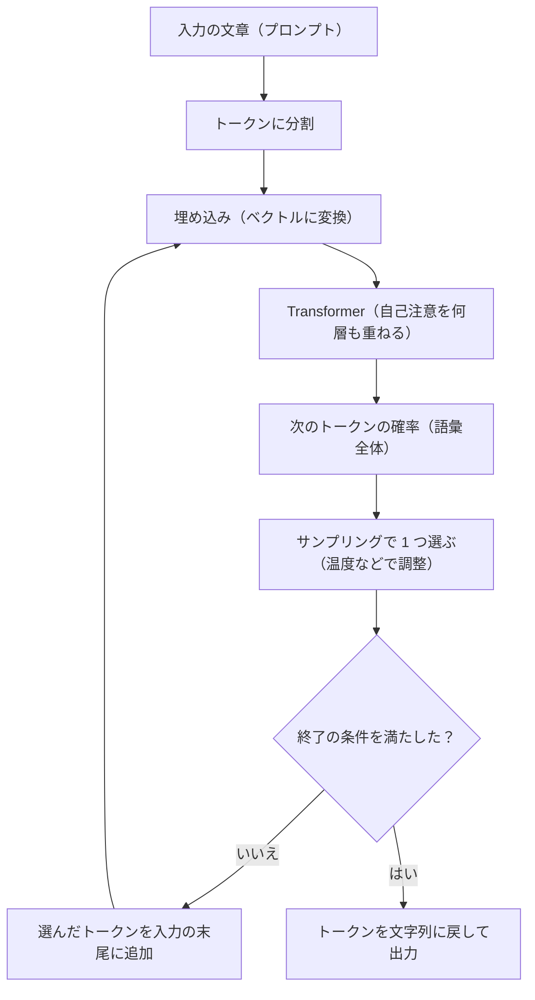

## この記事で分かること

- LLM（大規模言語モデル）が「次に来るトークンを予測する」ことを繰り返して文章を作る仕組み
- トークン、埋め込み（ベクトル）、Transformer と自己注意が、それぞれ何をしているか
- 事前学習、ファインチューニング、RLHF（人間のフィードバックによる強化学習）の役割
- 温度などのサンプリング設定、コンテキストウィンドウの意味
- ハルシネーションが起きる理由と、RAG などによる対策

## 一言で説明すると

LLM は、大量の文章から「この文脈なら、次にどんな言葉が来やすいか」を学習したモデルです。質問文を受け取ると、続きの言葉の候補ごとに確率を計算し、その中から 1 つを選んで文末に付け足す、という作業を何度も繰り返して回答を組み立てます。米国国立標準技術研究所（NIST）の生成 AI に関する文書 NIST AI 600-1（2024 年 7 月）も、LLM は文や句の中の次のトークンや単語を予測するものだと説明しています（2.2 節）。

## なぜ必要なのか

従来、文章の分類や翻訳、要約といった自然言語処理（人間の言葉をコンピュータで扱う技術）は、タスクごとに専用のモデルやルールを作るのが一般的でした。GPT-3 の論文（Brown et al., 2020）は、大量の文章で**事前学習**したうえでタスクごとに**ファインチューニング**（追加学習）する当時の一般的な方法でも、タスクごとに数千〜数万件の例が必要だと指摘しました。そのうえで、十分に大きな自己回帰型の言語モデルなら、プロンプト（入力文）の中に数例を示すだけで、追加学習なしに多くのタスクで良い成績を出せることを示しました。ただし、この方法では苦手なタスクがあることも報告されています。

1 つのモデルに文章で指示を与えるだけで、要約、翻訳、質疑応答、プログラムの作成補助などを幅広く扱えることが、LLM が広く使われるようになった理由の 1 つです。このため、意図した出力を得られるように、指示の内容、与える情報や例、出力の形式などを工夫することが重要になります。この工夫を**プロンプトエンジニアリング**と呼びます。応用情報技術者試験のシラバス Ver.7.2 にも、大規模言語モデル（LLM）、Transformer、自己注意機構、RLHF、プロンプトエンジニアリングなどが用語例として載っています。

## 身近な例え

LLM の動きは、スマートフォンの**予測変換を、大規模で高度にしたもの**にたとえられます。予測変換は直前の数文字から次の単語の候補を出しますが、LLM は入力された文章全体と、それまでに生成した部分をすべて見たうえで、次の 1 語を選びます。そして選んだ語を付け足しては、また次の 1 語を選ぶことを、回答が終わるまで続けます。

<Callout type="warn" title="例えの限界">
- **規模と仕組みが違う**: 予測変換の多くは辞書や入力履歴を使う比較的単純な仕組みですが、LLM は大量の文章から学習した巨大なニューラルネットワーク（後述）で、文脈の離れた部分どうしの関係まで考慮します。
- **候補を利用者が選ぶわけではない**: 予測変換では人が候補を選びますが、LLM はモデル自身が確率に基づいて選びます。選び方の設定（温度など）によって、同じ入力でも出力が変わることがあります。
</Callout>

## 技術的な仕組み

### トークン：文章を扱える単位に区切る

LLM は文章を文字列のまま扱うのではなく、**トークン**という単位の並びに区切ってから処理します。トークンは単語のこともあれば、単語の一部（サブワード）や記号のこともあります。辞書にあるすべての単語を個別に覚えるのは難しいため、珍しい語はより小さな部品の組み合わせとして表す方法が使われます。Sennrich et al.（2016）は、データ圧縮の手法であるバイトペア符号化（BPE）を応用した分割で、未知の単語も扱えるようにしました。

次の例は、考え方を示すための**説明用の架空の分割**です。実際の区切り方は、モデルごとのトークナイザー（分割器）によって異なります。

```text title="説明用の架空のトークン分割（実在するトークナイザーの結果ではありません）"
入力: 「キャッシュメモリの仕組みを教えて」
分割: [キャッシュ] [メモリ] [の] [仕組み] [を] [教え] [て]
```

各トークンには語彙表の中の番号が割り当てられ、モデルの内部では番号の列として扱われます。LLM のサービスで、入力や出力の量が文字数ではなくトークン数で数えられることがあるのはこのためです。

### 埋め込み：トークンを数値のベクトルにする

番号のままでは「似た意味の言葉」を表せません。そこで、各トークンを多数の数値の組（**ベクトル**）に変換します。これを**埋め込み**（embedding）と呼びます。Mikolov et al.（2013）は、大量の文章から単語のベクトル表現を学習し、そのベクトルで語の意味的・文法的な類似性をとらえられることを示しました。Transformer の論文（Vaswani et al., 2017）でも、入力のトークンは学習で得た埋め込みによってベクトルに変換されます（3.4 節）。

<Callout type="tip" title="覚え方">
入力は「文字列 → トークン（番号）→ ベクトル」の 3 段で数値になる、と順番で覚えます。段ごとに「何ができるようになるか」が違います。

| 段階 | 形 | できるようになること |
| --- | --- | --- |
| トークン化 | 番号の列 | 未知の語も部品の組み合わせで表せる。量はトークン数で数える |
| 埋め込み | ベクトルの列 | 似た意味の語を近い数値として扱える（番号は区別するだけで、近さを表せない） |

番号の「3 番」と「4 番」が意味的に近いとは限らない、という点が、ベクトルに変える理由です。
</Callout>

### Transformer と自己注意：文脈の中で言葉どうしを関係づける

現在の LLM の多くは、**Transformer** というニューラルネットワーク（数値の掛け算と足し算を何層も重ねた、学習で調整される計算の仕組み）を土台にしています。ニューラルネットワークを多層に重ねて学習させる手法を**ディープラーニング**（深層学習）と呼び、LLM はその応用の 1 つです（シラバスでも、ディープラーニングの応用分野の用語例に LLM や Transformer が並んでいます）。Transformer は 2017 年の論文「Attention Is All You Need」（Vaswani et al.）で提案されたもので、それまでの主流だった、文を 1 語ずつ順番に処理する再帰型のネットワーク（RNN）を使わず、**注意機構**（attention）だけに基づいています。このため計算を並列化しやすく、学習が速いことが報告されています。

中心となるのが**自己注意**（self-attention）です。論文では「1 つの系列の中の異なる位置どうしを関係づけて、その系列の表現を計算する仕組み」と説明されています（2 章）。たとえば「彼はその本を棚に戻した。それは重かった。」の「それ」を処理するとき、文中のどの語に注目すべきか（「本」か「棚」か）を、各語の組み合わせの関連度として計算し、関連の強い語の情報を多く取り込みます。これは説明のための例で、実際にどの語にどれだけ注目するか（重み）は、モデルや層によって異なります。

具体的には、各トークンのベクトルに、学習で調整される重みの行列を掛けて、**クエリ**（何を探しているか）、**キー**（自分は何についての情報か）、**値**（渡す情報の中身）という 3 つのベクトルを作ります。次に、クエリと各キーの内積（2 つのベクトルの向きが近いほど大きくなる値。長さにも左右されます）を計算し、キーの次元数 $d_k$ の平方根 $\sqrt{d_k}$ で割ります。次元が大きいと内積の値が大きくなりすぎ、softmax の出力が極端に偏って学習しにくくなるのを防ぐためです。そのうえで、softmax 関数（数値の並びを、合計 1 の確率のような重みに変換する関数）で重みに変え、その重みで値を足し合わせます（3.2.1 節）。この計算を、それぞれ別の学習済みの重みで複数の観点から並行して行うのが**マルチヘッド注意**です（3.2.2 節）。

注意の計算そのものには語順の情報がないため、Transformer では位置を表す情報（位置符号化）を埋め込みに加えます（3.5 節）。また、文章を生成する部分では、まだ生成していない後ろの位置を参照できないようにマスク（覆い隠し）をかけます（3.2.3 節）。

<Callout type="tip" title="覚え方">
クエリ・キー・値は、図書館で本を探す流れに対応させると覚えやすくなります。

1. **クエリ**＝探したいこと（検索語）、**キー**＝各本の背表紙のラベル、**値**＝本の中身
2. 検索語とラベルの近さ（内積）で、どの本をどれだけ参考にするかを決める（softmax で合計 1 の重みにする）
3. 重みに応じて中身（値）を混ぜ合わせたものが、そのトークンの新しい表現になる

$\sqrt{d_k}$ で割るのは「次元が増えるほど内積が大きくなり、softmax が 1 か所に偏りすぎる」のを防ぐため、と理由とセットで覚えます。なお、このたとえは計算の流れを示すためのもので、実際のクエリ・キー・値は学習で調整された数値のベクトルです。また、この「本棚」に並ぶのは同じ入力の中のトークン自身で、外部の資料を検索するわけではありません。1 冊を選ぶのではなく、全部の本の中身を重みに応じて混ぜる点も、実際の図書館とは異なります。
</Callout>

### 出力：次のトークンの確率

何層もの計算を経た最後のベクトルは、線形変換と softmax によって、語彙表のすべてのトークンについての「次に来る確率」に変換されます（Vaswani et al. 3.4 節）。次の表は、考え方を示すための**架空の値**です。

| 入力「今日はとても良い」に続く候補 | 確率（架空の値） |
| --- | --- |
| 天気 | 0.52 |
| 一日 | 0.21 |
| 気分 | 0.15 |
| その他すべて | 0.12 |

### 学習：事前学習と、指示に従わせるための追加学習

LLM の学習は、大きく 2 段階に分けて説明できます。

1. **事前学習**: 大量の文章を使い、「途中までの文から次のトークンを当てる」ことを繰り返し学習します。正解は文章そのものの続きなので、人が正解ラベルを付ける作業（**アノテーション**）が要りません（シラバスの用語では自己教師あり学習に当たります）。これで言葉の使われ方や一般的な知識が、モデル内部の数値（**パラメータ**）に蓄えられます。
2. **追加学習**: 事前学習だけのモデルは、利用者の意図に沿った応答をするとは限りません。InstructGPT の論文（Ouyang et al., 2022）は、大きいモデルでも事実と異なる、有害な、または役に立たない出力をしうると指摘し、次の手順を示しました。まず人が書いた模範応答でファインチューニングし（教師ありファインチューニング）、次に、同じ入力に対する複数の出力を人が順位付けしたデータから、人に好まれる応答ほど高い点数を付ける**報酬モデル**を学習します。最後に、その報酬モデルの点数が高くなるように、強化学習（PPO という手法）でモデルを調整します（同論文 3.1 節）。この、人の評価から報酬モデルを作り、強化学習で調整する部分が **RLHF**（Reinforcement Learning from Human Feedback）です。この論文では、パラメータ数が約 100 分の 1 の 13 億パラメータのモデルの出力が、1750 億パラメータの GPT-3 の出力よりも評価者に好まれました。ただし、単純な誤りはなお残ると述べています。

指示と応答の例で学習させて指示に従いやすくすることを**インストラクションチューニング**、モデルの振る舞いを人間の意図や価値観に合わせることを**アラインメント**と呼び、どちらもシラバスの用語例に含まれています。

LLM のように、幅広く大量のデータで事前に訓練しておき、追加学習などによってさまざまな用途に転用できるモデルを**基盤モデル**（foundation model）と呼びます。NIST AI 600-1 は、米国の大統領令 EO 14110 が基盤モデルのうち「デュアルユース基盤モデル」について定めた定義を引用しています。それによると、デュアルユース基盤モデルは「幅広いデータで訓練され、一般に自己教師あり学習を使い、少なくとも数百億のパラメータを持ち、広い範囲の文脈に適用できる AI モデル」です（1 章の脚注 1）。自社のデータで基盤モデルを追加学習し、特定の業務向けに調整するのもファインチューニングです。

なお、学習を終えたモデルを使って実際に出力を作る段階は、学習と区別して**推論**（inference）と呼ばれます。NIST AI 600-1 も、生成 AI のモデルで行う処理を事前学習・ファインチューニング・推論に分けて挙げています（2.5 節）。次の「生成」で説明するトークンの選択は、推論の段階で行われます。

<Callout type="tip" title="覚え方">
機械学習の学習方法は「何を手がかりに学ぶか」で分けられます。LLM の各段階をそこに当てはめると、試験でよく問われる用語をまとめて整理できます。

| 学習方法 | 手がかり | 代表的な使い方 | LLM での対応 |
| --- | --- | --- | --- |
| 教師あり学習 | 人が付けた正解ラベル（アノテーション） | 分類・回帰 | 模範応答による教師ありファインチューニング |
| 教師なし学習 | 正解なし。データどうしの似かた | クラスタリング | 表の段階に直接は対応しない（下の注を参照） |
| 自己教師あり学習 | データ自身から作った正解（文章の続き） | 事前学習 | 次のトークンを当てる事前学習 |
| 強化学習 | 行動の結果に与えられる報酬 | 試行錯誤で方策を改善 | RLHF（報酬モデルの点数を報酬にする） |

注：自己教師あり学習は、人がラベルを付けない点から、広い意味の教師なし学習の一種として説明されることもあります。

「正解を人が付ける → 教師あり」「正解がない → 教師なし」「報酬で学ぶ → 強化学習」と手がかりで見分け、「学習で作ったモデルを使う段階が推論」と区別しておきます。
</Callout>

### 生成：サンプリングと温度

次のトークンの確率が出たら、そこから 1 つを選びます。確率が最大になる候補を選び続ける方法（貪欲法やビームサーチ）では、Holtzman et al.（2020）が指摘するように、単調で同じ表現を繰り返す文章になりやすいことが知られています。そこで、確率に従ってランダムに選ぶ**サンプリング**が使われます。同じ論文は、同じモデルでも選び方（復号の方法）だけで文章の質が大きく変わると述べています。

代表的な調整が**温度**（temperature）です。モデルが出す各候補のスコア $u_i$ を温度 $t$ で割ってから softmax にかけます（Holtzman et al. 3.3 節）。

$$
p_i = \frac{\exp(u_i / t)}{\sum_j \exp(u_j / t)}
$$

$t$ を 1 より小さくすると確率の高い候補にさらに偏り、出力は安定しますが多様性は下がります。$t$ を大きくすると低い確率の候補も選ばれやすくなります。この式は $t = 0$ では割り算ができないため定義できませんが、$t$ を 0 に近づけるほど、常に最も確率の高い候補を選ぶ方法（貪欲法）に近づきます。温度 0 を指定できる API などでは、実装によっては貪欲法に近い動作になります（扱いは製品ごとに異なります）。このほか、確率の上位 $k$ 個だけから選ぶ **top-k サンプリング**や、確率の高い順に足していき合計が $p$ 以上になるまでの候補から選ぶ **top-p（nucleus）サンプリング**もあります（同 3.1・3.2 節）。

<Callout type="tip" title="覚え方">
温度の効き方は、式の「$u_i / t$」から数値で確かめられます。スコアが 2 と 1 の 2 候補で、確率の比 $\exp(u_1/t) / \exp(u_2/t) = \exp((u_1 - u_2)/t)$ を計算します。

| 温度 $t$ | 温度で割った差 $(u_1 - u_2)/t$ | 確率の比（約） |
| --- | --- | --- |
| 2 | 0.5 | 1.6 倍 |
| 1 | 1 | 2.7 倍 |
| 0.5 | 2 | 7.4 倍 |

小さい数で割るほど差が広がり、1 位の候補に集中します。「温度を下げる → 差が広がる → 決まった答えに固まる」「温度を上げる → 差が縮む → ばらつく」と因果で覚えておくと、温度 0 に近い設定が貪欲法に近づく理由も説明できます。
</Callout>

### 全体の流れ：次のトークンを予測して付け足すループ

ここまでの要素をつなげると、LLM が文章を生成する流れは次の図のようになります。



入力の文章はまずトークンに分割され（B）、それぞれが埋め込みのベクトルになります（C）。Transformer は自己注意によって文脈全体を見ながら計算し（D）、語彙のすべてのトークンについて次に来る確率を出します（E）。その確率分布からサンプリングで 1 トークンを選び（F）、終了の条件（終わりを表す特別なトークンが選ばれた、長さの上限に達したなど）を満たしていなければ、選んだトークンを入力の末尾に付け足して、もう一度同じ計算をします（H から C へ戻る）。Transformer の論文はこれを**自己回帰**と呼び、それまでに生成した記号を次の生成の入力に加える、と説明しています（3 章）。このループが回るたびに入力が 1 トークンずつ長くなるため、次に説明するコンテキストウィンドウの上限が関わってきます。

### コンテキストウィンドウ

モデルが 1 回の処理で入力として扱えるトークン数には上限があり、これを**コンテキストウィンドウ**（文脈の窓）と呼びます。上限はモデルによって異なります。チャット型のアプリが会話の流れを覚えているように見えるのは、一般に、それまでのやり取りを毎回まとめて入力に含めているためです。上限を超えた古い部分は、要約したり削ったりしなければ扱えません。

また、上限内に収まっていても、すべてが同じように使われるとは限りません。Liu et al.（2023）は、長い入力の中で必要な情報が先頭や末尾にあるときは性能が高く、中ほどにあると大きく下がることを、長い文脈向けに作られたモデルでも確認しています。

## 実務での活用例

### 要約・文章の添削

長い議事録や仕様書の要約、文章の言い換えや添削は、LLM が得意とする使い方です。シラバスも生成 AI の活用例として文章の添削・要約やプログラミングを挙げています。ただし、元の文章にない内容が混ざることがあるため、重要な数値や固有名詞は原文と照らし合わせる必要があります。

### プログラミングの補助

コードの説明、テストケースの案出し、エラーメッセージの意味の調査などに使えます。生成されたコードは存在しない関数やライブラリを含むことがあるため、実行とテスト、レビューを通してから使います。

### 社内文書に基づく質問応答（RAG）

社内規程や製品マニュアルについて答えさせたい場合、モデルのパラメータにはその情報がありません。そこで、質問に関連する文書を検索してプロンプトに含め、その内容に基づいて答えさせる **RAG**（Retrieval-Augmented Generation、検索拡張生成）が使われます。Lewis et al.（2020）は、パラメータに蓄えた知識は正確に取り出すこと、根拠を示すこと、新しい情報に更新することが難しいと指摘し、検索器と文書の索引を組み合わせることで、より具体的で事実に即した生成ができることを示しました。NIST AI 600-1 も、利用目的を検討する際に考慮するデータ源の例として grounding（根拠付け）や RAG を挙げています（MP-1.1-001）。

### 使うときの限界と注意

- 入力に紛れ込んだ悪意ある指示に従ってしまう**プロンプトインジェクション**という攻撃があり、シラバスのセキュリティの用語例にも挙がっています。
- 機密情報を入力してよいかは、利用するサービスの規約と組織のルールを確認します。

LLM に道具（検索やコードの実行など）を使わせ、複数の手順を自律的に進めさせる仕組みは[AIエージェント](/ai/ai-agent/)の記事で扱います。

## 関連技術との比較

| 観点 | ルールベースの自然言語処理 | 従来型の検索エンジン | LLM |
| --- | --- | --- | --- |
| 仕組み | 人が書いた規則や辞書で処理する | 索引から入力に合う既存の文書を探して並べる | 学習した確率に基づいて新しい文章を生成する |
| 出力 | 規則で決まった結果 | 既存の文書へのリンク・抜粋 | 生成された文章（毎回変わりうる） |
| 根拠の追跡 | 規則をたどれる | 元の文書をそのまま確認できる | 生成した文章自体には根拠が付かない（RAG などで補う） |
| 新しいタスクへの対応 | 規則を書き足す必要がある | 探すこと以外はできない | 指示や例をプロンプトで与えて対応できることが多い |
| 主な弱み | 想定外の表現に弱い | 答えを自分で組み立てない | もっともらしい誤り（ハルシネーション） |

## ハルシネーション：もっともらしい誤り

LLM が事実と異なる内容を、自信がありそうな文章で出力することを**ハルシネーション**（幻覚）と呼びます。NIST AI 600-1 は同じ現象を confabulation（作話）と呼び、「自信をもって述べられた、誤った、または虚偽の内容」と定義しています（2 章・2.2 節）。シラバスも、AI を利活用するうえでの留意事項として、ハルシネーションや古い情報の出力リスク、出力を人間が確認することの重要性を挙げています。

NIST AI 600-1 によれば、これは生成モデルの設計から自然に生じる結果です。モデルは学習データの統計的な分布に近い出力を作るように作られており、その予測は正確な内容になることも多い一方、事実と違う内容や前後で矛盾する内容になることもあります。長い回答を求める自由な質問や、高度な専門知識が必要な分野で特に起こりやすいとされています。誤った答えにもっともらしい推論や存在しない引用を添えることもあります。

なお、NIST AI 600-1 は、生成 AI に特有の、または生成 AI によって大きくなるリスクとして、作話のほかに、データプライバシー（個人情報などの漏えいや不正な利用）や有害なバイアス（社会にある偏りを増幅し、差別につながること）なども挙げています（2 章）。ハルシネーションは、こうした複数のリスクの 1 つとして管理されます。

対策としては、次のようなものがあります。

- **根拠となる資料を渡す**: RAG などで信頼できる文書を入力に含め、それに基づいて答えさせる（ただし、渡した文書の誤りや読み違いまでは防げません）。
- **出典を確かめる**: 出力に含まれる出典や引用を実際に確認する（NIST AI 600-1 の推奨行動 MS-2.5-003）。
- **人が確認する工程を入れる**: 重要な判断に使う出力は、人が検証してから使う（シラバスの用語ではヒューマンインザループ）。

## よくある誤解

<Misconceptions
  items={[
    { myth: 'LLM は内部のデータベースから事実を検索して答えている。', fact: 'LLM が行っているのは、学習で調整されたパラメータを使って次のトークンの確率を計算することで、事実の表を引いているわけではありません。このため、存在しない文献をもっともらしく作ってしまうことがあります。外部の文書を検索して使わせたい場合は RAG のような仕組みを別に組み合わせます。' },
    { myth: 'LLM は人間と同じように意味を理解して考えている。', fact: 'LLM が内部で何をどこまで「理解」していると言えるかは、研究者の間でも議論が続いている問題です。確かなのは、仕組みとしては次のトークンの予測を繰り返しており、人間とは学び方も誤り方も異なるということです。流暢な文章であることは、内容が正しいことの保証になりません。' },
    { myth: 'コンテキストウィンドウが大きければ、入力したことはすべて覚えていて正確に使われる。', fact: '上限を超えた部分はそもそも入力に含められません。上限内でも、長い入力の中ほどにある情報は先頭や末尾の情報より使われにくいという研究結果があります（Liu et al., 2023）。会話を覚えているように見えるのも、多くの場合は過去のやり取りを毎回入力に含めているためです。' },
    { myth: '温度を 0 にすれば、出力は正しくなる。', fact: '温度を下げると確率の高い候補が選ばれやすくなり、出力のばらつきは小さくなります。しかし、モデルが誤った内容に高い確率を付けていれば、その誤りが安定して出力されるだけです。正確さを高めるには、根拠資料を渡すことや人による確認が必要です。' },
  ]}
/>

## まとめ

- LLM は、入力をトークンに分割し、次のトークンの確率を計算して 1 つ選び、末尾に付け足すことを繰り返して文章を作る自己回帰型のモデルです。
- トークンは埋め込みでベクトルになり、Transformer の自己注意によって文脈中の語どうしが関係づけられます。
- 大量の文章での事前学習で言葉の使われ方を学び、教師ありファインチューニングや RLHF で指示に従うように調整されます。
- 温度や top-p などのサンプリング設定で出力の多様性が変わります。一度に扱える量はコンテキストウィンドウで制限されます。
- ハルシネーションは仕組み上、完全になくすことは難しいため、RAG で根拠を与え、出典を確認し、人が検証する工程を組み合わせて使います。

## 理解度チェック

**問1**: LLM に同じ質問を 2 回送ったところ、言い回しの違う回答が返ってきました。仕組みの面から理由を説明してください。

<details>
<summary>答えと解説</summary>

LLM は次のトークンの確率分布から、サンプリングによって 1 つを選んでいるためです。確率の高い候補が選ばれやすいものの、ほかの候補が選ばれることもあり、一度違うトークンが選ばれると、その後の文脈も変わって以降の出力が変わっていきます。温度を下げるとばらつきは小さくなります。

</details>

**問2**: 社内の就業規則について LLM に正確に答えさせたいとします。モデルを追加学習し直さずに、ハルシネーションを減らすために取れる方法を 2 つ挙げてください。

<details>
<summary>答えと解説</summary>

例: (1) RAG を使い、質問に関連する就業規則の該当箇所を検索してプロンプトに含め、その内容に基づいて答えさせる。(2) 回答に根拠とした条文を示させ、人がその条文を確認してから利用する。モデルはもともと社内の就業規則を学習していないため、根拠となる資料を渡すことと、人による確認を組み合わせることが重要です。

</details>

## 過去問題

<PastExam source="令和7年度 春期 応用情報技術者試験 午前 問71">
クラウドで学習し，エッジデバイスで推論する機械学習ベースのエッジ AI において，エッジデバイスで行われる推論処理として，適切なものはどれか。

- ア　一定の環境の中で試行錯誤を行い，行動に報酬を与えることで学習するプロセス
- イ　学習したモデルに従い，実際にデータの識別などを行うプロセス
- ウ　識別などを行うためのモデルを，正解のラベルを付けたデータによって作成するプロセス
- エ　識別などを行うためのモデルを，正解のラベルを付けないデータによって作成するプロセス

<PastExamAnswer answer="イ">
推論は、学習を終えたモデルを使って実際の入力に対する出力（識別や予測）を作る段階です。「学習」節の覚え方の表に当てはめると、アは報酬で学ぶ強化学習、ウは正解ラベル付きのデータで学ぶ教師あり学習、エはラベルなしのデータで学ぶ教師なし学習で、いずれもモデルを作る「学習」の側です。LLM でも、次のトークンを選んで文章を作る処理は推論の段階に当たります。
</PastExamAnswer>
</PastExam>

<PastExam source="令和6年度 秋期 応用情報技術者試験 午前 問71">
生成 AI のビジネス活用において，独自のデータを学習させることにより基盤モデルを自社の業務やサービスに特化したモデルへとカスタマイズすることを何と呼ぶか。

- ア　アノテーション
- イ　クラスタリング
- ウ　ファインチューニング
- エ　プロンプトエンジニアリング

<PastExamAnswer answer="ウ">
学習済みのモデルに追加のデータで学習させ、特定の用途に合わせて調整することをファインチューニングと呼びます（「学習」節）。アは学習データに正解ラベルを付ける作業、イは教師なし学習でデータをグループに分ける手法です。エは指示や与える情報を工夫する方法で、モデル自体は追加学習しない点がファインチューニングとの違いです。
</PastExamAnswer>
</PastExam>

<PastExam source="令和6年度 春期 応用情報技術者試験 午前 問3">
AI におけるディープラーニングに関する記述として，最も適切なものはどれか。

- ア　あるデータから結果を求める処理を，人間の脳神経回路のように多層の処理を重ねることによって，複雑な判断をできるようにする。
- イ　大量のデータからまだ知られていない新たな規則や仮説を発見するために，想定値から大きく外れている例外事項を取り除きながら分析を繰り返す手法である。
- ウ　多様なデータや大量のデータに対して，三段論法，統計的手法やパターン認識手法を組み合わせることによって，高度なデータ分析を行う手法である。
- エ　知識がルールに従って表現されており，演繹手法を利用した推論によって有意な結論を導く手法である。

<PastExamAnswer answer="ア">
ディープラーニングは、ニューラルネットワークを多層に重ねて学習させる手法です。「Transformer と自己注意」節で見たように、LLM も計算の層を何層も重ねたニューラルネットワークで、その応用の 1 つです。イは外れ値を除きながら規則を探すデータマイニングのような分析、ウは論理・統計・パターン認識を組み合わせたデータ分析の説明で、どちらも多層の学習には触れていません。エは、人が書いたルールと推論で結論を導くエキスパートシステムのような手法の説明で、データから学習するディープラーニングとは異なります。
</PastExamAnswer>
</PastExam>

<PastExam source="令和元年度 秋期 応用情報技術者試験 午前 問4">
AI の機械学習における教師なし学習で用いられる手法として，最も適切なものはどれか。

- ア　幾つかのグループに分かれている既存データ間に分離境界を定め，新たなデータがどのグループに属するかはその分離境界によって判別するパターン認識手法
- イ　数式で解を求めることが難しい場合に，乱数を使って疑似データを作り，数値計算をすることによって解を推定するモンテカルロ法
- ウ　データ同士の類似度を定義し，その定義した類似度に従って似たもの同士は同じグループに入るようにデータをグループ化するクラスタリング
- エ　プロットされた時系列データに対して，曲線の当てはめを行い，得られた近似曲線によってデータの補完や未来予測を行う回帰分析

<PastExamAnswer answer="ウ">
教師なし学習は正解ラベルを使わず、データどうしの似かたを手がかりにします。その代表がクラスタリングです（「学習」節の覚え方の表）。アの分類（既存のグループ分けを正解として境界を学ぶ）とエの回帰は、正解の値を使う教師あり学習の手法です。イのモンテカルロ法は乱数を使う数値計算の手法で、機械学習の学習方法の分類には当たりません。
</PastExamAnswer>
</PastExam>

<PastExam source="令和8年度 ITパスポート試験 公開問題 問98">
AI におけるプロンプトエンジニアリングの説明として，適切なものはどれか。

- ア　AI が，多数の事象やデータから普遍的なルールや知識を獲得すること
- イ　AI に対する質問や指示などが入力できる状態であることを，画面上に記号や文字列で示すこと
- ウ　意図した回答を得るために AI に対する質問や指示の内容，情報の提供，出力形式の指定などを工夫すること
- エ　神経細胞が作るネットワークをコンピュータで模した，AI で用いられる計算モデルのこと

<PastExamAnswer answer="ウ">
LLM は入力（プロンプト）を文脈として次のトークンを予測するため、指示の書き方や与える情報・例によって出力が変わります。そこで入力を工夫することがプロンプトエンジニアリングです（「なぜ必要なのか」節）。アは学習（帰納的に知識を得ること）、イはコマンド入力を促す記号としてのプロンプト、エはニューラルネットワークの説明です。
</PastExamAnswer>
</PastExam>

<PastExam source="令和7年度 ITパスポート試験 公開問題 問10">
生成 AI において，もっともらしいが事実とは異なる内容が出力されることを表す用語として，最も適切なものはどれか。

- ア　エコーチェンバー
- イ　シンギュラリティ
- ウ　ディープフェイク
- エ　ハルシネーション

<PastExamAnswer answer="エ">
事実と異なる内容を自信がありそうな文章で出力することをハルシネーションと呼びます（「ハルシネーション：もっともらしい誤り」節）。LLM は学習データの統計的な傾向に沿った「ありそうな続き」を作るため、内容が事実と一致する保証はありません。ウのディープフェイクは、生成 AI で作った本物そっくりの偽の画像・動画・音声などを指し、意図して作られた偽物である点が異なります。アのエコーチェンバーは似た意見ばかりに囲まれて考えが強まる現象、イのシンギュラリティは AI が人間の知能を超えるとされる転換点のことです。
</PastExamAnswer>
</PastExam>

<PastExam source="令和7年度 ITパスポート試験 公開問題 問28">
生成 AI に関する記述として，最も適切なものはどれか。

- ア　一切の学習を必要とせずに，新しいコンテンツを生成する。
- イ　過去のデータから項目間の相関などを学習したモデルを用いて，現在のデータから将来の値を予測して出力する。
- ウ　作成したシナリオに基づいて動作するソフトウェアロボットによって，業務を自動化する。
- エ　自然言語で指示された内容に従って，事前に学習したデータを基に，新しいコンテンツを生成する。

<PastExamAnswer answer="エ">
LLM は大量の文章で事前学習したうえで、プロンプトで与えた指示に従って新しい文章を生成します（「一言で説明すると」「学習」節）。アは、学習なしに生成できるという誤りです。プロンプトだけで新しいタスクに対応できるのも、事前学習で言葉の使われ方を身に付けているためです。イは予測モデル（回帰など）、ウは RPA の説明です。
</PastExamAnswer>
</PastExam>

<PastExam source="令和7年度 ITパスポート試験 公開問題 問80">
AI において，広範囲かつ大量のデータで訓練されたものであり，ファインチューニングなどによって文章生成 AI のような様々な用途に適応できる特徴をもつものを何というか。

- ア　アノテーション
- イ　エキスパートシステム
- ウ　基盤モデル
- エ　畳み込みニューラルネットワーク

<PastExamAnswer answer="ウ">
幅広い大量のデータで訓練し、追加学習などで多様な用途に適応させられるモデルを基盤モデルと呼びます（「学習」節）。LLM はその代表例です。応用情報技術者試験 令和6年度 秋期 午前 問71 は、同じ関係を逆向き（基盤モデルを特化させる操作の名前）から問うています。エの畳み込みニューラルネットワークは主に画像の処理に使われるネットワークの構造の名前です。
</PastExamAnswer>
</PastExam>

<PastExam source="令和8年度 ITパスポート試験 公開問題 問16">
教師あり学習において，正解となる情報を付与する作業を表す用語として，最も適切なものはどれか。

- ア　アノテーション
- イ　エンコード
- ウ　データクレンジング
- エ　フィルタリング

<PastExamAnswer answer="ア">
教師あり学習の正解ラベルを人がデータに付ける作業がアノテーションです。「学習」節で見たように、LLM の事前学習は文章の続きそのものが正解になるため、この作業が要らないことが、大量の文章で学習できる理由の 1 つです。一方、教師ありファインチューニングで使う模範応答は人が用意します。ウのデータクレンジングは、誤りや重複などを取り除いてデータの品質を整える作業です。イのエンコードはデータを別の形式に変換すること、エのフィルタリングは条件に合うデータだけを選び出すことです。
</PastExamAnswer>
</PastExam>

<PastExam source="令和8年度 ITパスポート試験 公開問題 問17">
AI を利活用する上で留意すべき事項として，適切なものだけを全て挙げたものはどれか。

a　AI の意図しない動作によって，人間の生命や身体などに危害を及ぼす可能性

b　AI の判断に差別的な内容が含まれる可能性

c　AI の判断にプライバシーの侵害となる内容が含まれる可能性

- ア　a，b
- イ　a，b，c
- ウ　a，c
- エ　b，c

<PastExamAnswer answer="イ">
3 つとも留意すべき事項です。「ハルシネーション」節で触れたように、NIST AI 600-1 は生成 AI のリスクとして、作話（ハルシネーション）のほかに、データプライバシー（c に対応）や有害なバイアス（b に対応）を挙げ、危険・暴力的な内容の生成もリスクに含めています。InstructGPT の論文が指摘したように、学習したモデルは有害な出力をしうるため、出力を人が確認する工程を組み合わせて使います（「ハルシネーション」節の対策）。
</PastExamAnswer>
</PastExam>
