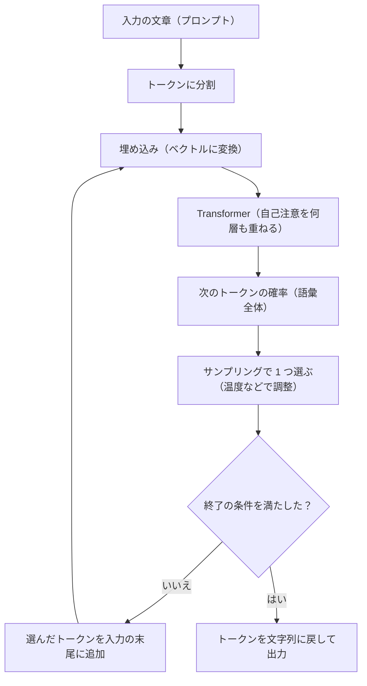

## この記事で分かること

- LLM（大規模言語モデル）が「次に来るトークンを予測する」ことを繰り返して文章を作る仕組み
- トークン、埋め込み（ベクトル）、Transformer と自己注意が、それぞれ何をしているか
- 事前学習、ファインチューニング、RLHF（人間のフィードバックによる強化学習）の役割
- 温度などのサンプリング設定、コンテキストウィンドウの意味
- ハルシネーションが起きる理由と、RAG などによる対策

## 一言で説明すると

LLM は、大量の文章から「この文脈なら、次にどんな言葉が来やすいか」を学習したモデルです。質問文を受け取ると、続きの言葉の候補ごとに確率を計算し、その中から 1 つを選んで文末に付け足す、という作業を何度も繰り返して回答を組み立てます。米国国立標準技術研究所（NIST）の生成 AI に関する文書 NIST AI 600-1（2024 年 7 月）も、LLM は文や句の中の次のトークンや単語を予測するものだと説明しています（2.2 節）。

## なぜ必要なのか

従来、文章の分類や翻訳、要約といった自然言語処理（人間の言葉をコンピュータで扱う技術）は、タスクごとに専用のモデルやルールを作るのが一般的でした。GPT-3 の論文（Brown et al., 2020）は、大量の文章で**事前学習**したうえでタスクごとに**ファインチューニング**（追加学習）する当時の一般的な方法でも、タスクごとに数千〜数万件の例が必要だと指摘しました。そのうえで、十分に大きな自己回帰型の言語モデルなら、プロンプト（入力文）の中に数例を示すだけで、追加学習なしに多くのタスクで良い成績を出せることを示しました。ただし、この方法では苦手なタスクがあることも報告されています。

1 つのモデルに文章で指示を与えるだけで、要約、翻訳、質疑応答、プログラムの作成補助などを幅広く扱えることが、LLM が広く使われるようになった理由の 1 つです。応用情報技術者試験のシラバス Ver.7.2 にも、大規模言語モデル（LLM）、Transformer、自己注意機構、RLHF、プロンプトエンジニアリングなどが用語例として載っています。

## 身近な例え

LLM の動きは、スマートフォンの**予測変換を、大規模で高度にしたもの**にたとえられます。予測変換は直前の数文字から次の単語の候補を出しますが、LLM は入力された文章全体と、それまでに生成した部分をすべて見たうえで、次の 1 語を選びます。そして選んだ語を付け足しては、また次の 1 語を選ぶことを、回答が終わるまで続けます。

<Callout type="warn" title="例えの限界">
- **規模と仕組みが違う**: 予測変換の多くは辞書や入力履歴を使う比較的単純な仕組みですが、LLM は大量の文章から学習した巨大なニューラルネットワーク（後述）で、文脈の離れた部分どうしの関係まで考慮します。
- **候補を利用者が選ぶわけではない**: 予測変換では人が候補を選びますが、LLM はモデル自身が確率に基づいて選びます。選び方の設定（温度など）によって、同じ入力でも出力が変わることがあります。
</Callout>

## 技術的な仕組み

### トークン：文章を扱える単位に区切る

LLM は文章を文字列のまま扱うのではなく、**トークン**という単位の並びに区切ってから処理します。トークンは単語のこともあれば、単語の一部（サブワード）や記号のこともあります。辞書にあるすべての単語を個別に覚えるのは難しいため、珍しい語はより小さな部品の組み合わせとして表す方法が使われます。Sennrich et al.（2016）は、データ圧縮の手法であるバイトペア符号化（BPE）を応用した分割で、未知の単語も扱えるようにしました。

次の例は、考え方を示すための**説明用の架空の分割**です。実際の区切り方は、モデルごとのトークナイザー（分割器）によって異なります。

```text title="説明用の架空のトークン分割（実在するトークナイザーの結果ではありません）"
入力: 「キャッシュメモリの仕組みを教えて」
分割: [キャッシュ] [メモリ] [の] [仕組み] [を] [教え] [て]
```

各トークンには語彙表の中の番号が割り当てられ、モデルの内部では番号の列として扱われます。LLM のサービスで、入力や出力の量が文字数ではなくトークン数で数えられることがあるのはこのためです。

### 埋め込み：トークンを数値のベクトルにする

番号のままでは「似た意味の言葉」を表せません。そこで、各トークンを多数の数値の組（**ベクトル**）に変換します。これを**埋め込み**（embedding）と呼びます。Mikolov et al.（2013）は、大量の文章から単語のベクトル表現を学習し、そのベクトルで語の意味的・文法的な類似性をとらえられることを示しました。Transformer の論文（Vaswani et al., 2017）でも、入力のトークンは学習で得た埋め込みによってベクトルに変換されます（3.4 節）。

### Transformer と自己注意：文脈の中で言葉どうしを関係づける

現在の LLM の多くは、**Transformer** というニューラルネットワーク（数値の掛け算と足し算を何層も重ねた、学習で調整される計算の仕組み）を土台にしています。Transformer は 2017 年の論文「Attention Is All You Need」（Vaswani et al.）で提案されたもので、それまでの主流だった、文を 1 語ずつ順番に処理する再帰型のネットワーク（RNN）を使わず、**注意機構**（attention）だけに基づいています。このため計算を並列化しやすく、学習が速いことが報告されています。

中心となるのが**自己注意**（self-attention）です。論文では「1 つの系列の中の異なる位置どうしを関係づけて、その系列の表現を計算する仕組み」と説明されています（2 章）。たとえば「彼はその本を棚に戻した。それは重かった。」の「それ」を処理するとき、文中のどの語に注目すべきか（「本」か「棚」か）を、各語の組み合わせの関連度として計算し、関連の強い語の情報を多く取り込みます。これは説明のための例で、実際にどの語にどれだけ注目するか（重み）は、モデルや層によって異なります。

具体的には、各トークンのベクトルに、学習で調整される重みの行列を掛けて、**クエリ**（何を探しているか）、**キー**（自分は何についての情報か）、**値**（渡す情報の中身）という 3 つのベクトルを作ります。次に、クエリと各キーの内積（2 つのベクトルの向きが近いほど大きくなる値。長さにも左右されます）を計算し、キーの次元数 $d_k$ の平方根 $\sqrt{d_k}$ で割ります。次元が大きいと内積の値が大きくなりすぎ、softmax の出力が極端に偏って学習しにくくなるのを防ぐためです。そのうえで、softmax 関数（数値の並びを、合計 1 の確率のような重みに変換する関数）で重みに変え、その重みで値を足し合わせます（3.2.1 節）。この計算を、それぞれ別の学習済みの重みで複数の観点から並行して行うのが**マルチヘッド注意**です（3.2.2 節）。

注意の計算そのものには語順の情報がないため、Transformer では位置を表す情報（位置符号化）を埋め込みに加えます（3.5 節）。また、文章を生成する部分では、まだ生成していない後ろの位置を参照できないようにマスク（覆い隠し）をかけます（3.2.3 節）。

### 出力：次のトークンの確率

何層もの計算を経た最後のベクトルは、線形変換と softmax によって、語彙表のすべてのトークンについての「次に来る確率」に変換されます（Vaswani et al. 3.4 節）。次の表は、考え方を示すための**架空の値**です。

| 入力「今日はとても良い」に続く候補 | 確率（架空の値） |
| --- | --- |
| 天気 | 0.52 |
| 一日 | 0.21 |
| 気分 | 0.15 |
| その他すべて | 0.12 |

### 学習：事前学習と、指示に従わせるための追加学習

LLM の学習は、大きく 2 段階に分けて説明できます。

1. **事前学習**: 大量の文章を使い、「途中までの文から次のトークンを当てる」ことを繰り返し学習します。正解は文章そのものの続きなので、人が正解ラベルを付ける必要がありません（シラバスの用語では自己教師あり学習に当たります）。これで言葉の使われ方や一般的な知識が、モデル内部の数値（**パラメータ**）に蓄えられます。
2. **追加学習**: 事前学習だけのモデルは、利用者の意図に沿った応答をするとは限りません。InstructGPT の論文（Ouyang et al., 2022）は、大きいモデルでも事実と異なる、有害な、または役に立たない出力をしうると指摘し、次の手順を示しました。まず人が書いた模範応答でファインチューニングし（教師ありファインチューニング）、次に、同じ入力に対する複数の出力を人が順位付けしたデータから、人に好まれる応答ほど高い点数を付ける**報酬モデル**を学習します。最後に、その報酬モデルの点数が高くなるように、強化学習（PPO という手法）でモデルを調整します（同論文 3.1 節）。この、人の評価から報酬モデルを作り、強化学習で調整する部分が **RLHF**（Reinforcement Learning from Human Feedback）です。この論文では、パラメータ数が約 100 分の 1 の 13 億パラメータのモデルの出力が、1750 億パラメータの GPT-3 の出力よりも評価者に好まれました。ただし、単純な誤りはなお残ると述べています。

指示と応答の例で学習させて指示に従いやすくすることを**インストラクションチューニング**、モデルの振る舞いを人間の意図や価値観に合わせることを**アラインメント**と呼び、どちらもシラバスの用語例に含まれています。

### 生成：サンプリングと温度

次のトークンの確率が出たら、そこから 1 つを選びます。確率が最大になる候補を選び続ける方法（貪欲法やビームサーチ）では、Holtzman et al.（2020）が指摘するように、単調で同じ表現を繰り返す文章になりやすいことが知られています。そこで、確率に従ってランダムに選ぶ**サンプリング**が使われます。同じ論文は、同じモデルでも選び方（復号の方法）だけで文章の質が大きく変わると述べています。

代表的な調整が**温度**（temperature）です。モデルが出す各候補のスコア $u_i$ を温度 $t$ で割ってから softmax にかけます（Holtzman et al. 3.3 節）。

$$
p_i = \frac{\exp(u_i / t)}{\sum_j \exp(u_j / t)}
$$

$t$ を 1 より小さくすると確率の高い候補にさらに偏り、出力は安定しますが多様性は下がります。$t$ を大きくすると低い確率の候補も選ばれやすくなります。この式は $t = 0$ では割り算ができないため定義できませんが、$t$ を 0 に近づけるほど、常に最も確率の高い候補を選ぶ方法（貪欲法）に近づきます。温度 0 を指定できる API などでは、実装によっては貪欲法に近い動作になります（扱いは製品ごとに異なります）。このほか、確率の上位 $k$ 個だけから選ぶ **top-k サンプリング**や、確率の高い順に足していき合計が $p$ 以上になるまでの候補から選ぶ **top-p（nucleus）サンプリング**もあります（同 3.1・3.2 節）。

### コンテキストウィンドウ

モデルが 1 回の処理で入力として扱えるトークン数には上限があり、これを**コンテキストウィンドウ**（文脈の窓）と呼びます。上限はモデルによって異なります。チャット型のアプリが会話の流れを覚えているように見えるのは、一般に、それまでのやり取りを毎回まとめて入力に含めているためです。上限を超えた古い部分は、要約したり削ったりしなければ扱えません。

また、上限内に収まっていても、すべてが同じように使われるとは限りません。Liu et al.（2023）は、長い入力の中で必要な情報が先頭や末尾にあるときは性能が高く、中ほどにあると大きく下がることを、長い文脈向けに作られたモデルでも確認しています。

## 図解：次のトークンを予測して付け足すループ



入力の文章はまずトークンに分割され（B）、それぞれが埋め込みのベクトルになります（C）。Transformer は自己注意によって文脈全体を見ながら計算し（D）、語彙のすべてのトークンについて次に来る確率を出します（E）。その確率分布からサンプリングで 1 トークンを選び（F）、終了の条件（終わりを表す特別なトークンが選ばれた、長さの上限に達したなど）を満たしていなければ、選んだトークンを入力の末尾に付け足して、もう一度同じ計算をします（H から C へ戻る）。Transformer の論文はこれを**自己回帰**と呼び、それまでに生成した記号を次の生成の入力に加える、と説明しています（3 章）。

## 実務での活用例

### 要約・文章の添削

長い議事録や仕様書の要約、文章の言い換えや添削は、LLM が得意とする使い方です。シラバスも生成 AI の活用例として文章の添削・要約やプログラミングを挙げています。ただし、元の文章にない内容が混ざることがあるため、重要な数値や固有名詞は原文と照らし合わせる必要があります。

### プログラミングの補助

コードの説明、テストケースの案出し、エラーメッセージの意味の調査などに使えます。生成されたコードは存在しない関数やライブラリを含むことがあるため、実行とテスト、レビューを通してから使います。

### 社内文書に基づく質問応答（RAG）

社内規程や製品マニュアルについて答えさせたい場合、モデルのパラメータにはその情報がありません。そこで、質問に関連する文書を検索してプロンプトに含め、その内容に基づいて答えさせる **RAG**（Retrieval-Augmented Generation、検索拡張生成）が使われます。Lewis et al.（2020）は、パラメータに蓄えた知識は正確に取り出すこと、根拠を示すこと、新しい情報に更新することが難しいと指摘し、検索器と文書の索引を組み合わせることで、より具体的で事実に即した生成ができることを示しました。NIST AI 600-1 も、利用目的を検討する際に考慮するデータ源の例として grounding（根拠付け）や RAG を挙げています（MP-1.1-001）。

### 使うときの限界と注意

- 入力に紛れ込んだ悪意ある指示に従ってしまう**プロンプトインジェクション**という攻撃があり、シラバスのセキュリティの用語例にも挙がっています。
- 機密情報を入力してよいかは、利用するサービスの規約と組織のルールを確認します。

LLM に道具（検索やコードの実行など）を使わせ、複数の手順を自律的に進めさせる仕組みは[AIエージェント](/ai/ai-agent/)の記事で扱います。

## 関連技術との比較

| 観点 | ルールベースの自然言語処理 | 従来型の検索エンジン | LLM |
| --- | --- | --- | --- |
| 仕組み | 人が書いた規則や辞書で処理する | 索引から入力に合う既存の文書を探して並べる | 学習した確率に基づいて新しい文章を生成する |
| 出力 | 規則で決まった結果 | 既存の文書へのリンク・抜粋 | 生成された文章（毎回変わりうる） |
| 根拠の追跡 | 規則をたどれる | 元の文書をそのまま確認できる | 生成した文章自体には根拠が付かない（RAG などで補う） |
| 新しいタスクへの対応 | 規則を書き足す必要がある | 探すこと以外はできない | 指示や例をプロンプトで与えて対応できることが多い |
| 主な弱み | 想定外の表現に弱い | 答えを自分で組み立てない | もっともらしい誤り（ハルシネーション） |

## ハルシネーション：もっともらしい誤り

LLM が事実と異なる内容を、自信がありそうな文章で出力することを**ハルシネーション**（幻覚）と呼びます。NIST AI 600-1 は同じ現象を confabulation（作話）と呼び、「自信をもって述べられた、誤った、または虚偽の内容」と定義しています（2 章・2.2 節）。シラバスも、AI を利活用するうえでの留意事項として、ハルシネーションや古い情報の出力リスク、出力を人間が確認することの重要性を挙げています。

NIST AI 600-1 によれば、これは生成モデルの設計から自然に生じる結果です。モデルは学習データの統計的な分布に近い出力を作るように作られており、その予測は正確な内容になることも多い一方、事実と違う内容や前後で矛盾する内容になることもあります。長い回答を求める自由な質問や、高度な専門知識が必要な分野で特に起こりやすいとされています。誤った答えにもっともらしい推論や存在しない引用を添えることもあります。

対策としては、次のようなものがあります。

- **根拠となる資料を渡す**: RAG などで信頼できる文書を入力に含め、それに基づいて答えさせる（ただし、渡した文書の誤りや読み違いまでは防げません）。
- **出典を確かめる**: 出力に含まれる出典や引用を実際に確認する（NIST AI 600-1 の推奨行動 MS-2.5-003）。
- **人が確認する工程を入れる**: 重要な判断に使う出力は、人が検証してから使う（シラバスの用語ではヒューマンインザループ）。

## よくある誤解

<Misconceptions
  items={[
    { myth: 'LLM は内部のデータベースから事実を検索して答えている。', fact: 'LLM が行っているのは、学習で調整されたパラメータを使って次のトークンの確率を計算することで、事実の表を引いているわけではありません。このため、存在しない文献をもっともらしく作ってしまうことがあります。外部の文書を検索して使わせたい場合は RAG のような仕組みを別に組み合わせます。' },
    { myth: 'LLM は人間と同じように意味を理解して考えている。', fact: 'LLM が内部で何をどこまで「理解」していると言えるかは、研究者の間でも議論が続いている問題です。確かなのは、仕組みとしては次のトークンの予測を繰り返しており、人間とは学び方も誤り方も異なるということです。流暢な文章であることは、内容が正しいことの保証になりません。' },
    { myth: 'コンテキストウィンドウが大きければ、入力したことはすべて覚えていて正確に使われる。', fact: '上限を超えた部分はそもそも入力に含められません。上限内でも、長い入力の中ほどにある情報は先頭や末尾の情報より使われにくいという研究結果があります（Liu et al., 2023）。会話を覚えているように見えるのも、多くの場合は過去のやり取りを毎回入力に含めているためです。' },
    { myth: '温度を 0 にすれば、出力は正しくなる。', fact: '温度を下げると確率の高い候補が選ばれやすくなり、出力のばらつきは小さくなります。しかし、モデルが誤った内容に高い確率を付けていれば、その誤りが安定して出力されるだけです。正確さを高めるには、根拠資料を渡すことや人による確認が必要です。' },
  ]}
/>

## まとめ

- LLM は、入力をトークンに分割し、次のトークンの確率を計算して 1 つ選び、末尾に付け足すことを繰り返して文章を作る自己回帰型のモデルです。
- トークンは埋め込みでベクトルになり、Transformer の自己注意によって文脈中の語どうしが関係づけられます。
- 大量の文章での事前学習で言葉の使われ方を学び、教師ありファインチューニングや RLHF で指示に従うように調整されます。
- 温度や top-p などのサンプリング設定で出力の多様性が変わります。一度に扱える量はコンテキストウィンドウで制限されます。
- ハルシネーションは仕組み上、完全になくすことは難しいため、RAG で根拠を与え、出典を確認し、人が検証する工程を組み合わせて使います。

## 理解度チェック

**問1**: LLM に同じ質問を 2 回送ったところ、言い回しの違う回答が返ってきました。仕組みの面から理由を説明してください。

<details>
<summary>答えと解説</summary>

LLM は次のトークンの確率分布から、サンプリングによって 1 つを選んでいるためです。確率の高い候補が選ばれやすいものの、ほかの候補が選ばれることもあり、一度違うトークンが選ばれると、その後の文脈も変わって以降の出力が変わっていきます。温度を下げるとばらつきは小さくなります。

</details>

**問2**: 社内の就業規則について LLM に正確に答えさせたいとします。モデルを追加学習し直さずに、ハルシネーションを減らすために取れる方法を 2 つ挙げてください。

<details>
<summary>答えと解説</summary>

例: (1) RAG を使い、質問に関連する就業規則の該当箇所を検索してプロンプトに含め、その内容に基づいて答えさせる。(2) 回答に根拠とした条文を示させ、人がその条文を確認してから利用する。モデルはもともと社内の就業規則を学習していないため、根拠となる資料を渡すことと、人による確認を組み合わせることが重要です。

</details>
