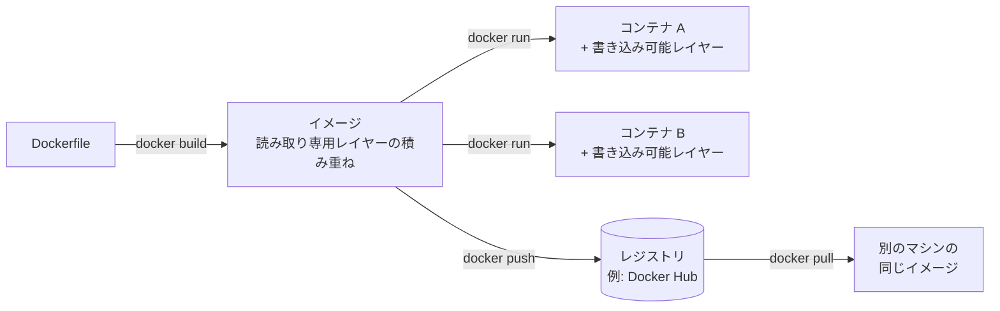

## この記事で分かること

- Docker（コンテナ）が解決する「自分の環境では動くのに」という問題
- コンテナと仮想マシンの違い（カーネルを共有するかどうか）
- イメージとコンテナの関係、レイヤーとコピーオンライトの仕組み
- コンテナの隔離を支える Linux の namespaces と cgroups、標準仕様 OCI
- Dockerfile・ボリューム・Docker Compose の基本と、セキュリティ上の注意点

## 一言で説明すると

Docker は、アプリとその動作に必要なファイル一式を「イメージ」という箱にまとめ、その箱からどのマシンでも同じ状態のアプリを「コンテナ」として起動するためのツールです。コンテナの正体は、OS の機能で周囲から隔離された普通のプロセスです。

## なぜ必要なのか

開発者の PC、CI（自動テスト）のサーバー、本番サーバーでは、言語ランタイムのバージョンやインストールされたライブラリが少しずつ違いがちです。Docker の公式ガイドも、こうした違いの一つひとつが「あるマシンでは動き、別のマシンでは失敗する」原因になると説明しています。いわゆる「自分の環境では動くのに（works on my machine）」問題です。

コンテナは、アプリと動作に必要なものをまとめて包むことで、Docker が動く場所ならどこでも同じように動かせるようにします。「手順書どおりに環境を作る」代わりに「作り終えた環境そのものを配る」という発想です。

## 身近な例え

引っ越しのたびに家具を一から組み立て直すのではなく、家具を配置済みの「ユニットハウス」をトラックで運ぶ様子を想像してください。設計図（Dockerfile）からユニットの型（イメージ）を作っておけば、同じ型から何棟でも同じ部屋（コンテナ）を設置できます。ただし、建物を支える土台（ホストのカーネル）だけは設置先のものを共有します。部屋の中の家具や設備（OS のファイルやライブラリ）はユニットに含めて運びます。

<Callout type="warn" title="例えの限界">
ユニットハウスは一度置いたら中に住み続けられますが、コンテナは削除すると中で書き込んだデータも一緒に消えます（後述のボリュームで対処します）。また、ユニット同士の壁は物理的な壁ほど強固ではありません。コンテナはすべて同じカーネルを共有するため、隔離の強さは仮想マシンより弱いと考えてください。
</Callout>

## 技術的な仕組み

### コンテナと仮想マシンの違い

仮想マシン（VM）は、ハイパーバイザーの上でゲスト OS を丸ごと起動します。Docker の公式ガイドによれば、VM はそれぞれ自分のカーネルを含む完全な OS を起動するのに対し、コンテナはあくまでプロセスであり、同じマシン上のすべてのコンテナがそのマシンのカーネルを共有します。OS の起動が不要なぶん、コンテナはおよそ 1 秒で起動し、1 台のマシンで多数を動かせる一方、ハイパーバイザーによるハードウェア境界がある VM のほうが隔離は強い、とされています。

| 観点 | コンテナ | 仮想マシン |
| --- | --- | --- |
| 中で動くもの | 隔離されたプロセス | ゲスト OS 全体（カーネルを含む） |
| カーネル | ホストのカーネルを共有 | VM ごとに独自のカーネル |
| 隔離の仕組み | OS の機能（namespaces、cgroups など） | ハイパーバイザーによるハードウェア境界 |
| 隔離の強さ | VM より弱い | より強い |
| 起動・集約度 | OS の起動が不要で、およそ 1 秒で起動。1 台で多数を動かせる | OS の起動が必要 |

両者は対立するものではなく、クラウドでは VM の上で多数のコンテナを動かすことがよくあります。macOS や Windows の Docker Desktop も、Linux コンテナを内部で管理している Linux の VM の中で動かしています。

### イメージ、コンテナ、レジストリ

**イメージ**は、コンテナの起動に必要なもの（OS のファイル、ランタイム、依存ライブラリ、コード、実行するコマンド）をまとめたパッケージで、一度ビルドしたら変更されません。中身を変えたいときは新しいイメージをビルドし直します。

**コンテナ**は、イメージから起動された実行中（または停止中）の実体です。同じイメージから何個でもコンテナを起動できます。

**レジストリ**はイメージを保管・配布するサービスで、Docker Hub が既定のレジストリです。レジストリの中にアプリごとの**リポジトリ**があり、リポジトリにはタグ付きのイメージが入ります。`docker image push`（別名 `docker push`）でイメージをレジストリへ送り、`docker pull` で取得します。`docker run` は、手元に無いイメージを自動的に pull します。

### レイヤーとコピーオンライト

イメージは読み取り専用の**レイヤー**を積み重ねたものです。Dockerfile の命令のうち、ファイルシステムを変更するもの（`RUN`、`COPY` など）がそれぞれレイヤーを作り、`CMD` や `LABEL` のようなメタデータだけの命令はレイヤーを作りません。共通のベースイメージを使うイメージ同士はレイヤーを共有できるため、保存やダウンロードは 1 回で済みます。

コンテナを起動すると、イメージのレイヤーはそのまま使われ、その上にコンテナ専用の薄い**書き込み可能レイヤー**が 1 枚追加されます。コンテナが下のレイヤーにあるファイルを書き換えるときは、まずそのファイルを書き込み可能レイヤーにコピーしてから変更します。これを**コピーオンライト**（copy-on-write）と呼びます。イメージ側は一切変更されないので、多くのコンテナが同じイメージを共有しながら、それぞれ別のデータを持てます。

複数の層を 1 つのディレクトリに見せる仕組みを**ユニオンファイルシステム**と呼び、Linux では OverlayFS がその代表です。従来の `overlay2` ストレージドライバでは、イメージのレイヤーが読み取り専用の下層（lowerdir）、コンテナのレイヤーが上層（upperdir）になり、両者を重ねた統合ビュー（merged）がコンテナから見えるファイルシステムになります。ファイルの削除は、下層を消すのではなく上層に「消した」印（ホワイトアウト）を置いて表現します。

なお Docker Engine 29.0 以降の新規インストールでは、containerd image store が既定の保存方式になり、従来のストレージドライバの代わりに「スナップショッター」（既定は overlayfs）が使われます（2026-11-28 時点の公式ドキュメントで確認）。以前のバージョンからアップグレードした環境では、有効化するまで `overlay2` などが使われ続けます。名前は変わっても、読み取り専用の層の上に書き込み層を重ねる考え方は同じです。

### 隔離を支える Linux の機能：namespaces と cgroups

コンテナは特別な仮想ハードウェアではなく、Linux カーネルの機能を組み合わせて作られています。中心となるのが次の 2 つです。

- **namespaces（名前空間）**: プロセスから見えるシステム資源を区切り、「自分専用のもの」に見せる機能です。Linux man-pages 6.19 の namespaces(7) では、PID（プロセス ID）、Network（ネットワーク機器やポート）、Mount（マウントポイント）、UTS（ホスト名）、IPC（System V IPC や POSIX メッセージキューなどのプロセス間通信）、User（ユーザー ID / グループ ID）、Cgroup（cgroup のルートディレクトリの見え方）、Time（boot クロックと monotonic クロック）の 8 種類が挙げられています。例えば PID 名前空間により、コンテナ内からは他のコンテナのプロセスが見えません。
- **cgroups（コントロールグループ）**: プロセスをグループにまとめ、CPU・メモリ・I/O などの使用量を制限・監視する機能です。cgroups(7) によれば、cgroups には v1 と v2 があり、全コントローラーを 1 つの階層で扱う cgroup v2 は Linux 4.5 で正式な機能になりました。カーネルのドキュメントでは、例えばメモリ上限（`memory.max`）に達して解放もできないとき、そのグループ内で OOM killer（メモリ不足時にプロセスを強制終了する仕組み）が働くと説明されています。

Docker のセキュリティ文書は、namespaces がコンテナ同士やホストからの隔離を担い、cgroups は 1 つのコンテナが資源を使い尽くしてシステム全体を止めることを防ぐ、と役割を整理しています。cgroups 自体は、コンテナ同士のアクセスを防ぐ機能ではありません。

### OCI：コンテナの標準仕様

コンテナの形式は Docker 独自のものではなく、標準化されています。2015 年 6 月 22 日、Docker や CoreOS などが Linux Foundation のもとで **OCI**（Open Container Initiative）を立ち上げ、Docker は自社のコンテナ形式とランタイムである runC を寄贈しました。OCI には次の 3 つの仕様があります。

- **Runtime Specification**: コンテナの構成（`config.json`）、実行環境、ライフサイクルを定める
- **Image Specification**: マニフェスト、ファイルシステムのレイヤー（変更差分）、構成情報などからなるイメージ形式を定める
- **Distribution Specification**: イメージを配布する API を定める

この標準があるため、Docker でビルドしたイメージを、OCI に対応した別のツールやランタイムでも扱えます。Docker は「コンテナそのもの」ではなく、コンテナを作って動かすための実装の 1 つです。

## 図解



図は左から右へ進みます。まず Dockerfile を `docker build` してイメージを作ります。イメージは読み取り専用レイヤーの積み重ねです。`docker run` でイメージからコンテナを起動すると、コンテナごとに書き込み可能レイヤーが 1 枚追加されるため、同じイメージから起動したコンテナ A と B は互いのデータに影響しません。イメージを `docker push` でレジストリに送れば、別のマシンでは `docker pull` で同じイメージを取得し、同じ環境のコンテナを起動できます。

## 実務での活用例

### Dockerfile を書く

小さな Python の Web アプリをイメージにする例です。

```dockerfile title="Dockerfile"
# ベースイメージ（Python 3.13 の軽量版）
FROM python:3.13-slim

# 以降の命令の作業ディレクトリ
WORKDIR /app

# 依存関係の一覧だけを先にコピーしてインストールする
COPY requirements.txt .
RUN pip install --no-cache-dir -r requirements.txt

# アプリのソースコードをコピーする
COPY . .

# このコンテナが待ち受けるポートの「説明」（公開はしない）
EXPOSE 8000

# コンテナ起動時に実行する既定のコマンド
CMD ["python", "app.py"]
```

- `FROM` はベースイメージを指定します。Dockerfile は原則 `FROM` から始まります。
- `WORKDIR` は以降の命令の作業ディレクトリで、存在しなければ作られます。
- `COPY` はビルドコンテキスト（ビルド時に渡すディレクトリ）からファイルをコピーします。不要なファイルは `.dockerignore` で除外できます。
- `RUN` はビルド時にコマンドを実行し、その結果を新しいレイヤーにします。
- `EXPOSE` はポートを実際には公開しません。ホストから接続するには `docker run -p 8000:8000` のように指定します。
- `CMD` はコンテナ起動時の既定のコマンドで、ビルド時には何も実行しません。

ビルドキャッシュでは、あるレイヤーが変わると、それより後のレイヤーはすべて作り直しになります。Docker のキャッシュ最適化ガイドも、パッケージ管理用のファイルを先にコピーして依存関係をインストールし、頻繁に変わるソースコードは最後にコピーする順序を勧めています。この例でもソースコードより先に `requirements.txt` だけをコピーしています。ソースだけを変更した場合は、依存関係のインストールまでのレイヤーがキャッシュから再利用されます。

### データを残す：ボリュームとバインドマウント

コンテナ内に書いたデータは、`docker rm` でコンテナを削除すると書き込み可能レイヤーごと消えます。残したいデータはコンテナの外に置きます。

- **ボリューム**: Docker が作成・管理する保存領域で、コンテナのライフサイクルとは独立して存在します。データベースのデータなど「アプリが持つデータ」に向きます。書き込みが多いデータは、コピーオンライトのオーバーヘッドを避けるためにもボリュームが推奨されています。
- **バインドマウント**: ホスト上の任意のディレクトリをコンテナに見せます。開発中にホストで編集したソースコードを、イメージを作り直さずにコンテナへ反映する用途に向きます。既定では書き込み可能なので、必要に応じて読み取り専用（`ro`）にします。

### 開発環境と CI をそろえる

Docker Compose は、複数のコンテナからなるアプリ（例: Web サーバーとデータベース）のサービス・ネットワーク・ボリュームを 1 つの YAML ファイルに定義し、1 つのコマンドでまとめて起動するツールです。この知識ベースの開発環境も Docker Compose で構成されています。開発者全員と CI が同じ Compose ファイルとイメージを使えば、「誰かの PC だけで動く」状態を減らせます。

### セキュリティ上の注意

- **カーネルを共有している**: コンテナの隔離は VM より弱いことを前提に、信頼できないコードの実行には慎重になります。
- **`--privileged` を安易に使わない**: 公式ドキュメントによれば、このフラグはコンテナにすべての Linux capability（root 権限を細かく分けたもの）とすべてのデバイスへのアクセスを与え、ホスト上のプロセスとほぼ同等のアクセスを許します。必要なら `--cap-add` や `--device` で必要な権限だけを足します。
- **Docker デーモンへのアクセスは root 相当**: Docker デーモンは通常 root で動き（Rootless mode を除く）、公式ドキュメントは信頼できるユーザーだけにデーモンを操作させるよう求めています。`docker` グループへの所属も root 相当の権限を与えます。デーモンが既定で待ち受ける UNIX ソケット（`/var/run/docker.sock`）について、OWASP の Docker Security Cheat Sheet は、ソケットへのアクセスを与えることはホストへの無制限の root アクセスを与えるのと同じだとして、コンテナに公開しないよう求めています。ソケットを読み取り専用でマウントしても Docker API が読み取り専用になるわけではない点にも注意が必要です。
- **コンテナ内では root 以外のユーザーで動かす**: Docker のベストプラクティスは、特権が不要なサービスなら Dockerfile の `USER` 命令で root 以外のユーザーに切り替えるよう勧めています。`USER` で指定したユーザーは、以降の `RUN` と、実行時の `CMD` / `ENTRYPOINT` に使われます。

## 関連技術との比較

| 観点 | Docker コンテナ | 仮想マシン | ホストへ直接インストール |
| --- | --- | --- | --- |
| 環境の再現性 | イメージで高い | ディスクイメージで高い | 手順や担当者に左右されやすい |
| OS カーネル | ホストと共有 | VM ごとに独立 | ホストそのもの |
| 隔離 | プロセス単位（OS の機能） | ハードウェア境界 | なし |
| 起動の重さ | 軽い（プロセスの起動） | 重い（OS の起動） | アプリの起動のみ（追加の負荷なし） |
| 別 OS カーネルの実行 | できない（Docker Desktop は内部で Linux VM を使う） | できる | できない |

[仮想記憶](/fundamentals/virtual-memory/)も、プロセスごとに「自分専用のメモリ空間」があるように見せる仕組みです。namespaces が資源の「見え方」を区切り、cgroups が「使える量」を制限するという考え方と合わせて理解すると、OS がプロセスを隔離する方法の全体像がつかみやすくなります。

## よくある誤解

<Misconceptions
  items={[
    { myth: 'コンテナは軽量な仮想マシンである。', fact: 'コンテナはホストのカーネルを共有する隔離されたプロセスで、ゲスト OS は起動しません。そのため軽い反面、隔離の強さは VM より弱くなります。' },
    { myth: 'コンテナの中に保存したデータはずっと残る。', fact: 'コンテナ内の変更は書き込み可能レイヤーに入り、コンテナを削除すると一緒に消えます。残したいデータはボリュームやバインドマウントに置きます。' },
    { myth: 'Docker とコンテナは同じものである。', fact: 'コンテナの形式は OCI で標準化されており、Docker はコンテナを作って動かす実装の 1 つです。OCI 準拠のイメージは他の対応ツールでも扱えます。' },
    { myth: 'Dockerfile に EXPOSE を書けばポートが公開される。', fact: 'EXPOSE は待ち受けるポートを記述するだけです。ホストから接続するには docker run の -p などで公開する必要があります。' },
    { myth: 'Mac や Windows では、Linux コンテナがホスト OS の上で直接動いている。', fact: 'コンテナはカーネルを共有するため、Docker Desktop は内部で Linux の VM を動かし、その中で Linux コンテナを実行しています。' },
  ]}
/>

## まとめ

- Docker は、アプリと実行環境をイメージにまとめ、どこでも同じコンテナとして動かすことで「自分の環境では動く」問題を減らします。
- コンテナはホストのカーネルを共有する隔離されたプロセスで、ゲスト OS を持つ VM より軽い一方、隔離は弱くなります。
- イメージは読み取り専用レイヤーの積み重ねで、コンテナは書き込み可能レイヤーを足し、コピーオンライトで変更を扱います。
- 隔離は Linux の namespaces（見え方を区切る）と cgroups（使用量を制限する）で実現され、形式は OCI で標準化されています。
- データはボリュームで残し、`--privileged` や Docker ソケットのマウントは避けます。

## 理解度チェック

**問1**: 同じイメージからコンテナ A と B を起動し、A の中で `/etc/app.conf`（イメージに含まれるファイル）を書き換えました。B から見た `/etc/app.conf` とイメージはどうなっていますか。

<details>
<summary>答えと解説</summary>

B から見たファイルもイメージも変わりません。A が書き換えたとき、ファイルはまず A の書き込み可能レイヤーにコピーされ、そのコピーが変更されます（コピーオンライト）。イメージのレイヤーは読み取り専用で共有されているだけなので、B は元のファイルを見続けます。

</details>

**問2**: データベースを動かしているコンテナを新しいバージョンのイメージに入れ替えるため、古いコンテナを削除する予定です。データを失わないためには、最初にどうしておくべきですか。

<details>
<summary>答えと解説</summary>

データベースのデータ置き場をボリューム（またはバインドマウント）にしておきます。コンテナの書き込み可能レイヤーにあるデータはコンテナの削除とともに消えますが、ボリュームはコンテナのライフサイクルとは独立して残るため、新しいコンテナに同じボリュームをマウントすればデータを引き継げます。

</details>

**問3**: 「コンテナ内からホストのコンテナを管理したいので、`/var/run/docker.sock` をマウントしよう」という提案があります。何が問題ですか。

<details>
<summary>答えと解説</summary>

Docker デーモンは通常 root 権限で動いており、OWASP の Docker Security Cheat Sheet が指摘するとおり、ソケットへのアクセスはホストへの無制限の root アクセスに相当します。読み取り専用でマウントしても API の操作は防げません。コンテナの隔離を事実上無効にするため、原則として避けます。

</details>
