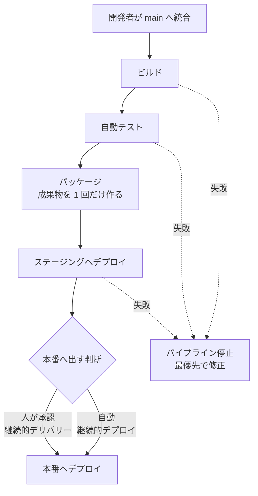

## この記事で分かること

- CI/CD が解決する「統合地獄」と「手作業のリリース」という問題
- 継続的インテグレーション（CI）、継続的デリバリー、継続的デプロイの正確な違い
- パイプラインの段階（ビルド → テスト → パッケージ → デプロイ）と、失敗したら止まる「品質ゲート」
- 「一度だけビルドし、同じ成果物をデプロイする」原則と、環境（ステージング・本番）の役割
- GitHub Actions でのワークフローの書き方、アクションのピン留め、シークレットの扱い

## 一言で説明すると

CI/CD は、コードの変更を小さく頻繁に取り込み、そのたびに機械が自動でビルドとテストを行い、合格したものだけを「いつでも本番に出せる状態」で次の工程へ流す仕組みです。人の手順書に頼っていたリリース作業を、毎回同じように動く自動の流れ（パイプライン）に置き換えます。

## なぜ必要なのか

複数人で開発するとき、各自が自分の担当部分を何週間も別々に作り、最後にまとめて結合すると、互いの変更がぶつかって動かない箇所が大量に見つかります。Martin Fowler は CI の解説記事で、別々に書かれた部品の統合が何か月も続き、いつ終わるか誰にも分からなかった現場を例に挙げ、複数の開発者の作業の統合は「長く予測できない作業」になると述べています。これがいわゆる**統合地獄**です。

リリース作業にも同じ問題があります。担当者が手順書を見ながらビルドし、ファイルをサーバーへコピーし、設定を変える、という手作業は、手順の抜けや環境ごとの差が入り込みやすく、怖いので回数を減らしたくなります。回数が減ると 1 回の変更が大きくなり、さらに失敗しやすくなります。Jez Humble の continuousdelivery.com は、こうした痛みには「痛いことほど頻繁に行い、痛みを前倒しする」という考え方で向き合うよう勧めています。

## 身近な例え

工場の生産ラインを想像してください。部品が届くたびにすぐ組み付け（統合）、各工程の検査台で自動検査を行い、不良が見つかればラインを止めて原因を直します。最後まで検査を通った製品は倉庫に「いつでも出荷できる状態」で並びます。出荷のタイミングを営業が決めるのが**継続的デリバリー**、検査を通ったら自動的にトラックに積んで出荷するのが**継続的デプロイ**です。

<Callout type="warn" title="例えの限界">
工場では同じ製品を何個も作りますが、ソフトウェアのパイプラインを流れるのは毎回「少しずつ違う新しい版」です。また、工場の検査は規格どおりかを確かめますが、自動テストは書かれた項目しか確かめられず、仕様そのものの誤りや想定外の使われ方は見逃します。
</Callout>

## 技術的な仕組み

### 継続的インテグレーション（CI）

Fowler は CI を、チームのメンバーが少なくとも毎日、自分の変更を共有のコードベース（Git などのバージョン管理ツールで管理するメインライン、通常は `main` ブランチ）に統合し、統合のたびにテストを含む自動ビルドで検証する実践と定義しています。同記事が挙げる主な習慣は次のとおりです。

- 少なくとも毎日メインラインへ統合する（長く分岐したブランチを作らない）
- メインラインへの変更ごとに自動でビルドを行う
- ビルドの中で自動テストを実行する（自己テストするビルド）
- ビルドが壊れたら最優先で直す。原因のコミットを取り消す（revert）のが最善のことも多い
- ビルドを速く保つ。XP（エクストリームプログラミング）の「10 分ビルド」という目安は十分現実的だとしています

変更が小さければ、壊れたときに原因を特定しやすくなります。また、毎回のビルドで走る自動テストは、今回の変更で既存の機能が壊れていないかを確かめる**回帰テスト**（リグレッションテスト）として働きます。

Fowler によれば、CI はもともと 1990 年代に Kent Beck が XP（エクストリームプログラミング）の実践の 1 つとして考案したものです。同記事は、テストは XP の中心的な実践で、テスト駆動開発（TDD）の形で行われることが多いとも述べています。XP には CI のほか、ペアプログラミング（2 人が 1 台の端末で一緒にコードを書く）などの実践もあります。

<Callout type="tip" title="覚え方">
「小さく頻繁に統合する → 1 回の差分が小さい → 壊れたら疑う範囲が狭い → すぐ直せる」という因果の鎖で覚えます。統合を何週間も貯めるとこの鎖が逆向きに働き、統合地獄になります。試験では、平成27年度 春期 応用情報技術者試験 午前 問50 で XP のプラクティスとして「単体テストを終えたプログラムは，すぐに結合して，結合テストを行う」が問われています。
</Callout>

### 継続的デリバリーと継続的デプロイ

「CD」には 2 つの意味があり、区別が重要です。

- **継続的デリバリー（Continuous Delivery）**: ソフトウェアを、いつでも本番にリリースできる状態に保つ実践です。Fowler は、ビジネス側の担当者が求めれば、その時点の開発版をすぐに本番へデプロイできる状態だと説明しています。頻繁にデプロイ「できる」が、しないことも選べる点が特徴で、多くの場合それはビジネス側がゆっくりしたリリースのペースを好むためだとしています。
- **継続的デプロイ（Continuous Deployment）**: パイプラインの自動テストをすべて通過した変更を、人の判断を挟まず**自動的に本番へ**リリースする実践です。Fowler は、継続的デプロイを行うには継続的デリバリーができていなければならない、としています。

つまり両者の違いは「本番に出す最後の一歩が自動か、人の判断か」です。IPA の応用情報技術者試験シラバス Ver.7.2 でも、DevOps の用語例に「継続的インテグレーション（CI）」「継続的デリバリー（CD）」「継続的デプロイ」が別々に並んでいます。

<Callout type="tip" title="覚え方">
3 つは「前のものができていることが前提」の積み重ねです。CI（毎回自動で検証）ができて初めて継続的デリバリー（いつでも出せる）が成り立ち、継続的デリバリーができて初めて継続的デプロイ（出す判断も自動）が成り立ちます。デリバリーとデプロイの違いは、本番へ出す**最後の一歩を押すのが人か機械か**の 1 点だけ、と覚えると混同しません。
</Callout>

### パイプラインと品質ゲート

変更をコミットから本番まで運ぶ自動の流れを**デプロイメントパイプライン**と呼びます。continuousdelivery.com の Patterns ページでは、最初の**コミットステージ**でデプロイ可能なパッケージを作り、単体テストや静的解析（コードを実行せずに調べる検査）を数分で行い、合格した変更だけが後続の自動テストへ進み、さらにステージングや本番などへ必要に応じてデプロイできる、という構成が説明されています。

各段階は**品質ゲート**（関所）として働きます。どこかで失敗すれば、それより先には進みません。同ページは、コミットステージが失敗したらすぐに直し、壊れた状態のまま新しい作業を積み増さないよう求めています。

次の図は、ここまでの内容と、この後の 2 つの節（成果物、環境）で説明する内容を 1 本の流れにまとめたものです。



図は上から下へ進みます。開発者が main に変更を統合するとビルドが始まり、自動テストに合格すると成果物が 1 回だけ作られます。その同じ成果物をステージングにデプロイして確認し、最後に本番へ出します。この最後の分岐で人が承認するのが継続的デリバリー、自動で進むのが継続的デプロイです（前の節の違いそのものです）。点線は、ビルド・テスト・ステージングのどこかで失敗すると以降の段階に進まず、パイプラインが止まることを表しています（ここまでのビルドとテストの部分が CI に当たります）。

<Callout type="tip" title="覚え方">
図の点線がすべて「停止」に集まっている点が品質ゲートの本質です。ビルド・テスト・ステージングの各段階は**関所**で、通れなければ先へは進めません。速く安い検査（ビルド、単体テスト）を手前に、時間のかかる検査（本番に近い環境での確認）を奥に置くので、コミットステージで見つかる誤りは数分で分かります。「失敗したら止めて直す、壊れたまま積み増さない」までをセットで覚えます。
</Callout>

### 成果物と「一度だけビルドする」原則

ビルドの結果できる配布物（実行ファイル、ZIP、コンテナイメージなど）を**成果物（アーティファクト）**と呼びます。Patterns ページは、パッケージは一度だけビルドし、パイプラインでテストしたものと**同じ成果物**をデプロイするよう勧めています。環境ごとにビルドし直すと、テストしたものと本番に出したものが厳密には別物になり、デプロイ失敗の原因がパッケージングにある可能性を排除できなくなるためです。

### 環境：ステージングと本番

**本番環境**は実際の利用者が使う環境、**ステージング環境**は本番にできるだけ近づけた最終確認用の環境です。GitHub Actions には「environments」という機能があり、production や staging といったデプロイ先ごとに、承認を必須にしたり、デプロイできるブランチを制限したりできます（2026-11-28 時点の GitHub Docs で確認）。継続的デリバリーの「人の判断」はこの承認として実装できます。上の図の「本番へ出す判断」の分岐で、人が承認する側に当たります。

## 実務での活用例

### GitHub Actions の最小ワークフロー

GitHub Actions では、リポジトリの `.github/workflows/` に YAML（インデントで階層を表す設定ファイルの書式）のファイルを置いてワークフローを定義します。次は Node.js のプロジェクトを想定した、テストして成果物を作り、main への push のときだけデプロイする例です（アクションの SHA とバージョンは 2026-11-28 時点で本サイトのリポジトリが使っているもの。`deploy.sh` と `DEPLOY_TOKEN` は説明用の架空の名前です）。

```yaml title=".github/workflows/ci.yml"
name: CI

on:
  push:
    branches: [main]
  pull_request:

# GITHUB_TOKEN（実行ごとに GitHub が自動で発行するトークン）の権限は最小限（読み取りのみ）にする
permissions:
  contents: read

jobs:
  build-and-test:
    runs-on: ubuntu-24.04
    steps:
      # アクションはタグではなくコミット SHA で固定し、版はコメントで残す
      - uses: actions/checkout@3d3c42e5aac5ba805825da76410c181273ba90b1 # v7.0.1
        with:
          persist-credentials: false
      - uses: actions/setup-node@949feb2413d6458794dcd2491c4babbbce0c15c1 # v7.1.0
        with:
          node-version-file: .node-version
      - run: npm ci
      - run: npm test
      - run: npm run build
      # テストに合格したビルド結果を成果物として保存する
      - uses: actions/upload-artifact@cf430e030ddbb5b0abf93d22962f4752f3646cd9 # v7.0.2
        with:
          name: app
          path: dist/

  deploy:
    needs: build-and-test # 上のジョブが成功したときだけ動く
    if: github.event_name == 'push' && github.ref == 'refs/heads/main'
    runs-on: ubuntu-24.04
    environment: production # 承認などの保護ルールをかけられる
    steps:
      # deploy.sh を使うためにリポジトリを取得する（ビルドはしない）
      - uses: actions/checkout@3d3c42e5aac5ba805825da76410c181273ba90b1 # v7.0.1
        with:
          persist-credentials: false
      # 作り直さず、テスト済みの成果物をそのまま使う
      - uses: actions/download-artifact@9000827ccba6bdab643e8b6fd33ac0654aef8333 # v8.0.2
        with:
          name: app
          path: dist/
      - run: bash deploy.sh dist/
        env:
          DEPLOY_TOKEN: ${{ secrets.DEPLOY_TOKEN }}
```

GitHub Docs のワークフロー構文によれば、`on` は起動するイベント、`jobs` の各ジョブは既定では並列に動き、`needs` で順序を付けられます。`needs` で指定したジョブが失敗またはスキップされると、依存するジョブもスキップされます。ステップが失敗するとそのジョブは失敗するので、テストが落ちればデプロイには進みません。これが品質ゲートの実装です。

### アクションをコミット SHA で固定する理由

`uses: actions/checkout@v7` のようにタグで指定すると、そのタグが後から別のコミットを指すように動かされる可能性があります。GitHub Docs の Secure use reference は、タグはリポジトリへのアクセス権を得た攻撃者によって移動・削除され得ると注意し、アクションを**フルレングスのコミット SHA**（40 桁のハッシュ）に固定することで、バックドアが仕込まれるリスクを軽減できると説明しています。SHA が本家のリポジトリのもので、フォークのものではないことも確認します。上の例のように版をコメントで残すと更新を管理しやすくなります。

### シークレットの扱い

API トークンやパスワードはワークフローファイルに直接書かず、リポジトリや environment の**シークレット**に登録して `${{ secrets.名前 }}` で参照します。GitHub Docs が挙げる主な注意点は次のとおりです。

- 値は `env` や `with` で渡し、コマンドライン引数で渡すのは避ける（`ps` コマンドで他のユーザーから見えたり、OS のセキュリティ監査イベントに記録されたりするおそれがある）
- ログ上の自動マスクは保証されない。JSON などの構造化データを 1 つのシークレットにまとめず、シークレットから加工した値（Base64 化したものなど）もシークレットとして登録する
- 誤ってログに出てしまったら、ログを削除し、シークレットを作り直す（ローテーション）
- フォークされたリポジトリからのプルリクエストで（`pull_request` イベントにより）起動したワークフローには、`GITHUB_TOKEN` 以外のシークレットは渡されない

### このサイトのパイプライン

この知識ベース自体も CI/CD で公開されています（2026-11-28 時点の構成）。プルリクエストと main への push のたびに CI のワークフローが動き、記事の検証・ビルド・ブラウザでの表示テストなどをまとめて実行します。並行して、[Docker](/cloud/docker/) のイメージをビルドし、コンテナを起動して応答を確かめる検査も行います。main への push で検証に合格した場合だけ、その実行で作ったサイトのファイル一式を成果物として保存します。

公開用のワークフローは、CI の完了をきっかけに起動し、CI が成功していた場合に限って動きます。そこでは**サイトを作り直さず**、CI が検証した成果物をダウンロードし、必要なファイルがそろっているかを確認してから GitHub Pages へデプロイします。「一度だけビルドし、検証したものと同じ成果物を出す」原則をそのまま形にした構成で、アクションはすべてコミット SHA で固定しています。CI が成功すれば人の承認なしで本番（公開サイト）へ出るので、継続的デプロイに当たります。公開を行うかどうかはリポジトリの変数で有効・無効を切り替えられるようにしてあり、2026-11-28 時点では有効です。

### DevOps との関係

**DevOps** は、開発チームと運用チームが連携して、迅速かつ柔軟にソフトウェアを届けるための文化と実践の総称です。IPA のシラバス Ver.7.2 では、DevOps の用語例として CALMS（文化・自動化・リーン・測定・共有）、SRE、CI、CD、継続的デプロイ、Four Keys（デプロイの頻度、変更のリードタイム、変更障害率、平均修復時間）などが挙げられています。CI/CD は、DevOps の「自動化」を支える中心的な実践の 1 つと位置付けられます。

## 関連技術との比較

| 観点 | 継続的インテグレーション | 継続的デリバリー | 継続的デプロイ |
| --- | --- | --- | --- |
| 目的 | 統合の問題を早く見つける | いつでもリリースできる状態を保つ | 合格した変更を即座に利用者へ届ける |
| 自動化の範囲 | 統合後のビルドとテスト | ビルド・テストに加え、どの版でもどの環境へもボタン 1 つでデプロイできる（本番デプロイの実行も自動） | 継続的デリバリーと同じ範囲に加え、本番へ出す判断も自動 |
| 本番へ出す判断 | 対象外 | 人（ビジネス側が実行するかどうかを決める） | 自動（パイプラインの自動テストに合格したら出す） |
| 前提 | 頻繁な統合と自動テスト | CI | 継続的デリバリー |

## よくある誤解

<Misconceptions
  items={[
    { myth: 'CI とは Jenkins や GitHub Actions のようなツールのことである。', fact: 'CI は「頻繁にメインラインへ統合し、毎回自動で検証する」という実践です。Fowler は、長期間のフィーチャーブランチ（機能ごとに main から分けた作業用ブランチ）上で CI サーバーを動かしているだけでは CI ではなく、ツールと実践を混同すべきではないと述べています。' },
    { myth: 'CD は常に「自動で本番にデプロイすること」を意味する。', fact: 'CD には継続的デリバリーと継続的デプロイの 2 つがあります。継続的デリバリーは「いつでも出せる状態」を保つことで、本番に出すかどうかは人が判断できます。自動で本番まで出すのは継続的デプロイです。' },
    { myth: 'CI が緑（成功）ならバグはない。', fact: 'テストはバグがないことを証明できません。Fowler も、CI はバグを無くすのではなく、見つけて取り除くのを劇的に容易にするものだと説明しています。CI が保証するのは「用意したテストに合格した」ことだけです。' },
    { myth: 'シークレットはログに出ても自動で隠されるので安全である。', fact: 'GitHub Docs は自動マスクが保証されないとしています。加工した値は隠されないこともあるため、ログに出さない書き方をし、漏れたらローテーションします。' },
  ]}
/>

## まとめ

- CI/CD は、統合地獄と手作業リリースの問題を、小さく頻繁な統合と自動化で解決します。
- CI は頻繁な統合と毎回の自動検証、継続的デリバリーは「いつでも出せる状態」、継続的デプロイは「合格したら自動で本番へ」です。
- パイプラインの各段階は品質ゲートで、失敗すれば先へ進まず、最優先で直します。成果物は一度だけ作り、同じものを各環境へデプロイします。
- GitHub Actions ではアクションをコミット SHA で固定し、権限を最小にし、シークレットはログに出さないよう扱います。

## 理解度チェック

**問1**: あるチームは、自動テストに合格した版をステージングまで自動で反映し、本番へは毎週金曜にプロダクトオーナーが承認ボタンを押してデプロイしています。これは継続的デリバリーと継続的デプロイのどちらに近いですか。

<details>
<summary>答えと解説</summary>

継続的デリバリーです。いつでも本番に出せる状態は保たれていますが、本番へ出す最後の判断を人（ビジネス側）が行っています。合格した変更が承認なしで自動的に本番へ出るなら継続的デプロイです。

</details>

**問2**: 「テストはステージング用にビルドした成果物で行い、本番には本番用の設定で改めてビルドした成果物をデプロイする」という運用の問題点は何ですか。

<details>
<summary>答えと解説</summary>

本番に出したものは、テストしたものとは別のビルド結果になります。ビルド時の依存関係の取得やビルド手順の違いで中身が変わり得るため、テスト結果が本番の成果物を保証しません。成果物は一度だけビルドし、その同じ成果物を各環境へデプロイします（環境ごとの違いは、一般にデプロイ時の設定として与えます）。

</details>

## 過去問題

現時点で関連する過去問は 7 問です。CI/CD そのものを問う問題に加え、CI を支える実践（XP、テスト駆動開発、回帰テスト、バージョン管理）を問う問題を選んでいます。

<PastExam source="令和7年度 春期 応用情報技術者試験 午前 問48">
XP（Extreme Programming）のプラクティスの一つであるものはどれか。

- ア　構造化プログラミング
- イ　コンポーネント指向プログラミング
- ウ　ビジュアルプログラミング
- エ　ペアプログラミング

<PastExamAnswer answer="エ">
XP（エクストリームプログラミング）は、短い周期で開発とテストを繰り返すアジャイル開発の手法で、2 人が 1 台の端末で一緒にコードを書くペアプログラミングを実践の 1 つに含みます。ほかの選択肢はプログラムの書き方（パラダイム）や開発の進め方の分類で、XP 固有の実践ではありません。「継続的インテグレーション（CI）」の節で触れた「10 分ビルド」も XP の用語で、CI は XP と深く結び付いた実践です。
</PastExamAnswer>
</PastExam>

<PastExam source="令和4年度 秋期 応用情報技術者試験 午前 問49">
エクストリームプログラミング（XP：Extreme Programming）における“テスト駆動開発”の特徴はどれか。

- ア　最初のテストで，なるべく多くのバグを摘出する。
- イ　テストケースの改善を繰り返す。
- ウ　テストでのカバレージを高めることを目的とする。
- エ　プログラムを書く前にテストコードを記述する。

<PastExamAnswer answer="エ">
テスト駆動開発は、先にテストコードを書き、そのテストに合格する最小限のプログラムを書く、という順序で進める方法です。こうして書きためたテストは、CI の節で説明した「自己テストするビルド」でそのまま自動実行され、変更のたびに回帰テストとして働きます。カバレージ（網羅率）の向上やバグの大量摘出は結果として得られることはあっても、手法の特徴そのものではありません。
</PastExamAnswer>
</PastExam>

<PastExam source="令和3年度 秋期 応用情報技術者試験 午前 問18">
分散開発環境において，各開発者のローカル環境に全履歴を含んだ中央リポジトリの完全な複製をもつことによって，中央リポジトリにアクセスできないときでも履歴の調査や変更の記録を可能にする，バージョン管理ツールはどれか。

- ア　Apache Subversion
- イ　CVS
- ウ　Git
- エ　RCS

<PastExamAnswer answer="ウ">
各開発者が全履歴を含むリポジトリの複製を持つのは、分散型のバージョン管理ツールである Git の特徴です。Subversion と CVS は中央のサーバーに履歴を置く集中型で、RCS はファイル単位で版を管理する古いツールです。CI は、各自の変更を共有のコードベース（メインライン、通常は `main` ブランチ）へ頻繁に統合する実践なので、こうしたバージョン管理ツールが前提になります。本記事の GitHub Actions の例も、Git のリポジトリへの push やプルリクエストをきっかけに動きます。
</PastExamAnswer>
</PastExam>

<PastExam source="平成30年度 秋期 応用情報技術者試験 午前 問50">
アジャイル開発で“イテレーション”を行う目的のうち，適切なものはどれか。

- ア　ソフトウェアに存在する顧客の要求との不一致を短いサイクルで解消したり，要求の変化に柔軟に対応したりする。
- イ　タスクの実施状況を可視化して，いつでも確認できるようにする。
- ウ　ペアプログラミングのドライバとナビゲータを固定化させない。
- エ　毎日決めた時刻にチームメンバが集まって開発の状況を共有し，問題が拡大したり，状況が悪化したりするのを避ける。

<PastExamAnswer answer="ア">
イテレーションは、計画・開発・テストを短い期間で区切って繰り返す単位です。動くソフトウェアを短い周期で顧客に見せることで、要求とのずれを早く見つけ、変化にも合わせられます。イはタスクボードなどの可視化、ウはペアの役割交代、エは毎日の短いミーティングの説明です。「なぜ必要なのか」の節の「痛いことほど頻繁に行い、痛みを前倒しする」と同じく、小さく頻繁に回して問題を早く見つける考え方で、CI/CD はこの短い周期を技術面で支えます。
</PastExamAnswer>
</PastExam>

<PastExam source="平成29年度 秋期 応用情報技術者試験 午前 問48">
アジャイル開発のプラクティスのうち，回帰テストを行うことを前提とするものはどれか。

- ア　日次ミーティング
- イ　ふりかえり
- ウ　ペアプログラミング
- エ　リファクタリング

<PastExamAnswer answer="エ">
リファクタリングは、外から見た振る舞いを変えずにプログラムの内部構造を改善することです。「振る舞いが変わっていない」ことを確かめるには、変更の前後で同じテストを実行して結果が変わらないことを確認する回帰テストが欠かせません。CI の節で説明したように、毎回のビルドで自動テストを走らせておけば、この回帰テストが変更のたびに自動で行われます。日次ミーティングとふりかえりは進め方の実践、ペアプログラミングはコードの書き方の実践で、回帰テストを前提とはしません。
</PastExamAnswer>
</PastExam>

<PastExam source="平成27年度 春期 応用情報技術者試験 午前 問50">
エクストリームプログラミング（XP）のプラクティスとして，適切なものはどれか。

- ア　1週間の労働時間は，チームで相談して自由に決める。
- イ　ソースコードの再利用は，作成者だけが行う。
- ウ　単体テストを終えたプログラムは，すぐに結合して，結合テストを行う。
- エ　プログラミングは1人で行う。

<PastExamAnswer answer="ウ">
単体テストを終えたプログラムをため込まず、すぐに結合してテストするのは、継続的インテグレーション（CI）そのものです。CI の節の「少なくとも毎日メインラインへ統合する」「自己テストするビルド」に当たります。ほかの選択肢は XP の考え方と合いません。XP は無理のない一定の労働時間を保つことを重んじ、労働時間を自由に決めることとは異なります。また、XP はコードをチームで共有することや、ペアプログラミングで 2 人で書くことを重んじるので、イとエも当てはまりません。
</PastExamAnswer>
</PastExam>

<PastExam source="平成26年度 秋期 応用情報技術者試験 午前 問48">
回帰テスト（リグレッションテスト）の説明として，適切なものはどれか。

- ア　新規に作成したプログラムの各モジュールの誤りを検出するためのテストである。
- イ　プログラムを修正したことによって，想定外の影響が出ていないかどうかを確認するためのテストである。
- ウ　ホワイトボックステストに限定して，単体モジュールの誤りを検出するためのテストである。
- エ　毎回，テストケースとテストデータを，作り直して行うテストである。

<PastExamAnswer answer="イ">
回帰テストは、修正や機能追加によって、それまで正しく動いていた部分が壊れていないかを確かめるテストです。同じテストを繰り返し実行するものなので、毎回作り直すエは誤りで、むしろ自動化に向いています。CI はこの回帰テストを変更のたびに自動で実行し、壊れた変更を統合の直後に見つける仕組みと言えます（「継続的インテグレーション（CI）」の節）。
</PastExamAnswer>
</PastExam>
