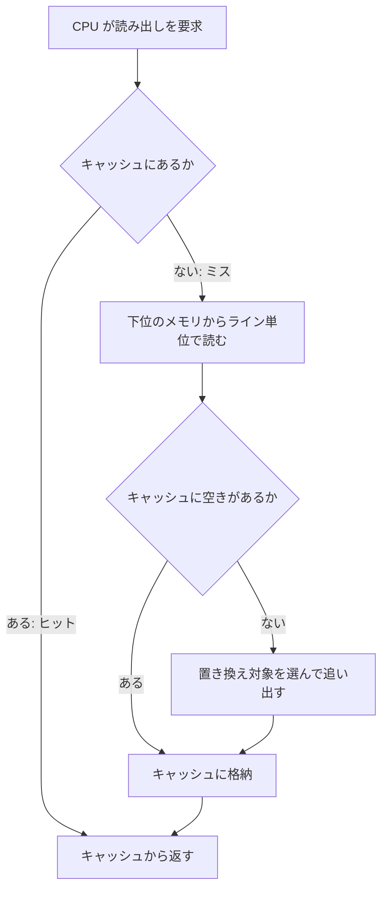

## この記事で分かること

- キャッシュメモリが必要になる理由（CPU とメインメモリの速度差）
- キャッシュが効く根拠である「時間的局所性」と「空間的局所性」
- ヒット率から実効アクセス時間を求める方法と、2 種類の計算モデルの違い
- キャッシュライン、配置方式、書き込み方式、置き換え方式の基本
- L1 / L2 / L3 の多段キャッシュと、Web のキャッシュとの共通点・相違点

## 一言で説明すると

キャッシュメモリは、CPU が最近使ったデータとその周辺を、CPU のすぐ近くにある小さくて速いメモリに写しておき、次に必要になったときにメインメモリまで取りに行かずに済ませる仕組みです。

## なぜ必要なのか

[CPU の仕組み](/fundamentals/cpu/)で見たように、CPU は命令やデータをメモリから読み出しながら処理を進めます。ところが、CPU の処理速度に比べてメインメモリ（DRAM）はかなり遅く、データが届くまでの間、CPU は多くの場合その先の処理を待たされます。

ワシントン大学の 2024 年の講義資料では、アクセス時間の目安として L1 キャッシュが約 1ns（ns はナノ秒、10 億分の 1 秒）、DRAM が約 100ns と示されています。2009 年の Jeff Dean の講演資料でも、L1 キャッシュ参照が 0.5ns、メインメモリ参照が 100ns とされています。製品や世代で値は変わりますが、**キャッシュとメインメモリの間にはおよそ 2 桁の差がある**と捉えておくとよいでしょう。

それなら全部を速いメモリで作ればよいと思うかもしれません。しかし[メモリとストレージ](/fundamentals/memory-and-storage/)で説明したとおり、キャッシュに使われる SRAM は 1 ビットあたりの回路が大きく、DRAM ほど集積できません。速いメモリは小さく高価で、大きいメモリは遅く安価です。そこで「よく使うものだけを小さく速いメモリに置く」という階層構造が生まれました。

## 身近な例え

書類仕事をしている人を想像してください。必要な書類はすべて倉庫の棚（メインメモリ）にありますが、毎回倉庫まで歩くと時間がかかります。そこで、よく使う書類のコピーを手元の机（キャッシュ）に置いておきます。机の上にあれば数秒で手に取れ（ヒット）、なければ倉庫まで取りに行き、ついでにそのコピーを机に置きます（ミス）。机は狭いので、しばらく使っていない書類は片付けて場所を空けます（置き換え）。

<Callout type="warn" title="例えの限界">
人間は「この書類は明日も使う」と考えて机に残す物を選べますが、CPU キャッシュでは何を置き、何を追い出すかをハードウェアが決まった規則で自動的に判断します。プリフェッチ命令のような例外はありますが、通常のプログラムでは「この値をキャッシュに置け」と指示することを意識しません。また、机に置くのは書類 1 枚ではなく、周辺の書類をまとめた「束」（後述するキャッシュライン）です。
</Callout>

## 技術的な仕組み

### キャッシュが効く理由：局所性

小さなキャッシュが役に立つのは、プログラムのメモリアクセスに偏りがあるからです。この偏りを**局所性**と呼び、2 種類あります。

- **時間的局所性**: 一度アクセスしたデータは、近いうちに再びアクセスされやすい。
- **空間的局所性**: あるアドレスにアクセスすると、その近くのアドレスも続けてアクセスされやすい。

配列の合計を求める短いコードで確かめてみます。

```ts title="sum.ts"
// 連続したメモリ領域に並ぶ数値の合計を求める
export function sum(values: Int32Array): number {
  let total = 0;
  for (let i = 0; i < values.length; i++) {
    total += values[i]; // values[0], values[1], ... と隣を順に読む（空間的局所性）
  }
  return total;
}
```

ループ本体の命令は、繰り返しのたびに同じアドレスから何度も読み出されます。これが時間的局所性です（`total` や `i` も毎回使われますが、こうした変数は CPU 内部のレジスタに置かれることも多く、その場合はキャッシュを経由しません）。一方、`values[i]` は隣り合う要素を順番に読むため、空間的局所性が働きます。キャッシュはミスしたときに周辺のデータもまとめて読み込むので、最初の 1 要素でミスしても、続く要素はヒットしやすくなります。

### ヒットとミス

CPU が欲しいデータがキャッシュにあることを**ヒット**、ないことを**ミス**と呼びます。アクセス全体のうちヒットした割合が**ヒット率**、ミスした割合が**ミス率**（1 − ヒット率）です。ミスしたときに下位のメモリから読み込むために余分にかかる時間を**ミスペナルティ**と呼びます。

### 読み出しの流れ（図解）



図は読み出し時の流れで、ここではキャッシュが 1 段だけの場合を想定しています（多段の場合は後述します）。CPU はまずキャッシュを調べ、あればそのまま値を受け取ります（ヒット）。なければ下位のメモリ（1 段ならメインメモリ、多段なら L2 などの次の段）から、目的のデータを含むひとまとまり（キャッシュライン）を読み込みます（ミス）。キャッシュに（正確には対応するセット内に）空きがなければ、置き換え方式に従って既存のラインを 1 つ追い出してから格納し、CPU に値を返します。ミスの経路のほうが手順が多く、遅い下位のメモリへのアクセスを含むため時間がかかります。

## 実効アクセス時間

### IPA 方式の式

キャッシュがあるときの平均的なアクセス時間を**実効アクセス時間**と呼びます。応用情報技術者試験のシラバスでも、ヒット率、ミス率、実効アクセス時間、ミスペナルティが学習項目に挙げられています。ここでは、ヒット率を $h$、キャッシュのアクセス時間を $T_c$、主記憶のアクセス時間を $T_m$ として、次の式で考えます。

$$
T_{\text{eff}} = h \times T_c + (1 - h) \times T_m
$$

「ヒットしたときは $T_c$、ミスしたときは $T_m$ かかる」と考え、それぞれを起こる割合で重み付けした平均です。ミスのときに $T_c$ を足していないのは、キャッシュを調べるのと並行して主記憶へのアクセスも始める、とみなしたモデルだと考えると理解しやすいでしょう。応用情報技術者試験でも同型の問題が出題されており（令和6年度春期 午前 問10）、問題文に式そのものは示されていませんが、この式で計算すると解答例と一致します。この記事では、この式を便宜上「IPA 方式」と呼びます（公式の名称ではありません）。

### 計算例

ここでは独自の数値で計算してみます。キャッシュのアクセス時間 $T_c = 2\,\text{ns}$、主記憶のアクセス時間 $T_m = 80\,\text{ns}$、ヒット率 $h = 0.95$ とします。

$$
T_{\text{eff}} = 0.95 \times 2 + 0.05 \times 80 = 1.9 + 4.0 = 5.9\,\text{ns}
$$

ヒット率だけを変えると、結果は次のようになります。

| ヒット率 $h$ | 計算 | 実効アクセス時間 |
| --- | --- | --- |
| 0.90 | $0.90 \times 2 + 0.10 \times 80$ | 9.8ns |
| 0.95 | $0.95 \times 2 + 0.05 \times 80$ | 5.9ns |
| 0.99 | $0.99 \times 2 + 0.01 \times 80$ | 2.78ns |

ヒット率が 0.90 から 0.99 へ上がっただけで、実効アクセス時間は 3 分の 1 以下になります。主記憶がキャッシュより 40 倍遅いため、わずかなミスの割合が平均を大きく左右するのです。

下のシミュレーターで、ヒット率を変えたときの実効アクセス時間の変化を確かめられます。

<EffectiveAccessTimeSimulator defaultHitRate={0.95} defaultCacheNs={2} defaultMemoryNs={80} />

ヒット率を上げると、実効アクセス時間はヒット率 1 ポイントごとに一定の量（$(T_m - T_c) \div 100$）ずつ小さくなり、キャッシュのアクセス時間 $T_c$ に近づきます。式 $T_{\text{eff}} = T_m - h \times (T_m - T_c)$ はヒット率 $h$ の 1 次式なので、シミュレーターの棒（メモリだけの場合を全体としたときの割合）もヒット率 1 ポイントごとに一定の長さずつ短くなります。なお、シミュレーターは実効アクセス時間を小数第 1 位まで表示するため、上の表の 2.78ns は 2.8ns と表示されます。

一方、「メモリだけの場合より約何倍速いか」の表示は、ヒット率が 1 に近づくほど急に大きくなります。初期値（$T_c = 2$、$T_m = 80$）では、ヒット率 90% で約 8.2 倍、95% で約 13.6 倍、99% で約 28.8 倍です。速度向上の倍率は実効アクセス時間の逆数に比例するため、残りのミスが減るほど伸び方が大きくなるのです。ヒット率をどれだけ上げても $T_c$ より速くはならないこと、主記憶が遅いほどヒット率の影響が大きくなることも確認してみてください。シミュレーターの下部には、次に説明するミスペナルティ方式で計算した値も参考として表示されます。

### もう 1 つのモデル：ミスペナルティ方式

コンピュータアーキテクチャの教科書や大学の講義では、次の**平均メモリアクセス時間**（AMAT: Average Memory Access Time）の式もよく使われます。

$$
\text{AMAT} = \text{ヒット時間} + \text{ミス率} \times \text{ミスペナルティ}
$$

こちらは「どのアクセスもまずキャッシュを調べる時間（ヒット時間）がかかり、ミスしたときだけ追加でミスペナルティがかかる」と考えます。ミスペナルティを $T_m$ とみなすと $T_c + (1 - h) \times T_m$ となり、先ほどの計算例では $2 + 0.05 \times 80 = 6.0\,\text{ns}$ です。

2 つの式の違いは、**ミスしたときにキャッシュを調べた時間も加えるかどうか**です。IPA 方式はミス時に $T_m$ だけを数え、AMAT 方式はミス時に $T_c + T_m$ を数えます。差は $(1 - h) \times T_c$ で、上の例では 0.1ns です。どちらが正しいというより前提が違うので、試験や資料では問題文の定義に従ってください。実際のミスペナルティは書き戻しの有無などによって一定ではなく、どちらの式も平均を見積もるための簡略化したモデルです。

## キャッシュの構成

### キャッシュラインとアドレスの分割

キャッシュはデータを 1 バイトずつではなく、**ブロック**（**キャッシュライン**）と呼ばれる連続した領域の単位で管理します。大きさは 8〜128 バイト程度で、空間的局所性を活かすためにまとめて読み込みます。

キャッシュは、CPU が指定したアドレスを 3 つの部分に分けて扱います。

- **オフセット**（ブロック内アドレス）: ライン内の何バイト目か
- **インデックス**: キャッシュ内のどの位置を見るか。この位置を**セット**（ラインを置ける場所のまとまり）と呼びます
- **タグ**: そこに入っているラインが本当に目的のアドレスのものかを確かめる目印

例えば 32 ビットのアドレスで、ラインが 64 バイト、セット数が 64 のキャッシュなら、オフセットは $\log_2 64 = 6$ ビット、インデックスも 6 ビット、残り $32 - 6 - 6 = 20$ ビットがタグになります（数値は説明用の例です）。

### 配置方式

あるラインをキャッシュのどこに置けるかには 3 つの方式があります。

| 方式 | 置ける場所 | 長所 | 短所 |
| --- | --- | --- | --- |
| ダイレクトマップ（ダイレクト方式） | インデックスで決まる 1 か所だけ | 回路が単純で速い | 同じ場所を取り合うアドレスが交互に使われるとミスが続く |
| セットアソシアティブ（セットアソシエイティブ方式） | インデックスで決まるセット内の複数か所（2 ウェイ、4 ウェイなど。ウェイはセット内でラインを置ける場所の数） | 取り合いによるミスを減らせる | セット内のタグを並行して比較する回路が必要 |
| フルアソシアティブ（フルアソシエイティブ方式） | どこにでも置ける | 取り合いによるミスが起きにくい | すべてのタグと比較するため回路が大きく、大容量には向きにくい |

セットアソシアティブは両極端の中間です。天野英晴氏の講義資料では、容量が小さいキャッシュの場合、2 ウェイのセットアソシアティブは容量 2 倍のダイレクトマップと同程度のヒット率になるという目安が示されています。

### 書き込み方式

CPU がデータを書き換えたとき、メインメモリへの反映方法には 2 種類あります。

- **ライトスルー**: キャッシュと同時にメインメモリにも書き込みます。メインメモリが常に最新で単純ですが、書き込みのたびに遅いメモリへのアクセスが発生します。書き込みを一時的にためるライトバッファを備えれば、性能低下は小さく抑えられます。
- **ライトバック**: まずキャッシュだけを書き換え、そのラインに「書き換え済み（ダーティ）」の印を付けます。ラインが追い出されるときに初めてメインメモリへ書き戻します。メモリへの書き込み回数を減らせる一方、追い出し時に書き戻しが必要なぶん、ミスペナルティが大きくなる場合があります。

### 置き換え方式

キャッシュが満杯のときにどのラインを追い出すかの規則が置き換え方式です。代表的なのは、最も長く使われていないものを追い出す **LRU**（Least Recently Used）です。時間的局所性の考え方に沿っていますが、ウェイ数が増えると使用順を正確に記録する回路が複雑になるため、実際のハードウェアでは近似的に実現する**擬似 LRU** がよく使われます。

## 多段キャッシュと実製品の例

現在の CPU はキャッシュを 1 段ではなく、L1、L2、L3 のように多段に重ねています。CPU に近い L1 は小さく最速で、L2、L3 と下るほど大きく遅くなります。L1 でミスしたら L2 を、L2 でもミスしたら L3 を調べ、最後にメインメモリへ向かいます。

天野氏の講義資料ではやや古い目安として、L1 が 64KB 程度で 1〜2 クロック、L2 が 256KB 程度で 3〜10 クロック、L3 が 2〜4MB で 10〜20 クロック、主記憶が 50〜100 クロックとされています。容量や速度は製品ごとに大きく異なるため、桁の感覚として捉えてください。

実製品の例として、Intel Core Ultra 9 プロセッサー 285K（2024 年第 4 四半期発売、24 コア）の製品仕様ページ（2026-11-28 確認）では、「Total L2 Cache」が 40MB、「Intel Smart Cache」が 36MB と記載されています。「Total L2 Cache」は名前のとおり全コア分の総量で、Smart Cache の 36MB もプロセッサー全体としての値です。**いずれも 1 コアあたりの容量ではありません**。なお同ページに L1 キャッシュの容量は記載されていません。

## 実務での活用例

キャッシュはハードウェアが自動で管理しますが、プログラムのメモリアクセスの仕方によってヒット率は変わります。

- **データを順番に読む**: 配列のように連続した領域を先頭から順に処理すると、空間的局所性が働いてヒットしやすくなります。2 次元配列では、メモリ上の並び順と同じ向きにループを回すのが基本です。
- **作業データを小さく保つ**: 繰り返し使うデータがキャッシュに収まる大きさなら、時間的局所性が活きます。大きなデータを小さな塊に分けて処理する工夫は、この考え方に基づいています。
- **性能を数値で見積もる**: ヒット率が少し変わるだけで平均アクセス時間が大きく変わることは、前の計算例で見たとおりです。性能を調べるときは、処理の量だけでなくメモリへのアクセスパターンにも目を向けると原因を見つけやすくなります。

## 関連技術との比較

「キャッシュ」という言葉は CPU に限らず、ディスクキャッシュや Web のキャッシュなど、遅いものの前に速い置き場を置く仕組み全般に広がりました。MDN の解説では、HTTP キャッシュにはブラウザ内の private キャッシュと、プロキシや CDN などの shared キャッシュがあり、`Cache-Control` の `max-age` などで「どのくらいの間そのまま使ってよいか（鮮度）」を決めると説明されています（仕様は RFC 9111）。

| 観点 | CPU キャッシュ | Web（HTTP）キャッシュ |
| --- | --- | --- |
| 目的 | メインメモリの遅さを隠す | ネットワーク越しの取得を減らす |
| 置き場所 | CPU チップ内の SRAM | ブラウザ、プロキシ、CDN など |
| 1 回の取得にかかる時間の目安 | ナノ秒程度 | ネットワーク越しの通信を含むため、CPU キャッシュよりはるかに長い |
| 保存期間 | 追い出されるまで（ハードウェアの置き換え方式で決まる） | 鮮度の期限は `max-age` などの設定次第 |
| 何を置くかの判断 | ハードウェアが自動で行う | サーバーが返すヘッダーや設定で制御する |
| 古いデータの扱い | 通常のプログラムは、古い値を意識せずに読み書きできるよう作られている | 鮮度の期限内なら、元データが変わっていても古い内容が返ることがある |

発想は同じでも、一貫性の扱いと時間のスケールがまったく違います。Web のキャッシュでは「古い内容を一定時間使ってよい」と設定で割り切るのに対し、CPU キャッシュは、通常のプログラムがキャッシュの存在や古い値を意識せずに済むように作られています。

## よくある誤解

<Misconceptions
  items={[
    { myth: '実効アクセス時間の式は 1 つだけで、どの資料でも同じ答えになる。', fact: 'ミス時にキャッシュのアクセス時間を加えるかどうかで 2 つのモデルがあり、答えがわずかに変わります。令和6年度春期 午前 問10 では、この記事で「IPA 方式」と呼んでいる h×Tc+(1−h)×Tm の形で計算すると解答例と一致します（「IPA 方式」は公式の名称ではありません）。問題文の前提に従ってください。' },
    { myth: 'キャッシュは大きければ大きいほど速い。', fact: '容量を増やすとアクセス時間（ヒット時間）やコストも増えます。そのため小さく速い L1 から大きく遅い L3 まで、段ごとに役割を分けています。' },
    { myth: '製品仕様の「L2 40MB」は 1 コアあたりの容量である。', fact: 'Intel の製品ページの「Total L2 Cache」は全コア分の総量で、Smart Cache の値もプロセッサー全体としての値です。いずれも 1 コアあたりの容量ではないので、区別して読む必要があります。' },
    { myth: 'キャッシュはハードウェアの話なので、プログラムの書き方とは関係ない。', fact: '管理は自動でも、アクセスの順序や作業データの大きさによってヒット率は変わります。連続したデータを順に読むコードはキャッシュを活かしやすくなります。' },
    { myth: 'CPU キャッシュと Web のキャッシュは同じ仕組みである。', fact: '速い置き場に写しを置く発想は同じですが、CPU キャッシュはナノ秒単位でハードウェアが管理し、通常のプログラムは古い値を意識せずに済むように作られています。Web のキャッシュは鮮度の期限内なら古い内容を返すことを許容します。' },
  ]}
/>

## まとめ

- キャッシュメモリは、CPU とメインメモリのおよそ 2 桁の速度差を埋めるための小さく速いメモリです。
- 時間的局所性と空間的局所性があるため、小さなキャッシュでも高いヒット率が得られます。
- 実効アクセス時間には、この記事で IPA 方式と呼んでいる式 $hT_c + (1-h)T_m$ と AMAT 方式があり、ミス時に $T_c$ を数えるかどうかが違います。
- キャッシュはライン単位で管理され、配置方式・書き込み方式・置き換え方式の組み合わせで設計されます。
- 多段キャッシュで速度と容量を両立させており、発想は Web のキャッシュと共通でも一貫性と時間スケールは大きく異なります。

## 理解度チェック

**問1**: キャッシュのアクセス時間が 4ns、主記憶のアクセス時間が 50ns、ヒット率が 0.92 のとき、この記事でいう IPA 方式の実効アクセス時間は何 ns ですか。

<details>
<summary>答えと解説</summary>

$0.92 \times 4 + 0.08 \times 50 = 3.68 + 4.0 = 7.68\,\text{ns}$ です。なお AMAT 方式（ミスペナルティを 50ns とみなす）で計算すると $4 + 0.08 \times 50 = 8.0\,\text{ns}$ になり、差は $(1 - 0.92) \times 4 = 0.32\,\text{ns}$ です。

</details>

**問2**: 同じ 2 次元配列の全要素を合計する 2 つのコードがあり、一方はメモリ上の並び順に沿って、もう一方は並び順を飛び飛びにまたいで読みます。キャッシュの観点で有利なのはどちらで、それはどの局所性によるものですか。

<details>
<summary>答えと解説</summary>

並び順に沿って読むほうが有利です。キャッシュはミス時にライン単位で周辺のデータもまとめて読み込むため、隣のアドレスを続けて読むと同じラインの中でヒットが続きます。これは空間的局所性によるものです。飛び飛びに読むと、ラインの一部しか使わないうちに別のラインが必要になり、ミスが増えやすくなります。

</details>
