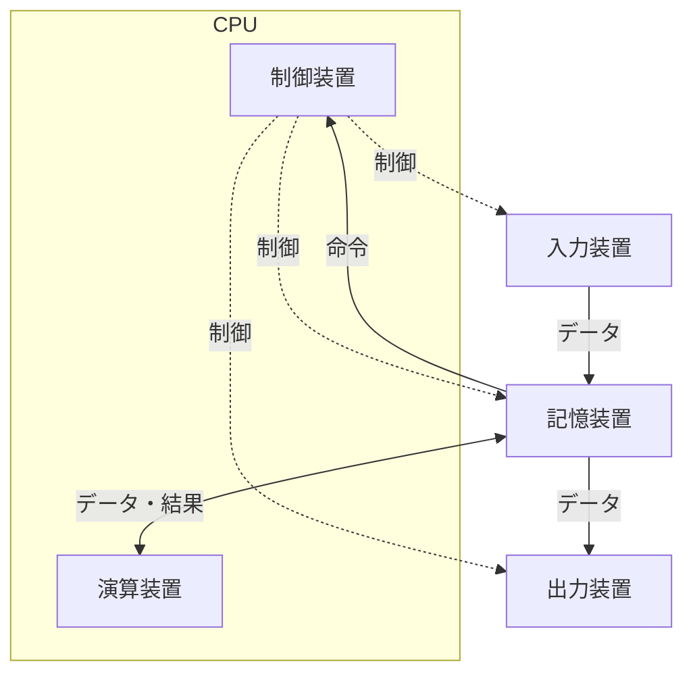
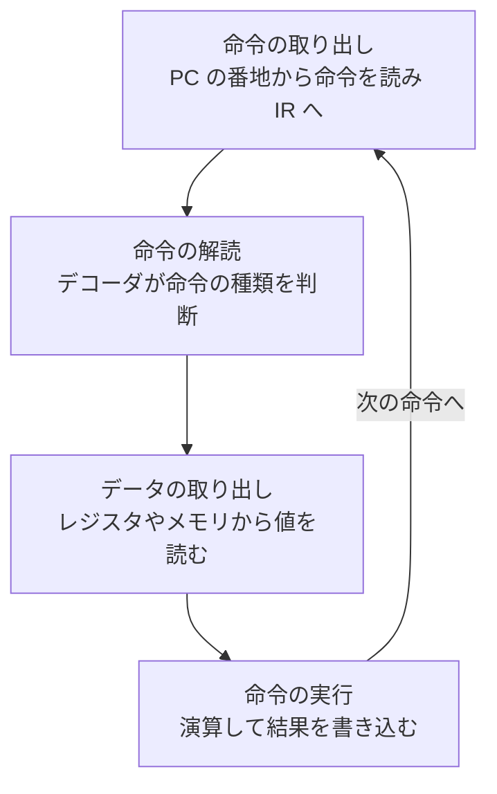

## この記事で分かること

- CPU がコンピュータの中で何を担当しているのか
- 制御装置・演算装置・レジスタがそれぞれ何をしているのか
- 命令が「取り出し → 解読 → データの取り出し → 実行」の順に処理される流れ
- クロック周波数・CPI・コア数が性能にどう関わり、なぜどれか 1 つだけでは速さが決まらないのか
- パイプラインとマルチコアで速くなる理由と、その限界

## 一言で説明すると

CPU は、メモリに置かれた命令を 1 つずつ読み、その指示どおりに計算やデータの移動を行う装置です。プログラムが動くとは、CPU がこの「読む → 実行する」を非常に速く繰り返している状態のことです。

## なぜ必要なのか

コンピュータには、キーボードなどの入力装置、データを覚えておく記憶装置、画面などの出力装置があります。しかし、それらだけでは「何を、どの順番で、どう計算するか」を決めて実行する役がいません。その役を担うのが CPU です。

同じ CPU でも、読み込ませる命令（プログラム）を変えれば、表計算にもゲームにも Web サーバーにもなります。処理の手順を部品の配線ではなく命令の並びとして与えられることが、汎用のコンピュータが成り立つ前提になっています。命令をデータと同じように記憶装置に置き、CPU がそれを読み出して実行するこの考え方は、一般に **プログラム内蔵方式** と呼ばれます。

## 身近な例え

CPU は「レシピどおりに作業する料理人」に例えられます。

- **レシピ** はプログラム（命令の並び）です。
- **料理人** が CPU です。レシピを 1 行読み、意味を理解し、材料を手元に取り、切る・混ぜる・焼くといった作業をします。
- **今どの行を読んでいるかを示すしおり** が、後で説明するプログラムカウンタです。
- **調理台** はレジスタ（CPU 内部のごく小さな作業場所）、**冷蔵庫や食品庫** はメモリに当たります。調理台は狭いけれどすぐ手が届き、冷蔵庫は広いけれど取りに行くのに時間がかかります。

<Callout type="warn" title="例えの限界">
料理人はレシピの意図をくみ取って手順を補ったり、味見して調整したりできますが、CPU は命令の意味を「理解」しません。決められた形式の単純な命令を、書かれたとおりに実行するだけです。また、1 つの命令でできることは「足し算を 1 回する」「メモリから値を 1 つ読む」程度と、レシピの 1 行よりずっと細かい単位です。
</Callout>

## 技術的な仕組み

### コンピュータの 5 大装置と CPU の位置

コンピュータは、**演算装置・制御装置・記憶装置・入力装置・出力装置** の 5 つの装置で構成されると整理されます。このうち、演算装置と制御装置をまとめたものが CPU（プロセッサ）です。

- **制御装置**: 命令を読み取って解読し、ほかの装置に「次はこれをせよ」と指示を出します。
- **演算装置（ALU: Arithmetic Logic Unit、算術論理演算装置）**: 足し算・引き算などの算術演算や、比較・論理演算を実際に行います。加算器などの回路で構成されます。
- **記憶装置**: 命令とデータを保持します。主記憶（メモリ）については[メモリとストレージ](/fundamentals/memory-and-storage/)で詳しく扱います。

### レジスタ: CPU の中の作業場所

レジスタは CPU 内部にある、ごく少量で非常に高速な記憶場所です。役割ごとに名前が付いています（略称は応用情報技術者試験のシラバスの表記に合わせています）。

| レジスタ | 略称 | 役割 |
| --- | --- | --- |
| プログラムカウンタ | PC | 次に実行する命令が置かれているメモリ上の番地（アドレス）を保持する |
| 命令レジスタ | IR | メモリから取り出した、いま実行しようとしている命令を保持する |
| 汎用レジスタ | GR | 計算に使う値や途中結果を一時的に保持する |
| メモリアドレスレジスタ | MAR | メモリを読み書きするときの番地を保持する |

制御装置の中にある **デコーダ（解読器）** が、IR に入った命令を解読し、どの回路をどう動かすかを決めます。

### 命令サイクル: 命令が実行されるまで

CPU は、1 つの命令を次の手順で処理します。この手順を命令サイクル（命令実行手順）と呼びます。

1. **命令の取り出し（フェッチ）**: PC が指す番地から命令を読み出して IR に入れ、PC を次の命令の番地に進めます。
2. **命令の解読（デコード）**: デコーダが IR の命令を解読し、何をする命令か（加算か、読み込みか、分岐か）と、どのデータを使うかを判断します。
3. **データの取り出し（オペランドフェッチ）**: 命令が使うデータ（オペランド）を、レジスタやメモリから取り出します。メモリ上のデータを使う場合、命令に書かれた情報から実際の番地（**実効アドレス**）を求めます。この計算方法をアドレス修飾と呼びます。
4. **命令の実行**: 演算装置で計算するなどして、命令を実行し、結果をレジスタやメモリに書き込みます。

これが終わると 1. に戻り、PC が指す次の命令を取り出します。分岐命令は PC の値を書き換えることで、次に実行する命令の場所を変えます。if 文やループは、この仕組みで実現されています。

### 機械語と ISA・マイクロアーキテクチャ

CPU が直接実行できるのは、0 と 1 の並びで表された **機械語** の命令だけです。C や Java などで書いたプログラムも、機械語に変換されて実行されるか、機械語で書かれたインタプリタや仮想マシンを通じて実行されます。

どんな命令があり、どんなレジスタやデータ型を使え、メモリにどうアクセスし、割り込みや例外をどう扱うか、といった「ソフトウェアから見た CPU の約束事」を **命令セットアーキテクチャ（ISA）** と呼びます。ISA はハードウェアとソフトウェアの間のインタフェースです。代表例に Arm や x86（Intel 64 / IA-32）があり、Intel 64 / IA-32 アーキテクチャの仕様は Intel の『Software Developer's Manual』（SDM）にまとめられています。

一方、その ISA を実際の回路としてどう作るか（パイプラインの段数、キャッシュの構成など）を **マイクロアーキテクチャ** と呼びます。キャッシュは、メモリの内容の一部を CPU の近くに写しておく小さく速い記憶装置です（詳しくは[キャッシュメモリ](/fundamentals/cache-memory/)で扱います）。同じ ISA に従っていれば、マイクロアーキテクチャが違う CPU でも同じ機械語のプログラム（バイナリ）が動きます。新しい世代の CPU で古いソフトウェアがそのまま動くのは、このためです。

命令セットの設計方針には、命令を単純なものに絞る **RISC** と、多機能な命令を持つ **CISC** という分類もあります。典型的には、RISC は命令の長さを揃え（固定長）、CISC は命令の長さがまちまち（可変長）とされます。ただし例外もあり、例えば RISC 系の ISA である RISC-V には、16 ビットの短い命令を 32 ビットの命令と混在させられる圧縮命令の拡張（C 拡張）があります。RISC でも固定長とは限らないため、この分類はあくまで傾向と考えるのが安全です。

### クロック周波数と CPI

CPU の内部回路は、**クロック** と呼ばれる一定間隔の信号に合わせて動作します。1 秒間のクロック数が **クロック周波数**、1 クロックの長さが **サイクルタイム** です。例えば 1 GHz（1 秒に 10 億回）なら、サイクルタイムは 1 ナノ秒です。

ただし、1 つの命令が 1 クロックで終わるとは限りません。命令の種類によって必要なクロック数は異なります。そこで、1 命令あたりに平均で何クロックかかるかを **CPI**（Cycles Per Instruction）で表します。

プログラムの処理時間（CPU 時間）は、次の 3 つで決まります。

- 実行する **命令の数**（プログラムや ISA、コンパイラで変わる）
- 1 命令あたりの **クロック数（CPI）**（マイクロアーキテクチャやメモリ待ちで変わる）
- 1 クロックの **長さ**（サイクルタイム。クロック周波数の逆数）

式で書くと、命令数を $IC$、サイクルタイムを $T_c$、クロック周波数を $f$ として次のとおりです。

$$
T = IC \times CPI \times T_c = \frac{IC \times CPI}{f}
$$

例えば、20 億（$2 \times 10^9$）命令を実行するプログラムを考えます。CPU A はクロック周波数 3 GHz で CPI が 1.5、CPU B は 4 GHz で CPI が 2.5 だとすると、次のようになります。

- CPU A: $T = \dfrac{2 \times 10^9 \times 1.5}{3 \times 10^9} = 1.0$ 秒
- CPU B: $T = \dfrac{2 \times 10^9 \times 2.5}{4 \times 10^9} = 1.25$ 秒

周波数は B の方が高いのに、CPI が大きいため A より遅くなります。クロック周波数は式の 1 要素にすぎず、周波数が高くても CPI が大きかったり、同じ処理に必要な命令数が多かったりすれば、処理時間は短くなりません。

さらに、周波数と CPI は互いに独立ではないと考えられます。メモリからデータが届くまでの待ち時間（秒）が CPU のクロックを上げても変わらないとすると、周波数を上げるほどその待ちに費やすクロック数が増え、メモリ待ちの多いプログラムでは CPI が悪化すると考えられます（上の CPU 時間の式から導ける推論です）。

1 秒間に何百万命令を実行できるかを表す指標 **MIPS**（Million Instructions Per Second）は、$\text{MIPS} = \dfrac{f}{CPI \times 10^6}$ で求められます。上の CPU A なら $3 \times 10^9 \div (1.5 \times 10^6) = 2000$ MIPS です。なお、この指標の MIPS は、同じ綴りの ISA の名前（MIPS アーキテクチャ）とは別物です。

### パイプライン: 命令を流れ作業にする

命令サイクルの各段階は、CPU 内の別々の回路が担当します。そこで、1 つの命令が終わるのを待たずに、前の命令が「解読」に進んだら次の命令の「取り出し」を始める、という流れ作業にできます。これを **パイプライン** と呼びます。

パイプラインは、1 つの命令を処理する時間（レイテンシ）を短くする技術ではありません。単位時間あたりに完了する命令の数（スループット）を増やす技術です。段数は設計によって異なります。

パイプラインがうまく流れない状態を **ハザード** と呼び、ハザードによって命令の実行が止められることを **ストール** と呼びます。ハザードには主に 3 種類あります。

- **構造ハザード**: 複数の段階が同じ回路（例えばメモリへの接続）を同時に使おうとして衝突する。
- **データハザード**: 命令どうしが同じデータを使うために、順番が崩れると正しい結果にならない。代表的なのは RAW（Read After Write）ハザードで、ある命令が直前の命令の計算結果を使おうとしたとき、その結果がまだ書き込まれていない状態です。フォワーディング（結果を後続命令へ直接渡す工夫）などで待ちを減らす設計もあります。
- **制御ハザード**: 分岐命令の結果が決まるまで、次にどの命令を取り出せばよいか分からない。

### マルチコア: CPU の中に処理役を複数置く

**コア** は、命令を読んで実行する一式の処理装置です。1 つの CPU（パッケージ）に複数のコアを載せたものが **マルチコア** プロセッサで、複数の処理を同時に進められます。最近は、高性能なコアと省電力なコアを組み合わせる構成もあります。Arm の big.LITTLE は、省電力の LITTLE コアと高性能の big コアを組み合わせる代表的な方式です。Arm は DynamIQ という、種類の異なるコアを 1 つのクラスタにまとめる構成も示しています。

しかし、コアを 2 倍にしても処理が 2 倍速くなるとは限りません。プログラムには、どうしても順番に実行しなければならない部分があり、その部分はコアを増やしても速くなりません。この「並列化できない部分の割合が、全体の速度向上の上限を決める」という関係を **アムダールの法則** と呼びます。処理全体のうち並列化できる部分の割合を $p$、コア数を $n$ とすると、速度向上率 $S$ は次の式で表されます。

$$
S = \frac{1}{(1 - p) + \dfrac{p}{n}}
$$

例えば、処理の 90%（$p = 0.9$）が並列化でき、8 コアで実行する場合は次のとおりです。

$$
S = \frac{1}{0.1 + \dfrac{0.9}{8}} = \frac{1}{0.2125} \approx 4.7
$$

コアを 8 倍にしても、速度は約 4.7 倍にとどまります。コアをいくら増やしても $\dfrac{p}{n}$ が 0 に近づくだけなので、上限は $\dfrac{1}{0.1} = 10$ 倍です。なお、この式は並列化できる部分がコア数に比例して理想的に速くなることを前提にしています。一般には、コア同士の連携や、メモリなど共有する資源の取り合いによって、実際の速度向上がこの値より小さくなることもあります。

## 図解

### 5 大装置と CPU

実線の矢印は命令やデータの流れ、点線の矢印は制御装置が出す指示を表します。CPU（枠内）は制御装置と演算装置からなります。図では見やすさのため、制御装置から演算装置への指示の矢印は省略しています。制御装置は記憶装置から命令を読み出し（「命令」の矢印）、それを解読してすべての装置に指示を出します。入力されたデータはいったん記憶装置に置かれ、演算装置で処理されて記憶装置に戻り、出力装置へ送られます。

### 命令サイクル

上から順に、取り出し → 解読 → データの取り出し → 実行 と進み、実行が終わると最初の取り出しに戻ります。パイプラインのない単純な CPU では、この輪を 1 周するごとに命令が 1 つ処理されます。

### パイプラインの流れ

次の表は、取り出し（F）・解読（D）・実行（E）・書き込み（W）の 4 段に分けたパイプラインの例です。横軸がクロック、縦軸が命令です。段の分け方は前述の命令サイクルと異なり、データの取り出しは解読（D）に含め、結果の書き込みを独立した段（W）にしています。段の分け方は設計によって異なり、これはその一例です。

| 命令 | 1 | 2 | 3 | 4 | 5 | 6 | 7 |
| --- | --- | --- | --- | --- | --- | --- | --- |
| 命令1 | F | D | E | W | | | |
| 命令2 | | F | D | E | W | | |
| 命令3 | | | F | D | E | W | |
| 命令4 | | | | F | D | E | W |

どの命令も完了までに 4 クロックかかる点は変わりません。しかし各段が別々の命令を同時に処理しているため、クロック 4 以降は理想的には毎クロック 1 命令ずつ完了します。もし命令2 が命令1 の結果を必要とするなら（データハザード）、命令2 は結果が揃うまで待たされ、表に空きが生じます。

## 実務での活用例

### CPU の仕様表を読む

PC やサーバーの CPU を選ぶときは、仕様表のクロック周波数だけでなく、コア数・コアの種類・キャッシュ容量などを合わせて見ます。例えば Intel Core Ultra 9 285K（2024 年第 4 四半期発売）の製品仕様ページ（2026-11-28 確認）には、高性能コア 8 個と高効率コア 16 個の計 24 コア、Intel Smart Cache 36 MB、L2 キャッシュ合計 40 MB などが記載されています。種類の違うコアが混在する CPU では、「24 コア」がすべて同じ性能のコアではない点に注意が必要です。キャッシュについては[キャッシュメモリ](/fundamentals/cache-memory/)で扱います。

### ビルドサーバーとシングルスレッド処理

大規模なソフトウェアのビルドでは、多数のソースファイルをそれぞれ独立にコンパイルできることが多く、こうした処理はコア数が多いほど同時に進められます。一方で、リンクのように並列化に限りがある工程や、依存関係のために前の工程の完了を待つ必要がある工程は、コアを増やしても短くなりにくくなります。アムダールの法則のとおり、こうした部分がビルド全体の時間の下限を決めます。

逆に、1 つのスレッド（プログラムの中で順番に実行される処理の流れ）で順番に計算するスクリプトや古いアプリケーションでは、コア数を増やしても効果はほとんどなく、1 コアあたりの処理性能（クロック周波数や CPI の小ささ）が効きます。性能に不満があるときは、まず「処理が複数コアを使えているか」を OS のタスクマネージャーやモニタリングツールで確認すると、どちらを強化すべきか判断しやすくなります。

## 性能を決める要素の比較

CPU の性能を決める主な要素を比べます。

| 観点 | クロック周波数 | CPI | 命令数 | コア数 |
| --- | --- | --- | --- | --- |
| 意味 | 1 秒あたりのクロック数 | 1 命令あたりの平均クロック数 | プログラムの実行に必要な命令の総数 | 同時に命令を実行できる処理装置の数 |
| 性能が良い方向 | 高いほど 1 クロックが短い | 小さいほど良い | 少ないほど良い | 並列化できる処理なら多いほど良い |
| 主に左右するもの | 半導体プロセス、回路やマイクロアーキテクチャの設計（パイプラインの段数など） | マイクロアーキテクチャ（パイプラインなど）、メモリ待ち | ISA、コンパイラ、アルゴリズム | CPU の製品構成 |
| 限界・注意点 | ほかの要素が悪ければ速くならない。上げるとメモリ待ちのクロック数が増え、CPI が悪化すると考えられる（CPU 時間の式からの推論） | 命令の種類やハザードで変動する | 命令を減らしても CPI が増えることがある | 並列化できない部分は速くならない |

## よくある誤解

<Misconceptions
  items={[
    {
      myth: 'クロック周波数が高い CPU ほど、常に速い。',
      fact: '処理時間は命令数・CPI・クロック周波数の組み合わせで決まります。周波数が低くても、1 命令に必要なクロック数が少ない CPU の方が速いことがあります。',
    },
    {
      myth: 'コア数を 2 倍にすれば、処理時間は半分になる。',
      fact: '並列化できない部分はコア数を増やしても速くなりません（アムダールの法則）。一般には、コア同士の連携や共有資源の取り合いによるロスが生じることもあります。',
    },
    {
      myth: 'パイプラインを使うと、1 つの命令が速く終わる。',
      fact: 'パイプラインが改善するのは単位時間あたりに完了する命令の数（スループット）です。1 つの命令にかかる時間（レイテンシ）は短くなりません。',
    },
    {
      myth: '同じ Arm（または x86）の CPU なら中身の設計も同じである。',
      fact: 'Arm や x86 は ISA（命令の約束事）の名前です。同じ ISA でも、回路の実装であるマイクロアーキテクチャは製品ごとに異なり、性能も変わります。',
    },
  ]}
/>

## まとめ

- CPU は制御装置と演算装置からなり、メモリから命令を読んで実行することを繰り返します。
- 命令は「取り出し → 解読 → データの取り出し → 実行」の順に処理され、PC・IR・汎用レジスタがそれを支えます。
- ISA はソフトウェアから見た約束事、マイクロアーキテクチャはその実装です。
- 性能はクロック周波数だけでなく、CPI と命令数でも決まります。
- パイプラインはスループットを、マルチコアは並列性を高めますが、ハザードや並列化できない部分が限界になります。

## 理解度チェック

問1: 命令の取り出しの段階で、どのレジスタの値を使って、取り出した命令をどのレジスタに入れますか。

プログラムカウンタ（PC）が指す番地から命令を読み出し、命令レジスタ（IR）に入れます。その後、PC は次の命令の番地に進みます。

問2: CPU A はクロック周波数が CPU B より高いのに、あるプログラムでは B の方が速く終わりました。考えられる理由を 2 つ挙げてください。

例えば、A の方が 1 命令あたりの平均クロック数（CPI）が大きい、あるいは A ではそのプログラムに必要な命令数が多い（ISA やコンパイラの違い）ことが考えられます。メモリ待ちが多くて A の CPI が悪化している場合もあります。

問3: 処理時間のうち 4 割が順番にしか実行できない処理です。コアをどれだけ増やしても、処理時間が元の何割より短くならないでしょうか。

順番にしか実行できない 4 割はコアを増やしても短くならないため、残り 6 割が限りなく短くなったとしても、処理時間は元の 4 割より短くなりません。これがアムダールの法則の考え方です。

