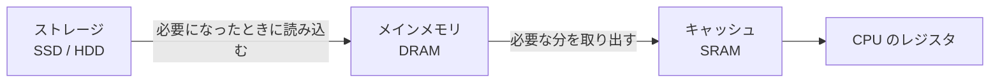

## この記事で分かること

- メモリ（主記憶）とストレージの役割の違い
- 揮発性・不揮発性の意味と、RAM / ROM の関係
- DRAM と SRAM の仕組みの違いと、それぞれが使われる場所
- メインメモリを速くするメモリインタリーブの考え方
- フラッシュメモリ、SSD、HDD の基本的な仕組みと速さの違い、HDD の平均アクセス時間の求め方
- 記憶階層の考え方と、KB と KiB のような容量の単位の違い

## 一言で説明すると

**メモリは CPU が今まさに使っているデータを置く「速いが小さく、電源を切ると消える」場所、ストレージはデータを長く保存しておく「遅いが大きく、電源を切っても消えない」場所**です。

## なぜ必要なのか

[CPUの仕組み](/fundamentals/cpu/)で見たように、CPU は命令とデータを次々に読み出して処理します。理想は「とても速く、とても大きく、とても安く、電源を切っても消えない」記憶装置が 1 種類あることですが、現実にはそのような部品はありません。速い記憶素子ほど 1 ビットあたりの値段が高く、大容量にしにくいからです。

そこでコンピュータは、性質の違う記憶装置を組み合わせます。CPU のすぐそばには速いが小さいメモリを置き、大量のデータは安くて大きいストレージに保存しておき、必要な分だけメモリに読み込んで使います。応用情報技術者試験のシラバスでも、揮発性・不揮発性、速度・容量・コストの関係、記憶階層がメモリ分野の基本項目として挙げられています。

## 身近な例え

メモリは**作業机**、ストレージは**本棚や倉庫**にたとえられます。

- 作業机（メモリ）: 手を伸ばせばすぐ資料に届きますが、広さに限りがあります。机の上の資料は、作業が終わると片付けられます（電源を切ると消える）。
- 本棚・倉庫（ストレージ）: たくさんの資料をしまっておけますが、取りに行くのに時間がかかります。しまった資料は残り続けます（電源を切っても消えない）。

作業するときは、倉庫から必要な資料だけを机に持ってきて広げます。机が狭すぎると、資料を何度も倉庫と行き来させることになり、作業が遅くなります。これは後で説明する「メモリ不足でアプリが遅くなる」現象とよく似ています。

<Callout type="warn" title="例えの限界">
実際の速さの差は「机と倉庫」の感覚よりずっと大きく、後で見るように HDD はメインメモリより 5 桁ほど遅いこともあります。また、机の上の資料は停電しても残りますが、メインメモリの内容は電源が切れると本当に消えてしまいます。さらに、CPU とメインメモリの間にもキャッシュという中間層があり、実際は「机と倉庫」の 2 段構成ではありません。
</Callout>

## 技術的な仕組み

### 揮発性と不揮発性

- **揮発性**: 電源を切ると内容が消える性質です。
- **不揮発性**: 電源を切っても内容が残る性質です。

メインメモリやキャッシュに使われる RAM（DRAM・SRAM）は揮発性、ストレージに使われるフラッシュメモリや HDD は不揮発性です。

### RAM と ROM

- **RAM（Random Access Memory）**: 読み書きが自由にできるメモリです。名前の「ランダムアクセス」は、記憶場所を指定すればどの場所にも直接読み書きできることを表しています。一般的に RAM と呼ばれて広く使われている DRAM・SRAM は揮発性で、メインメモリやキャッシュに使われます（FeRAM のように不揮発性の RAM もありますが、この記事では扱いません）。
- **ROM（Read Only Memory）**: 名前は「読み出し専用」ですが、現在では ROM は不揮発性メモリの意味で使われることが多くなっています。

注意したいのは、**ROM の仲間にも書き換えられるものがある**点です。電気的に書き換えられる EEPROM や、そこから発展したフラッシュメモリは、不揮発性でありながら書き換えができます。「ROM＝絶対に書き換えられない」と覚えると誤解につながります。

### DRAM と SRAM

RAM には大きく 2 種類あります。

- **DRAM（Dynamic RAM）**: 小さなコンデンサ（電気をためる部品）に電荷をためるかどうかで 0 と 1 を表します。電荷は時間とともに漏れて減るため、定期的に読み出して書き直す**リフレッシュ**が必要です。1 ビットを記憶する回路が小さく済むため、同じ大きさのチップにより多くのビットを詰め込め、容量あたりのコストを抑えられます。そのため**メインメモリ**に使われます。
- **SRAM（Static RAM）**: ラッチ（フリップフロップ）と呼ばれる、2 つの安定状態を保ち続ける回路で 1 ビットを記憶します。電源が入っている限り値を保持するのでリフレッシュが不要です。また、回路も高速に動作します。一方で DRAM ほど多くのビットを詰め込めず、容量あたりのコストが高くなります。そのため CPU 内の**キャッシュメモリ**に使われます。

集積度（同じチップに入る容量）は、DRAM が SRAM の数倍（講義資料ではおよそ 4 倍）です。キャッシュの詳しい仕組みは[キャッシュメモリ](/fundamentals/cache-memory/)で扱います。

<Callout type="tip" title="覚え方">
名前の **Dynamic（動的）** と **Static（静的）** から考えます。DRAM はコンデンサの電荷が時間とともに漏れて「放っておくと変わってしまう」ので、リフレッシュが必要です。SRAM はラッチが値を「保ち続ける」ので不要です。そこから先は因果の鎖でつながります。

- DRAM：1 ビットの回路が小さい → 集積度が高い → ビット単価が安い → 大容量が必要なメインメモリ
- SRAM：回路が大きいが高速 → ビット単価が高い → 小容量でよいキャッシュ

試験では「コンデンサ・リフレッシュ・安い・メインメモリ」なら DRAM、「フリップフロップ・リフレッシュ不要・高速・キャッシュ」なら SRAM と、記述の組み合わせで見分ける問題がよく出ます。
</Callout>

### メモリのデータ転送速度

メモリの速さを「1 秒間に何バイト運べるか」（データ転送速度）で表す場合は、1 回に運べるバイト数を、1 回の読み書きに必要な時間（メモリサイクルタイム）で割って見積もります。たとえば 1 回に 8 バイトを 10 ns ごとに運べるなら、$8 \div (10 \times 10^{-9}) = 8 \times 10^8$ バイト/秒です（筆者による計算例）。

### メインメモリを速くする工夫（メモリインタリーブ）

1 つのメモリが 1 サイクルに 1 回しか読み書きできないなら、データ転送速度は上の式で頭打ちになります。そこで、メインメモリへのアクセスを速く見せる工夫として**メモリインタリーブ**（シラバスでは「メモリインターリーブ」と表記）があります。主記憶を複数の**バンク**（独立して読み書きできる区画）に分け、CPU からのアクセス要求を複数のバンクで並列に処理できるようにする方式です。連続したアドレスを異なるバンクに順に割り当てておけば、あるバンクが動作している間に次のバンクへのアクセスを始められます。バンクを n 個にして並列に動かせば、同じ時間に運べるデータが増え、見かけのデータ転送速度を上げられます（実際にどこまで上がるかはアクセスの並び方などに左右されます）。応用情報技術者試験のシラバスでも、主記憶装置を高速化する方式として挙げられています。

### フラッシュメモリ（NAND 型）

SSD や USB メモリ、スマートフォンのストレージに使われるのが **NAND 型フラッシュメモリ**です。各セルには電荷をためる膜があり、高い電圧をかけて電子を注入すると書き込み、引き抜くと消去になります。電子は電源を切っても膜に残るので不揮発性です。NAND 型はセルを直列につなぐ構造で、大容量化に向いています。

フラッシュメモリは、消去を 1 バイトずつではなく**ブロック単位でまとめて**行うという特徴があります。書き込まれているデータの上にそのまま上書きすることはできず、書き換えるときは先に消去してから書き込みます。このため、一部のデータだけを書き換えたい場合でも、ブロック単位の消去を伴う処理が必要になることがあります。

また、フラッシュメモリには**書き換えできる回数に制限があります**。同じブロックばかりを書き換えるとそのブロックだけが先に寿命を迎えるので、SSD などでは、ブロックごとの書換え回数を管理して書き込み先を分散させる**ウェアレベリング**という技術が使われます。

<Callout type="tip" title="覚え方">
フラッシュメモリは「ROM の仲間（不揮発性）なのに書き換えられる」メモリで、その代わりに 3 つの制約があると覚えます。

1. 上書きできない（消してから書く）
2. 消すのはブロック単位でまとめて
3. 書き換え回数に上限がある（だからウェアレベリングで分散する）

試験の誤りの選択肢には、ほかのメモリの特徴がよく混ぜられます。「定期的なリフレッシュ（再書込み）が必要」は DRAM、「CPU のキャッシュに使う」は SRAM の特徴で、フラッシュメモリには当てはまりません。
</Callout>

### SSD と HDD

- **HDD（ハードディスクドライブ）**: 回転する円盤（プラッタ）に磁気でデータを記録し、アームの先のヘッドで読み書きします。目的の場所を読むには、ヘッドを目的のトラック（円盤上の同心円状の記録経路）まで動かす**シーク**と、目的のデータがヘッドの下に回ってくるのを待つ**回転待ち**が必要です。どちらも機械的な動きなので時間がかかります。
- **SSD（ソリッドステートドライブ）**: フラッシュメモリにデータを記録し、動く部品がありません。電気的にアクセスするため、シークや回転待ちがありません。

回転待ちの時間は回転数から計算できます。目的のデータは平均すると半回転待てば来るとみなすので、毎分 7,200 回転（7200rpm）の HDD では次のようになります（筆者による計算）。

$$
\text{平均回転待ち時間} = \frac{1}{2} \times \frac{60\ \text{秒}}{7200\ \text{回転}} \approx 0.00417\ \text{秒} \approx 4.17\ \text{ms}
$$

1 回転に約 8.33 ms かかり、その半分が平均の待ち時間です。

1 回の読み書きにかかる平均の時間（平均アクセス時間）は、ヘッドの動きに沿って次の 3 つに分けて考えます。

$$
\text{平均アクセス時間} = \text{平均シーク時間} + \text{平均回転待ち時間} + \text{データ転送時間}
$$

データ転送時間は、読み書きするデータ量を転送速度で割って求めます。転送速度が示されていない場合は、ヘッドが 1 回転する間に 1 トラック分のデータが下を通ることから、「1 回転の時間 × データ量 ÷ 1 トラックの容量」で求めます。たとえば 7200rpm の HDD で、平均シーク時間が 8 ms、4 KB を 200 MB/s で転送するとすれば、$8 + 4.17 + 0.02 \approx 12.2$ ms です（数値は説明用の仮定、筆者による計算）。

<Callout type="tip" title="覚え方">
ヘッドの動きの順に「**動かす（シーク）→ 待つ（回転待ち）→ 読む（転送）**」と並べれば式を忘れません。回転待ちは「60 秒 ÷ 回転数 = 1 回転の時間」を出してから**半分**にします。回転数が高いほど 1 回転が短く、待ち時間も短くなります。計算してみると、ミリ秒単位のシークと回転待ちに比べて転送時間はごく小さいことが多く、HDD の遅さの主因が機械的な待ち時間だと分かります。
</Callout>

シーク時間と回転待ちがミリ秒単位のため、HDD のランダムアクセスもミリ秒単位になります。実際、7200rpm のエンタープライズ向け HDD（Seagate Exos X24）のデータシートでも、連続転送は最大 285 MB/s と大きい一方、4K 単位のランダムな読み書きは毎秒百数十〜数百回程度（キュー深さ 16 の条件）にとどまります。

一方、SSD のメーカー資料では、読み出しのレイテンシ（要求してからデータが届くまでの待ち時間）は数十〜百数十 µs（マイクロ秒。1 µs は 100 万分の 1 秒）程度と示されています。たとえば NVMe 接続の SSD である Seagate Nytro 5550/5350 のデータシートでは 4KB の読み出しで平均 75 µs、KIOXIA の性能資料では PCIe 4.0 世代の製品で QD1（要求を 1 つずつ順に出す条件）の読み出しレイテンシが 90 µs です。ここで NVMe は SSD を高速に接続するための規格、PCIe 4.0 はその接続に使われる拡張バス規格の世代を指します。値は製品や測定条件によって変わります。

### 記憶階層

ここまで見てきた記憶装置を、速さと容量の順に積み重ねたのが次の図1 です。

<Figure caption="図1: 記憶階層の模式図（上ほど高速・小容量・ビット単価が高い）">
  <svg role="img" aria-label="記憶階層のピラミッド。上からレジスタ、キャッシュ（SRAM）、メインメモリ（DRAM）、SSD、HDD の 5 段。上ほど高速で小容量、下ほど低速で大容量。SSD・HDD は破線（不揮発性）、レジスタ〜メインメモリは実線（揮発性）" viewBox="0 0 480 260">
    <line x1="28" y1="30" x2="28" y2="226" stroke="currentColor" strokeWidth="2" />
    <polygon points="28,22 22,34 34,34" fill="currentColor" />
    <polygon points="28,234 22,222 34,222" fill="currentColor" />
    <text x="28" y="14" textAnchor="middle" fontSize="13" fill="currentColor">高速</text>
    <text x="28" y="254" textAnchor="middle" fontSize="13" fill="currentColor">低速</text>
    <line x1="452" y1="30" x2="452" y2="226" stroke="currentColor" strokeWidth="2" />
    <polygon points="452,22 446,34 458,34" fill="currentColor" />
    <polygon points="452,234 446,222 458,222" fill="currentColor" />
    <text x="452" y="14" textAnchor="middle" fontSize="13" fill="currentColor">小容量</text>
    <text x="452" y="254" textAnchor="middle" fontSize="13" fill="currentColor">大容量</text>
    <rect x="180" y="22" width="120" height="36" rx="4" fill="none" stroke="currentColor" />
    <text x="240" y="45" textAnchor="middle" fontSize="14" fill="currentColor">レジスタ</text>
    <rect x="150" y="64" width="180" height="36" rx="4" fill="none" stroke="currentColor" />
    <text x="240" y="87" textAnchor="middle" fontSize="14" fill="currentColor">キャッシュ（SRAM）</text>
    <rect x="120" y="106" width="240" height="36" rx="4" fill="none" stroke="currentColor" />
    <text x="240" y="129" textAnchor="middle" fontSize="14" fill="currentColor">メインメモリ（DRAM）</text>
    <rect x="90" y="148" width="300" height="36" rx="4" fill="none" stroke="currentColor" strokeDasharray="6 3" />
    <text x="240" y="171" textAnchor="middle" fontSize="14" fill="currentColor">SSD（フラッシュメモリ）</text>
    <rect x="60" y="190" width="360" height="36" rx="4" fill="none" stroke="currentColor" strokeDasharray="6 3" />
    <text x="240" y="213" textAnchor="middle" fontSize="14" fill="currentColor">HDD（磁気ディスク）</text>
  </svg>
</Figure>

図1 は**記憶階層**を表しています。上の段ほど CPU に近く高速ですが、容量が小さく、ビット単価が高くなります。下の段ほど低速ですが、大容量で安価です。実線の 3 段（レジスタ、キャッシュ、メインメモリ）は揮発性のメモリ、破線の 2 段（SSD、HDD）は不揮発性のストレージです。よく使うデータを上の段に置くことで、「速さは上の段に近く、容量は下の段に近い」記憶装置のように振る舞わせるのが記憶階層の狙いです。

各階層のアクセス時間の**目安**は次のとおりです。正確な値は製品・世代・測定条件で大きく変わるので、「何桁違うか」をつかむために使ってください。

| 階層 | 読み出しの待ち時間の目安 | 根拠（年） |
| --- | --- | --- |
| レジスタ | 1 ns 未満 | UW CSE351 講義資料（2024） |
| L1 キャッシュ | 約 0.5〜1 ns | Dean 講演（2009）、UW CSE351（2024） |
| メインメモリ（DRAM） | 約 100 ns | Dean 講演（2009）、UW CSE351（2024） |
| SSD | 約 100 µs 前後（UW 資料では 150 µs） | Seagate Nytro データシート、KIOXIA 資料（2020）、UW CSE351（2024） |
| HDD | 約 10 ms（シーク）＋回転待ち | Dean 講演（2009）、UW CSE351（2024） |

1 ns は 10 億分の 1 秒、1 µs は 1,000 ns、1 ms は 1,000 µs です。メインメモリの約 100 ns に対して SSD は約 100 µs なのでおよそ 3 桁（約 1,000 倍）、HDD の約 10 ms はおよそ 5 桁（約 10 万倍）遅いことになります。

<Callout type="tip" title="覚え方">
図1 のピラミッドは「**上ほど速い・小さい・高い**」の 3 点セットで、下へ行くほどその逆になります。揮発性の境目はメインメモリと SSD の間（図の実線と破線の境目）で、ここが「メモリ」と「ストレージ」の境目でもあります。

速さは、DRAM の **約 100 ns** を基準にして桁で覚えると便利です。ここで比べているのは連続転送の速さではなく、ランダムアクセスで 1 回読み出すまでの**待ち時間**の比です。単位は ns → µs → ms と 1,000 倍ずつ大きくなるので、SSD（約 100 µs）は DRAM の 3 桁遅く、HDD（約 10 ms）は 5 桁遅い、と導けます。
</Callout>

### ストレージから CPU までのデータの流れ

次の図2 は、プログラムを使うときのデータの流れを表しています。

図2 のとおり、アプリを起動したときや、新しいファイルを開いたときなど、必要になったタイミングで、ストレージに保存されたプログラムやデータがメインメモリに読み込まれます。CPU はメインメモリから必要な部分をキャッシュ経由で取り出し、レジスタに載せて処理します。右に行くほど速く、扱える量は小さくなります。

## 実務での活用例

### メモリ不足でアプリが遅くなる理由

ここからは一般的な説明です。具体的な効果は OS・機器・使い方によって変わります。

同時に開くアプリやブラウザのタブが増えて、メインメモリに入りきらなくなると、OS はしばらく使われていないデータを一時的にストレージへ退避し、必要になったら読み戻すことでやりくりします（スワップやページングと呼ばれる仕組み）。前述の表のとおりストレージはメインメモリより桁違いに遅いので、この出し入れが頻繁に起きると、操作が遅く感じられる一因になりえます。作業机が狭く、資料を何度も倉庫と往復させている状態です。

このような状況では、メモリの増設で改善する場合があります。ただし、遅さの原因がメモリ不足ではない場合には効果は期待できません。

### OS を入れるドライブに SSD を選ぶ

OS やアプリの起動では、多くのファイルをストレージのあちこちから読み込むことがあります。HDD はシークと回転待ちがあるため、ランダムな読み出しでは SSD より待ち時間が長くなります。そのため、OS 用のドライブには SSD が選ばれることが一般的です。一方、写真や動画のアーカイブのように大容量のデータは、容量あたりの価格を重視して HDD に置くという使い分けもあります。

### 容量の単位: KB と KiB

容量の表記には 2 つの流儀があります。

- **10 進接頭辞（SI）**: 1 kB = 1,000 バイト、1 GB = $10^9$ バイト
- **2 進接頭辞（IEC）**: 1 KiB = $2^{10}$ = 1,024 バイト、1 GiB = $2^{30}$ バイト

2 進接頭辞（Ki、Mi、Gi など）は 1998 年に IEC が承認したもので、SI 単位系には含まれません。たとえば先ほどの HDD のデータシートには「285 MB/s（272 MiB/s）」と両方が併記されています。同じ量でも単位によって数字が変わる例です。

なお、2 進接頭辞が定められる前から、コンピュータの分野では「KB」を 1,024 バイトの意味で使う慣習があり、今もメモリ容量やストレージの性能値（先ほどの「4KB」など）ではその意味で使われることがあります。どちらの意味かは文脈や資料の注記で確認しましょう。

同じ理由で、「1 TB」（$10^{12}$ バイト）のストレージの容量を 2 進で計算すると、次のように約 931 GiB になります（筆者による計算）。

$$
\frac{10^{12}}{2^{30}} \approx 931.3\ \text{GiB}
$$

表示する側が 2 進で計算しているのに単位を「GB」と書いていると、「容量が足りない」と感じる原因になります。

## 関連技術との比較

まずメモリとストレージの比較です。

| 観点 | メモリ（主記憶） | ストレージ |
| --- | --- | --- |
| 役割 | CPU が処理中のデータ・プログラムを置く | データ・プログラムを長期保存する |
| 電源を切ると | 消える（揮発性） | 残る（不揮発性） |
| 主な素子 | DRAM | NAND 型フラッシュメモリ（SSD）、磁気ディスク（HDD） |
| アクセス時間の目安 | 約 100 ns | SSD: µs 単位、HDD: ms 単位 |
| 容量あたりの価格 | 高い | 安い |

次に DRAM と SRAM の比較です。

| 観点 | DRAM | SRAM |
| --- | --- | --- |
| 記憶の仕組み | コンデンサの電荷 | ラッチ（フリップフロップ） |
| リフレッシュ | 必要 | 不要 |
| 速度 | SRAM より遅い | 回路が高速に動作する |
| 集積度 | 高い（SRAM の数倍。講義資料ではおよそ 4 倍） | 低い |
| ビット単価 | 安い | 高い |
| 主な用途 | メインメモリ | キャッシュメモリ |

最後に SSD と HDD の比較です。

| 観点 | SSD | HDD |
| --- | --- | --- |
| 記録方式 | フラッシュメモリのセルに電荷を蓄える | 回転する円盤に磁気で記録 |
| 可動部品 | なし | あり（円盤の回転、ヘッドの移動） |
| ランダム読み出しの待ち時間 | µs 単位（機械的な待ちがない） | シーク＋回転待ちで ms 単位 |
| 向いている用途 | OS・アプリ、頻繁にアクセスするデータ | 大容量データの保存 |

## よくある誤解

<Misconceptions
  items={[
    { myth: '機器の宣伝で「メモリ 128GB」と書かれていれば、それはメインメモリの容量だ。', fact: '「メモリ」という言葉はストレージの意味で使われることもあり、写真やアプリを保存するストレージ（フラッシュメモリ）の容量を指している場合があります。メインメモリ（RAM）の容量とは別の項目なので、仕様表でどちらの値かを確認しましょう。' },
    { myth: 'ROM は一度書いたら二度と書き換えられない。', fact: 'EEPROM やフラッシュメモリのように、不揮発性で書き換えもできる ROM の仲間があります。現在では ROM は「電源を切っても消えない」不揮発性メモリの意味で使われることが多くなっています。' },
    { myth: 'SSD はメインメモリとほぼ同じくらい速い。', fact: 'SSD は HDD より大幅に速いものの、記憶階層の表のとおり、アクセス時間の目安はメインメモリより約 3 桁遅くなります。' },
    { myth: '1 KB は常に 1,024 バイトだ。', fact: 'SI の k は 1,000 を表し、1 kB = 1,000 バイトです。KB を 1,024 バイトの意味で使う慣習もありますが、1,024 バイトを明確に表すには 2 進接頭辞の KiB を使います。' },
    { myth: 'メモリを増やせばどんな処理でも速くなる。', fact: 'メモリ不足でストレージとの出し入れが起きている場合には効果がありますが、メモリに余裕がある状態でさらに増やしても速くなるとは限りません。' },
  ]}
/>

## まとめ

- メモリ（主記憶）は CPU が処理中のデータを置く高速・揮発性の場所、ストレージはデータを長期保存する大容量・不揮発性の場所です。
- 一般的に RAM と呼ばれる DRAM・SRAM は揮発性、ROM は不揮発性で、ROM の仲間にも EEPROM やフラッシュメモリのように書き換えられるものがあります。
- DRAM はコンデンサに電荷をためる単純な構造で安く大容量にでき（リフレッシュが必要）、メインメモリに使われます。SRAM はラッチで記憶し、リフレッシュ不要で回路も高速ですが高価で、キャッシュに使われます。
- フラッシュメモリはブロック単位で消去し、書き換え回数に制限があります。
- HDD はシークと回転待ちのためミリ秒単位、SSD はマイクロ秒単位、DRAM は約 100 ns と、階層ごとに桁違いの差があります。
- 容量は 10 進（kB）と 2 進（KiB）で数え方が異なるため、単位に注意します。

## 理解度チェック

**問1** 毎分 5,400 回転の HDD の平均回転待ち時間は約何 ms でしょうか。

答えと解説

約 5.56 ms です。1 回転にかかる時間は $60 \div 5400 \approx 0.0111$ 秒（約 11.1 ms）で、平均回転待ちはその半分なので約 5.56 ms になります。回転数が低いほど待ち時間は長くなります。

**問2** 記憶装置についての説明として、適切なものはどれでしょうか。

- ア: SSD も HDD と同じくヘッドを目的の位置まで動かすシークが必要なので、ランダムな読み出しの待ち時間は HDD と同程度である
- イ: HDD は回転数が高いほど、平均回転待ち時間が長くなる
- ウ: フラッシュメモリは不揮発性でありながら書き換えができるが、書き換えできる回数には制限がある
- エ: 1 KiB は 1,000 バイトを表す

答えと解説

正解はウです。アは誤りで、SSD には動く部品がなく、シークや回転待ちはありません。イは誤りで、回転数が高いほど 1 回転の時間が短くなるため、平均回転待ち時間は短くなります（問1 と比べてみてください）。エは誤りで、1 KiB は $2^{10}$ = 1,024 バイトです。1,000 バイトは 1 kB です。

**問3** 「500 GB」（$500 \times 10^9$ バイト）のストレージは、約何 GiB でしょうか。

答えと解説

$500 \times 10^9 \div 2^{30} \approx 465.7$ なので、約 466 GiB です。

## 過去問題

<PastExam source="令和6年度 春期 応用情報技術者試験 午前 問11">
15M バイトのプログラムを圧縮して，フラッシュメモリに格納している。プログラムのサイズは圧縮によって元のサイズの 40 %になっている。フラッシュメモリから主記憶への転送速度が 20M バイト／秒であり，1M バイトに圧縮されたデータの展開に主記憶上で 0.03 秒が掛かるとき，このプログラムが主記憶に展開されるまでの時間は何秒か。ここで，フラッシュメモリから主記憶への転送と圧縮データの展開は同時には行われないものとする。

- ア　0.48
- イ　0.75
- ウ　0.93
- エ　1.20

<PastExamAnswer answer="ア">
「ストレージから CPU までのデータの流れ」（図2）で見た、ストレージからメインメモリへの読み込みを計算する問題です。圧縮後のサイズは $15 \times 0.4 = 6$ M バイトです。転送に $6 \div 20 = 0.3$ 秒、展開に $6 \times 0.03 = 0.18$ 秒かかり、両者は同時に行われないので合計 $0.3 + 0.18 = 0.48$ 秒です。展開時間は元の 15M バイトではなく、圧縮後の 6M バイトに対して掛かる点に注意します。
</PastExamAnswer>
</PastExam>

<PastExam source="令和5年度 秋期 応用情報技術者試験 午前 問10">
ファイルシステムをフラッシュメモリで構成するとき，ブロックごとの書換え回数を管理することによって，フラッシュメモリの寿命を延ばす技術はどれか。

- ア　ウェアレベリング
- イ　ジャーナリング
- ウ　デフラグ
- エ　ライトアンプリフィケーション

<PastExamAnswer answer="ア">
「フラッシュメモリ（NAND 型）」の節で説明したとおり、フラッシュメモリには書き換え回数の制限があるため、書換え回数を管理して書き込み先を分散させるウェアレベリングで寿命を延ばします。ジャーナリングはファイルシステムの更新履歴を記録して障害から回復しやすくする仕組み、デフラグはファイルの断片化を解消する操作で、どちらも寿命を延ばす技術ではありません。ライトアンプリフィケーションは、実際の書き込み量が要求より増えてしまう現象を指します。
</PastExamAnswer>
</PastExam>

<PastExam source="令和4年度 秋期 応用情報技術者試験 午前 問22">
フラッシュメモリの特徴として，適切なものはどれか。

- ア　書込み回数は無制限である。
- イ　書込み時は回路基板から外して，専用の ROM ライターで書き込まなければならない。
- ウ　定期的にリフレッシュしないと，データが失われる。
- エ　データ書換え時には，あらかじめ前のデータを消去してから書込みを行う。

<PastExamAnswer answer="エ">
フラッシュメモリは上書きできず、消去してから書き込みます（「フラッシュメモリ（NAND 型）」の節）。アは誤りで、書き換え回数には上限があります。イは誤りで、フラッシュメモリは電気的に書き換えられるので、機器に載せたままで書き換えられます。ウのリフレッシュが必要なのは DRAM です。
</PastExamAnswer>
</PastExam>

<PastExam source="令和3年度 秋期 応用情報技術者試験 午前 問9">
メモリインタリーブの説明として，適切なものはどれか。

- ア　主記憶と外部記憶を一元的にアドレス付けし，主記憶の物理容量を超えるメモリ空間を提供する。
- イ　主記憶と磁気ディスク装置との間にバッファメモリを置いて，双方のアクセス速度の差を補う。
- ウ　主記憶と入出力装置との間で CPU とは独立にデータ転送を行う。
- エ　主記憶を複数のバンクに分けて，CPU からのアクセス要求を並列的に処理できるようにする。

<PastExamAnswer answer="エ">
「メインメモリを速くする工夫（メモリインタリーブ）」の節のとおり、主記憶を複数のバンクに分けて並列にアクセスするのがメモリインタリーブです。アは仮想記憶、イはディスクキャッシュ、ウは DMA（CPU を介さないデータ転送）の説明です。アとイは記憶装置の容量や速度差を補う仕組み、ウは CPU の負担を減らすための転送方式です。「何と何の間で、何をするか」で区別しましょう。
</PastExamAnswer>
</PastExam>

<PastExam source="令和3年度 秋期 応用情報技術者試験 午前 問11">
表に示す仕様の磁気ディスク装置において，1,000 バイトのデータの読取りに要する平均時間は何ミリ秒か。ここで，コントローラの処理時間は平均シーク時間に含まれるものとする。

| 回転数 | 6,000 回転／分 |
| --- | --- |
| 平均シーク時間 | 10 ミリ秒 |
| 転送速度 | 10M バイト／秒 |

- ア　15.1
- イ　16.0
- ウ　20.1
- エ　21.0

<PastExamAnswer answer="ア">
「SSD と HDD」の節の式（平均シーク時間＋平均回転待ち時間＋データ転送時間）で求めます。1 回転は $60 \div 6000 = 0.01$ 秒 = 10 ミリ秒なので、平均回転待ち時間はその半分の 5 ミリ秒です。転送時間は $1000 \div (10 \times 10^6) = 0.0001$ 秒 = 0.1 ミリ秒です。合計は $10 + 5 + 0.1 = 15.1$ ミリ秒になります。
</PastExamAnswer>
</PastExam>

<PastExam source="令和2年度 10月 応用情報技術者試験 午前 問20">
SRAM と比較した場合の DRAM の特徴はどれか。

- ア　主にキャッシュメモリとして使用される。
- イ　データを保持するためのリフレッシュ又はアクセス動作が不要である。
- ウ　メモリセル構成が単純なので，ビット当たりの単価が安くなる。
- エ　メモリセルにフリップフロップを用いてデータを保存する。

<PastExamAnswer answer="ウ">
「DRAM と SRAM」の節と比較表のとおり、DRAM は 1 ビットを記憶する回路が小さく単純なので集積度が高く、ビット単価が安くなります。ア（キャッシュに使う）、イ（リフレッシュ不要）、エ（フリップフロップで記憶）はいずれも SRAM の特徴です。
</PastExamAnswer>
</PastExam>

<PastExam source="平成31年度 春期 応用情報技術者試験 午前 問20">
DRAM のメモリセルにおいて，情報を記憶するために利用されているものはどれか。

- ア　コイル
- イ　コンデンサ
- ウ　抵抗
- エ　フリップフロップ

<PastExamAnswer answer="イ">
DRAM はコンデンサに電荷をためるかどうかで 0 と 1 を表します（「DRAM と SRAM」の節）。電荷が漏れるためにリフレッシュが必要になる、という因果とセットで覚えておきましょう。エのフリップフロップ（ラッチ）で記憶するのは SRAM です。
</PastExamAnswer>
</PastExam>

<PastExam source="平成31年度 春期 応用情報技術者試験 午前 問10">
バス幅が 16 ビット，メモリサイクルタイムが 80 ナノ秒で連続して動作できるメモリがある。このメモリのデータ転送速度は何 M バイト／秒か。ここで，M は $10^6$ を表す。

- ア　12.5
- イ　25
- ウ　160
- エ　200

<PastExamAnswer answer="イ">
「メモリのデータ転送速度」の節で説明したとおり、1 回に運べるバイト数をメモリサイクルタイムで割ります。16 ビットは 2 バイトなので、$2 \div (80 \times 10^{-9}) = 2.5 \times 10^7$ バイト/秒 = 25M バイト/秒です。ビットをバイトに直し忘れると、誤りの選択肢である 200 になります。
</PastExamAnswer>
</PastExam>

<PastExam source="平成28年度 秋期 応用情報技術者試験 午前 問21">
フラッシュメモリに関する記述として，適切なものはどれか。

- ア　高速に書換えができ，CPU のキャッシュメモリに用いられる。
- イ　紫外線で全内容の消去ができる。
- ウ　周期的にデータの再書込みが必要である。
- エ　ブロック単位で電気的に内容の消去ができる。

<PastExamAnswer answer="エ">
フラッシュメモリは、電気的にブロック単位でまとめて消去します（「フラッシュメモリ（NAND 型）」の節）。アは CPU のキャッシュに使われる SRAM、ウの周期的な再書込み（リフレッシュ）は DRAM の特徴です。イの紫外線による消去は、フラッシュメモリより前からある EPROM と呼ばれる種類の ROM の特徴です。
</PastExamAnswer>
</PastExam>

<PastExam source="平成24年度 秋期 応用情報技術者試験 午前 問12">
毎分 6,000 回転，平均位置決め時間が 20 ミリ秒，1 トラック当たりの記憶容量が 20k バイトの磁気ディスク装置がある。1 ブロック 4k バイトのデータを 1 ブロック転送するのに要する平均アクセス時間は何ミリ秒か。ここで，磁気ディスクコントローラのオーバヘッドは無視できるものとする。

- ア　20
- イ　22
- ウ　27
- エ　32

<PastExamAnswer answer="ウ">
この問題では、「平均位置決め時間」を平均シーク時間として扱い、平均回転待ち時間を別に足します（回転待ちを足さずに転送時間だけを加えると、イの 22 になります）。1 回転は $60 \div 6000 = 0.01$ 秒 = 10 ミリ秒、平均回転待ち時間はその半分の 5 ミリ秒です。転送速度は与えられていないので、「SSD と HDD」の節のとおり 1 回転で 1 トラック（20k バイト）が読めることから、4k バイトの転送時間は $10 \times 4 \div 20 = 2$ ミリ秒です。合計 $20 + 5 + 2 = 27$ ミリ秒になります。
</PastExamAnswer>
</PastExam>
