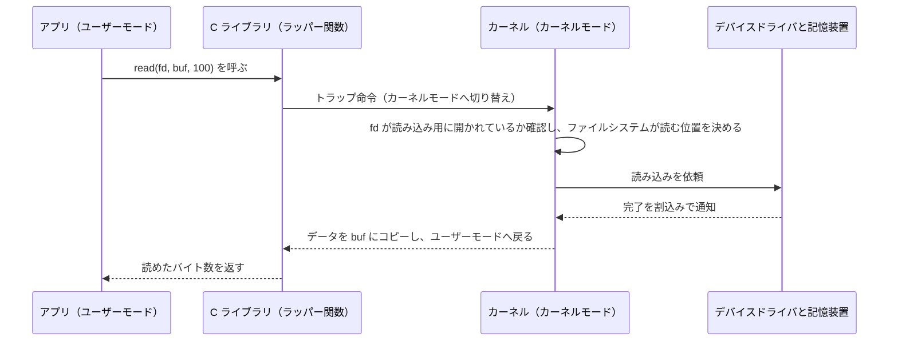

## この記事で分かること

- OS（オペレーティングシステム）がなぜ必要なのか（抽象化・資源管理・保護の 3 つの役割）
- カーネルモードとユーザーモードの違い、アプリが OS に仕事を頼む「システムコール」の流れ
- OS の主な機能（プロセス管理、メモリ管理、ファイルシステム、入出力管理）と、シェルや GUI の位置付け
- OS・ミドルウェア・アプリケーションの違いと、よくある誤解

## 一言で説明すると

OS は、CPU・メモリ・ストレージ・周辺機器といったハードウェアを、複数のプログラムが安全に、しかも簡単に使えるようにまとめて面倒を見る「土台のソフトウェア」です。アプリはハードウェアを直接操作せず、必要なことを OS に頼みます。

## なぜ必要なのか

[CPU](/fundamentals/cpu/) は命令を 1 つずつ取り出して実行する装置で、[メモリとストレージ](/fundamentals/memory-and-storage/)はデータを置く場所です。これらだけでもプログラムは動きますが、OS がなかったとすると、次のような問題が起きます。

1. **使いにくい**: アプリごとに、ディスクの読み書きの細かな手順や、キーボード・画面の制御方法を自分で書かなければなりません。
2. **取り合いになる**: CPU やメモリは 1 台のコンピュータで動く全プログラムが共有する資源です。誰がいつ、どれだけ使うかを決める役がいないと、同時に動かせません。
3. **危ない**: どのプログラムもディスクのどこでも読み書きでき、他のプログラムのメモリにも触れるなら、1 つの不具合や悪意ですべてが壊れ、他人のファイルも読めてしまいます。

ウィスコンシン大学の OS の教科書 OSTEP（Operating Systems: Three Easy Pieces）の第 2 章の説明を、この記事では次の 3 点に整理しています。

- **抽象化（仮想化）**: CPU・メモリ・ディスクといった物理的な資源を、より汎用的で使いやすい仮想的な形に変えて見せます。
- **資源管理**: 多くのプログラムが CPU・メモリ・ディスクを共有するので、OS は**資源管理者**としてそれらを効率よく、あるいは公平に配分します。
- **保護**: あるアプリの誤った動作や悪意ある動作が、他のアプリや OS 自身に害を与えないよう、互いを**隔離**します。

## 身近な例え

大きな賃貸ビルの管理会社を想像してください。テナント（アプリ）は、電気や水道の配管（ハードウェア）を自分でいじることはできません。「エアコンを修理してほしい」「会議室を借りたい」と管理会社の窓口に申し込むと、管理会社が専門業者（デバイスドライバ）を手配し、決まった手順で対応します。会議室の予約が重ならないように調整し（資源管理）、他のテナントの部屋の鍵は渡しません（保護）。テナントは配管の仕組みを知らなくても、窓口の申込書の書き方さえ知っていれば仕事ができます（抽象化）。

<Callout type="warn" title="例えの限界">
管理会社は依頼を受けて動くだけですが、OS は依頼がなくても、タイマー割込み（一定時間ごとにタイマー装置が CPU に送る合図）を使って定期的に CPU の制御を取り戻し、どのプログラムを動かすかを決め直します。また、窓口への申し込みは人が手続きしますが、システムコールではアプリから OS への切り替えを CPU が専用の命令で行います。
</Callout>

## 技術的な仕組み

### カーネルとユーザー空間

OS の中心部分で、ハードウェアを直接扱う部分を**カーネル**と呼びます。CPU には実行モードがあり、カーネルは何でもできる**カーネルモード**（特権モード、スーパーバイザーモードとも呼ばれます）で動き、アプリは制限のかかった**ユーザーモード**（非特権モード）で動きます。応用情報技術者試験のシラバス（Ver.7.2）でも、これらは OS の機能と構成の用語例として挙げられています。

OSTEP によると、ユーザーモードではハードウェアが動作を制限しており、例えばディスクへの I/O（入出力）要求を出す、任意の物理メモリに触れる、ネットワークにパケットを送る、といったことは通常できません。ユーザーモードのプログラムが I/O を直接行おうとすると CPU が例外（実行中の命令が原因で、CPU が処理を中断して OS に制御を移すこと）を起こし、OS はそのプロセス（実行中のプログラム）を終了させることが多いと同書は説明しています。

### システムコール：OS に仕事を頼む窓口

では、アプリがファイルを読みたいときはどうするのでしょうか。そのための窓口が**システムコール**です。Linux の man-pages（6.19）の syscalls(2) は、システムコールを「アプリケーションと Linux カーネルの間の基本的なインタフェース」と説明しています。

OSTEP によれば、システムコールは普通の関数呼び出しと違い、**トラップ**と呼ばれる特別な命令で、OS が起動時に登録しておいた処理（トラップハンドラ）へ移ると同時に、CPU をカーネルモードに切り替えます。OS は依頼を処理し終えると、専用の命令でユーザーモードに戻り、アプリの続きから実行を再開させます。行き先をアプリが自由に選べず、OS が決めた入口からしか入れないことが、保護の要になっています。

独自の例で、C 言語でファイルの先頭を読むプログラムを見てみます。

```c title="read_head.c"
#include <fcntl.h>
#include <unistd.h>

int main(void) {
    char buf[100];
    int fd = open("memo.txt", O_RDONLY);  /* 1. ファイルを開いてと頼む */
    if (fd == -1) return 1;               /* 失敗したら -1 が返る */
    ssize_t n = read(fd, buf, sizeof buf); /* 2. 最大 100 バイト読んでと頼む */
    close(fd);                             /* 3. もう使わないと伝える */
    return n < 0;
}
```

このプログラムは、ディスクのどこにファイルがあるか、ディスクにどう命令するかを一切書いていません。書いているのは「`memo.txt` を開いて」「100 バイトまで読んで」「閉じて」という依頼だけです。read(2) によると、`read` は読めたバイト数を返し、ファイルの終わりなら 0、エラーなら -1 を返します。読めるバイト数は要求より少ないこともあります。

なお、C のプログラムが呼んでいる `open` や `read` は、正確には C ライブラリ（glibc など）の**ラッパー関数**です。intro(2) によると、ラッパー関数が引数とシステムコール番号を決められたレジスタに置いてカーネルモードへトラップし、カーネルがエラーを返した場合は `errno` という変数にエラーの種類を入れて -1 を返します。

### OS の主な機能

OSTEP によれば、典型的な OS は数百個のシステムコールを提供しています。その裏側で OS が担う主な仕事は次のとおりです。

- **プロセス管理**: 実行中のプログラムを**プロセス**と呼びます。CPU が 1 つでも、OS がプロセスを短い時間で切り替えることで、多数のプログラムが同時に動いているように見せます（CPU の仮想化）。OS は起動時にタイマーを動かしておき、**タイマー割込み**で定期的に制御を取り戻すので、1 つのプログラムが CPU を独占し続けることはできません。詳しくは[プロセスとスレッド](/fundamentals/process-and-thread/)で扱います。
- **メモリ管理**: プロセスごとに「自分専用のメモリ」があるように見せ（アドレス空間）、それを実際のメモリに対応付けます。あるプロセスのメモリ操作が、他のプロセスや OS のメモリに影響しないようにするのも OS の仕事です。仕組みは[仮想記憶](/fundamentals/virtual-memory/)で詳しく解説しています。
- **ファイルシステム**: ストレージ上のデータを「ファイル」と「フォルダ（ディレクトリ）」として見せます。OSTEP によれば、`open` や `write` などのシステムコールはファイルシステムに回され、ファイルシステムがデータをディスクのどこに置くかを決めて、記憶装置に I/O 要求を出します。シラバスでも、補助記憶装置へのアクセスを装置に依存しないインタフェースで提供する機能（データ管理）として挙げられています。
- **入出力（デバイス）管理**: 特定の装置の扱い方を知っている OS 内のプログラムを**デバイスドライバ**と呼びます。OSTEP によると、ファイルシステムは接続方式（SCSI、IDE、USB など）の違いを意識せず共通の形で読み書きを依頼し、装置ごとの細かな違いはデバイスドライバが吸収します。装置の処理が終わったことは**割込み**（装置から CPU への「終わりました」という合図）で OS に伝えられます。OS はその間、待っているプロセスを休ませて別のプロセスを動かせるため、計算と I/O を重ねて進められます。

### シェルと GUI は OS の「上」で動くプログラム

コマンドを打ち込む画面（**シェル**、CLI）は、シラバスでは「利用者からのコマンド，指示を受けてそれを解釈し，プログラムの起動，制御などカーネルの機能を呼び出す」役割をもつものとして説明されています。つまりシェル自体も、カーネルに依頼する側のプログラムです。ウィンドウやアイコンで操作する GUI も、一般にはカーネルの上で動くプログラム群です。

### カーネルの構成：モノリシックカーネルとマイクロカーネル

シラバスの用語例には、カーネルの構成の違いとして**モノリシックカーネル**と**マイクロカーネル**が挙がっています。モノリシックカーネルは、ファイルシステムやデバイスドライバなど多くの機能を 1 つのカーネルの中にまとめて、カーネルモードで動かす構成です。マイクロカーネルは、カーネルを最小限の機能に絞り、それ以外の機能を分離して動かす構成です。OSTEP の第 13 章は、マイクロカーネルは OS の部品同士も互いに隔離するため、一般的なモノリシックカーネルより高い信頼性を提供しうると述べています。

## 図解



図は、前のコード例の `read` が実行されるときの流れです。アプリが呼んだ `read` はまず C ライブラリのラッパー関数に入り、トラップ命令でカーネルに移ります。このとき CPU はカーネルモードになります。カーネルは、渡された fd（ファイル記述子。`open` が返すファイルの受付番号）が有効で読み込み用に開かれているかを確かめます（そうでなければ read(2) のエラー EBADF になります）。ファイルにアクセスしてよいかという権限の確認は、この時点ではなく `open` のときに済んでおり、許されなければ `open` が失敗します（open(2) のエラー EACCES）。続いてファイルシステムがデータの位置を決め、デバイスドライバ経由で記憶装置に読み込みを頼みます。装置の処理が終わると割込みで知らされ、カーネルはデータをアプリのバッファ（データを受け取るためにアプリが用意したメモリ領域。コード例の `buf`）にコピーしてユーザーモードに戻ります。アプリから見れば、関数を 1 つ呼んだだけです。細部は状況によって変わります（例えば、データが既にメモリ上にあれば記憶装置への依頼は不要です）。

## 実務での活用例

- **アプリがハードウェアを直接触らない理由を説明できる**: 例えば「アプリから USB 機器が見えない」とき、原因はアプリではなく、OS がその機器のデバイスドライバを持っていない、あるいはアプリにアクセス権がないことかもしれません。
- **エラーを読む**: Linux では、システムコールが失敗すると C ライブラリのラッパー関数が -1 を返し、`errno` に理由を入れます（intro(2)）。`errno` は Linux 独自のものではなく、C 言語や POSIX（UNIX 系 OS の共通仕様）で使われる仕組みです。「Permission denied」や「No such file or directory」のようなメッセージは、多くの場合この `errno` を文章にしたものです。
- **OS の更新とセキュリティパッチ**: カーネルはすべてのアプリを守る土台なので、その不具合は全体に影響します。Linux カーネルの安定版（stable）のルールでは、安定版に入れる修正は実際に利用者が影響を受けるバグの修正などに限られ、その例として現実のセキュリティ問題が挙げられています。また、セキュリティの修正は専用の手順を経て、カーネルのセキュリティチームから受け付けられます（docs.kernel.org、2026-11-28 確認）。サーバーの運用では、こうした修正を含む OS の更新を計画的に適用することが重要です。

## 関連技術との比較

シラバスは、ミドルウェアを「OS とアプリケーションソフトウェアの中間に位置する」ソフトウェアとして説明し、例として DBMS（データベース管理システム）や TP モニター（トランザクション処理モニター）などを挙げています。

| 観点 | OS | ミドルウェア | アプリケーション |
| --- | --- | --- | --- |
| 位置 | ハードウェアの直上 | OS とアプリの中間 | 最上位（利用者に近い） |
| 主な役割 | 資源管理・抽象化・保護 | 多くのアプリに共通する機能の提供 | 利用者の目的の仕事をする |
| 例 | Linux、Windows、macOS のカーネルなど | DBMS、TP モニター、通信管理システム | 表計算ソフト、Web ブラウザ、業務システム |
| 動作モード | 中心部（カーネル）はカーネルモード | 通常はユーザーモード | ユーザーモード |
| ハードウェアへの接し方 | デバイスドライバを通じて直接扱う | OS に依頼する | OS（やミドルウェア）に依頼する |

「動作モード」の行は、一般的な構成を示したものです。マイクロカーネルのように、OS の機能の一部をカーネルの外に出す設計もあります。

## よくある誤解

<Misconceptions
  items={[
    { myth: 'OS とは、デスクトップやウィンドウなどの画面（GUI）のことである。', fact: 'GUI やシェルは、利用者が OS を操作するための入口となるプログラムです。資源管理や保護を担う OS の中心はカーネルで、画面のないサーバーでも OS は同じように働いています。' },
    { myth: 'アプリは CPU 以外のハードウェア（ディスクやネットワーク）を直接操作している。', fact: 'アプリはユーザーモードで動き、ディスクへの I/O 要求などは通常できません。アプリはシステムコールで OS に依頼し、カーネルがデバイスドライバを通じて装置を操作します。' },
    { myth: 'メモリを増やせば、OS は必ず速くなる。', fact: '一般に、効果があるのは、メモリ不足でストレージとの間のページの出し入れが頻繁に起きている場合です。使うデータがもともとメモリに収まっていれば、増やしても速さはほとんど変わらないことが多く、遅さの原因が CPU やストレージにあることもあります。ページの出し入れと、それが続くスラッシングの仕組みは本文のメモリ管理の項から案内している「仮想記憶」の記事で解説しています。' },
  ]}
/>

## まとめ

- OS は、ハードウェアを使いやすい形に見せ（抽象化）、プログラム間で配分し（資源管理）、互いを守る（保護）ための土台のソフトウェアです。
- カーネルはカーネルモードで、アプリはユーザーモードで動き、アプリはシステムコールを通じて OS に仕事を頼みます。
- OS の主な機能は、プロセス管理、メモリ管理、ファイルシステム、デバイスドライバと割込みによる入出力管理です。シェルや GUI はその上で動くプログラムです。
- ミドルウェアは OS とアプリの中間で、多くのアプリに共通の機能を提供します。

## 理解度チェック

**問1**: ユーザーモードで動いているアプリが、ディスクの特定の位置を直接読もうとして I/O 命令を実行しました。一般に何が起きますか。

<details>
<summary>答えと解説</summary>

CPU が例外を起こして OS に制御が移り、多くの場合そのプロセスは終了させられます。ユーザーモードでは I/O 要求のような特権的な操作がハードウェアによって禁止されているためです。ファイルを読みたいときは、`open` や `read` などのシステムコールで OS に依頼します。

</details>

**問2**: C のプログラムで `read(fd, buf, 100)` が 0 を返しました。どういう意味ですか。また、-1 が返った場合はどう調べればよいですか。

<details>
<summary>答えと解説</summary>

0 はファイルの終わりに達していて、読むデータがもうないことを表します。-1 はエラーで、Linux（POSIX）では `errno` にエラーの種類が入るので、それを確認します。

</details>

**問3**: DBMS は、OS・ミドルウェア・アプリケーションのどれに分類されますか。

<details>
<summary>答えと解説</summary>

ミドルウェアです。応用情報技術者試験のシラバスでは、DBMS は OS とアプリケーションの中間に位置するミドルウェアの例として挙げられています。

</details>
