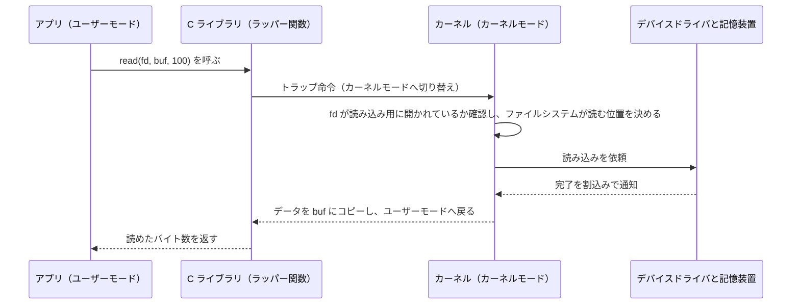

## この記事で分かること

- OS（オペレーティングシステム）がなぜ必要なのか（抽象化・資源管理・保護の 3 つの役割）
- カーネルモードとユーザーモードの違い、アプリが OS に仕事を頼む「システムコール」の流れ
- 割込み（内部割込み・外部割込み）で OS に制御が移る仕組み
- OS の主な機能（プロセス管理、メモリ管理、ファイルシステム、入出力管理）と、シェルや GUI の位置付け
- OS・ミドルウェア・アプリケーションの違いと、よくある誤解

## 一言で説明すると

OS は、CPU・メモリ・ストレージ・周辺機器といったハードウェアを、複数のプログラムが安全に、しかも簡単に使えるようにまとめて面倒を見る「土台のソフトウェア」です。アプリはハードウェアを直接操作せず、必要なことを OS に頼みます。

## なぜ必要なのか

[CPU](/fundamentals/cpu/) は命令を 1 つずつ取り出して実行する装置で、[メモリとストレージ](/fundamentals/memory-and-storage/)はデータを置く場所です。これらだけでもプログラムは動きますが、OS がなかったとすると、次のような問題が起きます。

1. **使いにくい**: アプリごとに、ディスクの読み書きの細かな手順や、キーボード・画面の制御方法を自分で書かなければなりません。
2. **取り合いになる**: CPU やメモリは 1 台のコンピュータで動く全プログラムが共有する資源です。誰がいつ、どれだけ使うかを決める役がいないと、同時に動かせません。
3. **危ない**: どのプログラムもディスクのどこでも読み書きでき、他のプログラムのメモリにも触れるなら、1 つの不具合や悪意ですべてが壊れ、他人のファイルも読めてしまいます。

ウィスコンシン大学の OS の教科書 OSTEP（Operating Systems: Three Easy Pieces）の第 2 章の説明を、この記事では次の 3 点に整理しています。

- **抽象化（仮想化）**: CPU・メモリ・ディスクといった物理的な資源を、より汎用的で使いやすい仮想的な形に変えて見せます。
- **資源管理**: 多くのプログラムが CPU・メモリ・ディスクを共有するので、OS は**資源管理者**としてそれらを効率よく、あるいは公平に配分します。
- **保護**: あるアプリの誤った動作や悪意ある動作が、他のアプリや OS 自身に害を与えないよう、互いを**隔離**します。

## 身近な例え

大きな賃貸ビルの管理会社を想像してください。テナント（アプリ）は、電気や水道の配管（ハードウェア）を自分でいじることはできません。「エアコンを修理してほしい」「会議室を借りたい」と管理会社の窓口に申し込むと、管理会社が専門業者（デバイスドライバ）を手配し、決まった手順で対応します。会議室の予約が重ならないように調整し（資源管理）、他のテナントの部屋の鍵は渡しません（保護）。テナントは配管の仕組みを知らなくても、窓口の申込書の書き方さえ知っていれば仕事ができます（抽象化）。

<Callout type="warn" title="例えの限界">
管理会社は依頼を受けて動くだけですが、OS は依頼がなくても、タイマー割込み（一定時間ごとにタイマー装置が CPU に送る合図）を使って定期的に CPU の制御を取り戻し、どのプログラムを動かすかを決め直します。また、窓口への申し込みは人が手続きしますが、システムコールではアプリから OS への切り替えを CPU が専用の命令で行います。
</Callout>

## 技術的な仕組み

### カーネルとユーザー空間

OS の中心部分で、ハードウェアを直接扱う部分を**カーネル**と呼びます。CPU には実行モードがあり、カーネルは何でもできる**カーネルモード**（特権モード、スーパーバイザーモードとも呼ばれます）で動き、アプリは制限のかかった**ユーザーモード**（非特権モード）で動きます。応用情報技術者試験のシラバス（Ver.7.2）でも、これらは OS の機能と構成の用語例として挙げられています。

OSTEP によると、ユーザーモードではハードウェアが動作を制限しており、例えばディスクへの I/O（入出力）要求を出す、任意の物理メモリに触れる、ネットワークにパケットを送る、といったことは通常できません。ユーザーモードのプログラムが I/O を直接行おうとすると CPU が例外（実行中の命令が原因で、CPU が処理を中断して OS に制御を移すこと）を起こし、OS はそのプロセス（実行中のプログラム）を終了させることが多いと同書は説明しています。

「なぜ必要なのか」で挙げた 3 つの役割は、この記事で説明する仕組みと次のように対応しています。

| 役割 | 解決する問題 | この記事に出てくる仕組み |
| --- | --- | --- |
| 抽象化 | 使いにくい | システムコール、ファイルとディレクトリ、デバイスドライバ |
| 資源管理 | 取り合いになる | タイマー割込みによるプログラムの切り替え、メモリの割り当て、CPU と I/O の重ね合わせ |
| 保護 | 危ない | カーネルモードとユーザーモード、プロセスごとのアドレス空間 |

<Callout type="tip" title="覚え方">
3 つの役割は、「使いにくい・取り合いになる・危ない」という 3 つの問題を裏返したものです。問題から逆にたどると、役割の名前を忘れても思い出せます。モードは「権限があるかどうか」と覚えます。ユーザーモードで特権的な操作をすると、CPU が例外を起こして OS が止める、という因果で整理しておくと、試験で問われる「特権命令違反」も、実行中の命令が原因で起きる出来事だと分かります。
</Callout>

### システムコール：OS に仕事を頼む窓口

では、アプリがファイルを読みたいときはどうするのでしょうか。そのための窓口が**システムコール**です。Linux の man-pages（6.19）の syscalls(2) は、システムコールを「アプリケーションと Linux カーネルの間の基本的なインタフェース」と説明しています。

OSTEP によれば、システムコールは普通の関数呼び出しと違い、**トラップ**と呼ばれる特別な命令で、OS が起動時に登録しておいた処理（トラップハンドラ）へ移ると同時に、CPU をカーネルモードに切り替えます。OS は依頼を処理し終えると、専用の命令でユーザーモードに戻り、アプリの続きから実行を再開させます。行き先をアプリが自由に選べず、OS が決めた入口からしか入れないことが、保護の要になっています。

独自の例で、C 言語でファイルの先頭を読むプログラムを見てみます。

```c title="read_head.c"
#include <fcntl.h>
#include <unistd.h>

int main(void) {
    char buf[100];
    int fd = open("memo.txt", O_RDONLY);  /* 1. ファイルを開いてと頼む */
    if (fd == -1) return 1;               /* 失敗したら -1 が返る */
    ssize_t n = read(fd, buf, sizeof buf); /* 2. 最大 100 バイト読んでと頼む */
    close(fd);                             /* 3. もう使わないと伝える */
    return n < 0;
}
```

このプログラムは、ディスクのどこにファイルがあるか、ディスクにどう命令するかを一切書いていません。書いているのは「`memo.txt` を開いて」「100 バイトまで読んで」「閉じて」という依頼だけです。read(2) によると、`read` は読めたバイト数を返し、ファイルの終わりなら 0、エラーなら -1 を返します。読めるバイト数は要求より少ないこともあります。

なお、C のプログラムが呼んでいる `open` や `read` は、正確には C ライブラリ（glibc など）の**ラッパー関数**です。intro(2) によると、ラッパー関数が引数とシステムコール番号を決められたレジスタに置いてカーネルモードへトラップし、カーネルがエラーを返した場合は `errno` という変数にエラーの種類を入れて -1 を返します。

上のコード例の `read` が実行されるときの流れを図にすると、次のようになります。



アプリが呼んだ `read` はまず C ライブラリのラッパー関数に入り、トラップ命令でカーネルに移ります。このとき CPU はカーネルモードになります。カーネルは、渡された fd（ファイル記述子。`open` が返すファイルの受付番号）が有効で読み込み用に開かれているかを確かめます（そうでなければ read(2) のエラー EBADF になります）。ファイルにアクセスしてよいかという権限の確認は、この時点ではなく `open` のときに済んでおり、許されなければ `open` が失敗します（open(2) のエラー EACCES）。続いてファイルシステムがデータの位置を決め、デバイスドライバ経由で記憶装置に読み込みを頼みます。装置の処理が終わると割込みで知らされ、カーネルはデータをアプリのバッファ（データを受け取るためにアプリが用意したメモリ領域。コード例の `buf`）にコピーしてユーザーモードに戻ります。アプリから見れば、関数を 1 つ呼んだだけです。細部は状況によって変わります（例えば、データが既にメモリ上にあれば記憶装置への依頼は不要です）。

<Callout type="tip" title="覚え方">
上の図の参加者を、左の 2 つ（アプリと C ライブラリ）は「頼む側」でユーザーモード、右の 2 つは「実行する側」と分けて見てください。`read` を呼んだプロセスから見ると、モードの切り替えはトラップ命令で入るときと、処理を終えて戻るときの 1 往復です（待つ間に CPU が別のプロセスを動かしていれば、完了の割込みでも CPU はカーネルモードに入ります）。「アプリから見れば関数呼び出し 1 回、裏ではモード切り替えが 1 往復」と覚えます。戻り値は「読めたバイト数」「0 はファイルの終わり」「-1 はエラーで、理由は errno を見る」の 3 通りです。
</Callout>

### 割込み：OS に制御が移るもう一つの道

システムコールは、アプリが自分から OS に制御を渡す入口でした。OS には、アプリが頼まなくても制御が移る道もあります。それが**割込み**です。OSTEP の第 6 章によると、OS は起動時に、例外や割込みが起きたときに動かすコードの場所をハードウェアに登録し、タイマーを動かしておきます。例外や割込みが起きると、CPU は実行中のプログラムを中断して登録されたコードへ移ります。OS は対処を終えると、中断したプログラムを再開するか、別のプログラムに切り替えます。

割込みのきっかけには、次のようなものがあります。

- **タイマー**: 一定時間ごとにタイマー装置が CPU に合図を送ります。OSTEP によると、OS はこのタイマー割込みで定期的に CPU の制御を取り戻すので、1 つのプログラムが CPU を独占し続けることはできません。
- **入出力の完了**: 装置が処理を終えると、CPU に合図を送ります（OSTEP 第 36 章）。上の図の「完了を割込みで通知」がこれです。
- **実行中の命令**: ユーザーモードでの特権的な操作のように、実行中の命令が原因で起きる例外も、OS に制御を移します。

応用情報技術者試験のシラバスは、割込みを**内部割込み**と**外部割込み**に分類して扱います。用語例としては、SVC（SuperVisor Call）割込み、入出力割込み、マシンチェック割込み、プログラム割込みなどが挙がっています。また、多重割込み（ある割込みの処理中に別の割込みを受け付けること）の扱いも出題範囲に含まれています。先に説明した例外は、試験では内部割込みに分類されます。試験での一般的な分け方は次のとおりです。

| 分類 | 原因 | 例 |
| --- | --- | --- |
| 内部割込み | 実行中のプログラム（命令）そのもの | ゼロ除算やオーバーフローなどの演算例外（プログラム割込み）、特権命令違反、ページフォールト、SVC 割込み（プログラムが OS の機能を呼び出すための割込み） |
| 外部割込み | CPU の外で起きた出来事 | 入出力の完了（入出力割込み）、タイマー割込み、ハードウェア異常（マシンチェック割込み） |

この分け方は過去問（平成21年度 春期 午前 問10 など）でも問われています。

割込みを処理している間、CPU は本来のプログラムを進められません。そのため、割込みの回数や 1 回の処理量が多いと、それだけほかの処理に使える CPU の能力が減ります。OSTEP は、非常に速い装置では割込みに伴う切り替えのコストが利点を上回ることがあり、装置の状態を繰り返し確かめる**ポーリング**のほうがよい場合もあると述べています。

<Callout type="tip" title="覚え方">
内部か外部かは、「何が原因で止まったか」で分けます。原因が実行中の命令（0 で割った、特権命令を使った、メモリにないページに触れた、システムコールを呼んだ）なら内部割込みです。プログラムとは無関係に外から来る合図（タイマー、入出力の完了、ハードウェアの故障）なら外部割込みです。ページフォールトは「メモリの出来事」に見えますが、きっかけは命令のアクセスなので内部割込みです。システムコール（アプリが自分から起こす内部割込み）とタイマー割込み（OS が CPU を取り戻す外部割込み）を対にしておくと、両方を一度に思い出せます。
</Callout>

### OS の主な機能

OSTEP によれば、典型的な OS は数百個のシステムコールを提供しています。その裏側で OS が担う主な仕事は次のとおりです。

- **プロセス管理**: 実行中のプログラムを**プロセス**と呼びます。CPU が 1 つでも、OS がプロセスを短い時間で切り替えることで、多数のプログラムが同時に動いているように見せます（CPU の仮想化）。この切り替えのきっかけになるのが、前の項で説明したタイマー割込みです。詳しくは[プロセスとスレッド](/fundamentals/process-and-thread/)で扱います。
- **メモリ管理**: プロセスごとに「自分専用のメモリ」があるように見せ（アドレス空間）、それを実際のメモリに対応付けます。あるプロセスのメモリ操作が、他のプロセスや OS のメモリに影響しないようにするのも OS の仕事です。仕組みは[仮想記憶](/fundamentals/virtual-memory/)で詳しく解説しています。
- **ファイルシステム**: ストレージ上のデータを「ファイル」と「フォルダ（ディレクトリ）」として見せます。OSTEP によれば、`open` や `write` などのシステムコールはファイルシステムに回され、ファイルシステムがデータをディスクのどこに置くかを決めて、記憶装置に I/O 要求を出します。ディレクトリも中身をもつファイルの一種です。その中身は、人が読める名前と、OS がファイルの実体を指すための番号（UNIX 系では inode 番号）の組の一覧であると OSTEP 第 39 章は説明しています。シラバスでも、補助記憶装置へのアクセスを装置に依存しないインタフェースで提供する機能（データ管理）として挙げられています。
- **入出力（デバイス）管理**: 特定の装置の扱い方を知っている OS 内のプログラムを**デバイスドライバ**と呼びます。OSTEP によると、ファイルシステムは接続方式（SCSI、IDE、USB など）の違いを意識せず共通の形で読み書きを依頼し、装置ごとの細かな違いはデバイスドライバが吸収します。装置の処理が終わったことは割込みで OS に伝えられます。OS はその間、待っているプロセスを休ませて別のプロセスを動かせるため、計算と I/O を重ねて進められます。さらに、大量のデータをメモリと装置の間で移すとき、CPU が 1 語ずつコピーしていると、CPU がその単純作業にかかり切りになります。OSTEP 第 36 章によると、**DMA**（Direct Memory Access）は、装置とメインメモリの間の転送を CPU がほとんど関わらずに行う専用の装置です。OS は「メモリのどこにあるデータを、どれだけ、どの装置へ」を DMA に指示し、転送が終わると DMA コントローラが割込みで知らせます。

計算と I/O の重ね合わせを、独自の簡単な例で表にすると次のようになります。プロセス A が計算の途中でディスクの読み込みを依頼し、その完了を待つ間に、OS はプロセス B に CPU を渡します。

| 時間 | 0〜2 | 2〜5 | 5〜7 |
| --- | --- | --- | --- |
| CPU | A の計算 | B の計算（A は読み込み待ち） | A の続き（完了の割込みで再開） |
| ディスク | （空き） | A のための読み込み | （空き） |

<Callout type="tip" title="覚え方">
「CPU と装置は別々に同時に動ける。ただし、それぞれ一度に 1 つの仕事しかできない」と覚えます。試験の問題では、上の表のように CPU の行と装置の行を並べた時刻表を書き、「空いていれば使う、使用中なら終わるまで待つ」「優先度が指定されていれば、高い方を先に（実行中の低い方から奪う）」を順に当てはめると解けます。DMA と割込みは役割分担で覚えます。データを運ぶのが DMA、終わったことを知らせるのが割込み、その間に別の仕事をするのが CPU です。
</Callout>

### シェルと GUI は OS の「上」で動くプログラム

コマンドを打ち込む画面（**シェル**、CLI）は、シラバスでは「利用者からのコマンド，指示を受けてそれを解釈し，プログラムの起動，制御などカーネルの機能を呼び出す」役割をもつものとして説明されています。つまりシェル自体も、カーネルに依頼する側のプログラムです。ウィンドウやアイコンで操作する GUI も、一般にはカーネルの上で動くプログラム群です。

カーネルとその上のプログラムを分けて考えると、コンテナも理解しやすくなります。Docker の公式ガイドによると、仮想マシンはそれぞれ自分のカーネルを含む OS 全体を起動します。これに対しコンテナは隔離されたプロセスで、同じマシン上のコンテナはすべてそのマシンのカーネルを共有します。詳しくは[Dockerの仕組み](/cloud/docker/)で扱います。

### カーネルの構成：モノリシックカーネルとマイクロカーネル

シラバスの用語例には、カーネルの構成の違いとして**モノリシックカーネル**と**マイクロカーネル**が挙がっています。モノリシックカーネルは、ファイルシステムやデバイスドライバなど多くの機能を 1 つのカーネルの中にまとめて、カーネルモードで動かす構成です。マイクロカーネルは、カーネルを最小限の機能に絞り、それ以外の機能を分離して動かす構成です。OSTEP の第 13 章は、マイクロカーネルは OS の部品同士も互いに隔離するため、一般的なモノリシックカーネルより高い信頼性を提供しうると述べています。

## 実務での活用例

- **アプリがハードウェアを直接触らない理由を説明できる**: 例えば「アプリから USB 機器が見えない」とき、原因はアプリではなく、OS がその機器のデバイスドライバを持っていない、あるいはアプリにアクセス権がないことかもしれません。
- **エラーを読む**: Linux では、システムコールが失敗すると C ライブラリのラッパー関数が -1 を返し、`errno` に理由を入れます（intro(2)）。`errno` は Linux 独自のものではなく、C 言語や POSIX（UNIX 系 OS の共通仕様）で使われる仕組みです。「Permission denied」や「No such file or directory」のようなメッセージは、多くの場合この `errno` を文章にしたものです。
- **OS の更新とセキュリティパッチ**: カーネルはすべてのアプリを守る土台なので、その不具合は全体に影響します。Linux カーネルの安定版（stable）のルールでは、安定版に入れる修正は実際に利用者が影響を受けるバグの修正などに限られ、その例として現実のセキュリティ問題が挙げられています。また、セキュリティの修正は専用の手順を経て、カーネルのセキュリティチームから受け付けられます（docs.kernel.org、2026-11-28 確認）。サーバーの運用では、こうした修正を含む OS の更新を計画的に適用することが重要です。

## 関連技術との比較

シラバスは、ミドルウェアを「OS とアプリケーションソフトウェアの中間に位置する」ソフトウェアとして説明し、例として DBMS（データベース管理システム）や TP モニター（トランザクション処理モニター）などを挙げています。

| 観点 | OS | ミドルウェア | アプリケーション |
| --- | --- | --- | --- |
| 位置 | ハードウェアの直上 | OS とアプリの中間 | 最上位（利用者に近い） |
| 主な役割 | 資源管理・抽象化・保護 | 多くのアプリに共通する機能の提供 | 利用者の目的の仕事をする |
| 例 | Linux、Windows、macOS のカーネルなど | DBMS、TP モニター、通信管理システム | 表計算ソフト、Web ブラウザ、業務システム |
| 動作モード | 中心部（カーネル）はカーネルモード | 通常はユーザーモード | ユーザーモード |
| ハードウェアへの接し方 | デバイスドライバを通じて直接扱う | OS に依頼する | OS（やミドルウェア）に依頼する |

「動作モード」の行は、一般的な構成を示したものです。マイクロカーネルのように、OS の機能の一部をカーネルの外に出す設計もあります。

## よくある誤解

<Misconceptions
  items={[
    { myth: 'OS とは、デスクトップやウィンドウなどの画面（GUI）のことである。', fact: 'GUI やシェルは、利用者が OS を操作するための入口となるプログラムです。資源管理や保護を担う OS の中心はカーネルで、画面のないサーバーでも OS は同じように働いています。' },
    { myth: 'アプリは CPU 以外のハードウェア（ディスクやネットワーク）を直接操作している。', fact: 'アプリはユーザーモードで動き、ディスクへの I/O 要求などは通常できません。アプリはシステムコールで OS に依頼し、カーネルがデバイスドライバを通じて装置を操作します。' },
    { myth: 'メモリを増やせば、OS は必ず速くなる。', fact: '一般に、効果があるのは、メモリ不足でストレージとの間のページの出し入れが頻繁に起きている場合です。使うデータがもともとメモリに収まっていれば、増やしても速さはほとんど変わらないことが多く、遅さの原因が CPU やストレージにあることもあります。ページの出し入れと、それが続くスラッシングの仕組みは本文のメモリ管理の項から案内している「仮想記憶」の記事で解説しています。' },
  ]}
/>

## まとめ

- OS は、ハードウェアを使いやすい形に見せ（抽象化）、プログラム間で配分し（資源管理）、互いを守る（保護）ための土台のソフトウェアです。
- カーネルはカーネルモードで、アプリはユーザーモードで動き、アプリはシステムコールを通じて OS に仕事を頼みます。
- 割込みは、アプリが頼まなくても OS に制御を移す仕組みです。実行中の命令が原因なら内部割込み、タイマーや入出力の完了など外からの合図なら外部割込みです。
- OS の主な機能は、プロセス管理、メモリ管理、ファイルシステム、デバイスドライバ・割込み・DMA による入出力管理です。シェルや GUI はその上で動くプログラムです。
- ミドルウェアは OS とアプリの中間で、多くのアプリに共通の機能を提供します。

## 理解度チェック

**問1**: ユーザーモードで動いているアプリが、ディスクの特定の位置を直接読もうとして I/O 命令を実行しました。一般に何が起きますか。

<details>
<summary>答えと解説</summary>

CPU が例外を起こして OS に制御が移り、多くの場合そのプロセスは終了させられます。ユーザーモードでは I/O 要求のような特権的な操作がハードウェアによって禁止されているためです。ファイルを読みたいときは、`open` や `read` などのシステムコールで OS に依頼します。

</details>

**問2**: C のプログラムで `read(fd, buf, 100)` が 0 を返しました。どういう意味ですか。また、-1 が返った場合はどう調べればよいですか。

<details>
<summary>答えと解説</summary>

0 はファイルの終わりに達していて、読むデータがもうないことを表します。-1 はエラーで、Linux（POSIX）では `errno` にエラーの種類が入るので、それを確認します。

</details>

**問3**: DBMS は、OS・ミドルウェア・アプリケーションのどれに分類されますか。

<details>
<summary>答えと解説</summary>

ミドルウェアです。応用情報技術者試験のシラバスでは、DBMS は OS とアプリケーションの中間に位置するミドルウェアの例として挙げられています。

</details>

## 過去問題

<PastExam source="令和7年度 春期 応用情報技術者試験 午前 問9">
DMA コントローラーの説明として，適切なものはどれか。

- ア　MPU では時間が掛かる積和演算を，高速に行う。
- イ　仮想メモリ機能，メモリ保護機能などのメモリ管理機能を提供する。
- ウ　動作クロックに合わせてカウントするカウントレジスタをもち，それによって時間の経過を保持する。
- エ　メモリと入出力装置，又はメモリとメモリとの間のデータ転送を，MPU を介さずに行う。

<PastExamAnswer answer="エ">
「OS の主な機能」の入出力管理の項で説明したとおり、DMA はメモリと装置の間のデータ転送を、CPU（MPU）に 1 語ずつコピーさせずに行う仕組みです。CPU は転送の指示だけを出し、転送中は別の仕事ができます。終わったことは割込みで知らされます。アは積和演算に特化したプロセッサ（DSP など）、イはメモリ管理ユニット（MMU）、ウはタイマーの説明です。
</PastExamAnswer>
</PastExam>

<PastExam source="令和5年度 秋期 応用情報技術者試験 午前 問19">
Linux カーネルの説明として，適切なものはどれか。

- ア　CUI によるコマンド入力のためのシェルと呼ばれるソフトウェアが組み込まれていて，文字での操作が可能である。
- イ　GUI を利用できるデスクトップ環境が組み込まれていて，マウスを使った直感的な操作が可能である。
- ウ　Web ブラウザ，ワープロソフト，表計算ソフトなどが含まれており，Linux カーネルだけで多くの業務が行える。
- エ　プロセス管理やメモリ管理などの，アプリケーションソフトウェアが動作するための基本機能を提供する。

<PastExamAnswer answer="エ">
カーネルは OS の中心で、プロセス管理やメモリ管理など、アプリが動くための土台を提供します（「カーネルとユーザー空間」「OS の主な機能」の節）。「シェルと GUI は OS の『上』で動くプログラム」の節のとおり、シェルや GUI のデスクトップ環境はカーネルに依頼する側のプログラムで、カーネルそのものには含まれません。ウのようなアプリケーションも同様です。「よくある誤解」の 1 つ目と同じ線引きを問う問題です。
</PastExamAnswer>
</PastExam>

<PastExam source="令和5年度 春期 応用情報技術者試験 午前 問14">
CPU と磁気ディスク装置で構成されるシステムで，表に示すジョブ A，B を実行する。この二つのジョブが実行を終了するまでの CPU の使用率と磁気ディスク装置の使用率との組合せのうち，適切なものはどれか。ここで，ジョブ A，B はシステムの動作開始時点ではいずれも実行可能状態にあり，A，B の順で実行される。CPU 及び磁気ディスク装置は，ともに一つの要求だけを発生順に処理する。ジョブ A，B とも，CPU の処理を終了した後，磁気ディスク装置の処理を実行する。

単位　秒

| ジョブ | CPU の処理時間 | 磁気ディスク装置の処理時間 |
| --- | --- | --- |
| A | 3 | 7 |
| B | 12 | 10 |

|  | CPU の使用率 | 磁気ディスク装置の使用率 |
| --- | --- | --- |
| ア | 0.47 | 0.53 |
| イ | 0.60 | 0.68 |
| ウ | 0.79 | 0.89 |
| エ | 0.88 | 1.00 |

<PastExamAnswer answer="イ">
入出力管理の項の覚え方のとおり、CPU と磁気ディスクの時刻表を書きます。A は CPU を 0〜3 秒、ディスクを 3〜10 秒に使います。B は A の CPU 処理が終わった 3 秒から CPU を使い始め、3〜15 秒です。続くディスク処理は 15〜25 秒です。全体は 25 秒で、CPU が動いていたのは 3 + 12 = 15 秒、ディスクは 7 + 10 = 17 秒です。使用率は CPU が $15 \div 25 = 0.60$、ディスクが $17 \div 25 = 0.68$ です。A のディスク処理と B の CPU 処理が重なる 3〜10 秒が、計算と I/O の重ね合わせに当たります。
</PastExamAnswer>
</PastExam>

<PastExam source="令和4年度 秋期 応用情報技術者試験 午前 問12">
コンテナ型仮想化の説明として，適切なものはどれか。

- ア　物理サーバと物理サーバの仮想環境とが OS を共有するので，物理サーバか物理サーバの仮想環境のどちらかに OS をもてばよい。
- イ　物理サーバにホスト OS をもたず，物理サーバにインストールした仮想化ソフトウェアによって，個別のゲスト OS をもった仮想サーバを動作させる。
- ウ　物理サーバのホスト OS と仮想化ソフトウェアによって，プログラムの実行環境を仮想化するので，仮想サーバに個別のゲスト OS をもたない。
- エ　物理サーバのホスト OS にインストールした仮想化ソフトウェアによって，個別のゲスト OS をもった仮想サーバを動作させる。

<PastExamAnswer answer="ウ">
「シェルと GUI は OS の『上』で動くプログラム」の節で触れたとおり、コンテナは隔離されたプロセスで、ホストのカーネルを共有します。そのため、コンテナごとにカーネルを含むゲスト OS をもちません。イとエは、それぞれ仮想マシンごとにゲスト OS を起動する方式（イはホスト OS をもたない方式、エはホスト OS 上で仮想化ソフトウェアを動かす方式）の説明です。アのように、どちらか一方にだけ OS があればよいわけではありません。
</PastExamAnswer>
</PastExam>

<PastExam source="令和4年度 秋期 応用情報技術者試験 午前 問18">
優先度に基づくプリエンプティブなスケジューリングを行うリアルタイム OS における割込み処理の説明のうち，適切なものはどれか。ここで，割込み禁止状態は考慮しないものとし，割込み処理を行うプログラムを割込み処理ルーチン，割込み処理以外のプログラムをタスクと呼ぶ。

- ア　タスクの切替えを禁止すると，割込みが発生しても割込み処理ルーチンは呼び出されない。
- イ　割込み処理ルーチンの処理時間の長さは，システムの応答性に影響を与えない。
- ウ　割込み処理ルーチンは，最も優先度の高いタスクよりも優先して実行される。
- エ　割込み処理ルーチンは，割り込まれたタスクと同一のコンテキストで実行される。

<PastExamAnswer answer="ウ">
「割込み」の節のとおり、割込みが起きると CPU は実行中のプログラムを中断して、登録された処理へ移ります。この切り替えはハードウェアが行うので、OS がどのタスクを動かすかを決める仕組み（タスクの優先度）より先に働きます。そのため、割込み処理ルーチンはどのタスクよりも優先して動きます。アは、タスクの切替えを禁止しても割込みそのものは止まらないので誤りです。イは、割込み処理が長いほどその間タスクが止まり、応答性が悪くなるので誤りです。エは、割込み処理ルーチンは割り込まれたタスクとは別の処理として動くので誤りです。
</PastExamAnswer>
</PastExam>

<PastExam source="平成26年度 春期 応用情報技術者試験 午前 問8">
100 MIPS の CPU で動作するシステムにおいて，タイマ割込みが 1 ミリ秒ごとに発生し，タイマ割込み処理として 1 万命令が実行される。この割込み処理以外のシステムの処理性能は，何 MIPS 相当になるか。ここで，CPU 稼働率は 100%，割込み処理の呼出し及び復帰に伴うオーバヘッドは無視できるものとする。

- ア　10
- イ　90
- ウ　99
- エ　99.9

<PastExamAnswer answer="イ">
「割込み」の節で説明したとおり、割込みを処理している間、CPU は本来の処理を進められません。1 ミリ秒ごとの割込みは 1 秒間に 1,000 回で、1 回に 1 万命令なので、割込み処理に使う命令数は 1 秒当たり $1{,}000 \times 10{,}000 = 10^7$ 命令、つまり 10 MIPS 分です。100 MIPS から差し引くと、ほかの処理に使えるのは 90 MIPS 相当です。タイマー割込みは OS が CPU を取り戻すために欠かせませんが、その分の処理能力を消費することが分かります。
</PastExamAnswer>
</PastExam>

<PastExam source="平成26年度 春期 応用情報技術者試験 午前 問9" modified>
メイン処理，及び表に示す二つの割込み A，B の処理があり，多重割込みが許可されている。割込み A，B が図のタイミングで発生するとき，0 ミリ秒から 5 ミリ秒までの間にメイン処理が利用できる CPU 時間は何ミリ秒か。ここで，割込み処理の呼出し及び復帰に伴うオーバヘッドは無視できるものとする。

| 割込み | 処理時間（ミリ秒） | 割込み優先度 |
| --- | --- | --- |
| A | 0.5 | 高 |
| B | 1.5 | 低 |

〔図：割込みの発生タイミング（表に置き換え）〕

| 割込み | 発生時刻（ミリ秒） |
| --- | --- |
| A | 1，2.5，3.5 |
| B | 0，5 |

- ア　2
- イ　2.5
- ウ　3.5
- エ　5

<PastExamAnswer answer="ア">
多重割込みが許可されているので、優先度の高い A は、B の処理中にも割り込めます（「割込み」の節）。0 ミリ秒に B が始まり、1 ミリ秒に A が割り込んで 1〜1.5 ミリ秒に A を処理します。B は残りの 0.5 ミリ秒を 1.5〜2 ミリ秒に処理して終わります。その後はメイン処理が 2〜2.5 ミリ秒、A が 2.5〜3 ミリ秒、メイン処理が 3〜3.5 ミリ秒、A が 3.5〜4 ミリ秒、メイン処理が 4〜5 ミリ秒です。メイン処理の合計は $0.5 + 0.5 + 1 = 2$ ミリ秒です。5 ミリ秒に発生する B は範囲の終わりなので影響しません。
</PastExamAnswer>
</PastExam>

<PastExam source="平成24年度 春期 応用情報技術者試験 午前 問20">
二つのタスクの優先度と各タスクを単独で実行した場合の CPU と入出力装置（I/O）の動作順序と処理時間は，表のとおりである。二つのタスクが同時に実行可能状態になってから，全てのタスクの実行が終了するまでの経過時間は何ミリ秒か。ここで，CPU は 1 個であり，I/O の同時動作はできないものとし，OS のオーバヘッドは考慮しないものとする。また，表の（ ）内の数字は処理時間を示すものとする。

| 優先度 | 単独実行時の動作順序と処理時間（ミリ秒） |
| --- | --- |
| 高 | CPU(2) → I/O(7) → CPU(3) → I/O(4) → CPU(3) |
| 低 | CPU(2) → I/O(3) → CPU(2) → I/O(2) → CPU(3) |

- ア　19
- イ　20
- ウ　21
- エ　22

<PastExamAnswer answer="エ">
入出力管理の項の覚え方のとおり、CPU と I/O の 2 段の時刻表を書きます。高は CPU 0〜2、I/O 2〜9 です。低は高が I/O 待ちの間に CPU 2〜4 を使いますが、I/O は高が使用中なので 9 まで待ち、I/O 9〜12 です。高は CPU 9〜12、I/O 12〜16 です。低はその間に CPU 12〜14 を使い、I/O は 16 まで待って 16〜18 です。高は CPU 16〜19 で終わり、低は CPU が空く 19 から 22 まで最後の CPU 処理をします。全体の経過時間は 22 ミリ秒です。
</PastExamAnswer>
</PastExam>

<PastExam source="平成21年度 秋期 応用情報技術者試験 午前 問20">
UNIX ではファイルを，通常ファイル，ディレクトリファイル及び特殊ファイルの 3 種類に分類している。ディレクトリファイルの説明として，適切なものはどれか。

- ア　磁気ディスクなどの入出力装置にアクセスするためのファイル
- イ　テキスト，オブジェクトコード，画像データなどを格納するためのファイル
- ウ　ファイル名とファイルの実体を対応付けるためのファイル
- エ　複数のパスから一つのファイルを参照できるようにするためのファイル

<PastExamAnswer answer="ウ">
「OS の主な機能」のファイルシステムの項で説明したとおり、ディレクトリの中身は「人が読める名前」と「ファイルの実体を指す番号」の組の一覧です。つまり、ファイル名とファイルの実体を対応付けるためのファイルです。アは装置を表す特殊ファイル、イは通常ファイル、エは 1 つのファイルに別の名前を付けるリンクの説明です。
</PastExamAnswer>
</PastExam>

<PastExam source="平成21年度 春期 応用情報技術者試験 午前 問10">
外部割込みの要因となるものはどれか。

- ア　仮想記憶管理における存在しないページにアクセスしたときのページフォールト
- イ　システム管理命令を一般ユーザモードで実行したときの特権命令違反
- ウ　ハードウェア異常などによるマシンチェック
- エ　浮動小数点演算命令でのオーバフローなどの演算例外

<PastExamAnswer answer="ウ">
「割込み」の節の覚え方のとおり、「何が原因で止まったか」で分けます。ハードウェアの異常は実行中の命令とは関係なく CPU の外で起きる出来事なので、マシンチェックは外部割込みです。アのページフォールト、イの特権命令違反、エの演算例外は、いずれも実行中の命令が原因で起きるので内部割込みです。
</PastExamAnswer>
</PastExam>
