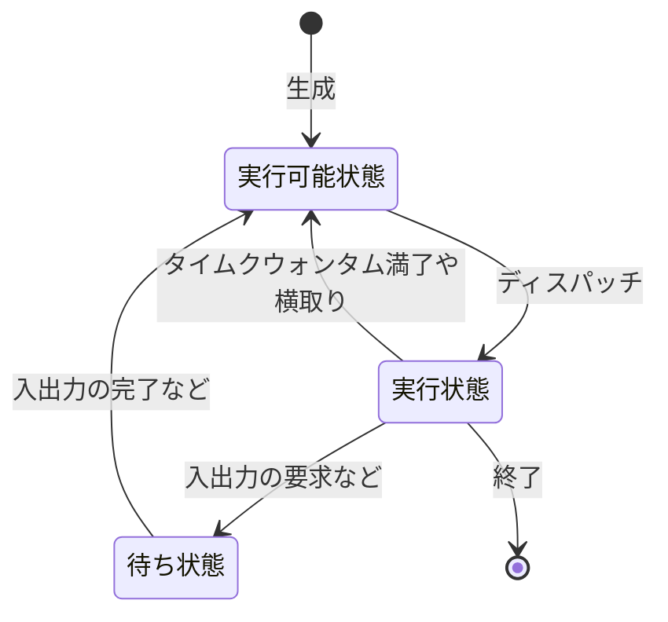

## この記事で分かること

- プログラム・プロセス・スレッドの違いと、それぞれが持つもの・共有するもの
- プロセスの 3 つの状態（実行・実行可能・待ち）と、状態が移り変わるきっかけ
- コンテキストスイッチと、ラウンドロビンや優先度によるスケジューリングの考え方
- マルチスレッドの利点と、レースコンディション・排他制御・デッドロックという落とし穴
- 並行と並列の違い、プロセスとスレッドの使い分け

## 一言で説明すると

プロセスは「実行中のプログラム」で、OS から専用のメモリ空間などの資源を割り当てられた作業単位です。スレッドは、1 つのプロセスの中で同じメモリを共有しながら別々に進む「処理の流れ」です。

## なぜ必要なのか

PC ではブラウザ、エディタ、音楽プレーヤーなどが同時に動いているように見えますが、CPU のコアの数は限られています。ウィスコンシン大学の OS の教科書 OSTEP（Operating Systems: Three Easy Pieces）は、OS が 1 つのプロセスを少し動かしては止めて別のプロセスを動かす**タイムシェアリング**によって、少ない CPU が多数あるかのように見せていると説明しています。その代償として、CPU を共有する各プロセスは単独で動くときより遅くなります。

このとき OS は「誰が・どこまで実行したか」「誰のメモリか」を区別して管理する必要があります。その管理の単位がプロセスです。さらに、1 つのアプリケーションの中でも「通信を待つ間に画面の操作に応える」「計算を複数のコアで分担する」といった同時進行が欲しくなります。そのために、1 つのプロセスの中でメモリを共有したまま複数の流れを進められる単位として、スレッドが使われます。

## 身近な例え

プロセスを「台所付きの別々の家」、スレッドを「1 つの家の台所で一緒に料理する家族」と考えてみます。

- 家（プロセス）はそれぞれ冷蔵庫や調理器具（メモリやファイルなどの資源）を持ち、隣の家の冷蔵庫は勝手に開けられません。
- 同じ家の家族（スレッド）は冷蔵庫を共有するので、食材の受け渡しは簡単です。ただし、2 人が同時に「卵が 1 個残っている」と確認して両方が使おうとすると、片方の料理が失敗します。冷蔵庫の扉に「使用中」の札を掛けるような取り決め（排他制御）が必要になります。
- 各自が手元に持つメモ（どこまで作業したか）は人ごとに別々です。これがスレッドごとのスタックとレジスタにあたります。

<Callout type="warn" title="例えの限界">
本物の家族は同時に動けますが、コアが 1 つしかない CPU では、スレッドは実際には交代で少しずつ動いています。それでも交代のタイミング次第で取り合いは起こります。また、家どうしも OS の仕組み（ファイルやプロセス間通信）を通せばデータをやり取りできます。
</Callout>

## 技術的な仕組み

### プログラム・プロセス・スレッド

**プログラム**は、ディスクなどに保存された命令とデータの集まりで、それ自体は動きません。OSTEP はプロセスを「実行中のプログラム」と定義しています。OS はプログラムのコードと静的データをメモリに読み込み（現代の OS は必要になった部分から読み込みます）、関数呼び出しに使う**スタック**や、動的に確保するデータ用の**ヒープ**を用意し、UNIX 系では標準入力・標準出力・標準エラーの 3 つのファイル記述子を開いた状態で実行を始めます。

同書によれば、プロセスは次のもので表されます。

- **アドレス空間**: プロセスが読み書きできるメモリ。中身はコード、データ、ヒープ、スタックです（[仮想記憶](/fundamentals/virtual-memory/)によってプロセスごとに独立しています）。
- **レジスタ**: 次に実行する命令の位置を示すプログラムカウンタ（PC）や、スタックの位置を示すスタックポインタなど。
- **I/O の情報**: 開いているファイルの一覧など。

OS はこれらの情報をプロセスごとに**プロセス制御ブロック**（PCB）という構造体にまとめて管理します。

**スレッド**は、プロセスの中の「実行の流れ」です。OSTEP は、マルチスレッドのプログラムは実行箇所（PC）を複数持ち、各スレッドは別々のプロセスによく似ているが、同じアドレス空間を共有する点だけが異なる、と説明しています。各スレッドは自分専用のレジスタの組とスタックを持ちます。

Linux の pthreads(7)（Linux man-pages 6.19、2026-11-28 確認）によれば、POSIX スレッドでは次のように分かれます。

| プロセス内のスレッドで共有するもの | スレッドごとに別々のもの |
| --- | --- |
| グローバル変数・ヒープ（データとヒープの領域） | スタック（関数内の自動変数） |
| プロセス ID、開いているファイル記述子 | スレッド ID |
| シグナルの処理方法、カレントディレクトリ、資源の制限など | シグナルマスク、`errno` など |

レジスタも、OSTEP の説明どおりスレッドごとに保存・復元されます。応用情報技術者試験のシラバスでは、スレッドに関連して**軽量プロセス**という用語が挙げられています。Linux の clone(2) では、新しく作る実行単位とアドレス空間やファイル記述子の表を共有するかを、CLONE_VM などのフラグで選べます。

### プロセスの状態遷移

シラバスは状態として**実行状態**、**実行可能状態**、**待ち状態**を挙げています。OSTEP の Running、Ready、Blocked にそれぞれ対応します。

- **実行状態**: CPU で命令を実行している状態です。
- **実行可能状態**: いつでも実行できるが、CPU が空くのを待っている状態です。
- **待ち状態**: 入出力の完了など、何かの出来事を待っている状態です。CPU が空いていても実行できません。



図のように、生成されたプロセスはまず実行可能状態になり、OS が選んで CPU を割り当てる**ディスパッチ**で実行状態に移ります。割り当てられた時間を使い切るか、より優先すべきものに CPU を奪われると実行可能状態に戻ります。実行中に入出力を要求すると待ち状態になり、その間 CPU は他のプロセスに使われます。入出力が完了すると、待ち状態から**実行可能状態**に戻ります。直接実行状態に戻るのではなく、もう一度ディスパッチされるのを待つ点に注意してください。

### コンテキストスイッチ

OS が実行中のプロセスから CPU を取り上げられるのは、一定時間ごとに発生する**タイマー割込み**があるからです（OSTEP 第 6 章）。割込みで OS に制御が移ると、**スケジューラ**が次に動かすものを決め、切り替える場合は**コンテキストスイッチ**を行います。これは、今のプロセスのレジスタや PC を保存し、次のプロセスの保存済みの値を復元する処理です。

OSTEP によれば、同じプロセス内のスレッド間の切り替えではアドレス空間が変わらないため、使うページテーブルを切り替える必要がありません。一方で同書の第 7 章は、切り替えの負担はレジスタの保存・復元だけでなく、CPU のキャッシュや TLB に溜まった状態が入れ替わることによっても生じると指摘しています。

### スケジューリング：ラウンドロビンと優先度

OSTEP によれば、現代のスケジューラはほぼすべて、実行中のものを途中で止めて別のものを動かせる**プリエンプティブ方式**です。代表的な方式が**ラウンドロビン**です。実行可能なものを順番に、決まった長さの時間（**タイムクウォンタム**、タイムスライス）ずつ実行し、使い切ったら列の最後に回します。

独自の例で計算してみます。CPU は 1 つで、ジョブ A（実行に 4 ミリ秒）、B（3 ミリ秒）、C（1 ミリ秒）が時刻 0 に A、B、C の順で並んでいるとします。タイムクウォンタムは 2 ミリ秒とし、切り替えにかかる時間は無視します。

| 時刻（ミリ秒） | 実行 | 実行後の残り | 待ち行列（次の順） |
| --- | --- | --- | --- |
| 0〜2 | A | A: 2 | B, C, A |
| 2〜4 | B | B: 1 | C, A, B |
| 4〜5 | C | C: 0（完了） | A, B |
| 5〜7 | A | A: 0（完了） | B |
| 7〜8 | B | B: 0（完了） | なし |

完了時刻は A が 7、B が 8、C が 5 です。到着から完了までの**ターンアラウンドタイム**の平均は $(7 + 8 + 5) / 3 \approx 6.7$ ミリ秒、到着から初めて実行されるまでの時間（OSTEP が定義する応答時間）の平均は $(0 + 2 + 4) / 3 = 2$ ミリ秒です。

到着順に最後まで実行する **FCFS**（先着順）なら、完了は A が 4、B が 7、C が 8 で、平均ターンアラウンドタイムは約 6.3 ミリ秒と少し良くなりますが、初めて実行されるまでの平均は $(0 + 4 + 7) / 3 \approx 3.7$ ミリ秒に延びます。

ラウンドロビンは、全員に早く順番を回して応答を良くする代わりに、ターンアラウンドタイムでは不利になりやすい方式です（OSTEP 第 7 章も同じ傾向を示しています）。なお、ここでの応答時間は OSTEP がスケジューリングの比較用に定めたものです。シラバスがシステムの性能指標として挙げるレスポンスタイム（応答時間）とは測る区間が同じとは限らないため、試験では問題文の定義に従ってください。

タイムクウォンタムの長さは調整が必要です。OSTEP は、クウォンタムが 10 ミリ秒で切り替えに 1 ミリ秒かかると時間の約 10% が切り替えに消えると例示し、短くしすぎると切り替えの負担が支配的になると説明しています。

もう 1 つの考え方が**優先度**（優先順位）です。優先度の高いものを先に実行し、同じ優先度どうしではラウンドロビンで回す、といった組み合わせ方が OSTEP 第 8 章で紹介されています。優先度が固定の方式を**静的優先順位方式**、実行の様子に応じて変える方式を**動的優先順位方式**と呼びます。優先度の高いものが次々に来ると、低いものがいつまでも実行されない**スタベーション**（飢餓状態、シラバスではリソーススタベーション）が起こりえます。

### マルチスレッドの利点と落とし穴

OSTEP は、スレッドを使う主な理由として次の 2 つを挙げています。

1. **並列化**: 大きな計算を分割し、複数の CPU（コア）で同時に処理して速くする。
2. **I/O 待ちで止まらない**: 1 つのスレッドがディスクや通信を待っている間に、別のスレッドが処理を進める。

一方で、メモリを共有するために問題も生じます。在庫数を 1 減らす処理を、2 つのスレッドがほぼ同時に実行する場面を考えます。次は説明用の擬似コードです（実在の言語の文法ではありません）。`stock` は全スレッドで共有する変数、`x` は各スレッドが自分のスタックに持つローカル変数です。

```text title="擬似コード（説明用）"
共有変数 stock = 10

スレッドの処理:
  x = stock      // (1) 読む
  x = x - 1      // (2) 計算する
  stock = x      // (3) 書き戻す
```

スレッド T1 が (1)(2) を終えて x = 9 を持った時点で切り替えが起こり、T2 も (1)〜(3) を実行して stock を 9 にします。その後 T1 が再開して (3) で 9 を書き戻すと、2 回減らしたのに stock は 8 ではなく 9 になります。OSTEP は、`counter = counter + 1` のような 1 行でも機械語では「読む・足す・書き戻す」の 3 命令になり、その途中でタイマー割込みが入ると同じことが起こる例を示しています。このように実行のタイミングで結果が変わる状態を**レースコンディション**（競合状態）、共有データを操作する部分を**クリティカルセクション**と呼びます。コアが 1 つでも、切り替えのタイミング次第で起こる点に注意してください。

対策は、クリティカルセクションに同時に 1 つのスレッドしか入れないようにする**排他制御**（相互排除）です。

- **ロック**（POSIX では**ミューテックス**）: 取得したスレッドだけがクリティカルセクションに入れます。他のスレッドがロックを取ろうとすると、解放されるまで待たされます（OSTEP 第 28 章）。
- **セマフォ**: 整数の値を持ち、待つ操作（Dijkstra の P 操作）で値を 1 減らして負なら待ち、知らせる操作（V 操作）で値を 1 増やして待っているものがいれば 1 つ起こします（OSTEP 第 31 章）。初期値を 1 にすればロックとして使え（バイナリセマフォ）、初期値を N にすれば同時に N 個まで通すことができます。

```text title="擬似コード（説明用）: ロックで保護した版"
lock(m)
x = stock
stock = x - 1
unlock(m)
```

排他制御には別の落とし穴もあります。スレッド T1 がロック L1 を持って L2 を待ち、T2 が L2 を持って L1 を待つと、どちらも永遠に進めません。これが**デッドロック**です。OSTEP によれば、デッドロックは「相互排除」「資源を持ったまま別の資源を待つ（保持と待機）」「資源を横取りできない」「循環待ち」の 4 条件がすべてそろったときに起こり、1 つでも欠ければ起こりません。実用的な予防策として、すべてのスレッドがロックを決まった順序（例: 必ず L1 → L2）で取ることが挙げられています。

### 並行と並列

**並行**（concurrency）は、複数の処理が「同じ期間に進行中」であることです。コアが 1 つでも、タイムシェアリングで交互に少しずつ進めれば並行に動きます。**並列**（parallelism）は、複数のコアなどで「同じ瞬間に」実行されることです。OSTEP も、マルチプロセッサではスレッドが実際に同時に動きうると述べています。並列による速度向上には限界があり、[CPU の記事のマルチコアの節](/fundamentals/cpu/#マルチコア-cpu-の中に処理役を複数置く)で扱ったアムダールの法則が上限を示します。シラバスも、データベースへの同時アクセスによるロックの発生などが並列処理の能力向上を妨げる原因（隘路）になることを挙げています。

## 実務での活用例

- **Web サーバー**: OSTEP は、Web サーバーやデータベース管理システムなどのサーバーアプリケーションの多くが、I/O 待ちと他の処理を重ねるためにスレッドを使っていると説明しています。あるリクエストがデータベースの応答を待つ間も、別のスレッドが他のリクエストを処理できます。そのぶん、共有するキャッシュやカウンタを更新する箇所には排他制御が必要です。
- **ブラウザのタブ**: Chromium（Google Chrome のもとになったオープンソースのブラウザ）の設計文書によれば、Web ページを描画する部分の不具合からブラウザ全体を守るため、描画を担う処理を別プロセス（レンダラプロセス）に分けています。新しいウィンドウやタブは一般に新しいプロセスで開かれ、レンダラがクラッシュしても、そのタブに「sad tab」を表示して再読み込みで復旧できます。ただし、ページがスクリプト（window.open）で開いた同じオリジンのウィンドウや、プロセス数が多くなりすぎた場合などはプロセスを共有することがあります（設計文書の記述。現在の Chrome の実装と細部が異なる場合があります）。

## 関連技術との比較

| 観点 | プロセス | スレッド |
| --- | --- | --- |
| メモリ空間 | プロセスごとに独立 | 同じプロセスのスレッドで共有 |
| 個別に持つもの | アドレス空間、レジスタ、開いているファイルなど | スタック、レジスタ（PC を含む）、スレッド ID など |
| データの受け渡し | OS の仕組み（ファイル、プロセス間通信など）を通す | 共有メモリを直接読み書きできる（排他制御が必要） |
| 切り替え | アドレス空間（ページテーブル）の切り替えが必要 | 同じプロセス内ならページテーブルの切り替えは不要 |
| 不具合の影響 | 別プロセスには及びにくい（Chromium がタブを分ける理由） | メモリを共有するため、プロセス全体に及びうる |
| 向いている用途（OSTEP） | データをあまり共有しない、論理的に別々の仕事 | データを共有しやすくしたい仕事 |

## よくある誤解

<Misconceptions
  items={[
    { myth: 'スレッドを増やせば増やすほど処理は速くなる。', fact: 'CPU で計算し続ける処理では、コア数を超えたスレッドは交代で動くだけで、切り替えの負担やロック待ちが増えます。並列化できない部分があればアムダールの法則が上限を決めます。一方、I/O 待ちの多い処理では、待っている間に別のスレッドが進めるため、コア数より多いスレッドが役立つこともあります。適切な数は処理の性質と環境によります。' },
    { myth: '共有データを読むだけのスレッドなら、同期は一切いらない。', fact: 'どのスレッドも書き換えないデータなら、読み取りどうしで結果が壊れることはありません。しかし書き換えるスレッドが 1 つでもあれば、書き換え途中の状態を読むおそれがあります。その場合は、書き換え中でないときだけ複数の読み取りを同時に許すリーダー・ライターロック（OSTEP 第 31 章）などを使います。' },
    { myth: 'コアが 1 つしかなければ、レースコンディションは起こらない。', fact: 'タイマー割込みによる切り替えは「読む・計算する・書き戻す」の途中でも起こるため、コアが 1 つでも起こります。並列でなくても並行なら注意が必要です。' },
    { myth: '入出力が完了したプロセスは、すぐに実行状態に戻る。', fact: '待ち状態から移るのは実行可能状態です。CPU が割り当てられる（ディスパッチされる）まで実行状態にはなりません。' },
    { myth: 'スレッドもプロセスと同じく、自分専用のメモリ空間を持つ。', fact: 'スレッドごとに別々なのはスタックやレジスタなどで、グローバル変数やヒープは共有します。だからこそ受け渡しが簡単で、排他制御が必要になります。' },
  ]}
/>

## まとめ

- プロセスは実行中のプログラムで、独立したアドレス空間や開いているファイルなどの資源を持ちます。スレッドはプロセス内の実行の流れで、メモリを共有し、スタックとレジスタを個別に持ちます。
- プロセスは実行・実行可能・待ちの状態を行き来し、入出力が完了すると実行可能状態に戻ります。
- OS はタイマー割込みとコンテキストスイッチで実行対象を切り替え、ラウンドロビンや優先度で次に動かすものを決めます。
- 共有メモリを同時に更新するとレースコンディションが起きるため、ミューテックスやセマフォで排他制御します。ロックの取り方を誤るとデッドロックが起こります。
- 並行は同じ期間に進行すること、並列は同じ瞬間に実行することで、並列による高速化には限界があります。

## 理解度チェック

**問1**: CPU は 1 つで、ジョブ A（5 ミリ秒）、B（2 ミリ秒）、C（4 ミリ秒）が時刻 0 に A、B、C の順で並んでいます。タイムクウォンタム 3 ミリ秒のラウンドロビンで実行すると、各ジョブの完了時刻はいつですか。切り替えの時間は無視します。

<details>
<summary>答えと解説</summary>

A が 10、B が 5、C が 11 ミリ秒です。0〜3 に A（残り 2）、3〜5 に B（完了）、5〜8 に C（残り 1）、8〜10 に A（完了）、10〜11 に C（完了）と進みます。クウォンタムを使い切る前に終わったジョブは、その時点ですぐ次のジョブに切り替わる点に注意してください。

</details>

**問2**: スレッド X は「口座 P のロック → 口座 Q のロック」の順に、スレッド Y は「口座 Q のロック → 口座 P のロック」の順にロックを取って送金処理をします。どんな問題が起こりえますか。また、簡単な対策を答えてください。

<details>
<summary>答えと解説</summary>

X が P を、Y が Q を取った状態で互いに相手のロックを待つと、デッドロックになります。対策として、例えば口座番号の小さい順など、すべてのスレッドで同じ順序でロックを取るように決めると循環待ちが起こらなくなります。

</details>
