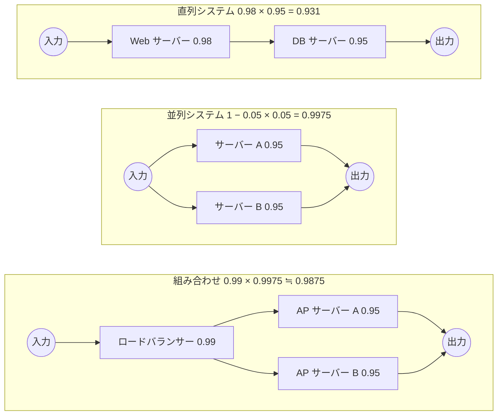

## この記事で分かること

- レスポンスタイム、ターンアラウンドタイム、スループットという 3 つの性能指標の違い
- MTBF と MTTR から稼働率を求める式と、その意味
- 直列システムと並列システムの稼働率の計算方法と、計算の前提
- 「稼働率 99.9%」が 1 年あたりどれだけの停止を許すのか
- RASIS や、フォールトトレランス・フェールセーフなどの信頼性設計の用語

## 一言で説明すると

システムの良さは「どれだけ速く・たくさん処理できるか（性能）」と「必要なときにどれだけ使えるか（可用性）」の 2 つの物差しで測ります。性能は時間や処理量で、可用性は「全体の時間のうち使えた時間の割合」（稼働率）で数値にします。

## なぜ必要なのか

「サーバーが遅い」「よく止まる」という感想のままでは、どこを直せばよいのか、直したらどれだけ良くなったのかが分かりません。指標を決めて数値で測ると、目標を立て、改善の効果を比べ、利用者と「どこまでを約束するか」を合意できるようになります。応用情報技術者試験のシラバス（Ver.7.2）でも、性能指標（レスポンスタイム、ターンアラウンドタイム、スループット、ベンチマーク）と、信頼性指標（MTBF、MTTR、稼働率、直列・並列システムの稼働率計算）が学習項目に挙げられています。

## 身近な例え

ラーメン店で考えてみます。注文してから最初の一杯が出てくるまでの時間が**レスポンスタイム**、団体客の注文がすべて出そろうまでの時間が**ターンアラウンドタイム**、1 時間に何杯出せるかが**スループット**です。そして、営業予定時間のうち実際に店を開けていられた割合が**稼働率**です。ときどき機材が壊れても（故障の間隔が長い＝MTBF が長い）、すぐ直せれば（修理時間が短い＝MTTR が短い）、稼働率は高く保てます。

<Callout type="warn" title="例えの限界">
ラーメン店の厨房は 1 か所なので、壊れればその間は店全体が止まります。実際のシステムでは、サーバーを複数台並べて 1 台が壊れても処理を続ける構成（後述する並列構成）が一般的です。また、店は「遅いが開いている」状態を自然に区別できますが、システムでは「応答が極端に遅い」状態を停止とみなすかどうかを事前に定義しておく必要があります。
</Callout>

## 性能の指標

### レスポンスタイムとターンアラウンドタイム

**レスポンスタイム（応答時間）**は、要求を出してから応答が返り始めるまでの時間です。Web ページなら、リンクをクリックしてから画面が反応するまでの待ち時間にあたり、対話的に使うシステムで重視されます。

**ターンアラウンドタイム**は、仕事を依頼してから結果がすべて得られるまでの時間です。夜間のバッチ処理（データをまとめて処理する仕事）のように、途中経過より完了時刻が大事な場面で重視されます。

OS の教科書として広く使われている OSTEP（Version 1.10）の第 7 章では、ターンアラウンドタイムを「完了時刻 − 到着時刻」、レスポンスタイムを「初めて実行された時刻 − 到着時刻」と定義しています。同書の脚注にもあるとおり、応答の起点と終点の取り方は資料によって少しずつ異なるため、試験や仕様書では問題文・文書の定義に従ってください。

### スループット

**スループット**は、単位時間あたりに処理できる仕事の量です。「1 秒あたりのリクエスト数」「1 分あたりのトランザクション（注文の確定や送金のように、ひとまとまりで完了させる処理の単位）数」のように表します。Google の SRE 本（第 4 章）でも、レイテンシ（応答時間）やエラー率と並んで、スループットがサービスの状態を測る代表的な指標として挙げられています。

レスポンスタイムが「1 件あたりの速さ」、スループットが「全体の処理量」を表すので、両者は別物です。例えば、レジを 1 台から 4 台に増やすと 1 時間に会計できる客数（スループット）は増えますが、1 人の会計そのものにかかる時間（処理時間）は縮みません。行列が解消すれば待ち時間は減りますが、空いているときの応答の速さは変わりません。逆に、処理が混み合って待ち行列ができると、スループットが上限に張り付いたままレスポンスタイムだけが悪化することがあります。

<Callout type="tip" title="覚え方">
3 つの指標は「何を数えるか」と「どちらが良いか」で整理すると混ざりません。前の 2 つは**時間**（短いほど良い）で、違いは終点だけです。スループットだけが**量**（多いほど良い）です。

| 指標 | 起点 → 終点 | 単位の例 | 良い方向 |
| --- | --- | --- | --- |
| レスポンスタイム | 要求 → 応答が返り始める | 秒 | 短いほど良い |
| ターンアラウンドタイム | 依頼（到着） → 結果がすべてそろう | 秒 | 短いほど良い |
| スループット | （単位時間あたり） | 件/秒 | 多いほど良い |

試験では、ジョブの到着時刻と実行順から「完了時刻 − 到着時刻」を計算させる形で問われます（記事末尾の過去問題にも例があります）。実行を待っていた時間もターンアラウンドタイムに含まれる点がポイントです。
</Callout>

### ベンチマーク

性能を製品間で比べるために、決められた処理を実行して結果を測るのが**ベンチマーク**です。代表的なものに、CPU の計算性能を測る SPEC CPU と、トランザクション処理やデータベースの性能を測る TPC のベンチマークがあります。SPEC CPU 2017 には、1 つの仕事を終えるまでの時間を比べる「speed」と、単位時間あたりの仕事量（スループット）を測る「rate」の 2 種類のスイートがあり、性能指標の違いがベンチマークの設計にも表れています。

speed と rate のそれぞれに、整数演算（Integer）と浮動小数点演算（Floating Point）のスイートがあります。シラバスの用語例にある SPECint と SPECfp は、SPEC の整数・浮動小数点の性能を指す通称です。なお SPEC の公式ページ（2026-11-28 確認）によると、SPEC CPU 2017 は後継の SPEC CPU 2026 のリリースに伴い 2026 年 11 月 17 日付で退役しています。

ベンチマークの結果は、あくまで「その処理を実行したときの値」です。自分のシステムの処理内容が違えば、同じ順位になるとは限りません。

## 可用性と稼働率

### MTBF と MTTR

**可用性**（Availability）は、必要なときにシステムを使える性質です。NIST の用語集には複数の定義が載っており、例えば NIST SP 800-160 Vol. 1 Rev. 1 の定義（ISO/IEC 7498-2 由来）は「権限を持つ者が、必要なときにアクセスして利用できる性質」です。可用性を数値にしたものが**稼働率**です。

稼働率は、次の 2 つの平均時間から求めます。

- **MTBF**（Mean Time Between Failures、平均故障間隔）: 故障から復旧した後、次に故障するまでに正常に動いていた時間の平均。長いほど壊れにくい（信頼性が高い）ことを表します。
- **MTTR**（Mean Time To Repair、平均修復時間）: 故障してから復旧するまでの時間の平均。短いほど直しやすい（保守性が高い）ことを表します。

システムは「動いている（MTBF の区間）→ 故障して止まっている（MTTR の区間）→ 動いている…」を繰り返すので、全体の時間のうち動いていた割合が稼働率になります。

$$
\text{稼働率} = \frac{\text{MTBF}}{\text{MTBF} + \text{MTTR}}
$$

<Callout type="note" title="MTBF の定義は資料によって異なる">
国内の講義資料（明治大学など）や試験対策では、上のように MTBF を「故障と故障の間の動作時間の平均」として扱います。一方、英語圏の講義資料には、MTBF を「動作時間の平均（MTTF: Mean Time To Failure）＋修復時間の平均（MTTR）」と定義するもの（KTH など）もあります。MTBF = MTTF + MTTR と定義する資料では、稼働率は MTTF ÷（MTTF + MTTR）になります。どちらも「動いていた時間 ÷ 全体の時間」という考え方は同じですが、記号の意味が違うので資料の定義を確認してください。
</Callout>

### 計算例：修復時間を短くすると

ここでは独自の数値で計算します。あるサーバーが、平均 1,960 時間動くごとに 1 回故障し、復旧に平均 40 時間かかるとします。

$$
\text{稼働率} = \frac{1960}{1960 + 40} = \frac{1960}{2000} = 0.98
$$

稼働率は 98% です。1 年（365 日 × 24 時間 = 8,760 時間）に換算すると、停止時間は $8760 \times 0.02 = 175.2$ 時間になります。

故障の頻度は変えずに、予備部品の常備や手順書の整備で MTTR を 10 時間に短くすると、次のようになります。

$$
\text{稼働率} = \frac{1960}{1960 + 10} = \frac{1960}{1970} \approx 0.9949
$$

稼働率は約 99.49% に上がります。壊れにくくする（MTBF を延ばす）ことだけでなく、早く直す（MTTR を縮める）ことでも稼働率は上がります。KTH の講義資料でも、MTTR を短くするには現地に予備部品と保守要員を常駐させるといった運用コストがかかることが指摘されています。

<Callout type="tip" title="覚え方">
時間の流れを「動く（MTBF）→ 止まる（MTTR）」の 1 周として思い浮かべ、稼働率は「1 周のうち動いていた割合」と覚えます。MTBF の B は Between（故障と故障の**間**）、MTTR の R は Repair（**修理**）です。

式の分子と分母を MTBF で割ると、次の形になります。

$$
\text{稼働率} = \frac{1}{1 + \dfrac{\text{MTTR}}{\text{MTBF}}}
$$

稼働率は MTTR と MTBF の**比**だけで決まる、ということです。両方を同じ倍率で変えても稼働率は変わらず、比を小さくする（壊れにくくする、または早く直す）と上がります。上の計算例では、比が $40/1960$ から $10/1960$ に下がったので稼働率が上がりました。
</Callout>

## 直列システムと並列システム

### 直列システム：すべて動いて初めて動く

Web サーバーとデータベースサーバーのように、**どれか 1 つでも止まるとシステム全体が止まる**構成を**直列システム**と呼びます。各装置の稼働率を $A_1, A_2$ とすると、全体の稼働率は次のとおりです。

$$
A_{\text{直列}} = A_1 \times A_2
$$

例えば、Web サーバーの稼働率が 0.98、データベースサーバーの稼働率が 0.95 なら、$0.98 \times 0.95 = 0.931$ です。全体の稼働率は、**どの装置単体よりも低く**なります。

### 並列システム：どれか 1 つ動けば動く

同じ役割のサーバーを 2 台用意し、**どちらか 1 台が動いていればシステムが動く**構成を**並列システム**と呼びます。全体が止まるのは「両方とも止まっている」ときだけなので、1 からその確率を引きます。

$$
A_{\text{並列}} = 1 - (1 - A_1)(1 - A_2)
$$

稼働率 0.95 のサーバーを 2 台並列にすると、1 台が止まっている確率は 0.05 なので、$1 - 0.05 \times 0.05 = 1 - 0.0025 = 0.9975$ です。

この式では、1 台が止まっても残りの 1 台がすぐに処理を引き継げるものとして、切り替えにかかる時間を無視しています。1 台だけで処理し、もう 1 台を待機させておく**アクティブ－スタンバイ構成**で切替時間を考える場合は、稼働中の 1 台が故障すると待機系に切り替わるまでの間だけシステムが止まります。故障したサーバーの修理は待機系が動いている間に行えるので、2 台が同時に故障しない前提なら、1 回の故障による停止時間は MTTR ではなく切替時間になります。このときの稼働率は、MTBF ÷（MTBF + 切替時間）で見積もれます。

### 組み合わせた例

並列にしたアプリケーションサーバー 2 台（各 0.95）の前に、稼働率 0.99 のロードバランサー（負荷分散装置）を 1 台置く構成を考えます。まず並列部分を 1 つにまとめて 0.9975 とし、それとロードバランサーが直列につながっているとみなします。

$$
0.99 \times 0.9975 = 0.987525
$$

全体は約 98.75% で、並列部分（99.75%）よりも下がっています。ロードバランサーが 1 台しかないため、ここが止まると全体が止まるからです。このように、1 つ止まると全体が止まる箇所を**単一障害点**（SPOF: Single Point of Failure）と呼びます。

ここまでの 3 つの構成と計算を、次の図に並べました。

図の上段は直列システムで、入力から出力まで 1 本の道しかありません。どの箱が止まっても道が切れるので、稼働率は掛け算で小さくなります。中段の並列システムでは道が 2 本あり、両方が同時に切れない限り出力まで届きます。下段は組み合わせで、ロードバランサーの部分は 1 本道（直列）、その先の AP サーバー（アプリケーションサーバー）は 2 本道（並列）になっています。下段の計算のように、組み合わせた構成は「並列部分を 1 つの箱にまとめてから、直列として掛ける」順に計算します。

<Callout type="tip" title="覚え方">
直列と並列は、**何を掛け算するか**が入れ替わっているだけです。

| 構成 | 全体が止まらない条件 | 掛け算するもの | 全体の値 |
| --- | --- | --- | --- |
| 直列 | 全部が動いている | 各装置の**稼働率** | 一番低い装置よりさらに低い |
| 並列 | 1 台でも動いている | 各装置の**止まっている確率**（1 − 稼働率） | 一番高い装置よりさらに高い（1 から引く） |

（「全体の値」の列は、各装置の稼働率が 0 より大きく 1 未満のときの比較です。）

図の道に当てはめると、直列は「1 本道の全区間が通れる確率」、並列は「すべての道が同時に切れる確率」を先に求めて 1 から引く、と覚えられます。選択肢で値の大小を比べる問題では、まず「単体より上がるか下がるか」で絞り込めます。
</Callout>

### 計算の前提

これらの式は、各装置が**互いに独立に故障する**ことを前提にしています。NIST の統計ハンドブックの直列モデル・並列モデルは、ある時間まで故障せずに動き続ける確率（信頼度 $R(t)$）のモデルで、部品が独立に動作・故障することを仮定していると明記されています。KTH の講義資料でも、直列・並列の式は部品が独立である場合のものとして示されており、稼働率の式も同じ仮定の上に成り立っています。並列構成で 2 台が同じ電源や同じソフトウェアのバグを共有していると、2 台が同時に止まりやすくなり、実際の稼働率は計算より低くなります。また並列の式は「1 台だけでも全体の処理をこなせる」ことも前提にしています。1 台では負荷を支えきれない構成なら、1 台が残っていても実質的に使えない場合があります。

## 「99.9%」はどれくらい止まるのか

稼働率を「9 がいくつ並ぶか」で呼ぶことがあります（99.9% なら「スリーナイン」）。1 年を 365 日（8,760 時間 ＝ 525,600 分）として、許される停止時間を計算すると次のとおりです。

| 稼働率 | 停止してよい割合 | 1 年あたりの停止時間 | 計算 |
| --- | --- | --- | --- |
| 99% | 1% | 87.6 時間（約 3.65 日） | $8760 \times 0.01$ |
| 99.9% | 0.1% | 8.76 時間（約 8 時間 46 分） | $8760 \times 0.001$ |
| 99.99% | 0.01% | 52.56 分 | $525600 \times 0.0001$ |
| 99.999% | 0.001% | 約 5.26 分 | $525600 \times 0.00001$ |

99.99% の 52.56 分という値は、Google の SRE 本（第 3 章）に示されている値とも一致します。9 が 1 つ増えるごとに、許される停止時間は 10 分の 1 になります。99.9% でも、1 か月（30 日）に直すと $30 \times 24 \times 60 \times 0.001 = 43.2$ 分止まってよいことになります。

## RASIS と信頼性設計

### RASIS

シラバスでは、システムを評価する観点として **RASIS** を挙げています。

| 頭文字 | 観点 | 意味 | 主な指標 |
| --- | --- | --- | --- |
| R | Reliability（信頼性） | 壊れにくさ | MTBF |
| A | Availability（可用性） | 使いたいときに使えるか | 稼働率 |
| S | Serviceability（保守性） | 直しやすさ | MTTR |
| I | Integrity（完全性） | データが壊れたり矛盾したりしないか | — |
| S | Security（安全性） | 不正な利用や漏えいから守られているか | — |

前半の RAS は、この記事で扱った MTBF・稼働率・MTTR に対応しています。

### 信頼性設計の考え方

故障や誤操作に備える設計の考え方には、次のようなものがあります（いずれもシラバスの用語例）。

| 用語 | 考え方 | 例 |
| --- | --- | --- |
| フォールトアボイダンス | 故障そのものが起きにくいようにする | 信頼性の高い部品の採用、予防保守 |
| フォールトトレラント（フォールトトレランス） | 構成要素の一部が故障しても、システム全体として動作を続ける | サーバーやディスクの多重化 |
| フェールセーフ | 故障したときは、安全な側に倒れるように止める | 鉄道の信号機が、故障時には停止を示す |
| フェールソフト | 故障した部分を切り離し、機能を落としてでも運転を続ける | 一部のサーバーが止まったら、検索機能だけ止めて閲覧は続ける |
| フールプルーフ | 人が誤った操作をしても、事故につながらないようにする | 確認ダイアログ、誤入力を受け付けない入力欄 |

フォールトアボイダンスが「故障を減らす」考え方なのに対し、フォールトトレラント・フェールセーフ・フェールソフトの 3 つは「故障は起きるもの」として、フールプルーフは「誤操作は起きるもの」として備える考え方です。NIST の用語集では、フォールトトレランスを「1 つ以上の構成要素が故障してもシステムが動き続ける能力」、フェールセーフを「故障時に、データ・財産・生命などへの損害を防ぐ形で機能を終了するモード」、フェールソフトを「故障時に、影響を受けた必須でない機能を選択的に終了すること」と定義しています。

<Callout type="tip" title="覚え方">
「いつ備えるか」と「故障したらどうなるか」の 2 つの問いで仕分けると、用語を取り違えません。

| いつ備えるか | 故障したら | 用語 | 英単語の手がかり |
| --- | --- | --- | --- |
| 故障の**前** | 故障そのものを減らす | フォールトアボイダンス | avoid ＝ 避ける |
| 故障の**後** | 全体として**そのまま動き続ける** | フォールトトレラント | tolerate ＝ 耐える |
| 故障の**後** | 安全側に**止めて守る** | フェールセーフ | safe ＝ 安全 |
| 故障の**後** | 機能を**縮小して続ける** | フェールソフト | soft ＝ 柔らかく（ゆるやかに）落とす |
| 人の**誤り**に | 誤操作でも事故にしない | フールプルーフ | fool-proof ＝ 誤っても大丈夫 |

選択肢では、用語と説明が入れ替えて出されることがあります。例えば、エレベーターが故障したら全機能を止めてかごをその場に固定するのは「止めて守る」のでフェールセーフ、空調の一部の系統が壊れたらその系統だけ止めて残りの系統で冷房を続けるのは「縮小して続ける」のでフェールソフトです。迷ったら英単語の意味に戻ると見分けられます。
</Callout>

## 実務での活用例

- **SLA と SLO**: シラバスでは、SLA（Service Level Agreement、サービスレベル合意書）を、サービスとその合意されたパフォーマンスを定めた組織と顧客との合意文書として説明しています。Google の SRE 本では、測る指標を SLI、その目標値を SLO、目標を守れなかったときの結果（典型的には返金などの金銭的なもの）を伴う契約を SLA と区別しています。
- **エラーバジェット**: SRE 本では、SLO が許す不安定さの量（四半期ごとに決める）を**エラーバジェット**と呼び、予算が残っている間は新しいリリースを進め、使い切ったらリリースを一時停止する運用を紹介しています。稼働率 100% を目指さず、許される停止時間を予算として使う考え方です。
- **平均だけでなく分布を見る**: SRE 本では、平均のレスポンスタイムは一部の極端に遅いリクエストを隠してしまうため、99 パーセンタイル（遅いほうから 1% の境目）なども見るべきだとしています。
- **冗長化のコストとのバランス**: SRE 本は、信頼性を一段上げるコストは直前の一段の 100 倍になることもあると述べています。サーバーを並列にすれば台数分の費用がかかり、運用も複雑になります。どこまで稼働率を上げるかは、止まったときの損失と費用を比べて決めます。

## 性能と可用性の比較

| 観点 | 性能 | 可用性 |
| --- | --- | --- |
| 問い | どれだけ速く・多く処理できるか | 必要なときに使えるか |
| 代表的な指標 | レスポンスタイム、ターンアラウンドタイム、スループット | 稼働率、MTBF、MTTR |
| 主な改善策 | 処理の高速化、台数を増やして負荷を分散 | 冗長化（並列構成）、故障の予防、復旧の迅速化 |
| 測り方の例 | ベンチマーク、モニタリング | 停止時間の記録、リクエスト成功率 |

サーバーを並列に増やす対策は、スループットと可用性の両方に効くことがあります。ただし目的が違うので、「何台で何件さばけるか」と「何台壊れても動くか」は別々に見積もる必要があります。

## よくある誤解

<Misconceptions
  items={[
    { myth: 'サーバーを 2 台並列にすれば、稼働率は 2 倍になる。', fact: '稼働率は 1（100%）を超えません。0.95 のサーバーを 2 台並列にすると 0.9975 で、変わるのは「止まっている確率」が 0.05 から 0.0025（20 分の 1）に減ることです。しかも共通の電源や同じバグで同時に止まる場合は、計算ほど上がりません。' },
    { myth: '可用性が高いシステムは、性能も高い。', fact: '可用性は「使えるかどうか」、性能は「どれだけ速いか」で、別の指標です。稼働率 99.99% でも応答が遅いシステムはあり得ます。どの程度遅ければ「使えない」とみなすかは、SLO などで別に定義します。' },
    { myth: '稼働率 99.9% なら、ほとんど止まらない。', fact: '1 年を 365 日とすると、99.9% は年 8.76 時間、1 か月（30 日）でも 43.2 分の停止を許します。止まると困る業務なら、この時間が許容できるかを具体的に確かめる必要があります。' },
    { myth: '直列につなぐ装置を増やしても、各装置の稼働率が高ければ全体は変わらない。', fact: '直列では稼働率の掛け算になるので、（稼働率が 1 未満の装置を足すかぎり）装置が増えるほど全体は必ず下がります。0.99 の装置を 5 台直列にすると約 0.951 です。' },
  ]}
/>

## まとめ

- レスポンスタイムは応答が返り始めるまで、ターンアラウンドタイムは結果がすべてそろうまでの時間、スループットは単位時間あたりの処理量で、それぞれ別のものを測ります。
- 稼働率は MTBF ÷（MTBF + MTTR）で求め、壊れにくくするだけでなく早く直すことでも上がります。
- 直列システムは掛け算で下がり、並列システムは「全部止まる確率」を 1 から引いて求めます。いずれも故障が独立であることが前提です。
- 99.9% は年 8.76 時間の停止を許します。9 が 1 つ増えるごとに許される停止時間は 10 分の 1 になります。
- RASIS は評価の観点、フォールトトレランス・フェールセーフ・フェールソフト・フールプルーフは故障や誤操作に備える設計の考え方です。

## 理解度チェック

**問1**: 平均 1,440 時間動くごとに故障し、復旧に平均 60 時間かかる装置の稼働率はいくつですか。

答えと解説

$1440 \div (1440 + 60) = 1440 \div 1500 = 0.96$ で、96% です。

**問2**: 稼働率 0.9 の装置 A と稼働率 0.8 の装置 B があります。直列につないだ場合と並列につないだ場合の稼働率をそれぞれ求めてください。

答えと解説

直列は $0.9 \times 0.8 = 0.72$ です。並列は $1 - (1 - 0.9)(1 - 0.8) = 1 - 0.1 \times 0.2 = 1 - 0.02 = 0.98$ です。直列では低いほうの 0.8 より下がり、並列では高いほうの 0.9 より上がります（故障が独立で、1 台で処理をこなせる場合）。

**問3**: 稼働率 99.95% のサービスは、1 年（365 日）あたり何分まで停止してよいことになりますか。

答えと解説

停止してよい割合は 0.05%（0.0005）なので、$525600 \times 0.0005 = 262.8$ 分（約 4 時間 23 分）です。

## 過去問題

<PastExam source="令和7年度 秋期 応用情報技術者試験 午前 問15">
五つのジョブ A～E に対して，ジョブの多重度が 1 で，処理時間順方式のスケジューリングを適用した場合，ジョブ B のターンアラウンドタイムは何秒か。ここで，OS のオーバーヘッドは考慮しないものとする。

単位　秒

| ジョブ | 到着時刻 | 単独実行時の処理時間 |
| --- | --- | --- |
| A | 0 | 2 |
| B | 1 | 4 |
| C | 2 | 3 |
| D | 3 | 2 |
| E | 4 | 1 |

- ア　8
- イ　9
- ウ　10
- エ　11

<PastExamAnswer answer="エ">
処理時間順方式は、実行を待っているジョブのうち処理時間が最も短いものを次に実行する方式です（多重度 1 なので、実行中のジョブは最後まで走らせます）。A が 0〜2 秒、その時点で待っている B（4 秒）と C（3 秒）のうち短い C が 2〜5 秒、5 秒の時点で待っている B・D・E のうち E が 5〜6 秒、D が 6〜8 秒、最後に B が 8〜12 秒に実行されます。「レスポンスタイムとターンアラウンドタイム」の節の定義どおり「完了時刻 − 到着時刻」で、$12 - 1 = 11$ 秒です。B の処理時間は 4 秒ですが、待たされた 7 秒も含まれます。
</PastExamAnswer>
</PastExam>

<PastExam source="令和6年度 秋期 応用情報技術者試験 午前 問15">
あるクライアントサーバシステムにおいて，クライアントから要求された 1 件の検索を処理するために，サーバで平均 100 万命令が実行される。1 件の検索につき，ネットワーク内で転送されるデータは平均 $2 \times 10^5$ バイトである。このサーバの性能は 100 MIPS であり，ネットワークの転送速度は $8 \times 10^7$ ビット／秒である。このシステムにおいて，1 秒間に処理できる検索要求は何件か。ここで，処理できる件数は，サーバとネットワークの処理能力だけで決まるものとする。また，1 バイトは 8 ビットとする。

- ア　50
- イ　100
- ウ　200
- エ　400

<PastExamAnswer answer="ア">
「スループット」の節の考え方で、サーバとネットワークのそれぞれが 1 秒間に何件こなせるかを求めます。サーバは $100 \times 10^6$ 命令/秒 ÷ $10^6$ 命令/件 $= 100$ 件/秒です。ネットワークは 1 件あたり $2 \times 10^5 \times 8 = 1.6 \times 10^6$ ビットなので、$8 \times 10^7 \div 1.6 \times 10^6 = 50$ 件/秒です。両方を通らないと 1 件が終わらないので、システム全体は少ないほうの 50 件/秒に制限されます。
</PastExamAnswer>
</PastExam>

<PastExam source="令和7年度 秋期 応用情報技術者試験 午前 問13">
コンピュータシステムの信頼性に関する記述のうち，適切なものはどれか。

- ア　$\dfrac{\text{MTBF}}{\text{MTBF} + \text{MTTR}}$ は，システムが稼働している時間の割合を表す。
- イ　MTBF－MTTR は，システムが正常であった時間を表す。
- ウ　MTBF は，正常なシステムが運用を開始してから初めて故障が起きるまでの時間を表す。
- エ　MTTR は，システムの故障が回復した時点から次に故障が起きるまでの平均時間を表す。

<PastExamAnswer answer="ア">
「MTBF と MTTR」の節の式そのもので、MTBF ÷（MTBF + MTTR）は全体の時間のうち動いていた時間の割合、つまり稼働率です。エの「回復してから次の故障までの平均時間」は MTTR ではなく MTBF の説明です。ウは「初めて」の故障までに限っている点が、故障と復旧を繰り返す間の平均である MTBF と合いません。イの差には決まった意味がありません。
</PastExamAnswer>
</PastExam>

<PastExam source="令和7年度 春期 応用情報技術者試験 午前 問12">
二つのシステム A，B の稼働率をそれぞれ $\alpha_A$ ($0 < \alpha_A < 1$)，$\alpha_B$ ($0 < \alpha_B < 1$)，MTBF をそれぞれ $\text{MTBF}_A$，$\text{MTBF}_B$，MTTR をそれぞれ $\text{MTTR}_A$，$\text{MTTR}_B$ としたとき，これらの関係として，常に成り立つものはどれか。

- ア　$\alpha_A = \alpha_B$ ならば，$\text{MTBF}_A = \text{MTBF}_B$ であり，かつ $\text{MTTR}_A = \text{MTTR}_B$ である。
- イ　$\alpha_A = \alpha_B$ ならば，$\text{MTTR}_A / \text{MTBF}_A = \text{MTTR}_B / \text{MTBF}_B$ である。
- ウ　$\alpha_A > \alpha_B$ ならば，$\text{MTBF}_A > \text{MTBF}_B$ であり，かつ $\text{MTTR}_A > \text{MTTR}_B$ である。
- エ　$\alpha_A > \alpha_B$ ならば，$\text{MTTR}_A / \text{MTBF}_A > \text{MTTR}_B / \text{MTBF}_B$ である。

<PastExamAnswer answer="イ">
「計算例：修復時間を短くすると」の覚え方で示したとおり、稼働率は $\alpha = 1 \div (1 + \text{MTTR}/\text{MTBF})$ と書け、MTTR/MTBF の比だけで決まります。稼働率が等しければこの比も等しいのでイが正しく、比が同じでも値そのものは違い得るのでアは常には成り立ちません。稼働率が高いほど比は小さくなるので、エは不等号が逆です。ウは、MTTR が大きい（直すのに時間がかかる）ほうが稼働率が高いとは限らないので誤りです。
</PastExamAnswer>
</PastExam>

<PastExam source="令和4年度 春期 応用情報技術者試験 午前 問14">
MTBF を長くするよりも，MTTR を短くするのに役立つものはどれか。

- ア　エラーログ取得機能
- イ　記憶装置のビット誤り訂正機能
- ウ　命令再試行機能
- エ　予防保全

<PastExamAnswer answer="ア">
MTTR は故障してから復旧するまでの時間なので、故障の原因を早く突き止められるエラーログが修理時間の短縮に役立ちます。ビット誤り訂正と命令再試行は、一時的な誤りをその場で直してシステムを止めない仕組みで、故障による停止を減らす（MTBF を長くする）側です。予防保全も、故障を起こりにくくする「フォールトアボイダンス」の考え方で、MTBF 側の対策です。
</PastExamAnswer>
</PastExam>

<PastExam source="令和5年度 秋期 応用情報技術者試験 午前 問15">
アクティブ－スタンバイ構成の 2 台のサーバから成るシステムがある。各サーバの MTBF は 99 時間，MTTR は 10 時間，フェールオーバーに要する時間は 2 時間であるとき，このシステムの稼働率はおよそ幾らか。ここで，二重に障害は発生しないものとする。

- ア　0.82
- イ　0.89
- ウ　0.91
- エ　0.98

<PastExamAnswer answer="エ">
「並列システム」の節で説明したアクティブ－スタンバイ構成の見積もりです。稼働率は「動いていた時間 ÷ 全体の時間」で、稼働中のサーバが平均 99 時間で故障すると、待機系に切り替わるまでの 2 時間だけシステムが止まります。故障したサーバの修理（10 時間）は、待機系が動いている間に行われるので、二重障害がない前提ではシステムの停止になりません。したがって $99 \div (99 + 2) \approx 0.98$ です。MTTR を使って $99 \div (99 + 10) \approx 0.91$ としたウは、1 台構成の稼働率です。
</PastExamAnswer>
</PastExam>

<PastExam source="令和6年度 秋期 応用情報技術者試験 午前 問14" modified>
稼働率が等しい装置 X を直列や並列に組み合わせたとき，システム全体の稼働率を高い順に並べたものはどれか。ここで，装置 X の稼働率は 0 よりも大きく 1 未満である。

| 構成 | 装置 X の組合せ |
| --- | --- |
| A | X 2 台を並列に接続する。 |
| B | X 1 台と，X 2 台を並列に接続した部分とを直列に接続する。 |
| C | X 2 台を直列に接続したものを 2 組作り，それらを並列に接続する。 |

- ア　A，B，C
- イ　A，C，B
- ウ　C，A，B
- エ　C，B，A

<PastExamAnswer answer="イ">
X の稼働率を $x$ とすると、「直列システムと並列システム」の節の式から、A は $1 - (1 - x)^2$、B は A に $x$ を掛けた $x\{1 - (1 - x)^2\}$、C は 2 台直列（$x^2$）を並列にした $1 - (1 - x^2)^2$ です。B は A に 1 未満の $x$ を掛けているので A より低く、C は並列にする 1 組の稼働率が $x^2 < x$ なので A より低くなります。例えば $x = 0.9$ なら A = 0.99、C ≒ 0.964、B ≒ 0.891 で、A、C、B の順です（一般にも $C - B = x^3(1 - x) > 0$ です）。
</PastExamAnswer>
</PastExam>

<PastExam source="令和4年度 春期 応用情報技術者試験 午前 問15">
2 台のプリンタがあり，それぞれの稼働率が 0.7 と 0.6 である。この 2 台のいずれか一方が稼働していて，他方が故障している確率は幾らか。ここで，2 台のプリンタの稼働状態は独立であり，プリンタ以外の要因は考慮しないものとする。

- ア　0.18
- イ　0.28
- ウ　0.42
- エ　0.46

<PastExamAnswer answer="エ">
「計算の前提」の節のとおり、稼働状態が独立なら確率を掛け算できます。「0.7 のほうだけ稼働」は $0.7 \times (1 - 0.6) = 0.28$、「0.6 のほうだけ稼働」は $(1 - 0.7) \times 0.6 = 0.18$ で、合計 0.46 です。ここに両方稼働の $0.7 \times 0.6 = 0.42$ を足した 0.88 が、並列システムの稼働率 $1 - 0.3 \times 0.4$ と一致することも確かめておくと、並列の式の意味がつかめます。
</PastExamAnswer>
</PastExam>

<PastExam source="令和6年度 春期 応用情報技術者試験 午前 問12">
システムの信頼性設計に関する記述のうち，適切なものはどれか。

- ア　フェールセーフとは，利用者の誤操作によってシステムが異常終了してしまうことのないように，単純なミスを発生させないようにする設計方法である。
- イ　フェールソフトとは，故障が発生した場合でも機能を縮退させることなく稼働を継続する概念である。
- ウ　フォールトアボイダンスとは，システム構成要素の個々の品質を高めて故障が発生しないようにする概念である。
- エ　フォールトトレランスとは，故障が生じてもシステムに重大な影響が出ないように，あらかじめ定められた安全状態にシステムを固定し，全体として安全が維持されるような設計方法である。

<PastExamAnswer answer="ウ">
「信頼性設計の考え方」の表のとおり、故障そのものを起こりにくくするのがフォールトアボイダンスです。アは人の誤操作に備えるフールプルーフの説明です。イのフェールソフトは機能を縮小して（縮退させて）運転を続けるもので、「縮退させることなく」が誤りです。エの「安全状態に固定する」はフェールセーフの説明です。
</PastExamAnswer>
</PastExam>

<PastExam source="令和3年度 秋期 応用情報技術者試験 午前 問13">
信頼性設計においてフールプルーフを実現する仕組みの一つであるインタロックの例として，適切なものはどれか。

- ア　ある機械が故障したとき，それを停止させて代替の機械に自動的に切り替える仕組み
- イ　ある条件下では，特定の人間だけが，システムを利用することを可能にする仕組み
- ウ　システムの一部に不具合が生じたとき，その部分を停止させて機能を縮小してシステムを稼働し続ける仕組み
- エ　動作中の機械から一定の範囲内に人間が立ち入ったことをセンサが感知したとき，機械の動作を停止させる仕組み

<PastExamAnswer answer="エ">
フールプルーフは、人が誤った操作や行動をしても事故につながらないようにする考え方です。危険な範囲に人が入るという誤った行動があっても機械を止めて事故を防ぐエが、その例になります。アは故障に備える多重化（フォールトトレラント）、ウは機能を縮小して続けるフェールソフトで、どちらも人の誤りではなく故障への備えです。イは利用者を限定するアクセス制御の説明です。
</PastExamAnswer>
</PastExam>
