## この記事で分かること

- 仮想記憶が解決する 2 つの問題（物理メモリの不足と、プログラム同士の隔離）
- 仮想アドレスと物理アドレスの違い、ページングとページテーブルによるアドレス変換
- アドレス変換を速くする TLB と、キャッシュメモリとの関係
- ページフォールト、デマンドページング、ページ置換え（FIFO と LRU）の考え方
- スラッシングやセグメンテーションフォールトなど、実務で出会う現象との関係

## 一言で説明すると

仮想記憶は、プログラムごとに「自分専用の広いメモリ」があるように見せ、そのメモリ上の住所（仮想アドレス）を、OS とハードウェアが実際のメモリ上の住所（物理アドレス）へ裏側で置き換える仕組みです。

## なぜ必要なのか

[メモリとストレージ](/fundamentals/memory-and-storage/)で見たように、メインメモリは速い代わりに容量に限りがあります。一方で、PC やサーバーでは多くのプログラムが同時に動いています。仮想記憶がなかったとすると、次の 2 つの問題が起きます。

1. **容量の問題**: すべてのプログラムが使うデータを同時にメインメモリへ置かなければならず、入りきらなければ動かせません。
2. **隔離の問題**: どのプログラムも同じ物理メモリを直接指定して読み書きできると、1 つのプログラムの不具合や悪意で、他のプログラムや OS のデータが壊されてしまいます。

ウィスコンシン大学の OS の教科書 OSTEP（Operating Systems: Three Easy Pieces）は、仮想記憶の目標として、プログラムに仮想化を意識させない**透過性**、時間と空間の**効率**、そして**プロセス**（実行中のプログラム）同士や OS を守る**保護**を挙げています。保護によって、あるプロセスの読み書きが他のプロセスや OS のメモリに一切届かない状態、つまり**隔離**が実現されます。さらに同書の第 21 章は、ディスク上の**スワップ領域**を使って物理メモリより多くのメモリを使えるようにすることを、現代の仮想記憶システムはすべて行っていると説明しています。

## 身近な例え

荷物の預かりサービスを想像してください。利用者は「私の箱の 1 番、2 番」のように自分だけの番号で荷物を呼びます。実際にどの棚に置かれているかは受付の台帳に書かれていて、利用者は知りません。台帳があるので、別の利用者の「1 番」と自分の「1 番」が混ざることはなく、他人の棚に手を出すこともできません。棚がいっぱいになると、しばらく出し入れのない箱は遠くの倉庫へ移され、頼まれたときに取り寄せられます。

ここで、利用者の番号が仮想アドレス、棚の位置が物理アドレス、受付の台帳がページテーブル、遠くの倉庫がディスク（スワップ領域）にあたります。

<Callout type="warn" title="例えの限界">
受付は人が台帳を見て案内しますが、実際のアドレス変換は命令が実行されるたびにハードウェア（MMU）が行います。台帳の内容を用意して書き換えるのは OS です。また、荷物は 1 つずつ預けますが、仮想記憶では決まった大きさの「ページ」単位でまとめて扱います。遠くの倉庫から取り寄せる時間は、実際にはメモリアクセスに比べて桁違いに長くかかります。
</Callout>

## 技術的な仕組み

### 仮想アドレスと物理アドレス

プログラムが扱うアドレスを**仮想アドレス**、メインメモリ上の実際の位置を**物理アドレス**（実アドレス）と呼びます。OSTEP は、C 言語でポインタの値を表示したときに見える数値も含め、ユーザープログラムから見えるアドレスはすべて仮想アドレスであり、本当の配置を知っているのは OS とハードウェアだけだと説明しています。プロセスごとに独立した仮想的なメモリ空間を**アドレス空間**と呼びます。

Linux カーネルのドキュメント（docs.kernel.org、2026-11-28 確認）でも、すべてのメモリアクセスは仮想アドレスを使い、CPU がそれを物理アドレスへ変換すると説明されています。この変換を担うハードウェアが **MMU**（Memory Management Unit）で、応用情報技術者試験のシラバスでは **DAT**（Dynamic Address Translator、動的アドレス変換）という用語で挙げられています。

### ページング：固定長に区切って対応付ける

代表的な方式が**ページング**です。仮想アドレス空間を**ページ**と呼ぶ固定長の区画に、物理メモリを同じ大きさの**ページフレーム**に区切り、「どのページをどのフレームに置いたか」を**ページテーブル**に記録します。ページテーブルは一般にプロセスごとに 1 つあり、OS が管理します。

仮想アドレスは、上位の**ページ番号**と下位の**オフセット**（ページ内の位置）に分けて扱います。OSTEP では、32 ビットのアドレス空間で 4KB のページを使う場合、ページ番号が 20 ビット、オフセットが 12 ビットになる例が示されています（$2^{12} = 4096$）。変換で置き換わるのはページ番号だけで、オフセットはそのまま使われます。

独自の例で計算してみます。ページの大きさを 4KB（16 進数で 0x1000）とし、ページテーブルに「ページ 3 → フレーム 7」と書かれているとします。

- 仮想アドレス 0x3A7C は、ページ番号 0x3、オフセット 0xA7C に分かれます。
- ページ 3 はフレーム 7 にあるので、物理アドレスは 0x7A7C です。

<Callout type="tip" title="覚え方">
オフセットのビット数はページの大きさから導けます。4KB は $2^{12}$ バイトなので、ページ内の位置を表すには 12 ビット要ります。16 進数の 1 桁は 4 ビットなので、12 ビットは 16 進数の 3 桁です。つまり 4KB のページでは「16 進数の下 3 桁はそのまま写し、上の桁だけページテーブルで付け替える」と覚えられます。ページの中身はフレームへまるごと移されるので、ページ内の位置（オフセット）が変わらないのは当然、と理屈で納得しておくと計算を間違えません。
</Callout>

ページテーブルの各エントリには、フレーム番号のほかに、そのページが有効かを示すビット、読み書き・実行を許すかを示す保護ビット、物理メモリ上にあるかを示す**存在ビット**（present ビット）、書き換えられたかを示すビットなどが入ります。無効なページや許可されていない方法でアクセスすると OS に処理が移り（トラップ）、多くの場合そのプロセスは終了させられます。これが仮想記憶による**記憶保護**です。

### TLB：アドレス変換のキャッシュ

ページテーブルは大きいため MMU の中には置けず、メインメモリ上に置かれます。すると、データを 1 回読むたびに、まずページテーブルを読むための余分なメモリアクセスが必要になり、遅くなってしまいます。

そこで MMU は **TLB**（Translation Lookaside Buffer）を備えています。OSTEP は TLB を「よく使われる仮想アドレスから物理アドレスへの変換を保持するハードウェアキャッシュ」と説明し、アドレス変換キャッシュと呼ぶほうが実態に近いとしています。TLB にあればページテーブルを見ずに変換でき（TLB ヒット）、なければページテーブルを引いて TLB に登録してから命令をやり直します（TLB ミス）。TLB が効くのは、[キャッシュメモリ](/fundamentals/cache-memory/)と同じく局所性があるからです。TLB が保持するのはデータそのものではなく「変換結果」である点に注意してください。

### ページフォールトとデマンドページング

物理メモリが足りないとき、OS はしばらく使われていないページをディスク上のスワップ領域へ書き出し（**ページアウト**）、そのページの存在ビットを 0 にします。存在ビットが 0 のページにアクセスすると、ハードウェアは例外を起こし、OS の**ページフォールトハンドラ**が呼ばれます。これを**ページフォールト**と呼びます。

OSTEP によると、OS はディスクからページを読み込み（**ページイン**）、ページテーブルを更新してから、止まっていた命令をやり直させます。読み込みを待つ間、そのプロセスは待ち状態になり、OS は別のプロセスを実行できます。プログラムの起動時にすべてを読み込まず、アクセスされたページだけをその時点で読み込む方式を**デマンドページング**と呼びます。

ページフォールトという名前ですが、これは正当なアクセスに対して起こる通常の出来事で、エラーではありません。OSTEP も、本来は「ページミス」と呼ぶべきものだと述べています。ただし同書によると、この言葉はページテーブルの参照で起きる例外全般を指して広く使われることもあり、無効なページや保護ビットに反するアクセスも、同じように例外として OS に処理が移ります。ページテーブルのエントリにある有効ビットや保護ビット、存在ビットによって、ディスクから読み込めば済む正当なアクセスなのか不正なアクセスなのかが区別され、不正な場合はプロセスが終了させられることが多いと同書は説明しています。

ここまでの TLB とページフォールトを、1 回のメモリアクセスの流れとしてまとめると次の図になります。

```mermaid
flowchart TD
  accTitle: 仮想アドレスが物理アドレスに変換される流れ
  A[CPU が仮想アドレスでアクセス] --> B[ページ番号とオフセットに分ける]
  B --> C{TLB に変換があるか}
  C -- ある: TLB ヒット --> H[フレーム番号とオフセットで物理アドレスを作る]
  C -- ない: TLB ミス --> D[メモリ上のページテーブルを引く]
  D --> E{ページは物理メモリにあるか}
  E -- ある --> F[TLB に変換を登録]
  F --> C
  E -- ない: ページフォールト --> G[OS がディスクから読み込みページテーブルを更新]
  G --> C
  H --> I[メインメモリにアクセス]
```

上の図では、まず TLB を調べ、ヒットすればすぐに物理アドレスを作ってメモリへアクセスします。TLB ミスならページテーブルを引き、ページが物理メモリにあれば変換を TLB に登録してやり直します。ページが物理メモリにない場合はページフォールトとなり、OS がディスクからページを読み込んでページテーブルを更新した後、命令をやり直します。空きフレームがなければ、読み込む前に次に説明するページ置換えでフレームを空けます。かかる時間は TLB ヒット、TLB ミス、ページフォールトの順に長くなり、特にディスクの読み込みを含むページフォールトは桁違いに時間がかかります。なお、TLB ミスをハードウェアが処理するか OS が処理するかは CPU のアーキテクチャによって異なります（OSTEP では x86 がハードウェア処理の例として挙げられています）。

<Callout type="tip" title="覚え方">
図の分岐を上から順に、「変換の情報をどこまで探しに行くか」と読むと 3 つの場合を区別できます。下の段ほど探しに行く先が遠くなり、時間がかかります。

| 場合 | 探しに行く先 | 処理する主体 |
| --- | --- | --- |
| TLB ヒット | MMU の中の TLB | ハードウェア |
| TLB ミス | メインメモリ上のページテーブル | ハードウェア（CPU によっては OS） |
| ページフォールト | ディスク（スワップ領域など） | OS |

ページフォールトの後始末も因果でたどれます。この記事と試験のモデル（正当なアクセスでページフォールトが起きるたびに、ディスクからページを読み込む場合）では、ページフォールト 1 回につき、そのページを読み込む**ページイン**が 1 回起きます。一方、追い出す**ページアウト**が必要になるのは、空きフレームがないときだけです。そのため、回数は「ページフォールト = ページイン ≧ ページアウト」になります。空きフレームがない場合の順番は「ページフォールト → 追い出すページを決める → ページアウト → ページイン」です。なお OSTEP 第 22 章によると、読み込んでから書き換えられていないページは、ディスク上の内容と同じなので書き出しを省き、フレームをそのまま再利用できます。試験ではこの回数の関係と順番がそのまま問われます。
</Callout>

### ページ置換え：FIFO と LRU

空きフレームがないとき、どのページを追い出すかを決める規則が**ページ置換えアルゴリズム**です。応用情報技術者試験のシラバスでは代表例として FIFO と LRU が挙げられています。

- **FIFO**（First In, First Out）: 最も早く物理メモリに読み込まれたページを追い出します。実装は単純ですが、よく使われているページでも古ければ追い出してしまいます。
- **LRU**（Least Recently Used）: 最後に使われてから最も時間がたったページを追い出します。「最近使ったものはまた使われやすい」という局所性に基づきます。

独自の例で、ページフォールトの回数を数えてみます。フレームは 3 つ、最初はすべて空で、ページは 1, 2, 3, 2, 4, 1, 2, 5, 2, 1 の順に参照されるとします。ここでは、空のフレームにページを読み込むときもページフォールトとして数えます（試験では問題文の条件に従ってください）。表のフレームの中身は、FIFO では読み込んだ順、LRU では最後に使った時刻が古い順に並べています。

| 参照 | FIFO のフレーム | FIFO | LRU のフレーム | LRU |
| --- | --- | --- | --- | --- |
| 1 | 1 | フォールト | 1 | フォールト |
| 2 | 1, 2 | フォールト | 1, 2 | フォールト |
| 3 | 1, 2, 3 | フォールト | 1, 2, 3 | フォールト |
| 2 | 1, 2, 3 | ヒット | 1, 3, 2 | ヒット |
| 4 | 2, 3, 4（1 を追い出す） | フォールト | 3, 2, 4（1 を追い出す） | フォールト |
| 1 | 3, 4, 1（2 を追い出す） | フォールト | 2, 4, 1（3 を追い出す） | フォールト |
| 2 | 4, 1, 2（3 を追い出す） | フォールト | 4, 1, 2 | ヒット |
| 5 | 1, 2, 5（4 を追い出す） | フォールト | 1, 2, 5（4 を追い出す） | フォールト |
| 2 | 1, 2, 5 | ヒット | 1, 5, 2 | ヒット |
| 1 | 1, 2, 5 | ヒット | 5, 2, 1 | ヒット |

ページフォールトは FIFO が 7 回、LRU が 6 回です。6 番目の参照（ページ 1）で追い出すページが分かれました。FIFO は 4 番目の参照で使われたばかりのページ 2 を「読み込んだのが古い」という理由で追い出したため、7 番目で再びフォールトしました。LRU は最近使われたページ 2 を残し、しばらく使われていないページ 3 を追い出したため、7 番目の参照がヒットしました。

OSTEP によると、完全な LRU は参照のたびに使用順を記録し直す必要があり、実装の負担が大きいため、実際の OS ではページが参照されたことを示す**参照ビット**（使用ビット）を使うクロックアルゴリズムなどで近似します。また、FIFO にはフレーム数を増やしたのにフォールトが増える参照列が存在すること（Belady の異常）が知られていますが、LRU ではこれが起きません。

<Callout type="tip" title="覚え方">
FIFO と LRU の違いは「何の時刻で並べるか」の 1 点です。FIFO は**読み込んだ時刻**、LRU は**最後に使った時刻**で並べ、どちらも先頭（いちばん古いもの）を追い出します。上の表で、ヒットしたときに FIFO の並びは変わらず、LRU の並びではそのページが末尾へ移っているのはこのためです。手で数えるときは「ヒットしたら並べ替えるのが LRU、並べ替えないのが FIFO」と覚え、表と同じように古い順の並びを書きながら進めると間違えません。
</Callout>

### スラッシング

動いているプロセス全体が必要とするメモリが物理メモリを大きく超えると、ページを追い出してはすぐまた読み込む、という状態が続きます。OSTEP はこれを**スラッシング**と呼び、システムが絶えずページングばかりしている状態として説明しています。同書は、メモリのアクセス時間を $T_M$、ディスクのアクセス時間を $T_D$、ページが物理メモリにない割合（ミス率）を $P_{\text{miss}}$ として、平均アクセス時間を次の式で見積もっています。

$$
\text{AMAT} = T_M + P_{\text{miss}} \times T_D
$$

どのアクセスもメモリの時間はかかり、ミスしたときだけディスクの時間が加わる、というモデルです。[キャッシュメモリ](/fundamentals/cache-memory/)の記事で扱った応用情報技術者試験の形の式 $h \times T_c + (1 - h) \times T_m$ とは、ミスのときに速い側の時間も数えるかどうかが異なります。同書の例では $T_M = 100\,\text{ns}$、$T_D = 10\,\text{ms}$ とし、ミス率 10% なら $100\,\text{ns} + 0.1 \times 10\,\text{ms}$ で約 1ms になります。わずかなミスでもディスクの遅さが全体を支配するのです。

<Callout type="tip" title="覚え方">
同書の例の数値では、$T_D \div T_M = 10\,\text{ms} \div 100\,\text{ns} = 10^5$ です。ディスクはメモリの 10 万倍遅いので、ミス率が $10^{-5}$（10 万回に 1 回）でも、ミスによる遅れは $10^{-5} \times 10\,\text{ms} = 100\,\text{ns}$ で、メモリ 1 回分と同じです。平均アクセス時間は $100\,\text{ns} + 100\,\text{ns} = 200\,\text{ns}$ となり、メモリのみの場合の 2 倍になります。「ミス 1 回の重さ × ミス率」で遅れを見積もる、と覚えておくと、試験で出る「許容できるページフォールト発生率」も同じ形で逆算できます。
</Callout>

ページフォールトの読み込みを待つ間、プロセスは待ち状態になります（OSTEP 第 21 章）。スラッシング中は多くのプロセスがディスクを待つため、一般に、CPU が実行できる仕事が減って CPU 使用率は低いのに処理がほとんど進まない、という状態になります。

対処としては、同時に動かすプロセスを減らし、それぞれの**ワーキングセット**（実際に活発に使っているページの集合）が物理メモリに収まるようにする方法があります。Linux では、メモリの回収でも空きを確保できないと、**OOM killer** がプロセスを選んで終了させます（docs.kernel.org、2026-11-28 確認）。

### セグメント方式

ページングとは別の方式に**セグメント方式**（セグメンテーション）があります。プログラムをコード、ヒープ、スタックのような意味のあるまとまり（セグメント）に分け、セグメントごとに先頭位置と大きさを管理します。セグメントは可変長なので、使われていない細切れの隙間が物理メモリに散らばる**外部断片化**が起きやすいという弱点があります。OSTEP によれば、固定長に区切るページングでは外部断片化は起きません。その代わり、ページの中に使われない部分が残る**内部断片化**が起こりえます。ページを大きくするほどこの無駄が増えるため、多くのシステムは 4KB（x86）や 8KB といった比較的小さなページを通常使うと同書は説明しています。両者を組み合わせた**セグメントページング方式**もシラバスの用語例に含まれています。

## 実務での活用例

- **メモリより多くのアプリを開ける理由**: 各プロセスはアドレス空間全体を物理メモリに置く必要がなく、デマンドページングで使う部分だけが読み込まれます。足りなくなれば、使われていないページがディスクへ退避されます。その代わり、退避と読み戻しが頻繁になると、スラッシングに近い状態になり動作が極端に遅くなります。
- **セグメンテーションフォールト**: C 言語などで無効なポインタを読み書きすると、Linux ではプロセスに SIGSEGV というシグナルが送られ、既定の動作は「プロセスを終了してコアダンプを出力する」と定められています（signal(7)、Linux man-pages 6.19）。これは仮想記憶の保護機能が、許されていないアドレスへのアクセスを検出した結果です。OSTEP によれば、この名前はセグメント方式の計算機に由来し、セグメント方式を使わない現在の計算機でも名前だけが残っています。
- **ヒュージページ**: Linux のドキュメントによると、TLB は数が限られるため、大量のメモリを活発に使うアプリケーションは TLB ミスで性能が落ちます。x86 などでは 2MB や 1GB の大きなページ（ヒュージページ）を使うと TLB の負担が減り、TLB のヒット率と全体の性能が上がるとされています。

## 関連技術との比較

仮想記憶とキャッシュメモリは、どちらも「速くて小さい記憶に、よく使うものだけを置く」という発想です。OSTEP も、メインメモリを仮想記憶のページのキャッシュとみなせると説明しています。

| 観点 | キャッシュメモリ | 仮想記憶（ページング） |
| --- | --- | --- |
| 速い側 / 遅い側 | キャッシュ / メインメモリ | メインメモリ / ディスク |
| 管理の単位 | キャッシュライン（大きさは[キャッシュメモリ](/fundamentals/cache-memory/)の記事を参照） | ページ（x86 では 4KB が通常） |
| ミスしたときの処理 | ハードウェアが自動で行う | ページフォールトとして OS が処理する |
| ミス 1 回の重さ | ナノ秒程度の差 | ディスクの読み込みを含み、桁違いに重い |
| 置き換え | LRU やその近似をハードウェアで実装 | FIFO・LRU の近似などを OS が実装 |

ページングとセグメント方式の違いは次のとおりです。

| 観点 | ページング | セグメント方式 |
| --- | --- | --- |
| 区切り方 | 固定長のページ | 意味のあるまとまりごとの可変長 |
| 断片化 | 外部断片化は起きないが、ページ内の内部断片化は起こりうる | 外部断片化が起きやすい |
| 管理のしやすさ | 空いているフレームならどこにでも置ける | 大きさに合う空き領域を探す必要がある |
| 保護の単位 | ページごと | セグメントごと（コードは読み取り専用、など） |

## よくある誤解

<Misconceptions
  items={[
    { myth: '仮想記憶とは、ディスク上のスワップ領域のことである。', fact: '仮想記憶の本体は、仮想アドレスを物理アドレスに変換してプロセスごとに独立したアドレス空間を見せる仕組みです。スワップ領域は、物理メモリに入りきらないページの退避先として使われる一部にすぎません。OSTEP によれば、プログラムのコードのページは実行ファイルから読み込まれるので、退避先はスワップ領域だけでもありません。' },
    { myth: '仮想記憶（スワップ領域）を増やせば、それだけ速くなる。', fact: 'ディスクはメインメモリより桁違いに遅いため、ページの出し入れが増えると遅くなります。スワップ領域を増やすと動かせる量は増えますが、ワーキングセットが物理メモリに収まらなければスラッシングで極端に遅くなります。' },
    { myth: 'ページフォールトはプログラムのバグによるエラーである。', fact: '存在ビットが 0 のページへの正当なアクセスで起こる通常の出来事で、OS がページを読み込めば処理は続きます。不正なアドレスへのアクセスも例外として OS に処理が移りますが、ページテーブルの有効ビットや保護ビットによって区別され、プロセスが終了させられることが多いのは不正な場合です。' },
    { myth: 'TLB はデータを保持する通常のキャッシュの一種である。', fact: 'TLB が保持するのは仮想アドレスから物理アドレスへの変換結果です。データそのものはキャッシュメモリやメインメモリから読みます。' },
    { myth: 'セグメンテーションフォールトが出るのは、セグメント方式を使っているからである。', fact: '名前はセグメント方式に由来しますが、ページングを使う現在の計算機でも、許されていないアドレスへのアクセスを指す言葉として使われています。' },
  ]}
/>

## まとめ

- 仮想記憶は、プロセスごとに独立したアドレス空間を見せ、物理メモリの不足とプログラム同士の隔離という 2 つの問題を解決します。
- ページングでは、固定長のページをページテーブルでフレームに対応付け、MMU がアクセスのたびに仮想アドレスを物理アドレスへ変換します。
- TLB は変換結果のキャッシュで、ページテーブルを引くための余分なメモリアクセスを減らします。
- 物理メモリにないページへのアクセスはページフォールトとなり、OS が読み込みます。空きがなければ FIFO や LRU（の近似）で追い出すページを選びます。
- ディスクは桁違いに遅いため、ページの出し入れが続くスラッシングが起きると性能が大きく落ちます。

## 理解度チェック

**問1**: ページの大きさが 4KB で、ページテーブルに「ページ 5 → フレーム 2」と書かれています。仮想アドレス 0x5123 は、どの物理アドレスに変換されますか。

答えと解説

0x2123 です。4KB（0x1000）のページでは、下位 12 ビット（16 進数で下 3 桁）がオフセット、残りがページ番号です。0x5123 はページ番号 0x5、オフセット 0x123 に分かれ、ページ 5 をフレーム 2 に置き換えるので 0x2123 になります。オフセットは変換されません。

**問2**: フレームが 3 つ（最初は空）で、ページが 1, 2, 3, 1, 4, 2, 1, 5 の順に参照されます。LRU で置き換える場合、ページフォールトは何回起きますか。空のフレームに読み込むときもフォールトとして数えます。

答えと解説

6 回です。1, 2, 3 で 3 回フォールトし、次の 1 はヒットします。4 の参照では最も長く使われていない 2 を追い出し（フォールト）、続く 2 の参照では 3 を追い出します（フォールト）。次の 1 はヒットし、最後の 5 では 4 を追い出します（フォールト）。合計 6 回です。

**問3**: あるサーバーで、同時に動かすプロセスを増やしたところ、CPU 使用率が低いのにディスクへのアクセスが急増し、処理がほとんど進まなくなりました。考えられる現象と対処を答えてください。

答えと解説

スラッシングが考えられます。各プロセスのワーキングセットの合計が物理メモリを超え、ページの追い出しと読み込みが繰り返されているため、プロセスはディスクを待つ時間がほとんどになります。同時に動かすプロセスを減らす、メモリを増やす、各プロセスが使うメモリを減らす、といった対処が考えられます。

## 過去問題

<PastExam source="令和7年度 春期 応用情報技術者試験 午前 問15">
仮想記憶管理におけるページ置換えアルゴリズムとして LRU 方式を採用する。主記憶のページ枠が，4000，5000，6000，7000 番地（いずれも 16 進数）の 4 ページ分で，プログラムが参照するページ番号の順が，1 → 2 → 3 → 4 → 2 → 5 → 3 → 1 → 6 → 5 → 4 のとき，最後の参照ページ 4 は何番地にページインされているか。ここで，最初の 1 → 2 → 3 → 4 の参照で，それぞれのページは 4000，5000，6000，7000 番地にページインされるものとする。

- ア　4000
- イ　5000
- ウ　6000
- エ　7000

<PastExamAnswer answer="ウ">
「ページ置換え：FIFO と LRU」の節と同じく、最後に使った時刻が古い順の並びを書きながら進めます。5 の参照では最も長く使われていない 1（4000 番地）を、1 の参照では 4（7000 番地）を、6 の参照では 2（5000 番地）を追い出します。最後の 4 の参照時点で最も長く使われていないのは、7 番目に参照された 3 で、これは 6000 番地にあります。したがって 4 は 6000 番地にページインされます。
</PastExamAnswer>
</PastExam>

<PastExam source="令和6年度 秋期 応用情報技術者試験 午前 問17">
ページング方式の仮想記憶において，ページ置換えの発生頻度が高くなり，システムの処理能力が急激に低下することがある。このような現象を何と呼ぶか。

- ア　スラッシング
- イ　スワップアウト
- ウ　フラグメンテーション
- エ　ページフォールト

<PastExamAnswer answer="ア">
「スラッシング」の節のとおり、ページを追い出してはすぐまた読み込む状態が続き、ページングばかりで処理が進まなくなる現象がスラッシングです。ページフォールトやスワップアウトは 1 回ごとの出来事で、それ自体は異常ではありません。フラグメンテーションは空き領域の断片化を指します。同じ問題は令和3年度 秋期 午前 問16 でも出題されています。
</PastExamAnswer>
</PastExam>

<PastExam source="令和6年度 秋期 応用情報技術者試験 午前 問18">
仮想記憶方式において，セグメンテーション方式と比較した場合のページング方式の長所はどれか。

- ア　記憶領域へのアクセス保護を論理的な単位で行うことができる。
- イ　記憶領域をプログラム間で容易に共用することができる。
- ウ　実行時に記憶領域の大きさを動的に変えることができる。
- エ　主記憶の外部断片化が発生しない。

<PastExamAnswer answer="エ">
「セグメント方式」の節と比較表のとおり、固定長のページで区切るページングでは外部断片化が起きません。ア〜ウは、コードやスタックのような意味のあるまとまりで区切るセグメント方式の側の特徴です。「固定長か可変長か」から長所と短所を導くと区別できます。
</PastExamAnswer>
</PastExam>

<PastExam source="令和5年度 秋期 応用情報技術者試験 午前 問16">
ページング方式の仮想記憶において，あるプログラムを実行したとき，1 回のページフォールトの平均処理時間は 30 ミリ秒であった。ページフォールト発生時の処理時間が次の条件であったとすると，ページアウトを伴わないページインだけの処理の割合は幾らか。

〔ページフォールト発生時の処理時間〕

(1) ページアウトを伴わない場合，ページインの処理時間は 20 ミリ秒である。

(2) ページアウトを伴う場合，置換えページの選択，ページアウト，ページインの合計処理時間は 60 ミリ秒である。

- ア　0.25
- イ　0.33
- ウ　0.67
- エ　0.75

<PastExamAnswer answer="エ">
空きフレームがあればページインだけで済み、なければ追い出すページの選択とページアウトが加わります（「ページフォールトとデマンドページング」の節と図の後の覚え方）。ページインだけの割合を $x$ とすると、平均は $20x + 60(1 - x) = 30$ です。整理すると $60 - 40x = 30$ となり、$x = 0.75$ です。平均 30 ミリ秒が 20 ミリ秒の側に近いことから、ページインだけの場合が多いと見当を付けることもできます。
</PastExamAnswer>
</PastExam>

<PastExam source="令和5年度 春期 応用情報技術者試験 午前 問17" modified>
仮想記憶システムにおいて，ページ置換えアルゴリズムとして FIFO を採用して，仮想ページ参照列 1，4，2，4，1，3 を 3 ページ枠の実記憶に割り当てて処理を行った。表の割当てステップ “3” までは，仮想ページ参照列中の最初の 1，4，2 をそれぞれ実記憶に割り当てた直後の実記憶ページの状態を示している。残りを全て参照した直後の実記憶ページの状態を示す太枠部分に該当するものはどれか。

| 割当てステップ | 参照する仮想ページ番号 | 実記憶ページの状態（1 枠目） | 実記憶ページの状態（2 枠目） | 実記憶ページの状態（3 枠目） |
| --- | --- | --- | --- | --- |
| 1 | 1 | 1 | − | − |
| 2 | 4 | 1 | 4 | − |
| 3 | 2 | 1 | 4 | 2 |
| 4 | 4 | | | |
| 5 | 1 | | | |
| 6 | 3 | （太枠部分） | （太枠部分） | （太枠部分） |

- ア　1，3，4
- イ　1，4，3
- ウ　3，4，2
- エ　4，1，3

<PastExamAnswer answer="ウ">
ステップ 4 のページ 4 と、ステップ 5 のページ 1 はどちらも実記憶にあるのでヒットです。FIFO ではヒットしても並びは変わりません（「ページ置換え：FIFO と LRU」の節の覚え方）。ステップ 6 のページ 3 はページフォールトで、最も早く読み込まれたページ 1 の枠が置き換えられます。したがって状態は 3，4，2 です。LRU なら最近使われた 1 と 4 が残り、2 が追い出される点と比べると、両者の違いが分かります。
</PastExamAnswer>
</PastExam>

<PastExam source="令和5年度 春期 応用情報技術者試験 午前 問18">
仮想記憶方式に関する記述のうち，適切なものはどれか。

- ア　LRU アルゴリズムは，使用後の経過時間が最長のページを置換対象とするページ置換アルゴリズムである。
- イ　アドレス変換をインデックス方式で行う場合は，主記憶に存在する全ページ分のページテーブルが必要になる。
- ウ　ページフォールトが発生した場合は，ガーベジコレクションが必要である。
- エ　ページングが繰り返されるうちに多数の小さな空きメモリ領域が発生することを，フラグメンテーションという。

<PastExamAnswer answer="ア">
アは「ページ置換え：FIFO と LRU」の節で説明した LRU の定義そのものです。イのインデックス方式は、ページ番号を添字としてページテーブルを直接引く方式です。この方式でも、ページテーブルには物理メモリにないページの分も存在ビット 0 のエントリとして載るため、必要なのは「主記憶に存在する全ページ分」ではなく、イは誤りです。ウのガーベジコレクションはページフォールトの処理とは関係がなく、エは固定長のページングでは起きない外部断片化の説明です。
</PastExamAnswer>
</PastExam>

<PastExam source="令和4年度 秋期 応用情報技術者試験 午前 問17">
ほとんどのプログラムの大きさがページサイズの半分以下のシステムにおいて，ページサイズを半分にしたときに予想されるものはどれか。ここで，このシステムは主記憶が不足しがちで，多重度やスループットなどはシステム性能の限界で運用しているものとする。

- ア　ページサイズが小さくなるので，領域管理などのオーバーヘッドが減少する。
- イ　ページ内に余裕がなくなるので，ページ置換えによってシステム性能が低下する。
- ウ　ページ内の無駄な空き領域が減少するので，主記憶不足が緩和される。
- エ　ページフォールトの回数が増加するので，システム性能が低下する。

<PastExamAnswer answer="ウ">
「セグメント方式」の節で触れた内部断片化の問題です。プログラムがページの半分以下の大きさなら、ページサイズを半分にしても 1 ページに収まり、ページ内の使われない部分が減ります。その分だけ主記憶に余裕ができるので、主記憶不足が緩和されます。ページが小さくなるとページの数は増えるため、アのように管理のオーバーヘッドが減るわけではありません。また、プログラムは半分の大きさのページにも収まるので、イのようにページ内の余裕がなくなることはなく、エのようにページフォールトが増える理由もありません。
</PastExamAnswer>
</PastExam>

<PastExam source="令和3年度 秋期 応用情報技術者試験 午前 問17">
主記憶へのアクセスを 1 命令当たり平均 2 回行い，ページフォールトが発生すると 1 回当たり 40 ミリ秒のオーバヘッドを伴うシステムがある。ページフォールトによる命令実行の遅れを 1 命令当たり平均 0.4 マイクロ秒以下にするために許容できるページフォールト発生率は最大幾らか。ここで，他のオーバヘッドは考慮しないものとする。

- ア　$5 \times 10^{-6}$
- イ　$1 \times 10^{-5}$
- ウ　$5 \times 10^{-5}$
- エ　$1 \times 10^{-4}$

<PastExamAnswer answer="ア">
「スラッシング」の節の覚え方のとおり、遅れは「ミス 1 回の重さ × ミス率」で見積もります。ページフォールト発生率を $p$ とすると、1 命令の遅れは $2 \times p \times 40\,\text{ms}$ です。これを $0.4\,\mu\text{s}$ 以下にするには、$p \le 0.4 \times 10^{-6} \div (80 \times 10^{-3}) = 5 \times 10^{-6}$ です。単位をミリ秒とマイクロ秒でそろえるのを忘れないようにします。
</PastExamAnswer>
</PastExam>

<PastExam source="令和3年度 春期 応用情報技術者試験 午前 問19">
ページング方式の仮想記憶において，ページアクセス時に発生する事象をその回数の多い順に並べたものはどれか。ここで，$A \geqq B$ は，$A$ の回数が $B$ の回数以上，$A = B$ は，$A$ と $B$ の回数が常に同じであることを表す。

- ア　ページアウト ≧ ページイン ≧ ページフォールト
- イ　ページアウト ≧ ページフォールト ≧ ページイン
- ウ　ページフォールト = ページアウト ≧ ページイン
- エ　ページフォールト = ページイン ≧ ページアウト

<PastExamAnswer answer="エ">
物理メモリにないページへのアクセスがページフォールトで、そのたびにそのページを読み込むページインが 1 回行われるので、両者の回数は等しくなります。ページアウトは空きフレームがないときにだけ行われるので、ページインの回数以下です。「ページフォールトとデマンドページング」の節の図の後の覚え方で示した因果の関係そのものです。
</PastExamAnswer>
</PastExam>

<PastExam source="令和元年度 秋期 応用情報技術者試験 午前 問18">
ページング方式の仮想記憶において，主記憶に存在しないページをアクセスした場合の処理や状態の順番として，適切なものはどれか。ここで，現在主記憶には，空きページはないものとする。

- ア　置換え対象ページの決定 → ページイン → ページフォールト → ページアウト
- イ　置換え対象ページの決定 → ページフォールト → ページアウト → ページイン
- ウ　ページフォールト → 置換え対象ページの決定 → ページアウト → ページイン
- エ　ページフォールト → 置換え対象ページの決定 → ページイン → ページアウト

<PastExamAnswer answer="ウ">
アドレス変換の流れ図のとおり、ページが物理メモリにないと分かった時点でページフォールトが起き、OS に処理が移ります。空きがないので、まず追い出すページを決め（ページ置換えアルゴリズム）、そのページをページアウトして枠を空けてから、必要なページをページインします。枠を空ける前に読み込むことはできないので、ページアウトがページインより先になります。
</PastExamAnswer>
</PastExam>
