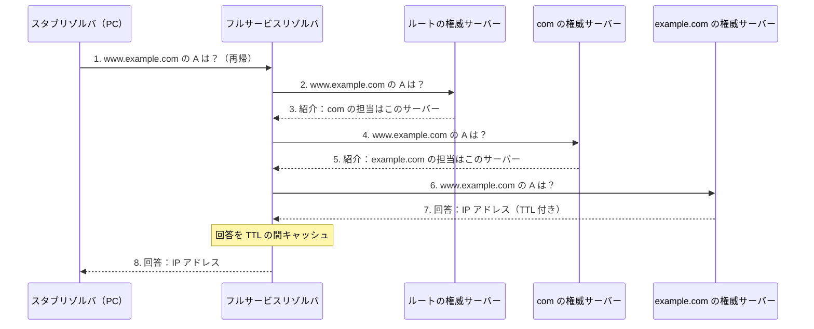

## この記事で分かること

- 名前（ドメイン名）を IP アドレスに変換する仕組みがなぜ必要なのか
- ルート、TLD、その下へと続くドメイン名の階層構造
- スタブリゾルバ、フルサービスリゾルバ（キャッシュ DNS サーバー）、権威 DNS サーバーの役割分担
- 再帰問い合わせと反復問い合わせの違い、キャッシュと TTL の関係
- A / AAAA / CNAME / MX / NS / TXT など主なレコードと、レコード変更時の注意点

## 一言で説明すると

DNS（Domain Name System）は、`www.example.com` のような人間が覚えやすい名前を、通信に必要な IP アドレスなどの情報に対応付ける、世界中に分散した階層型の「名前の台帳」です。

## なぜ必要なのか

[TCP/IP の基礎](/network/tcp-ip-basics/)で見たように、インターネット上の通信相手は IP アドレスで指定します。しかし数字の並びは人間には覚えにくく、サーバーの引っ越しなどで変わることもあります。そこで「名前」と「アドレス」を分け、名前から現在のアドレスを調べる仕組みが必要になります。MDN の用語集でも、DNS の最も目立つ役割は `mozilla.org` のような名前を IP アドレスに変換すること（名前解決）だと説明されています。

DNS が生まれる前は、全ホストの名前とアドレスの対応を 1 つのファイル（HOSTS.TXT）にまとめて 1 か所で管理し、各ホストがそれをダウンロードしていました。RFC 1034 によると、ホスト数が増えるとこの配布の負担が急激に大きくなり、各組織が変更のたびに管理元を待たなければならないことも問題でした。そこで DNS は、**台帳を階層に分割し、各部分をそれぞれの管理者に任せる（分散管理する）** 設計を採りました。

## 身近な例え

住所で人を訪ねる場面を想像してください。「日本 → 東京都 → 千代田区 → …」と大きな区分から順にたどれば、誰も全国の全住所を覚えていなくても目的地に着けます。DNS も同じで、ルートは「`com` のことなら、この担当に聞いて」と案内し、`com` の担当は「`example.com` なら、この担当に」と案内し、最後に `example.com` の担当が答えを教えてくれます。そして一度調べた答えは手帳に控えておき（キャッシュ）、しばらくは聞き直さずに済ませます。

<Callout type="warn" title="例えの限界">
この例えには、当てはまらない点が 2 つあります。

- **全体を知っている人がいない**: 住所なら、地図や住所録で誰でも番地まで一度に調べられます。DNS では、各階層の管理者は「すぐ下の階層を誰に任せたか（委任）」しか知らず、その先の中身は知りません。答えにたどり着くには、担当を順に聞いて回る必要があります。
- **控えの有効期限を決めるのは控えた側ではない**: 人間の手帳なら、いつまで控えを信じるかは書いた本人が決めます。DNS のキャッシュでは、期限（TTL）を決めるのは元の情報を管理している側です。控えた側は期限内なら古い控えを使い続けてよく、その間に元の情報が変わっても気づきません。
</Callout>

## 技術的な仕組み

### ドメイン名の階層構造

RFC 1034 では、DNS の名前空間は 1 本の木（ツリー）として定義されています。木の頂点が**ルート**で、ラベル（`.` で区切られた各部分）は空です。ルートのすぐ下が **TLD**（トップレベルドメイン、`com`、`jp` など）、その下が第 2 レベル（`example.com` の `example`）と続きます。ドメイン名は右から左へ読むと、木を上から下へたどる順になります。

```text title="www.example.com. の構造"
www . example . com . (ルート)
 ↑       ↑       ↑       ↑
第3レベル 第2レベル TLD   空のラベル
```

左端の `www` は第 3 レベルのラベルで、このようにホスト名として使われることが多い部分です。

各ラベルは 63 オクテット（バイト）以内、名前全体は 255 オクテット以内と決められており、大文字と小文字は区別しません（RFC 1034 3.1、RFC 1035 2.3.3・2.3.4）。なお、この記事で使う `example.com` は、RFC 2606 で例示用に予約された名前です。

木の一部を 1 つの管理単位として切り出したものを**ゾーン**と呼びます。親のゾーンに子ゾーンの担当サーバー（NS レコード）を登録して、管理を引き渡すことを**委任**といいます（RFC 9499）。ルートゾーンは IANA が管理しており、その中身は主に TLD への委任です。

### 3 つの登場人物

RFC 9499（DNS 用語集）の定義に沿って、名前解決に登場する役割を整理します。

| 役割（RFC 9499 の用語） | 日本でよく使われる呼び方（一般的な呼称） | していること |
| --- | --- | --- |
| スタブリゾルバ | （OS やライブラリの名前解決機能） | 自分では解決をすべて行わず、フルサービスリゾルバに問い合わせて答えをもらう |
| フルサービスリゾルバ | キャッシュ DNS サーバー | 再帰問い合わせを受けて、必要なら権威サーバーを順にたどって答えを探し、結果をキャッシュする |
| 権威 DNS サーバー | 権威サーバー、コンテンツサーバー | 自分が担当するゾーンについて、自分の持つデータから答える |

ルートの権威サーバーは、IANA のページによると `a.root-servers.net` から `m.root-servers.net` までの 13 の名前で設定されています。13 台しかないわけではありません。root-servers.org によると、2026-11-27 時点でルートサーバーシステムは約 2,000 の稼働中インスタンス（同じ名前で応答するサーバーの実体）で構成され、12 の独立した運用組織が運用しています。

### 再帰問い合わせと反復問い合わせ

問い合わせには 2 つのモードがあります（RFC 1034 4.3.1、RFC 9499）。

- **再帰問い合わせ**: 「最終的な答え（またはエラー）を返してください」という依頼です。再帰に対応したサーバー（フルサービスリゾルバ）がこれを受けると、途中の案内（紹介）を返さず、自分で調べ切って答えます。問い合わせには RD ビット（Recursion Desired、「再帰を希望する」ことを示す、DNS メッセージのヘッダー内の 1 ビットの印）が立ちます。
- **反復問い合わせ**: 受けたサーバーは、知っていれば答え、知らなければ「次はこちらに聞いて」という**紹介（referral）** を返します。続きは問い合わせた側が行います。

一般的な構成では、スタブリゾルバ → フルサービスリゾルバが再帰問い合わせ、フルサービスリゾルバ → 各権威サーバーが反復問い合わせです。

### 図解：www.example.com の名前解決

キャッシュが空の状態で、`www.example.com` の IPv4 アドレス（A レコード）を調べる流れです。



PC のスタブリゾルバは、フルサービスリゾルバに 1 回だけ再帰問い合わせを送ります（1）。フルサービスリゾルバは、まずルートの権威サーバーに尋ね、「`com` の担当はこちら」という紹介を受けます（2〜3）。次に `com` の権威サーバーから `example.com` の担当を紹介され（4〜5）、最後に `example.com` の権威サーバーから答えを得ます（6〜7）。この答えをキャッシュしてから PC に返します（8）。2〜7 が反復問い合わせとその応答です。キャッシュに途中の情報（例えば `com` の担当サーバー）が残っていれば、その段階は省略されます。

なお、この図は各サーバーに完全な名前 `www.example.com` を尋ねる古典的な動作を簡略化して示しています。RFC 9156（QNAME minimisation）に従うリゾルバは、プライバシーを守るため、上位のサーバーには必要な部分だけ（例えばルートには `com` だけ）を尋ねます。

### キャッシュと TTL

DNS の応答に含まれる各レコードには **TTL**（Time To Live）が付いています。TTL は秒単位の数値で、そのレコードを**キャッシュしてよい最大の時間**を表し、ゾーンの管理者が決めます（RFC 1034 3.6、RFC 9499）。キャッシュ側が TTL より短く保持するのは構いませんが、TTL を過ぎたら捨てて問い合わせ直す必要があります。TTL が 0 ならキャッシュしません。「その名前は存在しない」「その名前にその種類のレコードはない」という否定応答もキャッシュされます。RFC 2308 は、キャッシュを行うリゾルバは否定応答もキャッシュしなければならないとし、その期間はゾーンの SOA レコード（ゾーンの管理情報）の TTL と MINIMUM 値のうち小さいほうで決まると定めています。

キャッシュのおかげで、同じ名前への問い合わせのたびにルートからたどる必要がなくなり、応答が速くなるとともに、ルートや TLD のサーバーへの負荷も抑えられます。

### 主なリソースレコード

DNS が扱う 1 件 1 件の情報を**リソースレコード**（RR）と呼びます。

| タイプ | 内容 | 定義 |
| --- | --- | --- |
| A | IPv4 アドレス | RFC 1035 |
| AAAA | IPv6 アドレス | RFC 3596 |
| CNAME | 別名に対する正式名（正規名）。この名前は別の名前の別名だと示す | RFC 1035 |
| MX | その名前宛てのメールを受け取るサーバー。複数あるときは優先度の値が小さいほど優先 | RFC 1035 |
| NS | そのゾーンの権威 DNS サーバー | RFC 1035 |
| TXT | 任意のテキスト | RFC 1035 |

CNAME を置いた名前には、ほかのデータを置かないことになっています（RFC 1034 3.6.2）。MX の優先度は「値が小さいほど優先される」と定められています（RFC 1035 3.3.9）。TXT は自由なテキストを入れられるため、さまざまな用途に使われます。例えば SPF（Sender Policy Framework）は、あるドメイン名を名乗ってメールを送ってよいサーバーをドメインの管理者が公開する仕組みで、その設定は TXT レコードとして公開すると定められています（RFC 7208 3.1）。

### UDP と TCP（ポート 53）

RFC 1035（4.2 節）では、DNS サーバーは UDP と TCP の両方でポート 53 を使うと定めています。通常の問い合わせには UDP が使われ、ゾーン全体をコピーするゾーン転送には TCP が使われます。元の仕様では UDP のメッセージは 512 オクテットまでで、収まらない応答は切り詰められ、TC（切り詰め）ビット（応答が途中で切られたことを示す印）が立ちます。

現在は、DNS の拡張の仕組みである EDNS(0)（RFC 6891）により、問い合わせ側が受け取れる UDP の大きさを知らせることで、512 オクテットを超える応答も UDP で受け取れます。それでも収まらず TC ビット付きの切り詰められた応答が返った場合は、TCP で問い合わせ直します（RFC 7766）。DNSSEC や IPv6 の普及で応答が大きくなったことを背景に、RFC 7766（2016 年）は「汎用の DNS 実装は UDP と TCP の両方をサポートしなければならない（MUST）」と定め、TCP を単なる予備ではなく正式な選択肢として扱っています。

## 実務での活用例

### レコード変更と TTL

Web サーバーを移転して A レコードを書き換えても、世界中のフルサービスリゾルバには古いレコードがキャッシュされており、それぞれの TTL が切れるまでは古いアドレスが返る可能性があります。例えば TTL が 3600 秒（1 時間）なら、変更直前にキャッシュしたリゾルバは最大で約 1 時間、古いアドレスを使い続けることがありえます。これが俗に「DNS の浸透待ち」と呼ばれる現象の正体で、情報が徐々に広がっていくのではなく、各地のキャッシュが期限切れになるのを待っている状態です。

そのため実務では、TTL の定義から導かれる一般的な運用の工夫として、**変更の前にあらかじめ TTL を短くしておき**、古い TTL の期間が過ぎてから本番の書き換えを行い、落ち着いたら TTL を元に戻す、という手順がよく取られます（RFC で定められた手順ではありません）。旧サーバーも、古いキャッシュが消えるまでの間はしばらく動かしておくと安全です。

### コマンドで確認する

名前解決の結果は `dig` や `nslookup` で確認できます。2026-11-28 時点の BIND 9 マニュアル（dig のマニュアルページ。ページ上にバージョン番号の記載はありません）によると、`dig` は `@` でサーバーを指定しなければ `/etc/resolv.conf` に書かれたサーバー（通常はフルサービスリゾルバ）に問い合わせ、`+trace` を付けるとルートから紹介をたどる反復問い合わせの過程を表示します。

```bash title="dig の使用例"
# いつものフルサービスリゾルバに A レコードを問い合わせる
dig www.example.com A

# 特定のサーバー（例: 権威サーバー）に直接問い合わせる
# ns1.example.com は説明用の仮のサーバー名
dig @ns1.example.com www.example.com A

# ルートから順に紹介をたどる過程を表示する
dig +trace www.example.com
```

フルサービスリゾルバに聞いた答えと権威サーバーに直接聞いた答えを比べれば、「変更が反映されていない」のがキャッシュのせいなのか、権威サーバー側の設定ミスなのかを切り分けられます。応答に表示される TTL も、あとどのくらいキャッシュが残るかの手がかりになります。

### セキュリティ：キャッシュポイズニングと DNSSEC

**DNS キャッシュポイズニング**は、偽の応答をフルサービスリゾルバに受け入れさせ、キャッシュに偽の情報を入れる攻撃です。成功すると、そのリゾルバを使う利用者全員が、TTL の間、攻撃者のサーバーへ誘導されるおそれがあります。RFC 5452 によると、リゾルバは問い合わせ内容・16 ビットの ID・送信元/宛先のアドレスとポートがすべて一致する応答だけを受け入れるため、ID と送信元ポートを予測できないようランダムにすると、偽装は桁違いに難しくなります。ただし、これで完全に防げるわけではありません。

より根本的な対策が **DNSSEC** です。RFC 4033 によると、DNSSEC はレコードに電子署名（秘密鍵で作り、対応する公開鍵で誰でも検証できる、改ざん検出のためのデータ）を付け、ルートを起点とする信頼の連鎖で検証することで、データの発信元が正しいこと・改ざんされていないこと・その名前が存在しないことを確かめられるようにします。一方で、通信内容の暗号化（機密性）や DoS 攻撃（大量の通信などでサービスを妨害する攻撃）への対策は提供しません。問い合わせ経路の暗号化は別の仕組みが担い、DNS over TLS（RFC 7858）や DNS over HTTPS（RFC 8484）は、PC などのスタブリゾルバとフルサービスリゾルバの間の通信を TLS で暗号化します。応用情報技術者試験のシラバスでも、DNS キャッシュポイズニングと DNSSEC はセキュリティ分野の用語例に挙がっています。

## 関連技術との比較

| 観点 | hosts ファイル（HOSTS.TXT 方式） | DNS |
| --- | --- | --- |
| 管理の形 | 1 つのファイルにすべての対応を書く | 階層に分割し、ゾーンごとに管理者が持つ |
| 更新の反映 | 各ホストがファイルを取得・書き換えるまで反映されない | 権威サーバーを書き換えれば、各キャッシュの TTL 切れ後に反映される |
| 規模 | 小規模・手元の一時的な設定向き | インターネット全体の規模に対応 |
| 問い合わせ | 通信は発生しない（手元のファイルを読む） | ネットワーク越しに問い合わせる（結果はキャッシュ） |

現在の OS にも hosts ファイルは残っており、手元の端末だけで名前とアドレスの対応を上書きしたい開発・検証の場面で使われます。

## よくある誤解

<Misconceptions
  items={[
    { myth: 'DNS レコードを変更すれば、すぐに世界中で新しい値が使われる。', fact: '各フルサービスリゾルバは古いレコードを TTL の間キャッシュしてよいため、期限が切れるまで古い値が返ることがあります。いわゆる「浸透」は、キャッシュの期限切れを待つことです。' },
    { myth: 'どこかに世界中の名前をすべて知っている DNS サーバーがある。', fact: 'DNS は階層的な分散システムで、ルートは TLD の担当を、TLD は第 2 レベルの担当を知っているだけです。各ゾーンの中身はそのゾーンの権威サーバーだけが持っています。' },
    { myth: 'ルートサーバーは世界に 13 台しかない。', fact: '13 なのは a〜m の名前（識別子）の数です。root-servers.org によると、2026-11-27 時点で実体は約 2,000 の稼働中インスタンスで、12 の組織が運用しています。' },
    { myth: 'DNS は UDP だけを使う。', fact: 'RFC 1035 の時点からポート 53 の TCP も使われており、RFC 7766 では汎用の DNS 実装に UDP と TCP の両方のサポートを求めています。大きな応答やゾーン転送では TCP が使われます。' },
    { myth: 'DNSSEC を使えば DNS の通信内容が暗号化される。', fact: 'DNSSEC が保証するのはデータの発信元と完全性で、機密性（暗号化）は提供しません（RFC 4033）。問い合わせ経路の暗号化には DNS over TLS や DNS over HTTPS が使われます。' },
  ]}
/>

## まとめ

- DNS は、名前を IP アドレスなどに対応付ける、階層型・分散型の名前の仕組みです。
- 名前空間はルートを頂点とする木構造で、ゾーンごとに管理を委任しています。
- スタブリゾルバはフルサービスリゾルバに再帰問い合わせを送り、フルサービスリゾルバは権威サーバーを反復問い合わせでたどります。
- 結果は TTL の間キャッシュされるため、レコード変更はすぐには行き渡りません。変更前に TTL を短くしておくのが定石です。
- DNS は UDP/TCP の 53 番ポートを使い、キャッシュポイズニングへの対策として ID・ポートのランダム化や DNSSEC があります。

## 理解度チェック

**問1**: ある会社が、TTL 86400 秒（1 日）の A レコードを新しいサーバーのアドレスに書き換えました。書き換え直後に一部の利用者だけが旧サーバーにアクセスしてしまうのはなぜですか。また、次回の移転で影響を小さくするにはどうすればよいですか。

<details>
<summary>答えと解説</summary>

利用者が使っているフルサービスリゾルバに、書き換え前の A レコードが残っているためです。TTL が 86400 秒なので、直前にキャッシュしたリゾルバは最大で約 1 日、旧アドレスを返す可能性があります。次回は、移転の前に TTL を短く（例えば数分に）変更し、元の TTL の期間が過ぎてからアドレスを書き換えれば、古いキャッシュが残る時間を短くできます。

</details>

**問2**: PC がフルサービスリゾルバに送る問い合わせと、フルサービスリゾルバがルートサーバーに送る問い合わせは、それぞれ再帰問い合わせと反復問い合わせのどちらですか。ルートサーバーは何を返しますか。

<details>
<summary>答えと解説</summary>

PC からフルサービスリゾルバへは再帰問い合わせ、フルサービスリゾルバからルートサーバーへは反復問い合わせです。ルートサーバーは最終的な答えを持っていないので、TLD（例えば `com`）を担当する権威サーバーを示す紹介（referral）を返します。

</details>
