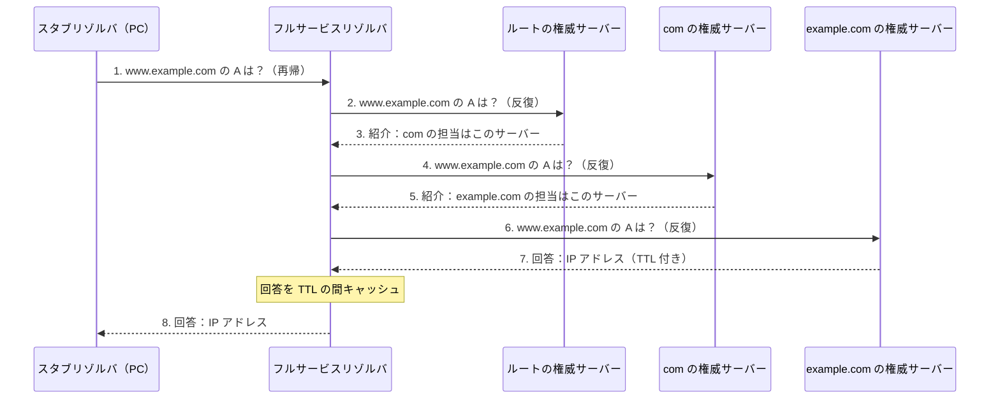

## この記事で分かること

- 名前（ドメイン名）を IP アドレスに変換する仕組みがなぜ必要なのか
- ルート、TLD、その下へと続くドメイン名の階層構造
- スタブリゾルバ、フルサービスリゾルバ（キャッシュ DNS サーバー）、権威 DNS サーバーの役割分担
- 再帰問い合わせと反復問い合わせの違い、キャッシュと TTL の関係
- A / AAAA / CNAME / MX / NS / PTR / TXT など主なレコードと、レコード変更時の注意点
- キャッシュポイズニング、オープンリゾルバの悪用と、DNSSEC などの対策の違い

## 一言で説明すると

DNS（Domain Name System）は、`www.example.com` のような人間が覚えやすい名前を、通信に必要な IP アドレスなどの情報に対応付ける、世界中に分散した階層型の「名前の台帳」です。

## なぜ必要なのか

[TCP/IP の基礎](/network/tcp-ip-basics/)で見たように、インターネット上の通信相手は IP アドレスで指定します。しかし数字の並びは人間には覚えにくく、サーバーの引っ越しなどで変わることもあります。そこで「名前」と「アドレス」を分け、名前から現在のアドレスを調べる仕組みが必要になります。MDN の用語集でも、DNS の最も目立つ役割は `mozilla.org` のような名前を IP アドレスに変換すること（名前解決）だと説明されています。

DNS が生まれる前は、全ホストの名前とアドレスの対応を 1 つのファイル（HOSTS.TXT）にまとめて 1 か所で管理し、各ホストがそれをダウンロードしていました。RFC 1034 によると、ホスト数が増えるとこの配布の負担が急激に大きくなり、各組織が変更のたびに管理元を待たなければならないことも問題でした。そこで DNS は、**台帳を階層に分割し、各部分をそれぞれの管理者に任せる（分散管理する）** 設計を採りました。

## 身近な例え

住所で人を訪ねる場面を想像してください。「日本 → 東京都 → 千代田区 → …」と大きな区分から順にたどれば、誰も全国の全住所を覚えていなくても目的地に着けます。DNS も同じで、ルートは「`com` のことなら、この担当に聞いて」と案内し、`com` の担当は「`example.com` なら、この担当に」と案内し、最後に `example.com` の担当が答えを教えてくれます。そして一度調べた答えは手帳に控えておき（キャッシュ）、しばらくは聞き直さずに済ませます。

<Callout type="warn" title="例えの限界">
この例えには、当てはまらない点が 2 つあります。

- **全体を知っている人がいない**: 住所なら、地図や住所録で誰でも番地まで一度に調べられます。DNS では、各階層の管理者は「すぐ下の階層を誰に任せたか（委任）」しか知らず、その先の中身は知りません。答えにたどり着くには、担当を順に聞いて回る必要があります。
- **控えの有効期限を決めるのは控えた側ではない**: 人間の手帳なら、いつまで控えを信じるかは書いた本人が決めます。DNS のキャッシュでは、期限（TTL）を決めるのは元の情報を管理している側です。控えた側は期限内なら古い控えを使い続けてよく、その間に元の情報が変わっても気づきません。
</Callout>

## 技術的な仕組み

### ドメイン名の階層構造

RFC 1034 では、DNS の名前空間は 1 本の木（ツリー）として定義されています。木の頂点が**ルート**で、ラベル（`.` で区切られた各部分）は空です。ルートのすぐ下が **TLD**（トップレベルドメイン、`com`、`jp` など）、その下が第 2 レベル（`example.com` の `example`）と続きます。ドメイン名は右から左へ読むと、木を上から下へたどる順になります。

```text title="www.example.com. の構造"
www . example . com . (ルート)
 ↑       ↑       ↑       ↑
第3レベル 第2レベル TLD   空のラベル
```

左端の `www` は第 3 レベルのラベルで、このようにホスト名として使われることが多い部分です。

各ラベルは 63 オクテット（バイト）以内、名前全体は 255 オクテット以内と決められており、大文字と小文字は区別しません（RFC 1034 3.1、RFC 1035 2.3.3・2.3.4）。なお、この記事で使う `example.com` は、RFC 2606 で例示用に予約された名前です。

木の一部を 1 つの管理単位として切り出したものを**ゾーン**と呼びます。親のゾーンに子ゾーンの担当サーバー（NS レコード）を登録して、管理を引き渡すことを**委任**といいます（RFC 9499）。ルートゾーンは IANA が管理しており、その中身は主に TLD への委任です。

### 3 つの登場人物

RFC 9499（DNS 用語集）の定義に沿って、名前解決に登場する役割を整理します。

| 役割（RFC 9499 の用語） | 日本でよく使われる呼び方（一般的な呼称） | していること |
| --- | --- | --- |
| スタブリゾルバ | （OS やライブラリの名前解決機能） | 自分では解決をすべて行わず、フルサービスリゾルバに問い合わせて答えをもらう |
| フルサービスリゾルバ | キャッシュ DNS サーバー | 再帰問い合わせを受けて、必要なら権威サーバーを順にたどって答えを探し、結果をキャッシュする |
| 権威 DNS サーバー | 権威サーバー、コンテンツサーバー | 自分が担当するゾーンについて、自分の持つデータから答える |

ルートの権威サーバーは、IANA のページによると `a.root-servers.net` から `m.root-servers.net` までの 13 の名前で設定されています。13 台しかないわけではありません。root-servers.org によると、2026-11-27 時点でルートサーバーシステムは約 2,000 の稼働中インスタンス（同じ名前で応答するサーバーの実体）で構成され、12 の独立した運用組織が運用しています。

### 再帰問い合わせと反復問い合わせ

問い合わせには 2 つのモードがあります（RFC 1034 4.3.1、RFC 9499）。

- **再帰問い合わせ**: 「最終的な答え（またはエラー）を返してください」という依頼です。再帰に対応したサーバー（フルサービスリゾルバ）がこれを受けると、途中の案内（紹介）を返さず、自分で調べ切って答えます。問い合わせには RD ビット（Recursion Desired、「再帰を希望する」ことを示す、DNS メッセージのヘッダー内の 1 ビットの印）が立ちます。
- **反復問い合わせ**: 受けたサーバーは、知っていれば答え、知らなければ「次はこちらに聞いて」という**紹介（referral）** を返します。続きは問い合わせた側が行います。

一般的な構成では、スタブリゾルバ → フルサービスリゾルバが再帰問い合わせ、フルサービスリゾルバ → 各権威サーバーが反復問い合わせです。2 つのモードがどこで使われるかを、キャッシュが空の状態で `www.example.com` の IPv4 アドレス（A レコード）を調べる流れで確かめます。



上の図で、PC のスタブリゾルバは、フルサービスリゾルバに 1 回だけ再帰問い合わせを送ります（1）。フルサービスリゾルバは、まずルートの権威サーバーに尋ね、「`com` の担当はこちら」という紹介を受けます（2〜3）。次に `com` の権威サーバーから `example.com` の担当を紹介され（4〜5）、最後に `example.com` の権威サーバーから答えを得ます（6〜7）。この答えをキャッシュしてから PC に返します（8）。2〜7 が反復問い合わせとその応答です。キャッシュに途中の情報（例えば `com` の担当サーバー）が残っていれば、その段階は省略されます。

なお、この図は各サーバーに完全な名前 `www.example.com` を尋ねる古典的な動作を簡略化して示しています。RFC 9156（QNAME minimisation）に従うリゾルバは、プライバシーを守るため、上位のサーバーには必要な部分だけ（例えばルートには `com` だけ）を尋ねます。

<Callout type="tip" title="覚え方">
「誰が最後まで調べる責任を持つか」で区別すると迷いません。再帰問い合わせは「答えを最後まで持ってきて」と**調べる作業ごと任せる**依頼、反復問い合わせは「知らなければ次の担当だけ教えて」と**自分で聞き回る**問い合わせです。上の図との対応は次のとおりです。

| 図の矢印 | 誰から誰へ | モード | 返ってくるもの |
| --- | --- | --- | --- |
| 1（問い合わせ）／8（応答） | PC（スタブリゾルバ）⇄ フルサービスリゾルバ | 再帰 | 最終的な答え（またはエラー） |
| 2〜7 | フルサービスリゾルバ → 各権威サーバー | 反復 | 紹介（次の担当）か、最後に答え |

PC は 1 回聞くだけで、聞き回るのはフルサービスリゾルバです。だからこそ、フルサービスリゾルバに答えが集まり、キャッシュする意味が生まれます。
</Callout>

### キャッシュと TTL

DNS の応答に含まれる各レコードには **TTL**（Time To Live）が付いています。TTL は秒単位の数値で、そのレコードを**キャッシュしてよい最大の時間**を表し、ゾーンの管理者が決めます（RFC 1034 3.6、RFC 9499）。キャッシュ側が TTL より短く保持するのは構いませんが、TTL を過ぎたら捨てて問い合わせ直す必要があります。TTL が 0 ならキャッシュしません。「その名前は存在しない」「その名前にその種類のレコードはない」という否定応答もキャッシュされます。RFC 2308 は、キャッシュを行うリゾルバは否定応答もキャッシュしなければならないとし、その期間はゾーンの SOA レコード（ゾーンの管理情報）の TTL と MINIMUM 値のうち小さいほうで決まると定めています。

キャッシュのおかげで、同じ名前への問い合わせのたびにルートからたどる必要がなくなり、応答が速くなるとともに、ルートや TLD のサーバーへの負荷も抑えられます。

<Callout type="tip" title="覚え方">
TTL は「元の情報の管理者が付ける有効期限（過ぎたら捨てる）」です。期限を決めるのは控えた側（キャッシュ）ではなく、ゾーンの管理者だという点が出発点になります。そこから次のトレードオフが導けます。

| TTL | キャッシュが効く時間 | 問い合わせの回数・負荷 | レコードを変えたときの反映 |
| --- | --- | --- | --- |
| 長い | 長い | 少ない | 遅い（古い控えが長く残る） |
| 短い | 短い | 多い | 速い |

後で説明する「変更前に TTL を短くしておく」運用は、この表の下の行を一時的に選ぶことです。
</Callout>

### 主なリソースレコード

DNS が扱う 1 件 1 件の情報を**リソースレコード**（RR）と呼びます。

| タイプ | 内容 | 定義 |
| --- | --- | --- |
| A | IPv4 アドレス | RFC 1035 |
| AAAA | IPv6 アドレス | RFC 3596 |
| CNAME | 別名に対する正式名（正規名）。この名前は別の名前の別名だと示す | RFC 1035 |
| MX | その名前宛てのメールを受け取るサーバー。複数あるときは優先度の値が小さいほど優先 | RFC 1035 |
| NS | そのゾーンの権威 DNS サーバー | RFC 1035 |
| PTR | 別の名前を指すポインター。逆引き（IP アドレス → ホスト名）に使う | RFC 1035 |
| TXT | 任意のテキスト | RFC 1035 |

名前から IP アドレスを調べることを**正引き**、反対に IP アドレスからホスト名を調べることを**逆引き**といいます。逆引きのために、DNS には `in-addr.arpa` という特別なドメインが用意されています。IPv4 アドレスの 4 つの数字を逆順に並べて `in-addr.arpa` を付けた名前（例えば `10.2.0.52` なら `52.0.2.10.in-addr.arpa`）に PTR レコードを置き、そこからホスト名を指します（RFC 1035 3.5）。逆順にするのは、ドメイン名が右ほど上位なので、アドレスの上位の数字を右に置けばネットワーク単位でゾーンを委任できるためです。

CNAME を置いた名前には、ほかのデータを置かないことになっています（RFC 1034 3.6.2）。MX の優先度は「値が小さいほど優先される」と定められています（RFC 1035 3.3.9）。TXT は自由なテキストを入れられるため、さまざまな用途に使われます。例えば SPF（Sender Policy Framework）は、あるドメイン名を名乗ってメールを送ってよいサーバーをドメインの管理者が公開する仕組みで、その設定は TXT レコードとして公開すると定められています（RFC 7208 3.1）。メールを受け取ったサーバーは、送信元として名乗られたドメインの SPF の設定と、実際にメールを送ってきたサーバーの IP アドレスを照らし合わせて、なりすましでないかを確かめます。照合に使うのは、メール本文の差出人欄ではなく、送信時のやり取り（SMTP の HELO と MAIL FROM）で名乗られたドメインです（RFC 7208）。似た仕組みの DKIM（RFC 6376）は、IP アドレスではなくメール本体にデジタル署名を付け、受信側は DNS で公開された送信ドメインの公開鍵でその署名を検証します。

<Callout type="tip" title="覚え方">
タイプ名は、そのレコードが「何を指しているか」の英語から来ています。名前の由来と結び付けると、試験の選択肢で入れ替えられていても見抜けます。

| タイプ | RFC での意味（元の英語） | 覚える一言 |
| --- | --- | --- |
| A | a host **A**ddress（RFC 1035） | 名前 → IPv4 |
| AAAA | IPv6 アドレス（RFC 3596） | A を 4 つ並べた名前。IPv4 の 32 ビットの 4 倍、128 ビットの IPv6 と結び付ける（名前の由来は RFC に明記されていない。覚えるための対応付け） |
| CNAME | the **C**anonical **NAME** for an alias（RFC 1035） | 別名 → 正式名 |
| MX | **M**ail e**X**change（RFC 1035） | メールの受け取り先 |
| NS | an authoritative **N**ame **S**erver（RFC 1035） | ゾーンの担当（権威サーバー） |
| PTR | a domain name **P**oin**T**e**R**（RFC 1035） | IP アドレス → 名前（逆引き） |

よくある引っかけは「別名を登録するのは NS」「DNS サーバーのホスト名を登録するのは MX」のような入れ替えです。別名は CNAME、ゾーンの担当サーバーは NS、メールは MX と、名前の由来から確かめてください。
</Callout>

### UDP と TCP（ポート 53）

RFC 1035（4.2 節）では、DNS サーバーは UDP と TCP の両方でポート 53 を使うと定めています。通常の問い合わせには UDP が使われ、ゾーン全体をコピーするゾーン転送には TCP が使われます。元の仕様では UDP のメッセージは 512 オクテットまでで、収まらない応答は切り詰められ、TC（切り詰め）ビット（応答が途中で切られたことを示す印）が立ちます。

現在は、DNS の拡張の仕組みである EDNS(0)（RFC 6891）により、問い合わせ側が受け取れる UDP の大きさを知らせることで、512 オクテットを超える応答も UDP で受け取れます。それでも収まらず TC ビット付きの切り詰められた応答が返った場合は、TCP で問い合わせ直します（RFC 7766）。DNSSEC や IPv6 の普及で応答が大きくなったことを背景に、RFC 7766（2016 年）は「汎用の DNS 実装は UDP と TCP の両方をサポートしなければならない（MUST）」と定め、TCP を単なる予備ではなく正式な選択肢として扱っています。

## 実務での活用例

### レコード変更と TTL

Web サーバーを移転して A レコードを書き換えても、世界中のフルサービスリゾルバには古いレコードがキャッシュされており、それぞれの TTL が切れるまでは古いアドレスが返る可能性があります。例えば TTL が 3600 秒（1 時間）なら、変更直前にキャッシュしたリゾルバは最大で約 1 時間、古いアドレスを使い続けることがありえます。これが俗に「DNS の浸透待ち」と呼ばれる現象の正体で、情報が徐々に広がっていくのではなく、各地のキャッシュが期限切れになるのを待っている状態です。

そのため実務では、TTL の定義から導かれる一般的な運用の工夫として、**変更の前にあらかじめ TTL を短くしておき**、古い TTL の期間が過ぎてから本番の書き換えを行い、落ち着いたら TTL を元に戻す、という手順がよく取られます（RFC で定められた手順ではありません）。旧サーバーも、古いキャッシュが消えるまでの間はしばらく動かしておくと安全です。

### コマンドで確認する

名前解決の結果は `dig` や `nslookup` で確認できます。2026-11-28 時点の BIND 9 マニュアル（dig のマニュアルページ。ページ上にバージョン番号の記載はありません）によると、`dig` は `@` でサーバーを指定しなければ `/etc/resolv.conf` に書かれたサーバー（通常はフルサービスリゾルバ）に問い合わせ、`+trace` を付けるとルートから紹介をたどる反復問い合わせの過程を表示します。

```bash title="dig の使用例"
# いつものフルサービスリゾルバに A レコードを問い合わせる
dig www.example.com A

# 特定のサーバー（例: 権威サーバー）に直接問い合わせる
# ns1.example.com は説明用の仮のサーバー名
dig @ns1.example.com www.example.com A

# ルートから順に紹介をたどる過程を表示する
dig +trace www.example.com
```

フルサービスリゾルバに聞いた答えと権威サーバーに直接聞いた答えを比べれば、「変更が反映されていない」のがキャッシュのせいなのか、権威サーバー側の設定ミスなのかを切り分けられます。応答に表示される TTL も、あとどのくらいキャッシュが残るかの手がかりになります。

### セキュリティ：キャッシュポイズニングと DNSSEC

**DNS キャッシュポイズニング**は、偽の応答をフルサービスリゾルバに受け入れさせ、キャッシュに偽の情報を入れる攻撃です。成功すると、そのリゾルバを使う利用者全員が、TTL の間、攻撃者のサーバーへ誘導されるおそれがあります。RFC 5452 によると、リゾルバは問い合わせ内容・16 ビットの ID・送信元/宛先のアドレスとポートがすべて一致する応答だけを受け入れるため、ID と送信元ポートを予測できないようランダムにすると、偽装は桁違いに難しくなります。ただし、これで完全に防げるわけではありません。

より根本的な対策が **DNSSEC** です。RFC 4033 によると、DNSSEC はレコードに電子署名（秘密鍵で作り、対応する公開鍵で誰でも検証できる、改ざん検出のためのデータ）を付け、ルートを起点とする信頼の連鎖で検証することで、データの発信元が正しいこと・改ざんされていないこと・その名前が存在しないことを確かめられるようにします。一方で、通信内容の暗号化（機密性）や DoS 攻撃（大量の通信などでサービスを妨害する攻撃）への対策は提供しません。

問い合わせ経路の暗号化は別の仕組みが担います。DNS over TLS（RFC 7858）や DNS over HTTPS（RFC 8484）は、PC などのスタブリゾルバとフルサービスリゾルバの間の通信を TLS で暗号化します。

DNSSEC の署名と検証は、次のように分担します。ゾーンの管理者が秘密鍵でレコードに署名し、公開鍵とともに権威サーバーで公開します。署名を検証するのは、応答を受け取ったフルサービスリゾルバ（検証を行うリゾルバ）です。応用情報技術者試験のシラバスでも、DNS キャッシュポイズニングと DNSSEC はセキュリティ分野の用語例に挙がっています。

フルサービスリゾルバの設定にも注意が必要です。インターネット上の誰からでも再帰問い合わせを受け付けるリゾルバは**オープンリゾルバ**と呼ばれ、DoS 攻撃の踏み台に悪用されます。RFC 5358 によると、攻撃者は送信元 IP アドレスを攻撃対象のアドレスに偽装した問い合わせを多数のオープンリゾルバに送ります。DNS は小さな問い合わせに大きな応答を返せるため、増幅された大量の応答が攻撃対象に届きます（リフレクション攻撃）。RFC 5358 は対策として、再帰問い合わせのサービスを想定した利用者（社内のネットワークなど）だけに提供するよう推奨しています。

<Callout type="tip" title="覚え方">
DNS のセキュリティ対策は、「何を守るのか」で整理すると混同しません。記事末尾の過去問題でも、これらの対策を入れ替えた選択肢が並んでいます。

| 対策 | 守るもの・防ぐこと | 防げないこと |
| --- | --- | --- |
| ID と送信元ポートのランダム化 | 偽の応答を「当てる」のを難しくする（キャッシュポイズニング対策） | 完全には防げない |
| DNSSEC | 応答が正しい発信元からのもので、改ざんされていないこと（公開鍵による署名の検証） | 通信の盗み見（暗号化はしない）、DoS |
| DNS over TLS / DNS over HTTPS | PC とフルサービスリゾルバの間の通信の盗み見・改ざん | 権威サーバー側から来るデータの正しさ |
| 再帰問い合わせを許す相手の限定 | オープンリゾルバとして踏み台にされること | 送信元の偽装そのもの（RFC 5358 は、偽装したパケットを入口で通さないフィルタリングを唯一の根本的な解決策としている） |

「署名」「照合」という言葉だけでは区別できません。DNS を使う仕組みは、**何に署名するのか、何と照合するのか**を対にして覚えてください。

| 仕組み | 署名・照合の対象 | 確かめること |
| --- | --- | --- |
| DNSSEC | DNS のレコードに署名 | DNS の応答が正しい発信元からのもので、改ざんされていないこと |
| DKIM | メール本体に署名（公開鍵は DNS で公開） | メールが送信ドメインの署名どおりで、改ざんされていないこと |
| SPF | 送信してきたサーバーの IP アドレスと照合（設定は TXT レコード） | そのドメインを名乗って送ってよいサーバーかどうか |

「暗号化」が出てきたら DoT / DoH（機密性）で、DNSSEC は暗号化しません。
</Callout>

## 関連技術との比較

| 観点 | hosts ファイル（HOSTS.TXT 方式） | DNS |
| --- | --- | --- |
| 管理の形 | 1 つのファイルにすべての対応を書く | 階層に分割し、ゾーンごとに管理者が持つ |
| 更新の反映 | 各ホストがファイルを取得・書き換えるまで反映されない | 権威サーバーを書き換えれば、各キャッシュの TTL 切れ後に反映される |
| 規模 | 小規模・手元の一時的な設定向き | インターネット全体の規模に対応 |
| 問い合わせ | 通信は発生しない（手元のファイルを読む） | ネットワーク越しに問い合わせる（結果はキャッシュ） |

現在の OS にも hosts ファイルは残っており、手元の端末だけで名前とアドレスの対応を上書きしたい開発・検証の場面で使われます。

## よくある誤解

<Misconceptions
  items={[
    { myth: 'DNS レコードを変更すれば、すぐに世界中で新しい値が使われる。', fact: '各フルサービスリゾルバは古いレコードを TTL の間キャッシュしてよいため、期限が切れるまで古い値が返ることがあります。いわゆる「浸透」は、キャッシュの期限切れを待つことです。' },
    { myth: 'どこかに世界中の名前をすべて知っている DNS サーバーがある。', fact: 'DNS は階層的な分散システムで、ルートは TLD の担当を、TLD は第 2 レベルの担当を知っているだけです。各ゾーンの中身はそのゾーンの権威サーバーだけが持っています。' },
    { myth: 'ルートサーバーは世界に 13 台しかない。', fact: '13 なのは a〜m の名前（識別子）の数です。root-servers.org によると、2026-11-27 時点で実体は約 2,000 の稼働中インスタンスで、12 の組織が運用しています。' },
    { myth: 'DNS は UDP だけを使う。', fact: 'RFC 1035 の時点からポート 53 の TCP も使われており、RFC 7766 では汎用の DNS 実装に UDP と TCP の両方のサポートを求めています。大きな応答やゾーン転送では TCP が使われます。' },
    { myth: 'DNSSEC を使えば DNS の通信内容が暗号化される。', fact: 'DNSSEC が保証するのはデータの発信元と完全性で、機密性（暗号化）は提供しません（RFC 4033）。問い合わせ経路の暗号化には DNS over TLS や DNS over HTTPS が使われます。' },
  ]}
/>

## まとめ

- DNS は、名前を IP アドレスなどに対応付ける、階層型・分散型の名前の仕組みです。
- 名前空間はルートを頂点とする木構造で、ゾーンごとに管理を委任しています。
- スタブリゾルバはフルサービスリゾルバに再帰問い合わせを送り、フルサービスリゾルバは権威サーバーを反復問い合わせでたどります。
- 結果は TTL の間キャッシュされるため、レコード変更はすぐには行き渡りません。変更前に TTL を短くしておくのが定石です。
- 名前から IP アドレスを調べるのが正引き、IP アドレスから名前を調べるのが逆引きで、逆引きには `in-addr.arpa` の下の PTR レコードを使います。
- DNS は UDP/TCP の 53 番ポートを使い、キャッシュポイズニングへの対策として ID・ポートのランダム化や DNSSEC があります。
- 誰からでも再帰問い合わせを受け付けるオープンリゾルバは攻撃の踏み台になるため、再帰問い合わせは想定した利用者だけに許します。

## 理解度チェック

**問1**: ある会社が、TTL 86400 秒（1 日）の A レコードを新しいサーバーのアドレスに書き換えました。書き換え直後に一部の利用者だけが旧サーバーにアクセスしてしまうのはなぜですか。また、次回の移転で影響を小さくするにはどうすればよいですか。

<details>
<summary>答えと解説</summary>

利用者が使っているフルサービスリゾルバに、書き換え前の A レコードが残っているためです。TTL が 86400 秒なので、直前にキャッシュしたリゾルバは最大で約 1 日、旧アドレスを返す可能性があります。次回は、移転の前に TTL を短く（例えば数分に）変更し、元の TTL の期間が過ぎてからアドレスを書き換えれば、古いキャッシュが残る時間を短くできます。

</details>

**問2**: PC がフルサービスリゾルバに送る問い合わせと、フルサービスリゾルバがルートサーバーに送る問い合わせは、それぞれ再帰問い合わせと反復問い合わせのどちらですか。ルートサーバーは何を返しますか。

<details>
<summary>答えと解説</summary>

PC からフルサービスリゾルバへは再帰問い合わせ、フルサービスリゾルバからルートサーバーへは反復問い合わせです。ルートサーバーは最終的な答えを持っていないので、TLD（例えば `com`）を担当する権威サーバーを示す紹介（referral）を返します。

</details>

## 過去問題

現時点で関連する過去問は 9 問です。

<PastExam source="令和6年度 秋期 応用情報技術者試験 午前 問33">
DNS に関する記述のうち，適切なものはどれか。

- ア　DNS サーバのホスト名を登録するレコードを MX レコードという。
- イ　DNS サーバに問い合わせを行うソフトウェアをレゾリューションという。
- ウ　IP アドレスに対応するホスト名を調べることを逆引きという。
- エ　ホスト名に対し別名を登録するレコードを NS レコードという。

<PastExamAnswer answer="ウ">
「主なリソースレコード」の節のとおり、IP アドレスからホスト名を調べるのが逆引きで、`in-addr.arpa` の下の PTR レコードを使います。MX はメールの受け取り先、別名を登録するのは CNAME で、NS はゾーンの権威サーバーを示します。DNS サーバーに問い合わせるソフトウェアはリゾルバ（スタブリゾルバ）です。
</PastExamAnswer>
</PastExam>

<PastExam source="令和6年度 秋期 応用情報技術者試験 午前 問42">
DNS キャッシュポイズニング攻撃に対して有効な対策はどれか。

- ア　DNS サーバにおいて，侵入したマルウェアをリアルタイムに隔離する。
- イ　DNS 問合せに使用する DNS ヘッダー内の ID を固定せずにランダムに変更する。
- ウ　DNS 問合せに使用する送信元ポート番号を 53 番に固定する。
- エ　外部からの DNS 問合せに対しては，宛先ポート番号 53 のものだけに応答する。

<PastExamAnswer answer="イ">
「セキュリティ：キャッシュポイズニングと DNSSEC」の節のとおり、リゾルバは ID や送信元ポートなどがすべて一致する応答だけを受け入れます。ID を予測できないようにランダムにすると、攻撃者が偽の応答を一致させるのが難しくなります。ウは逆で、送信元ポートを固定すると予測しやすくなります。アとエはキャッシュに偽の情報が入ることを防ぐ対策ではありません。
</PastExamAnswer>
</PastExam>

<PastExam source="令和6年度 秋期 応用情報技術者試験 午前 問44">
DNSSEC の仕様はどれか。

- ア　DNS キャッシュサーバで，権威 DNS サーバに名前を問い合わせるときの送信元ポート番号を問合せのたびにランダムに変える。
- イ　権威 DNS サーバで公開鍵を公開し，秘密鍵を使ってリソースレコードにデジタル署名を付与する。DNS キャッシュサーバで，権威 DNS サーバから受信したリソースレコードのデジタル署名を検証する。
- ウ　電子メールを送信するメールサーバの IP アドレスを権威 DNS サーバに登録する。電子メールを受信するメールサーバで，権威 DNS サーバに登録されている情報を用いて，送信元メールサーバの IP アドレスを検証する。
- エ　電子メールを送信するメールサーバの公開鍵を権威 DNS サーバで公開し，秘密鍵を使って電子メールにデジタル署名を付与する。電子メールを受信するメールサーバで，電子メールのデジタル署名を検証する。

<PastExamAnswer answer="イ">
DNSSEC では、ゾーンの管理者が秘密鍵でレコードに署名して公開鍵とともに権威サーバーで公開し、フルサービスリゾルバ（DNS キャッシュサーバ）がその署名を検証します。アは DNSSEC ではなく、キャッシュポイズニング対策のポート番号のランダム化です。ウは SPF の説明で、エは電子メールそのものに署名する別の仕組み（DKIM）です。
</PastExamAnswer>
</PastExam>

<PastExam source="令和6年度 春期 応用情報技術者試験 午前 問36">
企業の DMZ 上で 1 台の DNS サーバを，インターネット公開用と，社内の PC 及びサーバからの名前解決の問合せに対応する社内用とで共用している。この DNS サーバが，DNS キャッシュポイズニング攻撃による被害を受けた結果，直接引き起こされ得る現象はどれか。

- ア　DNS サーバのハードディスク上に定義されている DNS サーバ名が書き換わり，インターネットから DNS サーバに接続できなくなる。
- イ　DNS サーバのメモリ上にワームが常駐し，DNS 参照元に対して不正プログラムを送り込む。
- ウ　社内の利用者が，インターネット上の特定の Web サーバにアクセスしようとすると，本来とは異なる Web サーバに誘導される。
- エ　社内の利用者間の電子メールについて，宛先メールアドレスが書き換えられ，送信ができなくなる。

<PastExamAnswer answer="ウ">
社内用として名前解決を引き受けているので、このサーバーは社内の PC にとってのフルサービスリゾルバです。キャッシュポイズニングでは、そのキャッシュに偽のレコード（例えば Web サーバーの偽の A レコード）が入るため、問い合わせた社内の利用者は TTL の間、攻撃者の用意したサーバーへ誘導されます。攻撃で書き換わるのはキャッシュの中の名前とアドレスの対応で、ディスク上の設定やメールアドレスではありません。
</PastExamAnswer>
</PastExam>

<PastExam source="令和6年度 春期 応用情報技術者試験 午前 問37">
DNSSEC で実現できることはどれか。

- ア　DNS キャッシュサーバが得た応答の中のリソースレコードが，権威 DNS サーバで管理されているものであり，改ざんされていないことの検証
- イ　権威 DNS サーバと DNS キャッシュサーバとの通信を暗号化することによる，ゾーン情報の漏えいの防止
- ウ　長音“ー”と漢数字“一”などの似た文字をドメイン名に用いて，正規サイトのように見せかける攻撃の防止
- エ　利用者の URL の入力誤りを悪用して，偽サイトに誘導する攻撃の検知

<PastExamAnswer answer="ア">
DNSSEC が保証するのは、データの発信元が正しいことと改ざんされていないことです（「よくある誤解」の最後の項目）。通信内容の暗号化は提供しないので、イは誤りです。ウとエは、利用者に似た名前や打ち間違えた名前を使わせる攻撃で、DNS の応答自体は正しいため、DNSSEC では防げません。
</PastExamAnswer>
</PastExam>

<PastExam source="令和4年度 秋期 応用情報技術者試験 午前 問36">
オープンリゾルバを悪用した攻撃はどれか。

- ア　ICMP パケットの送信元を偽装し，多数の宛先に送ることによって，攻撃対象のコンピュータに大量の偽の ICMP パケットの応答を送る。
- イ　PC 内の hosts ファイルにある，ドメインと IP アドレスとの対応付けを大量に書き換え，偽の Web サイトに誘導し，大量のコンテンツをダウンロードさせる。
- ウ　送信元 IP アドレスを偽装した DNS 問合せを多数の DNS サーバに送ることによって，攻撃対象のコンピュータに大量の応答を送る。
- エ　誰でも電子メールの送信ができるメールサーバを踏み台にして，電子メールの送信元アドレスを詐称したなりすましメールを大量に送信する。

<PastExamAnswer answer="ウ">
オープンリゾルバは、誰からの再帰問い合わせにも応答するフルサービスリゾルバです。送信元を攻撃対象のアドレスに偽装して問い合わせると、小さな問い合わせに対する大きな応答が攻撃対象に送りつけられます（「セキュリティ」の節のリフレクション攻撃）。アは DNS ではなく ICMP を使う攻撃、エは DNS ではなくメールサーバーの踏み台化です。
</PastExamAnswer>
</PastExam>

<PastExam source="令和4年度 秋期 応用情報技術者試験 午前 問44">
SPF（Sender Policy Framework）の仕組みはどれか。

- ア　電子メールを受信するサーバが，電子メールに付与されているデジタル署名を使って，送信元ドメインの詐称がないことを確認する。
- イ　電子メールを受信するサーバが，電子メールの送信元のドメイン情報と，電子メールを送信したサーバの IP アドレスから，送信元ドメインの詐称がないことを確認する。
- ウ　電子メールを送信するサーバが，電子メールの宛先のドメインや送信者のメールアドレスを問わず，全ての電子メールをアーカイブする。
- エ　電子メールを送信するサーバが，電子メールの送信者の上司からの承認が得られるまで，一時的に電子メールの送信を保留する。

<PastExamAnswer answer="イ">
「主なリソースレコード」の節のとおり、SPF ではドメインの管理者が、そのドメインを名乗ってメールを送ってよいサーバーを TXT レコードで公開します。受信側は、送信元ドメインの SPF の設定と、実際に送ってきたサーバーの IP アドレスを照らし合わせます。メール本体のデジタル署名を使うアは、SPF ではなく DKIM の説明です（セキュリティ節の「覚え方」の 2 つ目の表）。
</PastExamAnswer>
</PastExam>

<PastExam source="令和4年度 春期 ネットワークスペシャリスト試験 午前II 問18">
DNS サーバで管理されるネットワーク情報の中で，外部に公開する必要がない情報が攻撃者によって読み出されることを防止するための，プライマリ DNS サーバの設定はどれか。

- ア　SOA レコードのシリアル番号を更新する。
- イ　外部の DNS サーバにリソースレコードがキャッシュされる時間を短く設定する。
- ウ　ゾーン転送を許可する IP アドレスを限定する。
- エ　ラウンドロビンを設定する。

<PastExamAnswer answer="ウ">
「UDP と TCP」の節のとおり、ゾーン転送はゾーン全体をまとめてコピーする仕組みです。誰にでも許すと、外部に見せる必要のない名前まで一度に読み出されてしまうので、転送を許す相手（セカンダリ DNS サーバーなど）の IP アドレスに限ります。イの TTL を短くしても、キャッシュに残る時間が変わるだけで、読み出しは防げません（「キャッシュと TTL」の節）。
</PastExamAnswer>
</PastExam>

<PastExam source="平成30年度 秋期 基本情報技術者試験 午前 問33">
TCP/IP ネットワークで DNS が果たす役割はどれか。

- ア　PC やプリンタなどからの IP アドレス付与の要求に対して，サーバに登録してある IP アドレスの中から使用されていない IP アドレスを割り当てる。
- イ　サーバにあるプログラムを，サーバの IP アドレスを意識することなく，プログラム名の指定だけで呼び出すようにする。
- ウ　社内のプライベート IP アドレスをグローバル IP アドレスに変換し，インターネットへのアクセスを可能にする。
- エ　ドメイン名やホスト名などと IP アドレスとを対応付ける。

<PastExamAnswer answer="エ">
「一言で説明すると」のとおり、DNS はドメイン名やホスト名と IP アドレスなどの情報を対応付ける仕組みです。アは IP アドレスを自動で割り当てる DHCP、ウはアドレスを変換する NAT の説明です。イのようにプログラム名だけで呼び出す仕組みは、DNS の役割ではありません。
</PastExamAnswer>
</PastExam>
