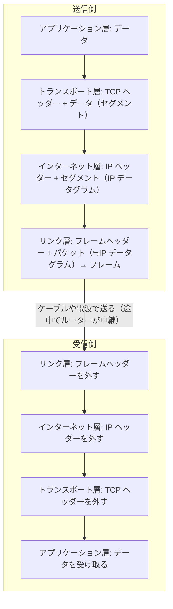
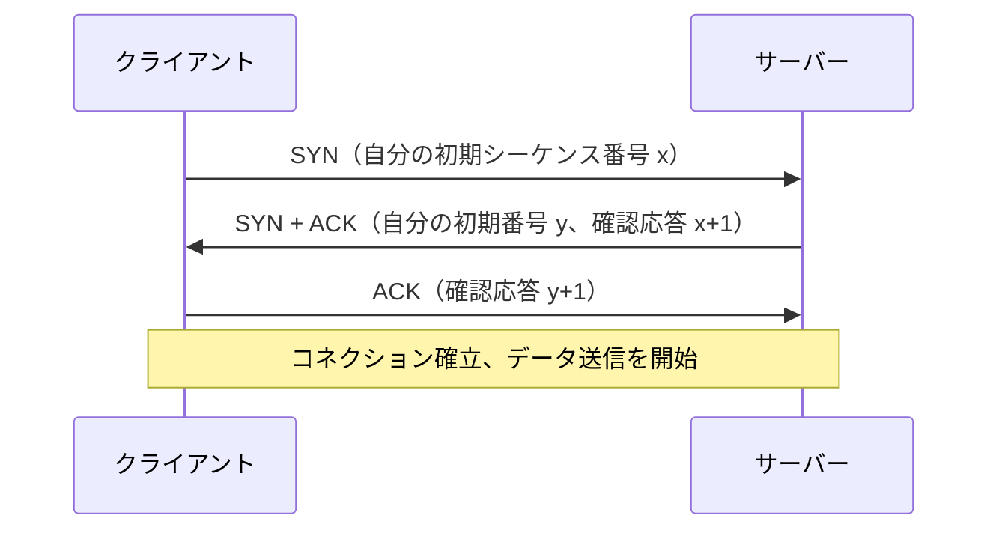

## この記事で分かること

- 通信の仕組みを「層」に分けて考える理由
- TCP/IP の 4 層モデルと OSI 参照モデル（7 層）の対応と違い
- データにヘッダーを付けて包む「カプセル化」の流れ
- IP アドレス・ルーティング・ポート番号の役割
- TCP と UDP の違いと、3 ウェイハンドシェイクの流れ

## 一言で説明すると

TCP/IP は、インターネットでデータを届けるための約束事（プロトコル）の集まりです。「どの機器へ届けるか」を IP が、「その機器のどのアプリへ、どの程度確実に届けるか」を TCP や UDP が受け持ち、役割の違う約束事を層のように積み重ねて使います。

## なぜ必要なのか

Web ページを 1 つ表示するだけでも、ケーブルや電波で信号を送る、どのネットワークを経由するか決める、途中で失われたデータを送り直す、ブラウザとサーバーが内容をやり取りする、という性質の違う仕事が必要です。これを 1 つの巨大な仕組みにまとめると、Wi-Fi から有線 LAN に替えるだけで全体を作り直すことになりかねません。

そこで、仕事を層に分け、各層は「すぐ下の層が提供する機能」だけを使って自分の仕事をするように設計します。こうすると、下の層（例えば Wi-Fi か有線 LAN か）が変わっても、上の層（例えば HTTP）はそのまま使えます。応用情報技術者試験のシラバスでも、TCP/IP を OSI 基本参照モデルの 7 階層と対比させながら、各層の役割を理解することが求められています。

## 身近な例え

国際郵便で書類を送る場面を考えます。あなたは手紙を書き（アプリケーション）、それを「経理部の田中さん宛」と書いた社内封筒に入れます（ポート番号に相当）。さらに会社の住所を書いた封筒に入れて投函すると（IP アドレスに相当）、郵便局はその住所だけを見て、国内便や航空便を乗り継いで運びます（ルーティングとリンク層）。受け取った会社は外側の封筒を開け、社内封筒の宛名を見て田中さんに渡します。それぞれの担当者は自分の封筒だけを見ればよく、中身を読む必要はありません。

<Callout type="warn" title="例えの限界">
郵便は 1 通の手紙をそのまま運びますが、TCP/IP では大きなデータを小さなパケットに分けて送り、パケットごとに違う経路を通ることもあります。また、IP 自体には郵便の書留のような配達保証がなく、届かなかったときの再送は TCP など上の層が受け持ちます。さらに、IP アドレスは住所のように固定されたものとは限らず、接続のたびに変わることもあります。
</Callout>

## 技術的な仕組み

### TCP/IP の 4 層と OSI 参照モデル

インターネットのホスト（通信の両端となるコンピューター）の要件をまとめた RFC 1122 は、TCP/IP を次の 4 層で説明しています。

- **アプリケーション層**: HTTP、DNS、SMTP など、アプリケーションが使うプロトコルの層です。
- **トランスポート層**: 通信の両端（エンドツーエンド）の間でアプリケーションにデータを届けます。信頼性のある**コネクション型**（データを送る前に相手と接続の手続きをする方式）の TCP と、手続きなしで送る**コネクションレス**の UDP があります。
- **インターネット層**: IP が、送信元ホストから宛先ホストまでデータを運びます。届くことは保証しません。エラー通知には ICMP（IP の制御・エラー通知用のメッセージ）を使います。
- **リンク層**: 直接つながっているネットワークとやり取りする層。イーサネットや無線 LAN（Wi-Fi）がこれにあたり、IP アドレスからリンク層のアドレス（MAC アドレス）を調べる ARP もここに分類されます。

一方、OSI 基本参照モデルは、IPA の応用情報技術者試験シラバスの説明では ISO が策定した 7 層のネットワークアーキテクチャです。両者の対応は一般に次のように整理されます。

| OSI 参照モデル | TCP/IP（RFC 1122） | 主なプロトコル・技術の例 |
| --- | --- | --- |
| 第 7 層 アプリケーション層 | アプリケーション層 | HTTP、DNS、SMTP |
| 第 6 層 プレゼンテーション層 | アプリケーション層 | （データ表現。TCP/IP では独立した層を持たない） |
| 第 5 層 セション層 | アプリケーション層（多くの資料での整理） | （TCP/IP では独立した層を持たない） |
| 第 4 層 トランスポート層 | トランスポート層 | TCP、UDP |
| 第 3 層 ネットワーク層 | インターネット層 | IP（IPv4 / IPv6）、ICMP |
| 第 2 層 データリンク層 | リンク層 | イーサネット、無線 LAN、ARP |
| 第 1 層 物理層 | リンク層（ケーブルや電波そのもの） | ケーブル、電波 |

この対応は**おおよその目安**です。RFC 1122 が明言しているのは「TCP/IP のアプリケーション層は OSI のプレゼンテーション層とアプリケーション層を合わせたもの」という点までで、同じ RFC の中で「厳密な階層化は不完全なモデルだ」とも述べています。例えば ARP は IP アドレスを扱うのでネットワーク層の仕事にも見えますが、RFC 1122 と IPA シラバスはどちらもリンク層（データリンク層）側に置いています。層の境界をきっちり当てはめようとしすぎないことが大切です。

### カプセル化：ヘッダーを付けて包む

送信側では、上の層から受け取ったデータの先頭に、各層が自分用の制御情報（**ヘッダー**）を付けて下の層に渡します。これを**カプセル化**と呼びます。RFC 1122 は各層の単位を次のように定義しています。

- TCP ヘッダー + アプリケーションのデータ = **セグメント**（トランスポート層の単位を一般に**メッセージ**と呼ぶ）
- UDP ヘッダー + アプリケーションのデータ = **UDP データグラム**
- IP ヘッダー + トランスポート層のメッセージ = **IP データグラム**（リンク層に渡す単位を**パケット**と呼ぶ。パケットは多くの場合は IP データグラムそのもので、分割されたときはその一部）
- リンク層のヘッダー + パケット = **フレーム**

リンク層によっては、先頭のヘッダーだけでなく末尾にも検査用の情報（トレーラー）が付きます。受信側では逆に、下の層から順にヘッダーを読んで取り外し、中身を上の層に渡します。ヘッダーの大きさの例として、IPv4 ヘッダーはオプションなしで 20 バイト（RFC 791）、TCP ヘッダーもオプションなしで 20 バイト（RFC 9293）、UDP ヘッダーは 8 バイト（RFC 768）です。

### IP アドレスとルーティング

**IP アドレス**は、IP ネットワーク上で通信相手のホストを指定するための番号です。IPv4 のアドレスは 32 ビット（RFC 791）なので、組み合わせは $2^{32}$ ＝ 約 43 億通りしかありません。IPv6 はこれを 128 ビットに広げ、あわせてヘッダーの形式を簡素化しています（RFC 8200）。

IP アドレスは「ネットワークを表す部分」と「そのネットワーク内のホストを表す部分」に分かれます。どこまでがネットワーク部かは、`172.16.0.0/16` のようにアドレスの後ろに `/` とビット数を付けて表します。これを **CIDR 表記**といい、RFC 4632 では「先頭 16 ビットがネットワーク部」という意味だと説明されています。

宛先が別のネットワークにある場合、データは**ルーター**（RFC 1122 ではゲートウェイ）が中継します。ルーターは IP ヘッダーの宛先アドレスを見て次の転送先を選び、これを繰り返して宛先まで届けます。これが**ルーティング**です。IPv4 ヘッダーの **TTL**（Time to Live）は中継のたびに減らされ、0 になったデータグラムは破棄されます（RFC 791）。経路の設定ミスなどでデータがいつまでも回り続けないための上限です。IPv6 では同じ役割を **Hop Limit** が担います（RFC 8200）。

ここで重要なのは、IP は「宛先まで運ぶ努力をする」だけで、届いたかの確認、再送、順序の並べ替えは行わないことです（RFC 791）。それを補うのが次のトランスポート層です。

### ポート番号：どのアプリに届けるか

IP アドレスで届くのは「ホスト」までです。1 台のサーバーでは Web サーバーやメールサーバーなど複数のプログラムが同時に動いているため、TCP と UDP は**ポート番号**（16 ビット、0〜65535）で宛先のプログラムを区別します。RFC 6335 は範囲を次の 3 つに分けています。

| 範囲 | 名称 | 説明 |
| --- | --- | --- |
| 0〜1023 | System Ports（ウェルノウンポート） | IANA（インターネットの番号資源を管理する機関）が割り当てる。HTTP の既定の 80、HTTPS の既定の 443（RFC 9110）、DNS の 53（RFC 1035）など |
| 1024〜49151 | User Ports（登録済みポート） | IANA が割り当てる |
| 49152〜65535 | Dynamic Ports（エフェメラルポート） | 割り当てられず、クライアント側が一時的に使う |

これは RFC 6335 が定める区分です。実際に OS がクライアント側の一時的なポートとして使う範囲は OS の設定によります（例: Linux カーネルの `ip_local_port_range` の既定は 32768〜60999。docs.kernel.org の最新版、2026-11-28 確認）。

TCP のコネクションは、両端の「IP アドレスとポート番号の組」（ソケット）のペアで識別されます（RFC 9293）。そのため、同じサーバーの 443 番ポートに多数のクライアントが同時に接続しても、それぞれ別の通信として区別できます。

### TCP と UDP

**TCP** は、コネクションを確立してから通信し、データを**欠けなく・順番どおりに**届けるプロトコルです（RFC 9293）。データに**シーケンス番号**（送ったデータが何バイト目にあたるかを示す通し番号）を付け、受信側の確認応答（ACK）が来なければ再送し、**チェックサム**（データから計算した検査用の値）で破損を検出します。受信側の処理が追いつかないときに送信量を抑える**フロー制御**や、ネットワークの混雑に合わせて送信量を調整する**輻輳制御**も備えています。

**UDP** は、必要最小限の機能だけを持つプロトコルです（RFC 768）。ヘッダーには送信元・宛先のポート番号とチェックサムの欄がありますが、事前の接続手続きはなく、届くことや重複しないことを保証しません。送信元ポートは使わなければ 0 にでき、IPv4 ではチェックサムも省略できます（すべて 0 なら「計算していない」の意味。RFC 768）。一方 IPv6 では UDP のチェックサムは原則として省略できません（トンネル用途などの例外あり、RFC 8200 8.1 節）。MDN は、遅れて再送されたデータを待つよりも捨てたほうがよい、時間に厳しい用途で UDP が好まれると説明しています。

## 図解

### カプセル化の流れ

送信側では、アプリケーション層からリンク層へ（上位の層から下位の層へ）進むたびにヘッダーが 1 つずつ増えます。ケーブルや電波を伝わって受信側に届くと、今度はリンク層からアプリケーション層へ（下位の層から上位の層へ）進むたびにヘッダーを 1 つずつ外し、最後にアプリケーションが元のデータを受け取ります。図ではどちらも処理の順に上から下へ並べています。途中のルーターはリンク層とインターネット層のヘッダーまでを見て転送するので、通常は TCP ヘッダーやデータの中身を処理する必要がありません。

### 3 ウェイハンドシェイク

TCP は、データを送る前に 3 回のやり取りでコネクションを確立します（RFC 9293）。まずクライアントが **SYN** で「接続したい」と伝え、自分が使うシーケンス番号の初期値を知らせます。サーバーは **SYN + ACK** で、受け取ったことの確認と自分側の初期値を返します。最後にクライアントが **ACK** を返すと、双方が相手の番号を知った状態になり、データの送受信を始められます。終了するときは FIN を使って、送信方向ごとに閉じます。

## 実務での活用例

### Web ページを開いたときに起きていること

ブラウザで URL を開くと、大まかには次の順に処理が進みます（MDN の How the web works と TCP handshake の解説、RFC 9293 を基に整理）。

1. **名前解決**: ドメイン名から IP アドレスを調べます（[DNS](/network/dns/)）。DNS の通常の問い合わせには主に UDP のポート 53 が使われます（RFC 1035）。
2. **TCP 接続**: サーバーの IP アドレスの 443 番ポートなどに向けて 3 ウェイハンドシェイクを行います。HTTPS の場合は続けて、通信を暗号化するための TLS のハンドシェイクを行います。
3. **HTTP のやり取り**: ブラウザが HTTP リクエストを送り、サーバーがレスポンスを返します。データは多数のパケットに分かれて届き、TCP が順番どおりに組み立て直してブラウザに渡します。

なお HTTP/3 では TCP の代わりに QUIC というプロトコルを使います（RFC 9114）。QUIC のパケットは UDP データグラムに入れて運ばれます（RFC 9000）。

### 疎通確認とトラブルシューティング

「サイトにつながらない」というとき、層を意識すると原因を絞り込めます。

- **ping**: ICMP のエコー要求を送り、エコー応答が返るかで、IP レベルで相手に届くかを確かめます（ping(8)、iputils 20250605）。
- **traceroute / tracepath**: traceroute(8) の説明によれば、TTL を 1 から始めて 1 つずつ増やしながらプローブ（調査用のパケット）を送ります。TTL が 0 になった地点のルーターは ICMP の Time Exceeded（時間超過）メッセージを送信元に返すことがあるため（RFC 792）、その送信元を順に見ることで経路上のルーターを推測できます。tracepath も TTL を増やしながら経路を調べる似たツールで、UDP を使い、経路上の MTU（一度に送れる最大サイズ）も報告します（tracepath(8)）。

ping が通るのに Web ページが開けないなら、IP までは問題なく、トランスポート層より上（ポートやアプリケーション）を疑う、といった切り分けができます。ただし、ネットワークの設定によっては ICMP に応答しない機器もあるため、ping が返らないことだけで「相手が停止している」と断定はできません。

## 関連技術との比較

| 観点 | TCP | UDP |
| --- | --- | --- |
| 接続の手続き | あり（3 ウェイハンドシェイク） | なし |
| 到達・順序の保証 | 再送と並べ替えで保証する | 保証しない（必要ならアプリ側で対処） |
| データの扱い | 区切りのないバイトの流れ（バイトストリーム） | 1 回ごとに独立したデータグラム |
| ヘッダー（オプションなし） | 20 バイト | 8 バイト |
| 流量の調整 | フロー制御・輻輳制御あり | なし |
| 使われる例 | HTTP/1.1・HTTP/2（HTTPS の既定ポートは TCP の 443） | DNS の通常の問い合わせ、HTTP/3（QUIC） |

どちらが優れているかではなく、「確実さと順序」を取るか「手続きの軽さと即時性」を取るかの違いです。

## よくある誤解

<Misconceptions
  items={[
    { myth: 'TCP は信頼性が高いので、常に UDP より優れている。', fact: 'TCP は再送や順序の保証の代わりに、接続の手続きや再送待ちの遅れが生じます。時間に厳しい用途では UDP が好まれ、HTTP/3 も UDP 上の QUIC を使っています。用途に合わせて選ぶものです。' },
    { myth: 'インターネットは OSI 参照モデルの 7 層どおりに作られている。', fact: 'インターネットの中核である IP、TCP、UDP などは IETF が RFC で定めた TCP/IP のプロトコル群で、RFC 1122 は 4 層で説明しています（リンク層のイーサネットや無線 LAN の規格は、IETF ではなく IEEE が定めています）。OSI は各層の役割を整理する参照モデルとして学ぶもので、TCP/IP との対応は近似です。' },
    { myth: 'IP アドレスは特定の人や機器を恒久的に表す。', fact: '機器に IP アドレスを自動で配る DHCP の動的割り当てではアドレスが期限付きで貸し出されて再利用され（RFC 2131）、IPv6 にはプライバシーのために時間とともに変わる一時アドレスもあります（RFC 8981）。10.0.0.0/8 などのプライベートアドレスは、別の組織でも同じ値が使われます（RFC 1918）。' },
    { myth: 'IP がデータの到達を保証している。', fact: 'IP は宛先まで運ぼうとするだけで、確認応答・再送・順序制御は持ちません（RFC 791）。到達や順序の保証が必要な場合は TCP やアプリケーション側が担います。' },
    { myth: 'IP アドレスが分かれば、どのアプリと通信するかも決まる。', fact: 'IP アドレスが指すのはホストまでです。ホスト上のどのプログラムに届けるかは、TCP や UDP のポート番号で決まります。' },
  ]}
/>

## まとめ

- 通信の仕事を層に分けることで、各層を独立して取り替えたり改良したりできます。
- TCP/IP はアプリケーション・トランスポート・インターネット・リンクの 4 層で、OSI の 7 層との対応はおおよその目安です。
- 送信時は各層がヘッダー（リンク層によっては末尾のトレーラーも）を付けて包み（カプセル化）、受信時は逆に外していきます。
- IP アドレスとルーティングでホストまで、ポート番号でアプリケーションまでデータを届けます。
- TCP は接続を確立して確実さと順序を保証し、UDP は手続きを省いて軽さと即時性を優先します。

## 理解度チェック

**問1**: あるホストの Web サーバーに、2 台のクライアントがどちらも宛先ポート 443 で同時に接続しています。サーバー側はこの 2 つの TCP コネクションをどうやって区別していますか。

答えと解説

TCP のコネクションは、送信元と宛先それぞれの「IP アドレスとポート番号の組」のペアで識別されます。宛先（サーバーの IP アドレスと 443）が同じでも、クライアント側の IP アドレスや送信元ポート番号（多くはエフェメラルポート）が異なるため、別のコネクションとして区別できます。

**問2**: ブラウザで開こうとしているのと同じホスト名に `ping` を実行すると応答が返るのに、ブラウザではそのサーバーの Web ページを開けません。どの層に問題がある可能性が高いと考えられますか。

答えと解説

同じホスト名で ping の応答が返るので、名前解決はでき、インターネット層（IP）までは相手に届いていると考えられます。そのため、トランスポート層より上、例えば Web サーバーのポートが開いていない、途中でそのポートの通信が遮断されている、Web サーバーのプログラム自体が止まっている、などを疑います。

**問3**: CIDR 表記 `192.168.10.0/24` で、ネットワーク部は先頭何ビットですか。また、ホスト部は何ビットですか。

答えと解説

`/24` は先頭 24 ビットがネットワーク部であることを表します。IPv4 アドレスは全体で 32 ビットなので、残りの $32 - 24 = 8$ ビットがホスト部です。

