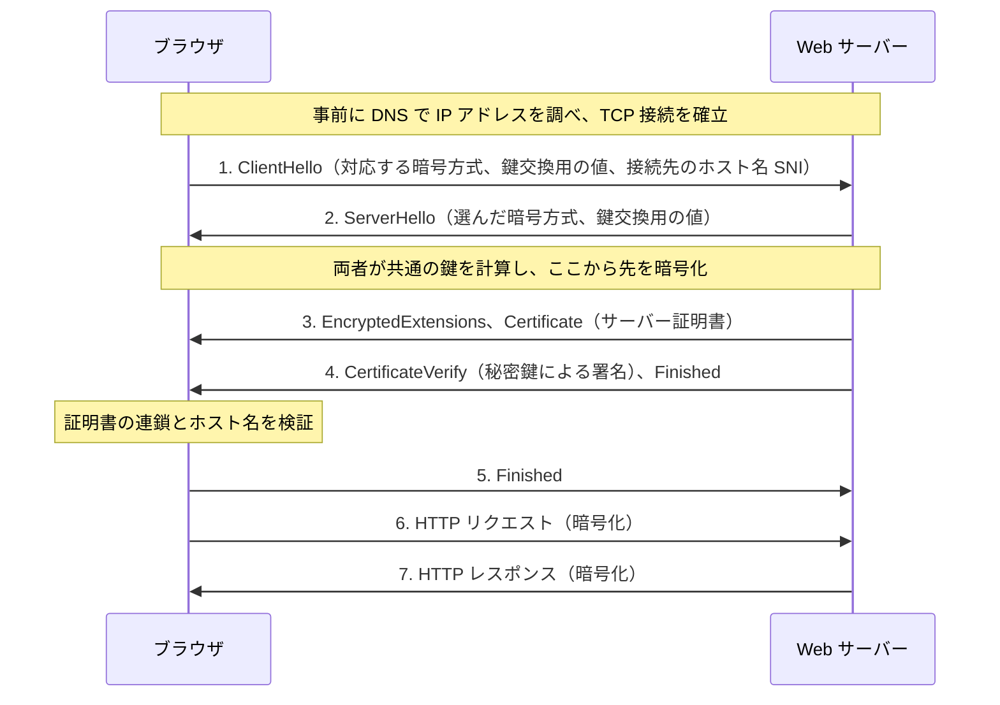

## この記事で分かること

- HTTP が「リクエストとレスポンス」でやり取りするステートレスなプロトコルであること
- リクエストとレスポンスの構造（メソッド、URL、ヘッダー、本文、ステータスコード）
- 主なメソッドの意味と「安全」「冪等」の違い、ステータスコードの 5 つのクラス
- HTTPS（HTTP over TLS）が守るもの・守らないもの、TLS 1.3 のハンドシェイクの流れ
- HTTP/1.1・HTTP/2・HTTP/3 の違いと、HSTS の役割

## 一言で説明すると

HTTP は、ブラウザなどのクライアントが「このページをください」「このデータを登録してください」と**頼み（リクエスト）**、サーバーが「どうぞ」「見つかりません」と**答える（レスポンス）** ための、Web の共通の約束事です。HTTPS は、その会話を TLS という仕組みで暗号化し、相手が本物のサーバーであることを確かめたうえで行う方式です。

## なぜ必要なのか

[TCP/IP の基礎](/network/tcp-ip-basics/)で見たように、TCP はデータを順番どおり確実に届けてくれますが、届けるのはただのバイト列です。「何を頼んでいるのか」「結果はどうだったのか」を表す決まりがなければ、ブラウザとサーバーは話が通じません。その決まりが HTTP です。RFC 9110 は HTTP を「ステートレスな、アプリケーション層の、要求/応答型のプロトコル群」と位置付けています。

一方、HTTP そのものには盗聴や改ざんを防ぐ仕組みがありません。RFC 9110（17.16.1 節）も、通信の機密性は下位の接続の安全性に頼ると述べています。パスワードやクレジットカード番号を平文のまま流せば、経路上の誰かに読まれたり書き換えられたりするおそれがあります。そこで、HTTP の下に TLS を挟んだ HTTPS が使われます。

## 身近な例え

HTTP のやり取りは、窓口に**申込用紙**を出すのに似ています。用紙には「何をしたいか（メソッド）」「どの書類について（URL）」「添付書類の種類などの補足（ヘッダー）」「中身（本文）」を書き、窓口からは「受理しました（200）」「その書類はありません（404）」といった結果の番号付きで返事が来ます。窓口は前の客のことを覚えていないので、毎回の用紙だけで用件が分かるように書く必要があります（ステートレス）。

HTTPS は、この用紙を**中が見えない封筒**に入れ、さらに窓口の担当者が**公的な身分証**を見せてから受け付ける方式にたとえられます。

<Callout type="warn" title="例えの限界">
- **封筒の宛名は見える**: HTTPS で隠れるのは用紙の中身（URL のパス、ヘッダー、本文）です。どの建物（サーバーの IP アドレス）に届けるかや、多くの場合どの窓口（ホスト名）宛てかは、通信を観察する人に分かります（後述）。
- **身分証が保証するのは「名前」だけ**: 証明書が示すのは「このサーバーの運営者がそのドメイン名を正当に管理していることを CA（認証局）が確認した」ということで、窓口が誠実な業者かどうかまでは保証しません。
</Callout>

## 技術的な仕組み

### リクエストとレスポンスの構造

HTTP/1.1 のメッセージは、RFC 9112（2.1 節）で次の形と決められています。

1. **開始行**（リクエストならリクエスト行、レスポンスならステータス行）
2. **ヘッダー**（`名前: 値` の行が 0 行以上）
3. **空行**（ヘッダーの終わりの印）
4. **本文**（ボディ。無いこともある）

リクエスト行は「メソッド 対象 バージョン」、ステータス行は「バージョン ステータスコード 理由句」の並びです（RFC 9112 3 章・4 章）。次は学習用に作った簡略化した例で、メモを 1 件登録するリクエストです（`example.com` は例示用のドメイン名です）。

```http title="リクエストの例（HTTP/1.1 のテキスト形式、学習用に簡略化）"
POST /api/notes HTTP/1.1
Host: notes.example.com
Content-Type: application/json
Content-Length: 28
Cookie: session=abc123

{"title": "買い物メモ"}
```

1 行目がリクエスト行で、メソッドが `POST`、対象（リクエストターゲット）が `/api/notes` です。`Host` ヘッダーは接続先のホスト名で、HTTP/1.1 ではすべてのリクエストに付けなければなりません（RFC 9112 3.2 節）。空行の後が本文です。これに対するレスポンスの例は次のとおりです。

```http title="レスポンスの例（HTTP/1.1 のテキスト形式、学習用に簡略化）"
HTTP/1.1 201 Created
Location: /api/notes/42
Content-Type: application/json
Content-Length: 38
Cache-Control: no-store

{"id": 42, "title": "買い物メモ"}
```

`201 Created` は「新しいリソース（Web 上で URL によって指し示される対象）が作られた」ことを表し、`Location` ヘッダーがその場所を示します（RFC 9110 15.3.2 節）。2 つの例の `Content-Length` は本文の長さをバイト数で示すヘッダーで、本文を UTF-8 で表すと、日本語 1 文字が 3 バイトになるため、それぞれ 28 バイトと 38 バイトです。実際の通信ではこのほかにも `Date` などのヘッダーが付きますが、どちらの例でも省略しています。

この「人が読めるテキスト」の形は HTTP/1.1 のものです。HTTP/2 と HTTP/3 では、同じ意味のメッセージをバイナリ（機械向けの 2 進データ）のフレームに分けて送るため（MDN（HTTP/2）、RFC 9114（HTTP/3））、通信内容をそのまま読むことはできません。ただし、メソッドやステータスコード、ヘッダーの意味は共通で、RFC 9110 にまとめて定義されています（1.2 節）。

### ステートレスと Cookie

**ステートレス**とは、各リクエストが単独で意味が分かるように作られていて、サーバーが前のリクエストを覚えていることを前提にしない、という意味です（RFC 9110 3.3 節）。しかし、ログイン状態やショッピングカートのように「続きの会話」が必要な場面もあります。そこで使われるのが **Cookie** です（RFC 6265）。

1. サーバーはレスポンスの `Set-Cookie` ヘッダーで、小さなデータ（例: セッション ID）をブラウザに保存させます。
2. ブラウザは以後、同じサイトへのリクエストに `Cookie` ヘッダーでそのデータを付けて送ります。

HTTP 自体はステートレスのまま、Cookie で状態をつなぐ形です。MDN はこれを「ステートレスだが、セッションレスではない」と表現しています。`Secure` 属性を付けた Cookie は TLS などの安全な経路でだけ送られ、`HttpOnly` 属性を付けると JavaScript などのスクリプトから読めなくなります（RFC 6265 4.1.2.5・4.1.2.6 節）。

### 主なメソッド

メソッドは「何をしたいか」を表します。RFC 9110（9.2 節）は 2 つの性質を定義しています。

- **安全（safe）**: 意味として読み取り専用で、クライアントはサーバーの状態を変えることを求めていない
- **冪等（idempotent）**: 同じリクエストを 1 回送っても複数回送っても、サーバーに意図される効果が同じ

| メソッド | 意味（RFC 9110 9.3 節） | 安全 | 冪等 |
| --- | --- | --- | --- |
| GET | 対象リソースの現在の表現を取得する | ○ | ○ |
| POST | 同封したデータを、対象リソース独自の方法で処理させる（フォーム送信、新規作成など） | × | × |
| PUT | 同封したデータで対象リソースを作成、または丸ごと置き換える | × | ○ |
| DELETE | 対象リソースを削除する | × | ○ |

冪等なリクエストは、通信が途中で切れて結果が分からなくても送り直せます。POST を送り直すと、注文が 2 回登録されるといったことが起こりえます。

### ステータスコード

レスポンスの 3 桁の数字が**ステータスコード**で、先頭の 1 桁でクラスが決まります（RFC 9110 15 章）。

| クラス | 意味 | 代表例 |
| --- | --- | --- |
| 1xx 情報 | リクエストを受け取り、処理を続けている | 100 Continue |
| 2xx 成功 | リクエストを受け取り、理解し、受理した | 200 OK、201 Created、204 No Content |
| 3xx リダイレクト | 完了にはさらに別の動作が必要 | 301 Moved Permanently、302 Found、304 Not Modified |
| 4xx クライアントエラー | リクエストに誤りがある、または応じられない | 400 Bad Request、401 Unauthorized、403 Forbidden、404 Not Found |
| 5xx サーバーエラー | 正しそうなリクエストをサーバーが処理できなかった | 500 Internal Server Error、503 Service Unavailable |

301 は恒久的、302 は一時的な移転、304 は「手元のキャッシュを使ってよい」、401 は有効な認証情報が無い、403 は理解したうえで拒否、503 は過負荷やメンテナンスによる一時的な停止を表します（RFC 9110 15.4〜15.6 節）。

### 主なヘッダー

| ヘッダー | 向き | 役割 |
| --- | --- | --- |
| Host | リクエスト | 接続先のホスト名（HTTP/1.1 では必須） |
| Content-Type | 両方 | 本文のデータ形式（メディアタイプ）。例: `text/html`、`application/json`（RFC 9110 8.3 節） |
| Cache-Control | 両方 | キャッシュへの指示。`max-age=60` は 60 秒間は新しいとみなす、`no-store` は保存しない（RFC 9111 5.2 節） |
| Set-Cookie / Cookie | レスポンス / リクエスト | 状態の保存と送り返し（RFC 6265） |
| Location | レスポンス | 作成されたリソースやリダイレクト先の URL |

### HTTPS：HTTP over TLS

HTTPS は、TCP の上に **TLS**（Transport Layer Security）の層を挟み、その中で HTTP をやり取りする方式です。URL が `https://` で始まり、ポート番号を書かなければ TCP の 443 番を使います（`http://` は 80 番。RFC 9110 4.2.1・4.2.2 節）。

RFC 8446（TLS 1.3、2018 年 8 月）は、TLS が提供するものを 3 つ挙げています。

- **認証**: サーバーは常に認証される（クライアントの認証は任意）
- **機密性**: 送ったデータは両端以外には読めない（ただしデータの長さは隠さない）
- **完全性**: 途中で書き換えられたら検出できる

サーバーの認証には**証明書**を使います。証明書は、サーバーの公開鍵（暗号化や署名の検証に使う、公開してよい鍵）とドメイン名を結び付け、それを**認証局**（CA: Certification Authority）が電子署名したものです。秘密鍵は持ち主だけが持つ、公開鍵と対になる鍵で、電子署名は秘密鍵で作り、対応する公開鍵で誰でも検証できる、改ざんと作成者のなりすましを見破るためのデータです。ブラウザや OS はあらかじめ信頼する CA の**ルート証明書**を持っており、サーバーから送られた証明書を中間 CA の証明書を経てルートまでたどって検証します（応用情報のシラバスでも、ルート証明書・中間 CA 証明書・サーバ証明書が PKI の用語例に挙がっています）。RFC 9110（4.3.4 節）は、クライアントが証明書の示す名前と接続先 URL のホスト名が一致することを検証しなければならず、証明書が無効なら利用者に確認するか接続を打ち切るよう求めています。

## 図解：HTTPS 通信の始まり（TLS 1.3）

RFC 8446 2 章の流れを、証明書による通常の接続について簡略化して示します。



ブラウザは最初に、使える暗号方式と鍵交換用の値を ClientHello で送ります（1）。サーバーは方式を選び、自分の鍵交換用の値を ServerHello で返します（2）。お互いの値から両者は同じ鍵を計算でき、この鍵そのものは通信路に流れません。RFC 8446 では、この鍵交換以降のメッセージはすべて暗号化されるので、証明書も暗号化されて届きます（3）。CertificateVerify は「証明書の公開鍵に対応する秘密鍵を本当に持っている」ことを示す、ハンドシェイク全体への署名です。Finished はハンドシェイク全体に対する認証コードで、途中のメッセージが書き換えられていないことを確かめます（4、5）。ブラウザは証明書を検証してから Finished を返し、以後の HTTP のやり取りはすべて暗号化されます（6、7）。

このように TLS 1.3 のフルハンドシェイクでは、TLS の部分は 1 往復（1-RTT）で完了します（HTTPS over TCP ではその前に TCP 接続の確立で 1 往復）。以前接続したサーバーとの再接続では、最初の送信にデータを載せる 0-RTT も使えますが、RFC 8446（2.3 節）はそのデータがリプレイ（盗み取った通信の再送）に弱いことを注意しています。

なお、ClientHello は暗号化前に送られるため、そこに含まれる **SNI**（Server Name Indication、接続先のホスト名）は通常は平文です。RFC 9849（Encrypted Client Hello、2026 年 3 月）の序論も、平文の SNI や平文の DNS 問い合わせ、サーバーの IP アドレスから接続先が分かりうると述べています。

## HTTP のバージョンの違い

表で使う用語を先に説明します。**多重化**は、1 本の接続の中で複数のやり取りを同時に進めることです。**HPACK**（HTTP/2）と **QPACK**（HTTP/3）は、毎回ほぼ同じ内容になるヘッダーを短く符号化して送るヘッダー圧縮方式です。**QUIC** は UDP の上に作られたトランスポートプロトコルで、ストリームの多重化やストリームごとの流量制御を備え、TLS 1.3 を組み込んでいます（RFC 9114 1.2 節）。

| 観点 | HTTP/1.1 | HTTP/2 | HTTP/3 |
| --- | --- | --- | --- |
| 現行の仕様 | RFC 9112（2022 年 6 月） | RFC 9113（2022 年 6 月） | RFC 9114（2022 年 6 月） |
| 下位のプロトコル | TCP（HTTPS なら TCP + TLS） | TCP（HTTPS なら TCP + TLS） | QUIC（UDP 上。TLS 1.3 を組み込み） |
| メッセージの形 | テキスト | バイナリのフレーム | バイナリのフレーム |
| 1 本の接続での並行処理 | 持続的接続は既定。ただし応答は順番に返す必要がある | ストリームを多重化して並行にやり取り | ストリームを多重化して並行にやり取り |
| ヘッダー圧縮 | なし | HPACK | QPACK |

HTTP/1.1 では、1 本の接続で複数のリクエストを続けて送れても、応答は受け取った順に返さなければなりません（RFC 9112 9.3.2 節）。前の応答が遅いと後ろが待たされる、この現象を**ヘッドオブラインブロッキング**と呼びます。

HTTP/2 は 1 本の TCP 接続の上に複数の**ストリーム**（並行する独立したやり取りの単位）を作ってこれを解消しましたが、RFC 9113 自身が認めるとおり、TCP のレベルの待たされは残ります。TCP はデータを順番どおりに届けるため、1 つのパケットが失われると、そのパケットと無関係なストリームまで止まってしまうからです（RFC 9114 1.1 節）。

HTTP/3 は UDP 上の QUIC を使い、ストリームごとに独立して届けるので、あるストリームの損失がほかを止めません。

サーバーは `Alt-Svc` ヘッダーなどで HTTP/3 に対応していることを知らせ、QUIC で接続できなければクライアントは TCP の HTTP に戻ります（RFC 9114 3.1 節）。応用情報のシラバスでも、HTTP/2、HTTP/3、QUIC は用語例に挙がっています。

## 実務での活用例

### 開発者ツールで通信を見る

主要なブラウザには開発者ツールがあり、その「ネットワーク」（Network）のパネルで、ページを開いたときの各リクエストのメソッド、URL、ステータスコード、ヘッダー、本文、使われたプロトコルのバージョンを確認できます。HTTPS の通信でも、ブラウザ自身が暗号化の前後を扱っているので内容が見えます。表示されないときは、ここで 4xx か 5xx かを見ると原因の切り分けに役立ちます。

### すべてを HTTPS にする理由と HSTS

ログイン画面だけでなく、すべてのページを HTTPS にするのが一般的です。HTTP のページが 1 つでもあれば、そこを改ざんされて偽のリンクやスクリプトを埋め込まれたり、Cookie を盗まれたりする入り口になりうるからです（Cookie に `Secure` 属性を付けるのもこのためです）。

さらに、利用者がアドレスバーに `http://` で始まる URL を入力したり、そうしたリンクをたどったりすると、HTTPS に転送される前の平文の 1 回目のリクエストが狙われるおそれがあります。これを防ぐのが **HSTS**（HTTP Strict Transport Security、RFC 6797）です。サーバーは HTTPS のレスポンスに次のようなヘッダーを付けます。

```http title="HSTS ヘッダーの例"
Strict-Transport-Security: max-age=31536000; includeSubDomains
```

これを受け取ったブラウザは、`max-age` の秒数（この例では 365 日）の間、そのサイトへの `http://` の URL を自動で `https://` に書き換え、証明書エラーがあれば利用者が無視して進むことを許さずに接続を打ち切ります（RFC 6797 8.3・8.4 節）。`includeSubDomains` はサブドメインにも適用する指定です。このため、一度 HTTPS で訪れてこのヘッダーを受け取った後は、利用者が `http://` で入力しても平文のリクエストは送られません。ただし、ヘッダーを受け取る前の、まさに最初のアクセスは守れないため（RFC 6797 14.6 節）、ブラウザにあらかじめ HSTS 対象のサイトを組み込んでおく**プリロードリスト**という対策があります（RFC 6797 12.3 節）。HSTS も応用情報のシラバスの用語例に含まれています。

## HTTP と HTTPS の比較

| 観点 | HTTP | HTTPS |
| --- | --- | --- |
| URL のスキーム | `http://` | `https://` |
| 既定のポート | TCP 80 | TCP 443 |
| 通信内容（URL のパス、ヘッダー、本文） | 平文で経路上から読める | 暗号化され、改ざんは検出できる |
| サーバーの確認 | なし | 証明書でドメイン名の持ち主であることを検証 |
| 経路上から分かること | すべて | IP アドレス、通常は SNI のホスト名、通信量やタイミング |

## よくある誤解

<Misconceptions
  items={[
    { myth: 'HTTPS なら、どのサイトを見ているかも隠せる。', fact: '暗号化されるのは URL のパスやヘッダー、本文です。接続先の IP アドレスは見えますし、ClientHello の SNI や平文の DNS 問い合わせからホスト名も分かりうると RFC 9849 は述べています。ECH（Encrypted Client Hello）や暗号化 DNS はこの点を補う仕組みです。' },
    { myth: '鍵マーク（南京錠）が出ていれば、安全で信頼できるサイトだ。', fact: '鍵マークが示すのは、通信が TLS で保護され、証明書がそのドメイン名に対して有効だということです。フィッシング詐欺の業者でも自分のドメインの証明書は取得できるため、運営者が誠実かどうかは別に判断する必要があります。' },
    { myth: 'POST はデータが URL に出ないので安全だ。', fact: 'POST の本文も、HTTP なら平文で経路上から読めます。盗聴を防ぐのは HTTPS です。ただし URL は画面やブックマーク、サーバーのログに残りやすいので、機微な情報を URL に入れないという意味では POST の本文に入れる意義はあります（RFC 9110 17.9 節）。' },
    { myth: 'HTTP/2 や HTTP/3 ではメソッドやステータスコードの意味が変わった。', fact: '変わったのは送り方（フレームの形式や下位のプロトコル）で、メソッド・ステータスコード・ヘッダーの意味はすべてのバージョンで RFC 9110 に共通して定義されています。' },
  ]}
/>

## まとめ

- HTTP は、クライアントのリクエストにサーバーがレスポンスを返すステートレスなプロトコルで、状態は Cookie でつなぎます。
- リクエストはメソッド・対象・ヘッダー・本文、レスポンスはステータスコード・ヘッダー・本文で構成されます。GET は安全かつ冪等、PUT と DELETE は冪等、POST はどちらでもありません。
- ステータスコードは先頭の桁で 1xx〜5xx の 5 クラスに分かれます。
- HTTPS は HTTP を TLS で包み、機密性・完全性・サーバー認証を提供しますが、接続先のホスト名などは見えることがあります。
- HTTP/2 はストリームの多重化、HTTP/3 は QUIC（UDP）でヘッドオブラインブロッキングを減らしました。HSTS は HTTPS の利用を強制します。

## 理解度チェック

**問1**: ネットワークが不安定で、レスポンスが返る前に接続が切れてしまいました。同じリクエストを自動で送り直しても問題になりにくいのは、`GET /items/7`、`PUT /items/7`、`POST /items` のうちどれですか。

<details>
<summary>答えと解説</summary>

`GET /items/7` と `PUT /items/7` です。GET は安全かつ冪等、PUT は冪等なので、何度送っても意図される効果は 1 回送った場合と同じです。`POST /items` は冪等ではないため、送り直すと商品が 2 件登録されるなど、結果が変わるおそれがあります。

</details>

**問2**: 公衆無線 LAN で `https://shop.example.com/orders/123?coupon=X` を開きました。同じネットワークで通信を観察している第三者に、通常分かりうるものと分からないものを分けてください。

<details>
<summary>答えと解説</summary>

分かりうるもの: 接続先の IP アドレス、ホスト名 `shop.example.com`（平文の SNI や DNS 問い合わせから）、通信の量やタイミング。分からないもの: パス `/orders/123`、クエリ `coupon=X`、ヘッダー（Cookie を含む）、本文。これらは TLS で暗号化されます。

</details>
