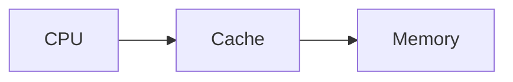

## 概要

この記事は検索テスト用の固有語「キャッシュヒット率」を含みます。[応用編](/fundamentals/fixture-advanced/)や[ネットワーク編](/network/fixture-network/)へリンクします。

### 小見出し

| 項目 | 値 |
| --- | --- |
| 記憶装置 | レジスタ |

## 数式

インライン数式 $E = h \times T_c + (1 - h) \times T_m$ を含みます。

$$
\text{実効アクセス時間} = h T_c + (1 - h) T_m
$$

## コード

```ts title="example.ts"
export function add(a: number, b: number): number {
  return a + b;
}
```

## 図解



図は CPU、キャッシュ、メモリの順にデータを探す流れを表します。
