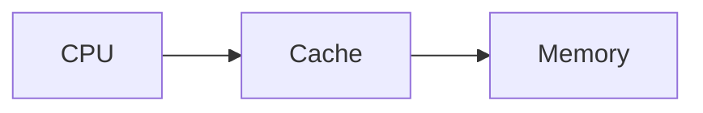

## 概要

この記事は検索テスト用の固有語「キャッシュヒット率」を含みます。[応用編](/fundamentals/fixture-advanced/)や[ネットワーク編](/network/fixture-network/)へリンクします。

### 小見出し

| 項目 | 値 |
| --- | --- |
| 記憶装置 | レジスタ |

## 数式

インライン数式 $E = h \times T_c + (1 - h) \times T_m$ を含みます。

$$
\text{実効アクセス時間} = h T_c + (1 - h) T_m
$$

長い数式はブロック内で横スクロールし、ページ全体ははみ出しません。

$$
T_{\text{avg}} = h_1 T_1 + (1 - h_1)\left(h_2 T_2 + (1 - h_2)\left(h_3 T_3 + (1 - h_3)\left(h_4 T_4 + (1 - h_4)\left(h_5 T_5 + (1 - h_5) T_{\text{memory}}\right)\right)\right)\right)
$$

## コード

```ts title="example.ts"
// 2 つの数を足し合わせます
export function add(a: number, b: number): number {
  return a + b;
}
```

ファイル名のないコードブロックです。

```bash
npm run content:check
```

## 補足情報

<Callout type="note">
補足のコールアウトです。**強調**や `コード` も書けます。
</Callout>

<Callout type="warn" title="キャッシュの無効化">
注意のコールアウトです。タイトル付きで表示されます。
</Callout>

<Callout type="tip">
ポイントのコールアウトです。
</Callout>

## 図解



図は CPU、キャッシュ、メモリの順にデータを探す流れを表します。

<Figure caption="図1: 記憶階層の模式図（上ほど高速・小容量）">
  <svg role="img" aria-label="レジスタ、キャッシュ、メモリの 3 段の階層" viewBox="0 0 240 132" width="240" height="132">
    <rect x="70" y="4" width="100" height="36" rx="4" fill="none" stroke="currentColor" />
    <text x="120" y="27" textAnchor="middle" fontSize="13" fill="currentColor">レジスタ</text>
    <rect x="40" y="48" width="160" height="36" rx="4" fill="none" stroke="currentColor" />
    <text x="120" y="71" textAnchor="middle" fontSize="13" fill="currentColor">キャッシュ</text>
    <rect x="10" y="92" width="220" height="36" rx="4" fill="none" stroke="currentColor" />
    <text x="120" y="115" textAnchor="middle" fontSize="13" fill="currentColor">メインメモリ</text>
  </svg>
</Figure>

図1 は、上の段ほど高速で容量が小さいことを示します。

## よくある誤解

<Misconceptions
  items={[
    { myth: 'キャッシュを大きくすれば必ず速くなる。', fact: '容量を増やすとアクセス時間やコストも増えるため、階層ごとに適切な大きさがあります。' },
    { myth: 'ヒット率は常に 100% を目指すべき。', fact: '実際のプログラムでは一定のミスは避けられず、ミス時の遅延も含めて評価します。' },
  ]}
/>

## 過去問

<PastExam source="令和7年度 秋期 応用情報技術者試験 午前 問1">
（テスト用の問題文です。）キャッシュのアクセス時間を $T_c = 10$ ナノ秒、主記憶のアクセス時間を $T_m = 60$ ナノ秒とします。

| 項目 | 値 |
| --- | --- |
| ヒット率 | 0.9 |

実効アクセス時間は何ナノ秒か。

- ア　10
- イ　15
- ウ　35
- エ　60

<PastExamAnswer answer="イ">
$0.9 \times 10 + 0.1 \times 60 = 15$ ナノ秒です（テスト用の解説）。
</PastExamAnswer>
</PastExam>

<PastExam source="平成31年度 春期 基本情報技術者試験 午前 問2" modified>
（テスト用の問題文です。）記憶階層で、最も高速なものはどれか。

- ア　メインメモリ
- イ　補助記憶
- ウ　レジスタ
- エ　キャッシュ

<PastExamAnswer answer="ウ">
上の段ほど高速です。**レジスタ** は CPU 内部にあります（テスト用の解説）。
</PastExamAnswer>
</PastExam>
